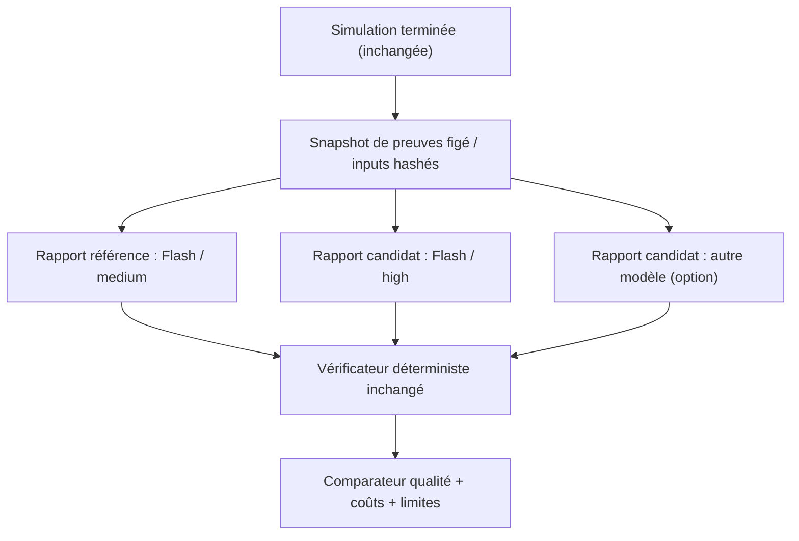

# PRD — Benchmark LLM du ReportAgent et régénération non destructive sur simulation existante

> **Projet** : MiroFish, branche `local-first`  
> **Statut** : proposition de développement — **non implémentée**  
> **Date** : 19 octobre 2026  
> **Base de code consultée** : `zohac/MiroFish`, commit `b0c668dd8811a42b3b98bbb66b7b05a9a60252e0`  
> **Proposition de planification** : Epic 013 (numérotation à confirmer dans le dépôt)  
> **Périmètre** : backend de rapports, configuration LLM, API, écran de génération de rapport, audits et tests. **Hors périmètre initial : relancer OASIS, refaire les graphes et changer les règles commerciales Keova.**

## 1. Résumé de décision

**Problème à résoudre.** Les simulations MiroFish sont orchestrées de bout en bout. Le modèle déclaré pour les derniers essais Keova est `gemini-3.8-flash`, utilisé avec un effort de raisonnement `medium` selon la configuration de l'utilisateur. Le septième essai produit une analyse riche, mais son audit ne vérifie aucune des 167 affirmations extraites et refuse la publication automatique (`needs_review`). Nous ignorons quelle part de ces erreurs vient du raisonnement du LLM et quelle part du pipeline de récupération, de rédaction et de vérification.

**Décision expérimentale recommandée.** Ne pas lancer immédiatement une huitième simulation complète. Ajouter la possibilité de **régénérer seulement le rapport à partir d'un même run**, avec une **configuration LLM par rapport** et une comparaison reproductible. Commencer par **`gemini-3.8-flash` en `high`**, face à la référence `medium`. Puis seulement, tester un modèle différent accessible via OpenCode GO si le gain est insuffisant. Garder un modèle Codex coûteux comme arbitre ponctuel, non comme modèle de production par défaut.

**Bénéfice** : isoler et mesurer la contribution du modèle, réduire les dépenses OASIS et la durée de benchmark.  
**Coût** : développement du mode replay, stockage/versionnement des rapports, mesure de consommation et affichage UI.  
**Risque principal** : comparer des rapports qui ne disposent pas exactement des mêmes preuves, ou attribuer au modèle un échec causé par le vérificateur.  
**Décisions existantes** : aucune modification à Keova ; ne pas rouvrir les Epics 011 et 012, tous deux déclarés clos. Nouvelle capacité MiroFish proposée.

## 2. Contexte vérifié et hypothèses

### 2.1 Faits établis (dépôt)

| Point | Constat dans `local-first` |
|---|---|
| Configuration LLM actuelle | `backend/app/config.py` expose `LLM_BASE_URL`, `LLM_MODEL_NAME`, `LLM_REASONING_EFFORT` globaux. |
| Effort de raisonnement | `backend/app/utils/llm_compat.py` transmet `reasoning_effort` s'il est configuré ; il prend sa valeur par défaut dans l'environnement. |
| Client partagé | `backend/app/utils/llm_client.py` accepte déjà `api_key`, `base_url`, `model`, mais pas de paramètre d'effort propre à une instance. |
| Compatibilité des requêtes | `backend/app/utils/openai_chat_compat.py` traite spécialement la famille GPT-5 ; les capacités des autres modèles ne sont pas toutes décrites. |
| ReportAgent | `backend/app/services/report_agent.py` reçoit un `llm_client` optionnel et utilise `LLMClient()` par défaut. Il planifie le rapport, produit les sections, vérifie puis persiste l'audit. |
| Démarrage via API | `POST /api/report/generate` accepte notamment `simulation_id` et `force_regenerate`, mais pas d'identifiant de profil LLM pour le rapport. |
| Chaîne de simulation | Le run OASIS et son graphe sont préparés avant le rapport ; le ReportAgent peut consulter le graphe, les événements et, si disponible, interviewer des agents. |
| Fin d'exécution | La génération ferme l'environnement OASIS dans des blocs `finally`. Une génération ultérieure peut donc ne plus disposer des interviews live. |
| Contrôle qualité | Epics 011 et 012 : `ReportClaim`, `EvidencePack`, `ReportQualityGate`, archive d'audit et statut de publication sous réserve. |
| Situation observée en R7 | `report_claims.json` : 167 affirmations, 0 vérifiée. `quality_checks.json` : `needs_review` / `is_publishable=false`. |

### 2.2 Hypothèses **à tester**, et non faits établis

- `high` peut améliorer la fidélité documentaire, la distinction intention/action et la cohérence rédactionnelle.
- Un modèle plus puissant peut mieux faire appel aux outils et extraire les preuves ; il peut aussi simplement rédiger une histoire plus convaincante.
- L'API OpenCode GO actuellement utilisée pourrait accepter `reasoning_effort=high` pour `gemini-3.8-flash` : **à confirmer par un appel de validation**, pas à supposer sur la seule présence du paramètre.
- Des modèles à prix similaire ou inférieur pourraient surpasser Flash en qualité de rapport ; l'accès affiché dans l'IHM OpenCode ne garantit ni quota, ni support identique via l'API.

## 3. Objectifs et non-objectifs

### Objectifs

1. Générer **N versions de rapport distinctes pour un unique `simulation_id`**, chacune avec un modèle et un effort explicitement enregistrés.
2. Permettre une comparaison `medium` vs `high` **sans recalcul d'ontologie, de profils, de graphe, de rounds OASIS ni de nouveaux posts**.
3. **Figer ou rendre reproductibles les entrées consultées par le ReportAgent** ; ne pas considérer des interviews offline régénérées comme équivalentes à des interviews live.
4. Mesurer la qualité, la provenance des preuves, les coûts et la durée par génération.
5. Conserver l'ancien rapport, y compris s'il est `needs_review`, et permettre son téléchargement avec son audit.
6. Maintenir les règles `fail-closed` et la séparation faits / personas / hypothèses.

### Non-objectifs (V1)

- Choisir automatiquement un fournisseur plus cher en cas d'échec.
- Faire tourner Codex sur l'ensemble des agents OASIS.
- Développer un routeur multi-modèles générique pour toutes les tâches MiroFish dès la première story.
- Faire passer un rapport en `verified_publishable` par simple changement de modèle ou augmentation de tokens.
- Promettre une amélioration prédictive ou commerciale de Keova.

## 4. Risques de conception à traiter d'abord

### R1 — Le simple changement global de variable n'est pas un test isolé

Changer `LLM_REASONING_EFFORT=high` dans le `.env` avant une nouvelle simulation modifie potentiellement les appels d'extraction, d'ontologie et de configuration, en plus du rapport. Cela confond les variables expérimentales. **Le paramètre doit être fixé au niveau de la génération de rapport** et être visible dans le manifeste associé.

### R2 — Le rapport dépend du graphe et des interviews

La génération complète peut encore interroger Graphiti et `interview_agents`. Après clôture d'OASIS, la même question peut produire un repli offline. Deux rapports ne sont donc pas comparables uniquement parce qu'ils pointent vers le même `simulation_id`.

**V1 recommandée : mode `replay_frozen`** sur un paquet d'éléments figés : événements OASIS normalisés, sélection de cohorte et rôles, brief, sources typées, instantané exploitable du graphe et **résultats d'outils / interviews déjà capturés**. Si une dépendance indispensable manque, afficher `REPLAY_NOT_REPRODUCIBLE` avec détail ; ne pas substituer silencieusement de nouveaux événements ou de nouvelles interviews. À défaut, proposer un mode `replay_best_effort` **explicitement distinct**, non éligible à une comparaison scientifique stricte.

### R3 — Une meilleure rédaction n'est pas une meilleure vérification

Le pipeline R7 reconnaît **0 affirmation `OBSERVED_SOCIAL_ACTION`** malgré des passages `[Événements simulés réels]`. Le benchmark doit distinguer **qualité d'interprétation** et **qualité du rapprochement des preuves**. Ne pas attribuer automatiquement 0/167 au modèle.

### R4 — Risque de remplacement destructif du rapport

L'API possède déjà `force_regenerate`; cela **ne garantit pas** un historique multi-rapports consultable ni une isolation des fichiers `report_claims.json`, `quality_checks.json` et ZIP générés au niveau `simulation_id`.

**Règle obligatoire : les résultats de chaque génération sont isolés par `report_id`** ; les anciens fichiers ne sont jamais écrasés. Le pointeur « rapport principal » est explicite, et le téléchargement du dossier d'audit d'un rapport sélectionné retourne exactement l'état lié à ce rapport (pas le dernier audit du run).

## 5. Architecture cible minimale



### 5.1 `ReportLLMProfile` (contrat suggéré)

Une configuration **immuable et résolue avant le démarrage du job** :

```json
{
  "profile_id": "flash-high",
  "provider_id": "opencode-go",
  "model": "gemini-3.8-flash",
  "reasoning_effort": "high",
  "temperature": null,
  "max_output_tokens": null,
  "max_total_cost_usd": 2.0,
  "max_wall_seconds": 900
}
```

**Note** : valeurs d'exemple pour le contrat, pas paramètres vérifiés de compatibilité. Ne pas envoyer `temperature`, `reasoning_effort` ni un type de limite non accepté sans vérification de capacité du fournisseur. `max_total_cost_usd` représente un plafond expérimental configurable, **pas un prix garanti**. Les secrets et adresses privées restent dans la configuration serveur ; l'API n'accepte pas d'URL arbitraire côté client.

### 5.2 Appels LLM non globaux

- Injecter un `LLMClient` dédié à chaque instance de `ReportAgent`, avec `model`, `base_url`, `reasoning_effort` et profil de capacités.
- Adapter `create_chat_completion(...)` pour recevoir un effort **explicite par requête** au lieu de lire uniquement `LLM_REASONING_EFFORT`.
- Préserver `LLM_REASONING_EFFORT` comme défaut de compatibilité **pour les appels sans override**.
- Ne jamais modifier `os.environ` au démarrage d'un job pour sélectionner son modèle : cela introduirait des races entre travaux concurrents.
- En cas d'effort refusé par le fournisseur, enregistrer clairement `UNSUPPORTED_REASONING_EFFORT` ; pas de dégradation implicite vers `medium` tout en étiquetant le rapport « high ».
- Exposer le **niveau demandé**, le **niveau effectivement confirmé ou inconnu** et la réponse de validation des capacités.

### 5.3 Conservation de plusieurs rapports

- Chaque génération reçoit un `report_id` propre.
- Un `ReportGenerationRun` lie `simulation_id`, `report_id`, `evidence_snapshot_id`, `profile_id`, statut et coûts.
- `GET /api/report/by-simulation/<simulation_id>` doit garder un comportement rétrocompatible documenté ; ajouter un endpoint distinct pour l'historique, ou un sélecteur explicite.
- Qualité/claims/audit/logs par `report_id`, avec référence au snapshot, hash et version du code.
- Empêcher les travaux concurrents d'écrire dans les mêmes fichiers et bloquer la suppression du graphe tant qu'un lecteur en dépend.

### 5.4 Replay et processus OASIS

- Après `COMPLETED`, **ne pas rappeler les agents en live** par défaut.
- Les entretiens déjà archivés sont des preuves **du run original** ; s'ils manquent, la régénération ne les recrée pas comme s'ils avaient été recueillis pendant les 72 heures.
- L'archive doit préciser `evidence_mode: replay_frozen | replay_best_effort | live`, et indiquer les outils indisponibles.
- L'utilisateur peut réexécuter un rapport même si le rapport initial a échoué à la publication, sous réserve d'un snapshot suffisant.

## 6. Modèles à tester — stratégie progressive et budget

**Prix affichés dans les captures de l'utilisateur, en USD pour 1 million de tokens** (indicatifs, susceptibles de changer ; vérifier l'éligibilité, les éventuels plafonds et la facturation dans OpenCode GO avant exécution).

| Ordre | Modèle affiché | Entrée / 1M | Sortie / 1M | Rôle recommandé |
|---|---|---:|---:|---|
| A — référence | `gemini-3.8-flash` / `medium` | 1,50 $ | 7,50 $ | Baseline, si régénérée dans les mêmes conditions |
| B — **premier test** | `gemini-3.8-flash` / `high` | 1,50 $ | 7,50 $ | Isoler l'effet de l'effort de raisonnement |
| C — alternative coût | `deepseek-v4-pro` | 1,74 $ | 3,84 $ | Challenger économique ; vérifier la prise en charge des fonctions utilisées |
| D — alternative ouverte | `qwen3.8-max` | 2,00 $ | 6,00 $ | Challenger open-weight ; tester JSON/texte français |
| E — challenger polyvalent | `gpt-6.1-sol` | 2,00 $ | 10,00 $ | Contrôle qualité sur petit échantillon |
| F — arbitre ponctuel | `gpt-5.3-codex` | 1,75 $ | 14,00 $ | Seulement si C/D/E restent ambigus ; pas par défaut |

La liste correspond aux **libellés et tarifs visibles**, non à une promesse de disponibilité API ou de support des paramètres `high`. Le tarif final dépend du volume réel, des tokens de raisonnement éventuellement facturés, du cache, des reprises et des règles du fournisseur. Ne pas conclure que les modèles gratuits d'OpenCode GO sont sans limites : leur disponibilité et leurs quotas doivent être testés. Les modèles `*-free` sont facultatifs pour le benchmark, mais **ne sont pas un remplacement automatique** du modèle de référence.

**Important** : Codex est optimisé notamment pour la programmation. Son nom ou son prix ne prouvent pas qu'il sera meilleur pour un rapport de sociologie simulée. Pour un arbitrage haut de gamme, tester la qualité réelle et pas seulement la gamme commerciale.

### Politique de dépenses

1. `dry_run` : estimer le volume d'entrée (snapshot + contexte + sections) sans appel LLM.
2. Budget configurable par **job** et par **campagne** ; valeur plafond d'essai déterminée et acceptée par l'utilisateur.
3. Comptabiliser séparément entrée, sortie, cache et éventuel raisonnement, avec le champ `usage` du fournisseur quand il existe ; indiquer `usage_unavailable` sinon.
4. Bloquer l'envoi d'une nouvelle section si son estimation ferait franchir le plafond ; avertir avant le démarrage et avant une reprise.
5. Jamais de bascule automatique vers Codex, Opus ou Pro.
6. Conserver métriques par appel et cumulées : modèle, effort demandé, tokens, durée, coût estimé, erreurs et reprises. Ne jamais inclure les clés ou prompts sensibles dans la télémétrie.

## 7. Protocole expérimental A/B (sans nouveau run OASIS)

### Phase 0 — Qualification technique à coût minimal

- Une requête courte avec `gemini-3.8-flash`, `medium`, puis `high` **depuis le même chemin réseau que le backend**.
- Journaliser les paramètres réellement envoyés et les champs de réponse disponibles, sans exposer de clés.
- Vérifier l'absence de rejet des paramètres de raisonnement, de JSON, de `max_tokens`, de `temperature` et des timeouts.
- Si le fournisseur ne confirme pas l'effort effectif, distinguer `requested=high` de `effective=unknown` et déclarer le benchmark d'effort **non concluant**.

### Phase 1 — Comparaison contrôlée Flash medium vs high

1. Geler les entrées R7 : `simulation_id=sim_80a54d7bbd7b`, documents, brief, acteurs, événements, mémoires/outils capturés ; stocker un hash commun.
2. Vérifier la **complétude du snapshot** ; si incomplet, signaler les manques et isoler un sous-ensemble de preuves rejouable, sans le compléter avec des interventions nouvelles.
3. Générer le rapport **dans le même mode `replay_frozen`** avec `medium` et `high` ; à défaut, rejouer le dernier rapport référence dans ces conditions (ne pas utiliser R7 tel quel comme baseline strict si ses entrées diffèrent).
4. Garder constants : instructions, code, corpus, snapshot, outils autorisés, budget de sortie et paramètres compatibles ; ne changer que `reasoning_effort`.
5. Effectuer idéalement **3 générations par configuration**, si budget disponible, pour distinguer amélioration moyenne et hasard de génération.
6. Exécuter **la même version figée des vérificateurs** sur tous les rapports ; ne pas corriger le code entre deux variantes d'un même benchmark.
7. Sauvegarder scores et coûts, sans promouvoir automatiquement un modèle.

### Phase 2 — Challenger différent (conditionnelle)

Si `high` n'améliore pas les erreurs matérielles, évaluer **un seul** modèle supplémentaire : commencer par `deepseek-v4-pro` ou `qwen3.8-max`, selon les capacités et quotas vérifiés. Conserver le même snapshot et le même protocole. Une option `gpt-6.1-sol` peut servir de témoin supplémentaire si elle est accessible via la passerelle. Codex seulement après justification écrite du coût attendu.

### Phase 3 — Tests de généralisation (après validation initiale)

Reprendre les fixtures **SaaS Keova**, **politique publique** et **télécoms** des Epics 011/012. Ne pas sur-optimiser les réglages à partir de Keova seul. Valider les principales améliorations sur des contextes non vus.

## 8. Mesures de qualité — comparer ce qui est comparable

| Indicateur | Règle de calcul / lecture |
|---|---|
| **Validité des citations** | Pour les *verbatims revendiqués*, nombre de citations appariées à un événement exact / citations revendiquées. Une reformulation doit être étiquetée « synthèse », pas citation brute. |
| **Couverture des assertions d'action** | Nombre d'actions observées avec `event_id` valide / assertions d'action réellement extraites. Dénominateur à zéro => **échec de couverture**, pas 100 %. |
| **Séparation intentions et actions** | Aucune prise de rendez-vous, souscription ou paiement « confirmé » sans événement qualifiant de même type. |
| **Cohérence des personas** | Aucun fait de persona A publié comme autobiographie de persona B sans justification documentaire. Persona demandé mais silencieux => « non observé ». |
| **Fidélité au brief** | Respect des 72 h, rôles réels/pilotes, sous-domaine Essentiel vs Premium, absence de promesses non validées. |
| **Provenance** | Faits historiques, spécifications de persona, hypothèses, traces OASIS et inférences distincts. |
| **Contradictions internes** | Détecter « adopté » vs « aucun acte », « silencieux » vs « a refusé », versions incompatibles entre sections. |
| **Qualité de l'analyse** | Grille humaine aveugle : précision, nuances, prise en compte d'hypothèses réfutées, utilité sans invention. |
| **Exécution** | Durée, taux d'échec/reprise, coût estimé et tokens par rapport validable. |

**Attention** : `0/167` sur R7 ne démontre pas à lui seul une faible qualité du modèle : l'extracteur a classé **0 assertion d'action** alors que le Markdown en contient. L'expérience doit publier séparément le score *brut* des composants existants et une revue manuelle (ou une extraction corrigée et figée) avant d'attribuer le résultat au LLM. Toute « amélioration du taux de vérification » obtenue par effacement des actions observées est un échec, pas un succès.

**Critère de décision proposé** : choisir `high` si la revue aveugle montre une réduction claire des erreurs matérielles et des citations non fondées, sans dépassement du budget ni baisse de couverture. Sinon conserver `medium` ou tester une alternative. Ne pas optimiser uniquement le style, la longueur ou l'assurance du rapport.

## 9. Exigences fonctionnelles (FR)

| ID | Exigence | Priorité |
|---|---|---|
| FR-01 | Configuration LLM propre à chaque **job de rapport** ; défaut rétrocompatible | P0 |
| FR-02 | Transmission et vérification de l'effort `medium`/`high` avec déclaration de capacité du fournisseur | P0 |
| FR-03 | Régénération d'un rapport sur un run existant **sans relancer OASIS** | P0 |
| FR-04 | Snapshot / replay contrôlé, traçabilité des interviews live vs archivées vs absentes | P0 |
| FR-05 | Rapports, claims, qualité et audit indépendants par `report_id`, aucun écrasement | P0 |
| FR-06 | Exposition d'un historique et d'un sélecteur de rapport par simulation | P1 |
| FR-07 | Résumé comparatif qualité, tokens, durée, coût et paramètres effectifs | P1 |
| FR-08 | Budget maximal, `dry_run`, pas d'escalade de prix automatique | P0 |
| FR-09 | Compatibilité des paramètres par modèle/fournisseur ; erreurs explicites sans faux « high » | P0 |
| FR-10 | Conservation des barrières anti-affabulation et de publication ; protocole fixe de comparaison | P0 |
| FR-11 | Export des résultats du benchmark en JSON/Markdown avec provenance et identifiant de snapshot | P1 |

## 10. Découpage en stories suggéré

### Story 013-1 — Configuration LLM dédiée au ReportAgent (P0)

Modifier `LLMClient`, `llm_compat`, `openai_chat_compat` et l'injection dans `ReportAgent`. Ajouter un objet de configuration immuable, mapping de capacité et validation `reasoning_effort`. Ne pas casser les appels Graphiti/OASIS non concernés. Ajouter tests de concurrency : deux rapports simultanés avec efforts différents ne doivent jamais échanger leurs paramètres.

**DoD** : `gemini-3.8-flash` `medium/high` testé en smoke (ou rejet explicite si passerelle incompatible), aucune mutation globale, métadonnées demandées/effectives enregistrées, suite existante verte.

### Story 013-2 — Replay isolé et vérifiable (P0)

Créer le snapshot d'entrées et un mode `replay_frozen` qui désactive les interactions OASIS live et réutilise les preuves capturées. Valider l'accès graphe et distinguer les données réellement figées d'un graphe qui aurait changé.

**DoD** : même hash des données pour A et B ; aucun nouveau round, aucune publication ni interview live ; échec explicite si les éléments indispensables manquent.

### Story 013-3 — Historique multi-rapports et API (P0)

Étendre `POST /api/report/generate` avec `report_profile_id` / `evidence_mode`, sans casser les clients existants. Historique par `simulation_id`, métadonnées et fichiers par `report_id`. Traiter `force_regenerate` sans écraser la version précédente. Cohérence des leases graphe, tâches asynchrones et statut qualité.

**DoD** : plusieurs rapports et leurs audits téléchargeables distinctement ; aucun vieux rapport écrasé ; erreurs et annulations propres ; sûreté en parallèle.

### Story 013-4 — Mesure de coûts et limites (P0/P1)

Journaliser métriques d'usage par appel puis par job, calculer un coût **estimatif** depuis une table de tarifs explicite et datée, gérer les informations manquantes, plafond et avertissements UI. Ne pas journaliser la clé API ni le contenu personnel brut.

**DoD** : tableau de consommation et durée reproductible ; `usage_unavailable` explicite ; stop avant franchissement du plafond prédictible ; aucune bascule automatique vers un modèle payant.

### Story 013-5 — Sélection UI et comparaison (P1)

Ajouter au Step4 Rapport une action « Régénérer ce rapport avec un autre modèle », profil/effort, estimation, historique, badges qualité, diff et téléchargement des audits. Exposer la distinction `replay_frozen`/`best_effort`.

**DoD** : utilisateur identifie sans ambiguïté quel rapport, quel modèle, quel effort et quel statut il consulte ; aucun rapport précédent masqué définitivement.

### Story 013-6 — Campagne contrôlée & qualification (P0)

Automatiser un benchmark `medium/high` sur **R7 figé**, avec au moins un contrôle de comparaison de modèles conditionnel. Exporter verdict, contraintes, coûts, qualité et biais résiduels. Si R7 n'offre pas de replay figé complet, préparer un run neuf avec snapshot complet **une seule fois** puis générer A/B dessus.

**DoD** : même source et hash, règle de score figée, traces/audits vérifiables, test de non-régression multi-domaines, résultats déclarés non concluants si incompatibilité fournisseur ou preuves insuffisantes.

## 11. Scénarios de recette (Gherkin condensé)

| ID | Étant donné… / Quand… | Attendu |
|---|---|---|
| AT-01 | Deux jobs sur le même run : `medium` et `high` | Paramètres isolés ; zéro changement sur OASIS ; deux `report_id` distincts |
| AT-02 | Un proxy rejette `reasoning_effort=high` | Échec clair, aucune simulation fictivement étiquetée `high` |
| AT-03 | Le proxy accepte la requête mais ne confirme pas l'effort réel | Métadonnée `effective_reasoning=unknown`, verdict de comparaison d'effort non concluant |
| AT-04 | Le graph store a changé depuis le snapshot | Replay strict refusé, aucune comparaison faussement « contrôlée » |
| AT-05 | OASIS est fermé et un outil d'interview est demandé | Réponse issue des interviews archivées ou indisponibilité explicite ; jamais une interview live inventée |
| AT-06 | Un rapport R7 existe avant la régénération | Il reste lisible, avec son Markdown, ses claims et son audit originaux |
| AT-07 | Deux générations accèdent à la même simulation | Pas d'écrasement ni de collision de fichiers ou de statut |
| AT-08 | Un modèle rédige « achat confirmé » sans événement transactionnel | L'audit marque l'affirmation non vérifiée et n'attribue pas d'adoption confirmée |
| AT-09 | Un persona est `present_no_action` | Aucune citation ni décision observée ne lui est attribuée |
| AT-10 | Le rapport n'a aucune assertion d'action détectée malgré des passages événementiels | Contrôle de couverture échoué ou à réviser ; pas de réussite par dénominateur nul |
| AT-11 | Un budget insuffisant est configuré | Refus ou arrêt contrôlé avant requêtes additionnelles ; aucune escalade automatique |
| AT-12 | Le fournisseur ne retourne pas `usage` | Métriques marquées inconnues/estimées, jamais valeur de facture affirmée |
| AT-13 | Un fournisseur refuse `temperature`/JSON/token cap | Erreur de capacité diagnostiquée ; adaptateur utilise seulement options confirmées |
| AT-14 | Benchmark sur 3 domaines | Gains maintenus, absence de surapprentissage Keova et pas de dégradation de provenance |

## 12. Ordre de livraison et décisions attendues du développeur

**MVP de test rapide** : stories 013-1 à 013-3 + partie minimale de 013-4 et 013-6. L'UI sophistiquée peut attendre : une petite API et un rapport de comparaison suffisent au départ. **Ne lancer aucun test Codex coûteux avant d'avoir démontré la comparaison Flash medium/high.**

Décisions d'implémentation à documenter dans une ADR courte :

1. Stratégie de snapshot (recherche graphe/requêtes/outils/interviews) et conditions minimales pour déclarer un replay « figé ».
2. Format de stockage/indice multi-rapports et compatibilité des anciens `report_id`.
3. Matrice de capacités par fournisseur/modèle et comportement en cas d'options non reconnues.
4. Source et horodatage des prix, budget par job et accès au `usage` brut.
5. Fichier de benchmark et grille de revue humaine aveugle avant toute décision de changement de modèle.

## 13. Sources et références de mise en œuvre

- **Branche** : `https://github.com/zohac/MiroFish/tree/local-first` ; snapshot audité `b0c668dd8811a42b3b98bbb66b7b05a9a60252e0`.
- `backend/app/config.py` — paramètres LLM globaux.
- `backend/app/utils/llm_client.py` — client LLM réutilisable.
- `backend/app/utils/llm_compat.py` — effort raisonnement et en-têtes OpenCode.
- `backend/app/utils/openai_chat_compat.py` — paramètres Chat Completions par famille.
- `backend/app/api/report.py` — création des tâches asynchrones, `force_regenerate`, barrières graphe.
- `backend/app/services/report_agent.py` — planification, génération des sections, audit, fermeture OASIS.
- `backend/app/services/simulation_audit_service.py` — métadonnées et archive scellée.
- `docs/plans/011-preuve-simulation-et-fiabilite-rapport/` — traçabilité des événements (clos).
- `docs/plans/012-fiabilite-preuves-et-publication/` — fiabilité des acteurs et barrière fail-closed (clos).
- **Run témoin R7** : `sim_80a54d7bbd7b`, `report_aaa93b86048c` ; archives fournies par l'utilisateur. Résultat : 167 claims, 0 validé, `needs_review`.
- **Prix** : captures de l'interface « Models » OpenCode fournies le 19 octobre 2026 ; indicatifs et non certifiés côté passerelle.

---

### Verdict pour lancer le développement

**GO pour développer le replay et le benchmark LLM par rapport. NO-GO pour remplacer globalement le modèle MiroFish ou pour juger Codex supérieur sans mesure.** La première expérience pertinente reste **Flash `medium` vs Flash `high`, même simulation, mêmes preuves et vérificateur inchangé**. Tout écart de résultat doit être rapproché de la consommation réelle et des problèmes de pipeline restant ouverts.
