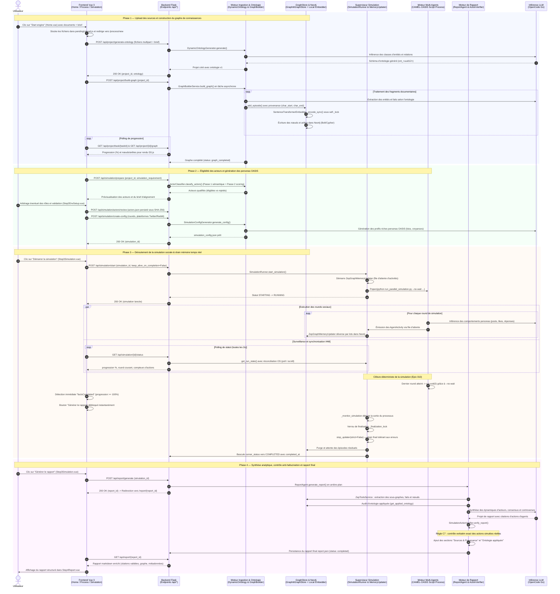
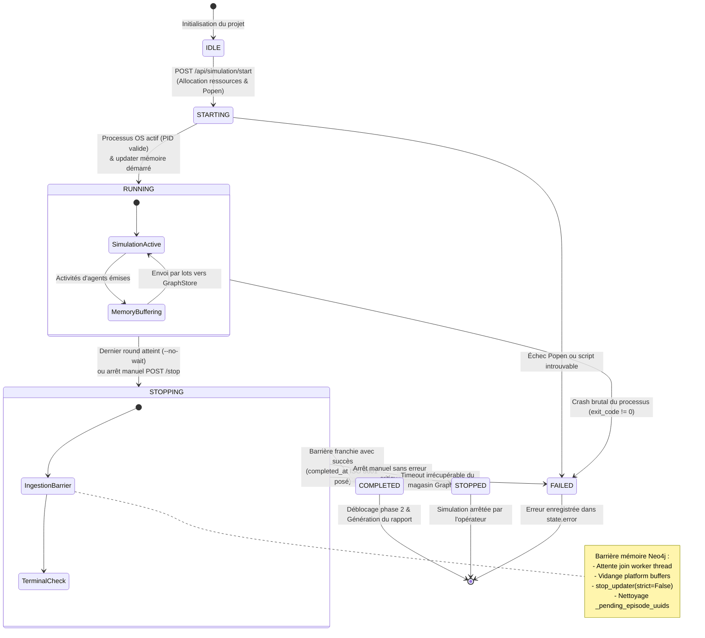

# Architecture et flux global — De « Start engine » au Rapport final

> **Date de formalisation :** 15 octobre 2026 · branche `local-first`  
> **Auteur :** Antigravity & Équipe MiroFish  
> **Contexte :** Moteur de simulation sociale MiroFish sans dépendance cloud propriétaire (post-Epics 001 à 010).  
> **Fichiers de référence :**  
> - Frontend : [`frontend/src/views/Home.vue`](../../frontend/src/views/Home.vue), [`frontend/src/views/MainView.vue`](../../frontend/src/views/MainView.vue), [`frontend/src/components/Step1GraphBuild.vue`](../../frontend/src/components/Step1GraphBuild.vue), [`frontend/src/components/Step2EnvSetup.vue`](../../frontend/src/components/Step2EnvSetup.vue), [`frontend/src/components/Step3Simulation.vue`](../../frontend/src/components/Step3Simulation.vue), [`frontend/src/views/ReportView.vue`](../../frontend/src/views/ReportView.vue).  
> - Backend API : [`backend/app/api/project.py`](../../backend/app/api/project.py), [`backend/app/api/graph.py`](../../backend/app/api/graph.py), [`backend/app/api/simulation.py`](../../backend/app/api/simulation.py), [`backend/app/api/report.py`](../../backend/app/api/report.py).  
> - Backend Services : [`backend/app/services/ontology_generator.py`](../../backend/app/services/ontology_generator.py), [`backend/app/services/graph_builder.py`](../../backend/app/services/graph_builder.py), [`backend/app/services/actor_classifier.py`](../../backend/app/services/actor_classifier.py), [`backend/app/services/simulation_config_generator.py`](../../backend/app/services/simulation_config_generator.py), [`backend/app/services/simulation_runner.py`](../../backend/app/services/simulation_runner.py), [`backend/app/services/zep_graph_memory_updater.py`](../../backend/app/services/zep_graph_memory_updater.py), [`backend/app/services/report_agent.py`](../../backend/app/services/report_agent.py), [`backend/app/services/simulation_action_verifier.py`](../../backend/app/services/simulation_action_verifier.py).  
> - Graphe & Inférence : [`backend/app/utils/graph_store/graphiti_store.py`](../../backend/app/utils/graph_store/graphiti_store.py), [`backend/app/utils/graphiti_embedder.py`](../../backend/app/utils/graphiti_embedder.py), [`backend/scripts/run_parallel_simulation.py`](../../backend/scripts/run_parallel_simulation.py).

---

## 1. Vue d'ensemble : Qui fait quoi et pourquoi ?

MiroFish est un environnement de prédiction et d'expérimentation sociale. À partir de documents bruts (articles, rapports, notes), il extrait une structure de connaissances sous forme de graphe, modélise des personas réalistes, fait interagir ces agents au sein d'environnements sociaux simulés (type Twitter ou Reddit), et synthétise les comportements émergents dans un rapport analytique étayé.

Pour que l'intégralité du moteur tourne **en local, sans cloud propriétaire et à coût marginal nul (0 €)**, chaque brique a été spécialisée :

| Rôle / Composant | Technologie & Emplacement | Pourquoi ce choix ? |
|---|---|---|
| **IHM Utilisateur & Visualisation** | **Vue 3 + Vite + D3.js + Pinia** `frontend/src/` | Interface réactive moderne : affichage pas-à-pas (Steps 1 à 5), rendu D3.js interactif (force-directed graph), monitoring temps réel des rounds et découplage strict du métier. |
| **API & Orchestration** | **Flask (Python 3.11)** `backend/app/api/` & `services/` | Clean Architecture (`api -> services -> utils`). Gestion des cycles asynchrones, validation des contrats, verrous de barrière et isolation transactionnelle. |
| **Moteur d'Ontologie Dynamique** | **`DynamicOntologyGenerator`** `services/ontology_generator.py` | *(Epic 007)* Infère dynamiquement les types d'entités et relations à partir du corpus sans ontologie rigide préconçue. Versionnage immuable `ont_<uuid12>`. |
| **Graphe de Connaissances Local** | **Graphiti + Neo4j 5.26 (APOC)** `utils/graph_store/graphiti_store.py` | *(Epics 001–004)* Remplace Zep Cloud propriétaire. Stocke nœuds, arêtes, horodatages d'épisodes et permet la recherche hybride (Cypher + vecteurs) en local. |
| **Moteur d'Embeddings Vectoriels** | **SentenceTransformers (`all-MiniLM-L6-v2`)** `utils/graphiti_embedder.py` | *(Epic 010-3)* Vectorisation dense 384d en local via PyTorch. Protégé par un verrou thread-safe `self._lock` éliminant tout crash concurrent (`meta-tensors`). |
| **Filtrage des Acteurs Éligibles** | **`ActorClassifier`** `services/actor_classifier.py` | *(Epic 009)* Classification en deux passes (règles sémantiques + scoring heuristique) pour empêcher les concepts inanimés (ex. « Espace », « Technologie ») de devenir des personas. |
| **Moteur de Simulation Sociale** | **CAMEL-AI / OASIS** `backend/scripts/run_parallel_simulation.py` | Moteur multi-agents modélisant des canaux Twitter et Reddit : posts, commentaires, likes, retweets, propagation virale et alignement de croyances. |
| **Ingestion Mémoire Temps Réel** | **`ZepGraphMemoryUpdater`** `services/zep_graph_memory_updater.py` | Déverse en continu les actions simulées dans Neo4j sous forme d'épisodes. Tolérance aux pannes (`strict=False`, Epic 010-3) pour ne jamais bloquer la clôture. |
| **Supervision de Vivacité** | **`SimulationRunner`** `services/simulation_runner.py` | *(Epic 010-1 & 010-2)* Injection systématique de `--no-wait`, supervision active des rounds, réconciliation de vivacité OS (`poll()`, `os.kill(0)`) et autorité disque sur `mtime`. |
| **Moteur de Rapport & Anti-Hallucination** | **`ReportAgent` & `SimulationActionVerifier`** `services/report_agent.py` & `simulation_action_verifier.py` | *(Epic 009-4)* Analyse du graphe consolidé, génération de tendances et vérification verbatim exacte des citations d'agents (`event_id` déterministe). |
| **Passerelle d'Inférence LLM** | **OpenCode Go / Antigravity Proxy** `backend/scripts/antigravity_proxy.py` | Modèle d'inférence haute performance, accessible sans frais et sans clé cloud propriétaire, compatible standard OpenAI. |

---

## 2. Vue 1 — Cartographie des composants et des flux

Le schéma ci-dessous détaille l'agencement des conteneurs, processus et bases de données, distinguant les frontières HTTP, IPC et Cypher :

```mermaid
flowchart TB
  subgraph FRONTEND["Frontend Web (Vue 3 / Vite :3000)"]
    HOME["Home.vue<br/>(Hero Banner & 'Start engine')"]
    MAIN_VIEW["MainView.vue<br/>(Steps 1 & 2)"]
    SIM_VIEW["SimulationRunView.vue / Step3Simulation.vue<br/>(Suivi des rounds & détection factsCompleted)"]
    REP_VIEW["ReportView.vue / Step4Report.vue<br/>(Rapport d'analyse & citations)"]
    D3_GRAPH["Visualiseur Graphe D3.js<br/>(D3 force-directed)"]
  end

  subgraph BACKEND["Backend Applicatif Flask (:5001)"]
    API_PROJ["/api/project<br/>(Projet, ontologie, build-graph)"]
    API_SIM["/api/simulation<br/>(Actors review, config, start/stop)"]
    API_REP["/api/report<br/>(Generate, status, get)"]

    subgraph SERVICES["Services Métier"]
      ONTO_GEN["DynamicOntologyGenerator<br/>(Inférence entités/relations)"]
      ACTOR_CLS["ActorClassifier<br/>(Filtre 2-pass acteurs éligibles)"]
      SIM_CFG["SimulationConfigGenerator<br/>(Profils personas OASIS)"]
      SIM_RUNNER["SimulationRunner<br/>(Superviseur processus & --no-wait)"]
      MEM_UPDATER["ZepGraphMemoryUpdater<br/>(Drain mémoire asynchrone)"]
      REP_AGENT["ReportAgent<br/>(Synthèse & métriques)"]
      ACT_VERIF["SimulationActionVerifier<br/>(Contrôle anti-affabulation)"]
    end

    subgraph UTILS["Couche d'Abstraction & Graphe"]
      G_STORE["GraphStore (Interface)<br/>GraphitiGraphStore"]
      EMBEDDER["SentenceTransformerEmbedder<br/>(PyTorch all-MiniLM-L6-v2, thread-safe Lock)"]
    end
  end

  subgraph SIM_WORKER["Moteur Multi-Agents OASIS (Sous-processus OS)"]
    CLI_SIM["run_parallel_simulation.py<br/>(CLI CAMEL-OASIS)"]
    PLAT_TW["Twitter Platform Engine<br/>(Timeline, tweets, retweets)"]
    PLAT_RD["Reddit Platform Engine<br/>(Subreddits, threads, upvotes)"]
    IPC_SRV["Canal IPC Socket/Pipe<br/>(simulation_ipc.py)"]
  end

  subgraph INFRA["Données & Inférence"]
    NEO4J[("Neo4j 5.26 Community<br/>+ APOC (Bolt :7687)")]
    LLM_PROXY["Passerelle LLM<br/>(OpenCode Go / Antigravity Proxy)"]
    DISK_STATE[("Disque Local<br/>run_state.json, actors.json, reports/")]
  end

  %% Relations Frontend -> Backend
  HOME -->|"1. Upload fichiers + brief<br/>POST /api/project/generate-ontology"| API_PROJ
  MAIN_VIEW -->|"2. Lancer graphe<br/>POST /api/project/build-graph"| API_PROJ
  MAIN_VIEW -->|"3. Polling graphe<br/>GET /api/project/{id}/graph"| API_PROJ
  API_PROJ -.->|"Données nœuds/arêtes"| D3_GRAPH
  MAIN_VIEW -->|"4. Arbitrage acteurs<br/>POST /api/simulation/actors/review"| API_SIM
  SIM_VIEW -->|"5. Démarrer simulation<br/>POST /api/simulation/start"| API_SIM
  SIM_VIEW -->|"6. Polling statut & rounds<br/>GET /api/simulation/{id}/status"| API_SIM
  SIM_VIEW -->|"7. Générer rapport<br/>POST /api/report/generate"| API_REP
  REP_VIEW -->|"8. Consulter rapport<br/>GET /api/report/{id}"| API_REP

  %% Relations Backend internes
  API_PROJ --> ONTO_GEN
  API_PROJ --> G_STORE
  API_SIM --> ACTOR_CLS
  API_SIM --> SIM_CFG
  API_SIM --> SIM_RUNNER
  API_REP --> REP_AGENT

  %% Inférence & Graphe
  ONTO_GEN -->|"Inférence structurelle"| LLM_PROXY
  G_STORE -->|"Cypher / Transactions"| NEO4J
  G_STORE -->|"Extraction entités"| LLM_PROXY
  G_STORE -->|"Dense embeddings"| EMBEDDER
  REP_AGENT -->|"Outils ZepTools / Requêtes"| G_STORE
  REP_AGENT -->|"Anti-hallucination"| ACT_VERIF
  REP_AGENT -->|"Rédaction analytique"| LLM_PROXY

  %% Simulation Execution
  SIM_RUNNER -->|"Spawn sous-processus (--no-wait)"| CLI_SIM
  SIM_RUNNER -->|"Commandes IPC (send_close_env)"| IPC_SRV
  CLI_SIM --> PLAT_TW
  CLI_SIM --> PLAT_RD
  PLAT_TW & PLAT_RD -->|"Actions personas"| LLM_PROXY
  PLAT_TW & PLAT_RD -->|"Événements live (AgentActivity)"| MEM_UPDATER
  MEM_UPDATER -->|"Flush épisodes & faits"| G_STORE
  SIM_RUNNER -->|"Persistance mtime & états"| DISK_STATE
```

---

## 3. Vue 2 — Diagramme de séquence détaillé (De bout en bout)

Ce diagramme retrace la chronologie exacte des 5 grandes phases, depuis le clic initial jusqu'à la consultation du rapport final :

---

## 4. Vue 3 — Machine à états du cycle de vie de simulation

Le cycle de vie du runner applicatif (`SimulationRunState`), fiabilisé par l'Epic 010, obéit à la machine à états suivante sous verrou de finalisation (`_finalization_lock`) et autorité disque (`mtime` de `run_state.json`) :

---

## 5. Justification des choix techniques & garanties locales

1. **Zéro fuite cloud & Indépendance Zep (ADR 0001, ADR 0004)** :
   Historiquement, MiroFish dépendait du service cloud Zep pour son graphe de connaissances et sa mémoire agentique. L'interface universelle `GraphStore` et son implémentation `GraphitiGraphStore` permettent de faire tourner le stockage de nœuds, d'arêtes temporelles et de faits directement sur Neo4j Community en local, sans clé d'API distante et sans télémétrie.

2. **Sérialisation thread-safe des Embeddings (Epic 010-3)** :
   Lors de l'inférence conjointe de multiples agents asynchrones sous `asyncio.to_thread`, les modèles PyTorch `SentenceTransformer` partagent des buffers mémoires internes pouvant entrer en collision (`Cannot copy out of meta tensor`). L'intégration du verrou d'instance `self._lock` au sein de `SentenceTransformerEmbedder._encode_sync` sérialise les calculs matriciels sans dégrader les performances (latence < 10 ms par batch).

3. **Arrêt déterministe et complétion par les faits (Epic 010-1 & 010-2)** :
   - L'argument `--no-wait` passé au script CLI `run_parallel_simulation.py` garantit que le processus python quitte spontanément dès la dernière action du dernier round achevée, sans bloquer dans une attente IPC indéfinie.
   - L'IHM Vue 3 calcule la variable `factsCompleted` (`progress_percent >= 100` et fin des plateformes), permettant d'activer le bouton « Générer le rapport » sans attendre un cycle de polling lent ou une désynchronisation de cache OS.

4. **Intégrité de la Barrière Mémoire & Tolérance aux fautes (Epic 010-3, FR-4)** :
   Lors de la finalisation terminale, la simulation passe temporairement par l'état `STOPPING`. Cela interdit à l'IHM et à l'API de rapport de lire un graphe incomplet tant que les activités en vol ne sont pas vidangées. Le paramètre `strict=False` assure toutefois que si un micro-lot secondaire d'activité subit une erreur bénigne, l'updater journalise l'anomalie mais autorise la transition vers `COMPLETED` pour délivrer le rapport sans blocage.

5. **Certification anti-hallucination (Epic 009-4, Critère C7)** :
   Le `ReportAgent` ne se contente pas d'un résumé LLM libre : chaque affirmation citant l'intervention d'un persona est confrontée par `SimulationActionVerifier` au registre déterministe des actions réelles (`event_id` SHA-256). Toute citation non retrouvée verbatim est explicitement signalée comme contradiction.
