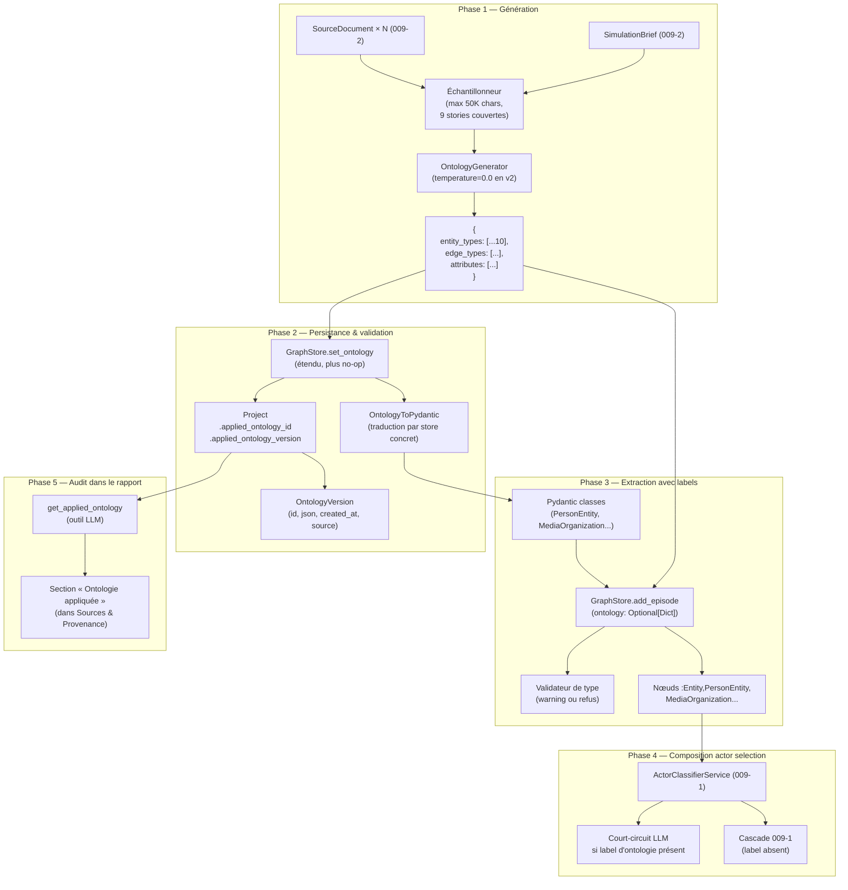
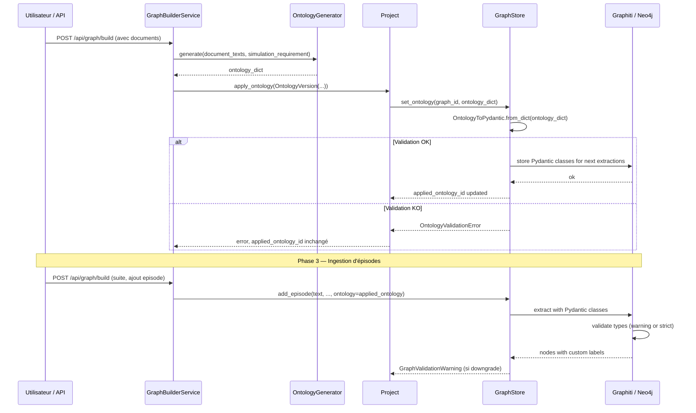
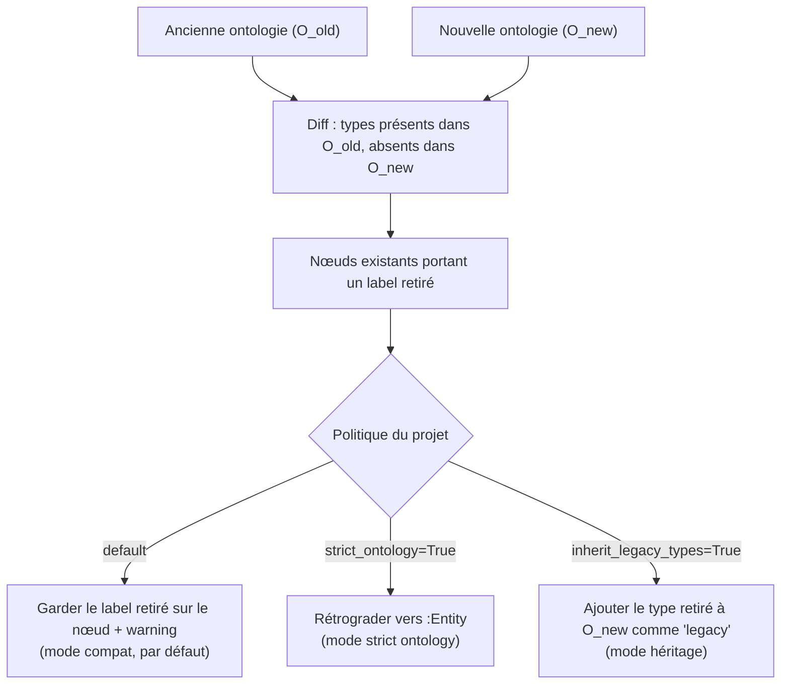
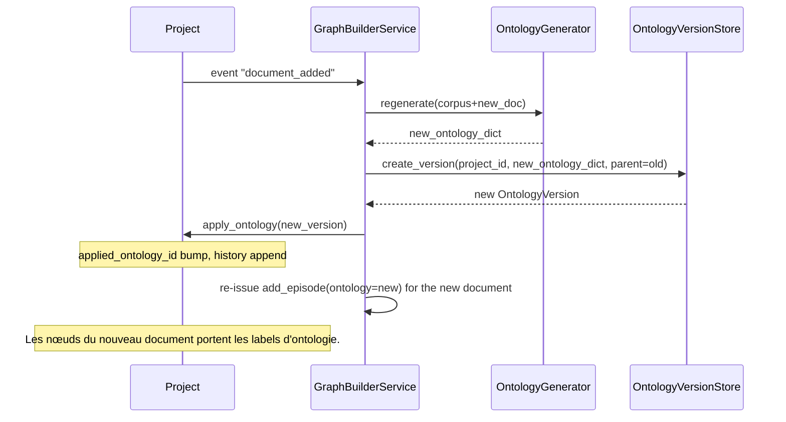
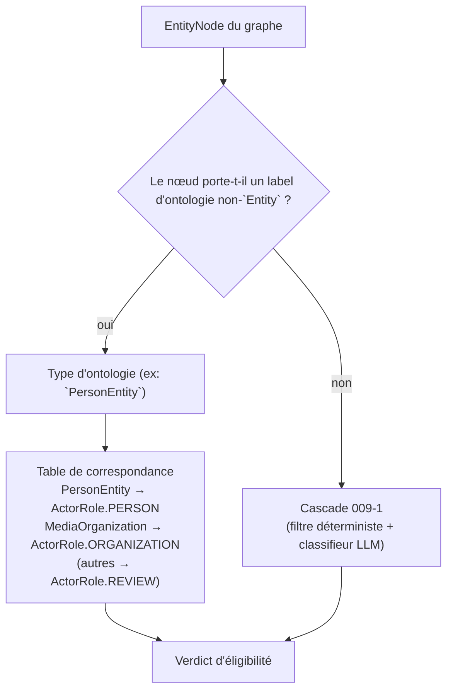
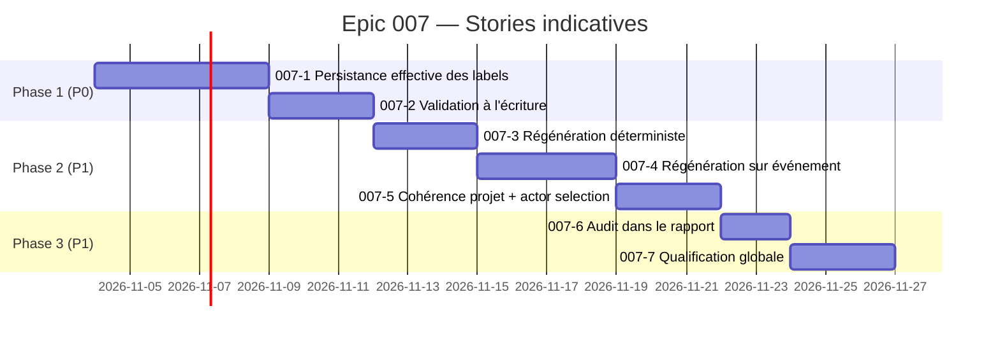

# Architecture — Epic 007 : Ontologie dynamique (v2)

- **Statut** : `in-progress` · **Dépend de** : 003, 004, 005, 009 · **Bloque** : 010
- **Référence PRD** : [`prd.md`](prd.md)
- **Décision structurante** : [ADR 0014](../../decisions/0014-pose-effective-ontology-graphstore.md)
- **Nature** : cible proposée. Les composants ci-dessous ne sont pas encore implémentés ; le code de l'ontologie v1 (`OntologyGenerator`, `set_ontology` no-op, `zep_entity_reader`) reste en place et sert de socle.

> L'ADR 0003 a différé l'ontologie dynamique en v2 et l'Epic 009 a clos le verrou d'éligibilité. La v2 transforme l'ontologie générée en **typage réel du graphe** : labels posés sur les nœuds, validation à l'écriture, régénération sur événement, audit dans le rapport.

---

## 1. Vue d'ensemble du pipeline d'ontologie

L'ontologie suit un cycle de vie en cinq phases, câblées sur les événements projet (ajout de document, modification de brief) et sur les appels LLM (génération) :



Le pipeline est **idempotent** : la même ontologie générée deux fois donne le même résultat (C3). Le **cycle de régénération** sur événement (C4) reboucle de la phase 1 vers la phase 2 sans toucher aux nœuds existants (préservation des labels, §5).

---

## 2. Modèles de données

### 2.1 `OntologyVersion` (nouveau)

Représente une version immuable d'ontologie appliquée à un projet. Le `Project` ne porte qu'une référence vers la version courante ; l'historique est conservé pour audit.

```python
@dataclass(frozen=True)
class OntologyEntityType:
    name: str            # PascalCase anglais, ex: "PersonEntity"
    description: str     # description métier, langue = langue du brief
    attributes: List[str]  # noms d'attributs en snake_case
    source: InformationOrigin  # ADR 0012 : documentary | hypothesis | inference

@dataclass(frozen=True)
class OntologyEdgeType:
    name: str            # UPPER_SNAKE_CASE anglais, ex: "WORKS_FOR"
    source_types: List[str]   # noms d'entity_types autorisés en source
    target_types: List[str]   # noms d'entity_types autorisés en cible
    description: str

@dataclass(frozen=True)
class OntologyVersion:
    version_id: str          # `ont_<uuid12>` — immuable
    project_id: str
    entity_types: Tuple[OntologyEntityType, ...]   # au plus 10 (hypothèse H1)
    edge_types: Tuple[OntologyEdgeType, ...]
    created_at: str          # ISO 8601 UTC
    source_summary: str      # justification courte (1-2 phrases)
    parent_version_id: Optional[str]  # pour le diff entre versions
```

**Invariant** : `len(entity_types) <= MAX_ONTOLOGY_TYPES` (constante déjà présente dans `backend/app/utils/ontology.py:6`).

### 2.2 Extension de `Project`

Deux champs rétrocompatibles (cf. PRD §6.3) :

```python
@dataclass
class Project:
    # ...champs existants Epic 009-2...
    applied_ontology_id: Optional[str] = None       # OntologyVersion.version_id
    applied_ontology_version: int = 0                # compteur monotone
    ontology_history: List[str] = field(default_factory=list)  # [version_id, ...]
```

Un projet sans ontologie appliquée (cas de la v1 ou d'un projet migré Epic 006) a `applied_ontology_id is None`.

### 2.3 `GraphValidationWarning` (nouveau)

Signal out-of-band, distinct des exceptions, pour la politique de validation par défaut (C2 — rétrograder + warning) :

```python
@dataclass
class GraphValidationWarning:
    graph_id: str
    attempted_type: str          # le type hors ontologie détecté
    node_uuid: Optional[str]     # None si la détection est pré-écriture
    source_call: str             # "add_episode" | "set_ontology" | ...
    message: str
    timestamp: str               # ISO 8601 UTC
    policy: str                  # "downgrade" | "strict"
```

En 007-2, les warnings sont conservés dans un journal durable par `graph_id`, distinct de `Project.ontology_history`. Leur rattachement à `Project.applied_ontology_id` attend le versionnement de 007-4, et exposés via une nouvelle méthode `GraphStore.get_ontology_warnings(graph_id) -> List[GraphValidationWarning]`.

---

## 3. Interfaces étendues

### 3.1 `GraphStore.set_ontology` passe du no-op à la pose effective

```python
class GraphStore(ABC):
    # ...contrat existant...

    def set_ontology(
        self,
        graph_id: str,
        ontology: Dict[str, Any],
        *,
        strict: bool = False,  # nouveau : True active le refus sur type hors ontologie
    ) -> None:
        """Pose l'ontologie sur le graphe : traduit en classes concrètes du store,
        enregistre dans le store, marque les écritures suivantes avec ces types.

        Comportement par défaut (strict=False) : rétrograde tout nœud avec un
        type non déclaré vers :Entity + GraphValidationWarning.
        Comportement strict (strict=True) : refuse l'écriture du nœud avec
        GraphValidationError explicite.
        """
```

L'implémentation `GraphitiGraphStore` traduit `entity_types` en `Pydantic` via la factory `OntologyToPydantic.from_dict(ontology)` (cf. §4) et passe le résultat à `Graphiti.add_episode(..., entity_types=...)` pour les écritures suivantes. `ZepGraphStore` aligne son implémentation sur le même contrat (scaffolding laissé en suspens, à finaliser).

### 3.2 `GraphStore.add_episode` accepte l'ontologie

```python
def add_episode(
    self,
    graph_id: str,
    text: str,
    source_description: str = "",
    metadata: Optional[Dict[str, Any]] = None,
    created_at: Optional[str] = None,
    *,
    ontology: Optional[Dict[str, Any]] = None,  # nouveau
) -> EpisodeRecord:
    """Ajoute un épisode textuel unitaire au graphe.

    Si `ontology` est fourni, l'extraction Graphiti utilise les classes
    Pydantic traduites. Sinon, le comportement Epic 003-2 est conservé
    (label :Entity générique).
    """
```

Le paramètre est **keyword-only et optionnel** : la rétrocompatibilité Epic 003 est garantie.

### 3.3 `GraphStore.get_ontology_warnings`

```python
def get_ontology_warnings(
    self, graph_id: str, since: Optional[str] = None
) -> List[GraphValidationWarning]:
    """Retourne les warnings de validation collected pour ce graphe.

    `since` (ISO 8601 UTC) borne la fenêtre temporelle pour les
    vérifications de l'audit (C7).
    """
```

### 3.4 Méthodes ajoutées à `Project` (rétrocompatibles)

```python
class Project:
    def apply_ontology(self, version: OntologyVersion) -> None:
        """Pose l'ontologie comme version courante. Émet un événement projet
        que `GraphBuilderService` câble à `GraphStore.set_ontology`."""

    def get_applied_ontology(self) -> Optional[OntologyVersion]:
        """Lit la version courante depuis le store (jamais depuis un cache local)."""

    def get_ontology_warnings(self, since: Optional[str] = None) -> List[GraphValidationWarning]:
        """Délègue à `GraphStore.get_ontology_warnings`."""
```

---

## 4. Traduction Pydantic pour Graphiti

Graphiti consomme des classes Pydantic pour `entity_types` et `edge_types`. La traduction se fait en deux temps pour gérer le risque R1 (Pydantic générés à l'exécution).

### 4.1 Factory `OntologyToPydantic`

```python
class OntologyToPydantic:
    """Traduit un dict d'ontologie (OntologyGenerator) en classes Pydantic.

    Validation en deux temps :
      1) Schéma : tous les champs sont des primitifs Python (str, int, float, bool, list[str])
         ou des références vers d'autres entity_types déclarés.
      2) Constructibilité : on instancie un stub de chaque classe (valeurs par défaut)
         pour s'assurer que Pydantic ne lève pas à la définition.

    Si une étape échoue, l'ontologie est rejetée avec `OntologyValidationError`
    et le `Project.applied_ontology_id` n'est pas mis à jour.
    """

    @staticmethod
    def from_dict(ontology: Dict[str, Any]) -> Dict[str, type[BaseModel]]:
        """Retourne les classes Pydantic des types d'entité, indexées par nom.

        Dictionnaire et non liste : c'est la clé qu'il en fait qui devient le
        label Cypher du nœud extrait (`node_operations.py`, mesuré sur
        `graphiti-core` 0.30.2). Les types de relation passent par
        `edge_types_from_dict`, qui renvoie `{}` quand l'ontologie n'en déclare
        aucun : les relations sont facultatives, les types d'entité non.
```

### 4.2 Cycle de vie



---

## 5. Régénération sur événement (C4 + C5)

### 5.1 Déclencheurs

| Événement | Source | Action |
|---|---|---|
| **E1 — Ajout de document** | `POST /api/graph/upload` | Régénération immédiate, fusion avec l'ontologie courante (préservation des labels existants, ajout des types nouveaux). |
| **E2 — Modification du brief** | `PATCH /api/simulation/brief` (hypothèse) | Régénération. Diff sémantique du brief : si la variation est mineure (seuil `difflib.SequenceMatcher.ratio() > 0.95`), on conserve. Sinon, on régénère. |
| **E3 — Demande explicite** | `POST /api/project/<id>/ontology/regenerate` | Régénération intégrale (re-génération LLM, écrasement de l'ontologie courante avec bump de version). |
| **E4 — Création de projet** | `POST /api/project` | Génération initiale (état de l'art actuel, branchement vers le store). |

### 5.2 Politique de préservation des labels



Le mode par défaut (warn) est non destructif : un type retiré du delta reste sur les nœuds tant qu'une intervention explicite ne le rétrograde pas.

### 5.3 Boucle d'invalidation



L'invalidation **ne re-touche pas** les nœuds existants (préservation §5.2). Seuls les nouveaux épisodes ingérés héritent de la nouvelle ontologie.

---

## 6. Composition avec `ActorClassifierService` (Epic 009, C6)

`ActorClassifierService` (story 009-1) consomme l'ontologie comme **signal primaire** quand le label existe, et conserve la cascade 009-1 quand le label est absent. Cette composition évite le double typage (règle §3.2 de l'Epic 009) :



**Invariant** : la table de correspondance est **injective** (un seul `ActorRole` par type d'ontologie) et **finie** (les types d'ontologie non mappés tombent en `REVIEW`, jamais en `ELIGIBLE` direct). Cette table est déclarée dans `backend/app/services/actor_classifier.py` (story 009-1) et **étendue** en 007-5 par lecture du `Project.applied_ontology_id` courant.

**Test C6** : un mock LLM vérifie que l'appel LLM n'a pas lieu quand le label est suffisant (court-circuit) et qu'il a lieu quand le label est absent (cascade 009-1).

---

## 7. Audit dans le rapport (C7)

La section « Sources & Provenance » du rapport (story 009-4) reçoit une **sous-section « Ontologie appliquée »** :

```
## Sources & Provenance

### 1. Typologie stricte des 5 origines d'information
[...existant Epic 009-4...]

### 6. Ontologie appliquée (Epic 007, FR-007)
| Type d'entité | Description | Origine | Compte |
|---|---|---|---|
| `PersonEntity` | Citoyen ou usager type du domaine | documentary | 12 |
| `MediaOrganization` | Organe de presse, régulateur | documentary | 4 |
| `RegulatoryDecision` | Décision ou sanction d'un régulateur | hypothesis | 0 |
| `LegacyEntity` | Type hérité d'une migration Epic 006 | inherited | 3 |

**Version d'ontologie appliquée** : `ont_a3f9c2d8e1b7` (créée le 2026-11-04T14:22:00Z, source : brief + 4 documents).
**Politique de validation** : rétrograder + warning (par défaut).

### 2. Documents sources et statut de validation
[...existant Epic 009-4...]
```

Le rapport est généré par `build_sources_provenance_section()` (story 009-4) qui appelle `Project.get_applied_ontology()` et `GraphStore.get_ontology_warnings()`.

L'outil LLM `get_applied_ontology` (PRD §6.3) est défini dans `ReportAgent._define_tools()` :

```python
"get_applied_ontology": {
    "name": "get_applied_ontology",
    "description": "Retourne l'ontologie appliquée au projet courant (types, "
                   "descriptions, origines, comptes d'entités). Utiliser pour "
                   "expliquer au lecteur d'où viennent les types cités.",
    "parameters": {
        "include_counts": "Inclure le compte d'entités par type (défaut true)",
        "since": "Filtrer les warnings depuis cette date ISO 8601 (optionnel)",
    },
}
```

---

## 8. Endpoints API

### 8.1 `POST /api/project/<project_id>/ontology/regenerate`

Force la régénération de l'ontologie (déclencheur E3).

- **Auth** : propriétaire du projet
- **Réponse 200** : `{ "version_id": "ont_...", "entity_types": [...], "edge_types": [...], "created_at": "..." }`
- **Réponse 409** : si une régénération est déjà en cours
- **Réponse 422** : si l'ontologie générée est invalide (Pydantic lève, `OntologyValidationError` propagée)

### 8.2 `GET /api/project/<project_id>/ontology`

Lit l'ontologie courante.

- **Réponse 200** : sérialisation de `OntologyVersion`
- **Réponse 404** : si `applied_ontology_id is None`

### 8.3 `GET /api/project/<project_id>/ontology/warnings?since=...`

Liste les `GraphValidationWarning` du projet.

- **Réponse 200** : `List[GraphValidationWarning.to_dict()]`
- **Réponse 404** : si le projet n'a pas d'ontologie appliquée

### 8.4 `PATCH /api/project/<project_id>/ontology/policy`

Change la politique (`strict_ontology: bool`). Endpoint **idempotent**.

- **Auth** : propriétaire du projet
- **Réponse 200** : nouvelle politique confirmée

### 8.5 Câblage avec les endpoints existants

- `POST /api/graph/upload` (existant) : déclenche E1 (régénération) en arrière-plan, répond 202 avec un identifiant de tâche.
- `POST /api/simulation/prepare` (009-3) : aucun changement. Le `Project.applied_ontology_id` est lu par l'actor selection, mais le contrat de l'endpoint reste stable.

---

## 9. Persistance et stockage

### 9.1 `OntologyVersionStore` (nouveau, fichier `backend/app/models/ontology_version.py`)

```python
class OntologyVersionStore:
    """Stockage immuable des versions d'ontologie, indexées par version_id.

    Persistance : fichiers JSON dans `Config.UPLOAD_FOLDER/ontologies/<version_id>.json`.
    Index : `Config.UPLOAD_FOLDER/ontologies/index.json` (project_id -> [version_id, ...]).
    """

    @staticmethod
    def create(project_id: str, ontology_dict: Dict, parent: Optional[str]) -> OntologyVersion: ...

    @staticmethod
    def get(version_id: str) -> Optional[OntologyVersion]: ...

    @staticmethod
    def list_for_project(project_id: str) -> List[OntologyVersion]: ...
```

### 9.2 Étiquette des nœuds dans Neo4j

Les labels d'ontologie sont des **labels Cypher supplémentaires** (et non des attributs). L'invariant est : un nœud porte au plus un label non-`Entity`. La résolution par `zep_entity_reader.get_entity_type()` continue de fonctionner sans modification (Epic 003-4), car la première branche « label non-Entity » devient effective.

### 9.3 Sérialisation et migration

- Une `OntologyVersion` est immuable : sa suppression est une opération administrative (audit, GDPR) qui n'affecte pas les graphes l'ayant référencée.
- Les graphes qui référencent une version supprimée continuent de fonctionner avec leurs labels posés ; le rapport signale « ontologie héritée — version non retrouvée ».

---

## 10. Stratégie de tests

### 10.1 Tests unitaires

- `OntologyToPydantic.from_dict` : cas valides, cas invalides (champs non primitifs, références circulaires, > 10 types).
- `Project.apply_ontology` / `get_applied_ontology` / `get_ontology_warnings` : round-trip, null-safety, threading.
- `GraphStore.set_ontology` sur les deux implémentations (mock + concret) : validation commune des noms et des cardinalités, ontologie retenue par `graph_id`, et **lecture neutre** `get_applied_ontology` qui rend la même structure des deux côtés. La politique stricte est volontairement absente de cette étape : elle appartient à 007-2 et l'ADR 0014 refuse d'annoncer un contrat non appliqué.
- `GraphStore.add_episode(..., ontology=...)` : ingestion avec et sans ontologie, conservation des labels existants.

### 10.2 Tests d'intégration

- **C1 — Persistance effective** : 2 fixtures (télécom et énergie), ingestion avec ontologie, comptage Cypher `MATCH (n) WHERE n.<custom_label>` ≥ 80 % des nœuds.
- **C2 — Validation à l'écriture** : tentative d'écriture d'un nœud avec un type hors ontologie, capture du warning, puis test en mode strict qui lève `GraphValidationError`.
- **C3 — Budget de régénération** : 2 corpus (50K et 10K), mesure du temps, comparaison des diffs JSON.
- **C4 — Régénération sur ajout de document** : ingestion d'un doc, vérification des labels ; ajout d'un second doc, vérification de la préservation + nouveau type.
- **C5 — Cohérence projet** : 2 projets à corpus distincts, 2 simulations par projet, comparaison des `applied_ontology_id`.
- **C6 — Actor selection** : mock LLM, label présent court-circuite, label absent conserve 009-1.
- **C7 — Audit dans le rapport** : 2 fixtures de rapport, présence de la sous-section, contenu attendu.

### 10.3 Banc de qualification globale

`backend/scripts/verifier_qualification_epic_007.py` (à créer en 007-7) orchestre :

1. Démarrage du stack Docker (`docker compose up -d`, healthcheck Neo4j).
2. Création de 2 projets à corpus distincts.
3. Pour chaque projet, exécution de C1, C3, C4, C5, C6, C7.
4. Examen de C8 (étanchéité NFR-5, filet global > 1177, lint, structure).
5. Production d'un rapport formel `rapport-qualification-epic-007.md` avec verdict GO/NO-GO.

---

## 11. Ordre de réalisation



L'ordre peut être révisé dans `epic-007.md` au démarrage de la première story.

---

## 12. Limites et hypothèses architecturales

- **A1 — Pas d'ontologie multi-niveaux.** Une seule ontologie par projet. La composition base+delta est reportée.
- **A2 — Pas d'édition manuelle des types.** L'ontologie reste inférée ; l'édition utilisateur est un lot ultérieur.
- **A3 — Compatibilité 009 préservée.** L'ontologie est un input pour l'actor selection, pas une redéfinition du rôle. La table de correspondance (§6) est injective et finie.
- **A4 — NFR-5 maintenu.** La consigne ontologique reste une donnée utilisateur. L'inspection des messages LLM (test dédié) garantit qu'elle ne fuite pas en `system_prompt`.
- **A5 — Performance acceptable.** Le coût additionnel d'écriture (Pydantic + label) est mesuré au banc Epic 005-4 ; ajustement au cas où il dépasserait les seuils Epic 005-5.
- **A6 — Étanchéité du store.** La traduction Pydantic vit dans `backend/app/utils/graph_store/`, pas dans `services/`. La règle de dépendance `api → services → utils` (AGENTS.md §2.1) reste respectée : `services` consomme le contrat, `utils` produit la traduction.

## 13. État après 007-1 et préparation de 007-2 — 12 octobre 2026

La pose effective des labels est implémentée ; les modèles versionnés et les
services de régénération ci-dessus restent des cibles. `strict` est mémorisé
mais n’a pas encore d’effet de refus. Le ticket 007-2 précise politique projet,
journal durable et deux endpoints. `api/project.py` sera créé et enregistré :
les routes projets actuelles vivent dans `api/graph.py`.

Graphiti persiste avant le retour de `add_episode` ; Zep extrait à distance et
son Batch ne délègue pas à `add_episode`. Le contrôle avant sauvegarde doit
être démontré pour chacun de ces chemins avant développement. Ni une
inspection après écriture, ni une suppression compensatoire ne prouvent le
refus strict. Voir la définition de prêt du [ticket 007-2](story-007-2.md).

## 14. Faisabilité du contrôle avant persistance — 12 octobre 2026

[ADR 0015](../../decisions/0015-controle-ontologie-avant-persistance.md) :
contrôle de la réponse brute avant conversion de l’ID en label, puis des nœuds
hydratés dans `_process_episode_data`, avant délégation à la sauvegarde ; mécanisme Graphiti éprouvé sur
11 cas, y compris le batch séquentiel applicatif. Le bulk natif Graphiti
contourne cette frontière et n’est pas autorisé comme substitution transparente.

Zep sait transmettre `strict_ontology`, mais aucun contrôle applicatif avant
persistance ni diagnostic par candidat conforme à C2 n’est établi. Le DoR de
007-2 reste non satisfait ; l’implémentation est suspendue. Voir l’[étude
rejouable](faisabilite-007-2.md) pour la distinction transport/garantie serveur.
