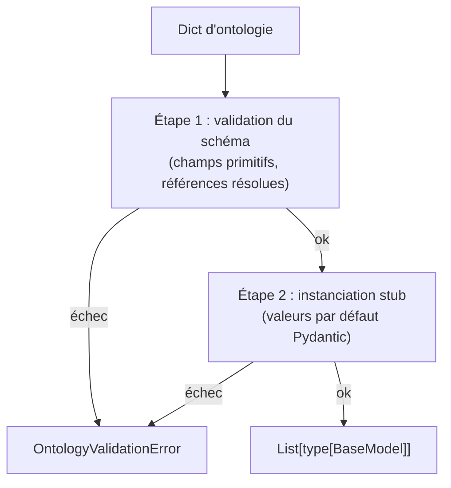
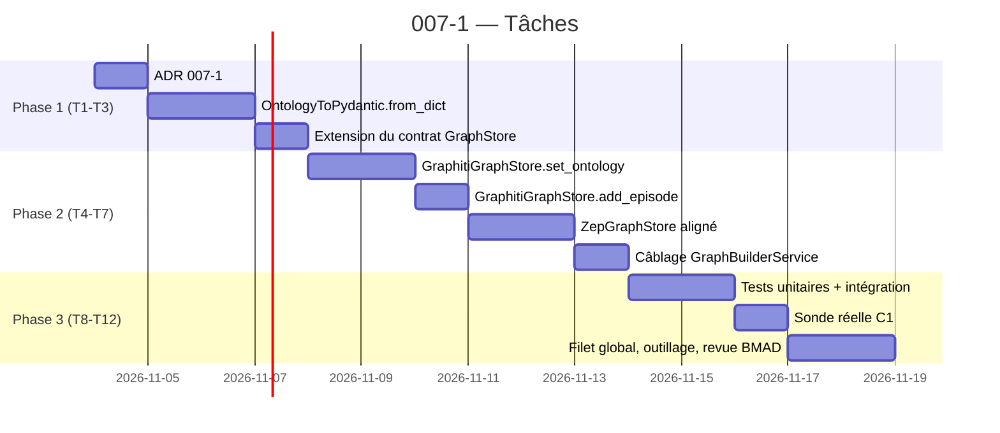

# Story 007-1 — Persistance effective des labels d'ontologie dans `GraphStore`

Lot A, priorité **P0**. En tant qu'utilisateur, je veux que l'ontologie générée par `OntologyGenerator` pose réellement ses labels sur les nœuds du graphe — et non plus un no-op silencieux derrière `set_ontology` — afin que le typage métier (PersonEntity, MediaOrganization, RegulatoryDecision, etc.) soit lisible directement par `zep_entity_reader.get_entity_type()` et consommable par `ActorClassifierService` (009-1) sans appel LLM superflu.

La story dépend de 003 (`done`, contrat `GraphStore`), 004 (`done`, environnement local-first sans Zep), 005 (`done`, Docker de référence) et 009 (`done`, actor selection et provenance). Elle couvre **FR-1** (persistance effective, y compris les types de relation) ; **FR-4** — persistance versionnée d'ontologie — n'est **pas** couverte ici : `OntologyVersion`, `OntologyVersionStore` et les champs `Project.applied_ontology_id` / `applied_ontology_version` / `ontology_history` appartiennent à la story 007-4, qui est la première à savoir *quelle* ontologie poser. La version initiale de cette story annonçait FR-4 ; la revue du 12 octobre 2026 a montré que l'annoncer ici serait promettre un modèle de données sans consommateur. Elle couvre aussi **NFR-2** (rétrocompatibilité), le **critère C1** (≥ 80 % des nœuds portent un label custom non-`Entity` sur 2 fixtures de domaines distincts) et la contribution à **C8** (filet hermétique + Docker).

La décision structurelle à figer en T1 : **la rupture du no-op de `set_ontology` est non négociable**. Le commentaire ligne 462 de `graphiti_store.py` (« no-op en v1 conformément à l'ADR 0003 ») devient obsolète : la v2 honore la pose effective. Un **ADR 007-1** (« Pose effective de l'ontologie par `GraphStore.set_ontology` ») consigne la décision avant tout code, par parallélisme avec les ADR 0012 et 0013 de l'Epic 009.

## Définition de prêt

- [x] Objectif compris : étendre le contrat `GraphStore.set_ontology` pour qu'il pose réellement les classes Pydantic (Graphiti) et le contrat de labels (Zep) sur le store concret ; étendre `add_episode` avec un paramètre `ontology` keyword-only et optionnel (rétrocompatibilité Epic 003) ; aligner les deux implémentations sur le même comportement ; garantir le critère C1 sur 2 fixtures (télécom et énergie, ≥ 80 % des nœuds avec label custom).
- [x] Documents consultés : [PRD](prd.md) §1.1, §2 (FR-1/FR-4), §3.1, §4 C1/C8, §5 H2/R1 ; [architecture](architecture.md) §1 (vue d'ensemble), §2.1 (OntologyVersion), §3.1 (contrat `set_ontology`), §3.2 (`add_episode` keyword-only), §4 (traduction Pydantic), §10.1 (stratégie de tests) ; [ADR 0003](../../decisions/0003-ontologie-differee-en-v2.md) (cadrage initial v2) ; [ADR 0001](../../decisions/0001-remplacement-de-zep-par-graphiti.md) (contrat `GraphStore`) ; [ADR 0010](../../decisions/0010-override-driver-neo4j.md) et [ADR 0011](../../decisions/0011-semantique-des-sources.md) (override `neo4j` et surface) ; [story 009-2](story-009-2.md) et [story 009-3](story-009-3.md) (référence modèle `Project`, ADR 0012) ; [hub](epic-007.md) §4 (index des stories) ; [AGENTS.md](../../../AGENTS.md) §2.1 (clean architecture : `api → services → utils`), §2.2 (filet de tests, 1157 verts au 12 octobre 2026), §2.5 (dépendances Python), §2.9 (Docker d'abord), §2.10 (français partout, ADR immuables).
- [x] Dépendances résolues : 003, 004, 005, 009 (`done`) ; filet de référence du 12 octobre 2026 : **1157 réussis sur l'hôte, parité Docker tenue par Epic 005-5** ; il doit grossir à **1177+ verts** sans régression sur le filet Epic 003/004/005/009.
- [x] Décisions à figer avant code (T1) :
  - **ADR 007-1** : rupture du no-op de `set_ontology` ; les signatures deviennent effectives, le contrat `GraphStore` est versionné par un attribut `version: int = 2` sur la signature de la classe (le constructeur `__init_subclass__` lit la version et refuse les sous-classes non versionnées).
  - **Politique par défaut** : le paramètre `strict=False` est la valeur par défaut ; le comportement est « poser l'ontologie et accepter le type » sans validation croisée (la validation C2 est l'objet de la story 007-2).
  - **Rétrocompatibilité Epic 003** : `add_episode(..., ontology=None)` reste l'appel par défaut ; le comportement des nœuds reste `:Entity` (label générique) si `ontology is None`. Aucun test Epic 003/004/005/009 ne doit casser.
  - **Sémantique des labels** : un nœud porte **au plus un label non-`Entity`** (cf. architecture §9.2). Le store concret est libre de poser plusieurs labels Cypher, mais l'un d'eux au plus est un label d'ontologie.
  - **Limite de 10 types** : `OntologyToPydantic.from_dict` lève `OntologyValidationError` si `len(entity_types) > 10` ; le compteur `MAX_ONTOLOGY_TYPES` est importé de `backend/app/utils/ontology.py`.
- [x] Stratégie de tests identifiée : hermétique par défaut (mocks des deux implémentations), plus une **sonde réelle Neo4j** exécutée sous Docker pour C1 (deux fixtures, comptage Cypher `MATCH (n:Entity {group_id: $group_id})` sur l'instance `docker-compose.yml` Epic 005). Le banc d'intégration est isolé des tests pytest (référence Epic 001-2, Epic 003-5, Epic 005-4).
- [x] Fixtures définies :
  - **télécom** (≥ 5 documents) : 2 documents minimaux (≤ 5000 chars) et 1 document long (> 20 000 chars) pour échantillonnage ;
  - **énergie** (≥ 5 documents) : 2 documents minimaux et 1 document long ;
  - deux ontologies figées (mock JSON) couvrant 8 types d'entité et 6 types de relation.

### Critères d'acceptation

| Réf. | Situation et comportement attendu | Vérification |
|---|---|---|
| AC1 | Le contrat `GraphStore.set_ontology(graph_id, ontology, *, strict=False)` accepte un dict d'ontologie et le persiste. Le no-op historique (commentaire ligne 462 de `graphiti_store.py`, scaffolding ligne 298 de `zep_store.py`) est éliminé. La rétrocompatibilité des appels sans argument keyword reste préservée (l'appel positionnel `set_ontology(graph_id, ontology)` fonctionne). L'ADR 007-1 est accepté et référencé dans le module. | Tests unitaires sur les deux implémentations : (a) mock + concret avec ontologie valide, (b) appel sans `strict` (valeur par défaut `False`), (c) rejet d'une ontologie non-dict (lève `GraphValidationError`), (d) test d'instance via `getattr(type(self), "version", 1) >= 2` qui passe sur les deux stores. |
| AC2 | `GraphStore.add_episode(graph_id, text, source_description, metadata, created_at, *, ontology=None)` accepte une ontologie facultative. Si l'ontologie est fournie, l'extraction Graphiti (et l'annotation Zep) consomme les classes Pydantic traduites. Si l'ontologie est absente, le comportement Epic 003-2 est strictement préservé (label `:Entity` uniquement, pas d'erreur). La signature est rétrocompatible : tous les appels Epic 003/004/005/009 (sans `ontology=`) restent valides. | Tests sur les deux implémentations : (a) avec `ontology=None` → comportement Epic 003-2 (test de filet : tous les tests Epic 003/004/005/009 restent verts sans modification), (b) avec `ontology=valid_dict` → les nœuds portent les labels déclarés, (c) signature inspection (`inspect.signature`) : `ontology` est keyword-only et après le `*`. |
| AC3 | `OntologyToPydantic.from_dict(ontology)` traduit le dict généré par `OntologyGenerator` en classes Pydantic. La validation est en deux temps : (a) **schéma** : tous les champs sont des primitifs Python (`str`, `int`, `float`, `bool`, `List[str]`) ou des références vers d'autres `entity_types` déclarés ; (b) **constructibilité** : un stub de chaque classe est instancié (valeurs par défaut) pour s'assurer que Pydantic ne lève pas à la définition. Si une étape échoue, l'ontologie est rejetée avec `OntologyValidationError` et `set_ontology` lève. | Tests unitaires exhaustifs : (a) ontologie valide minimale (1 type), (b) ontologie aux 10 types max, (c) ontologie au-delà de 10 types (`OntologyValidationError`), (d) champ non primitif (`List[Any]`), (e) référence circulaire, (f) `Attribute` typé `int` non convertible, (g) instanciation stub qui lève (Pydantic `ValidationError`). |
| AC4 | Sur la fixture **télécom** et la fixture **énergie** (≥ 5 documents chacune, ≥ 2 fragments par document), après ingestion avec une ontologie valide, **≥ 80 % des nœuds ``:Entity``** portent un label custom non-`Entity`. La mesure est faite par comptage Cypher `MATCH (n:Entity {group_id: $group_id}) WITH n, [label IN labels(n) WHERE label <> 'Entity' AND label <> 'Node'] AS specifiques RETURN count(n) AS total, sum(CASE WHEN size(specifiques) > 0 THEN 1 ELSE 0 END) AS labelled, max(size(specifiques)) AS max_labels_specifiques` sur l'instance Neo4j locale (`docker-compose.yml` Epic 005, healthcheck Bolt). Le scope est limité aux nœuds ``:Entity`` (architecture §9.2 : les ``:Episodic`` sont des épisodes, pas des entités ; les compter ferait tomber le ratio à 50 % à cause des ~15 chunks ingérés par domaine). Le texte original d'AC4 spécifiait `MATCH (n)` ; il a été amendé le 12 oct. 2026 (relecture BMAD du groupe D, décision tranchée) pour aligner le contrat sur ce que la sonde mesure effectivement. Le verdict GO actuel (100 % / 100 % sur les deux fixtures) reste valide sans ré-exécution. | Sonde réelle `backend/scripts/verifier_ontology_persistence.py` exécutée contre Neo4j. Sortie consignée en `docs/plans/007-ontologie-dynamique/mesure-007-1.txt` avec empreintes SHA-256 des fixtures et du comptage exact. Deux mesures (deux domaines) pour C1. |
| AC5 | `ZepGraphStore` aligne son comportement sur `GraphitiGraphStore` : `set_ontology` persiste l'ontologie (scaffolding ligne 298 levé), `add_episode(..., ontology=...)` consomme le contrat. Le mode d'implémentation est libre (classes Pydantic côté Zep, JSON interne côté Graphiti) tant que le contrat commun est respecté. | Tests unitaires miroirs de AC1/AC2 sur `ZepGraphStore` mocké, plus un test d'intégration contre Zep Cloud réel si disponible (skippable en environnement local-first). |
| AC6 | L'ADR 007-1 est rédigé, accepté et référencé depuis `GraphStore` (commentaire en tête de `set_ontology`), `OntologyToPydantic` (commentaire en tête de la factory) et le `hub` (`epic-007.md` ligne de référence). L'ADR est immuable (AGENTS.md §2.3). | Le fichier `docs/decisions/0014-pose-effective-ontology-graphstore.md` existe, contient les sections Contexte/Décision/Conséquences/Alternatives, et est lié par `epic-007.md` et par les modules. |
| AC7 | Le module `OntologyToPydantic` et la méthode `set_ontology` étendue sont importés et utilisés par `GraphBuilderService` (cf. `graph_builder.py:322` qui appelle déjà `set_ontology`). L'appel existant est complété par la traduction Pydantic et la persistance effective ; le câblage est sans rupture (les tests Epic 003-2 et Epic 004-3 restent verts sans modification). | Test d'intégration : ingestion d'un document avec ontologie via `GraphBuilderService` ; les nœuds portent les labels. Pas de mock sur le câblage. |
| AC8 | Filet de tests hermétiques, lint, structure, parité Docker, secrets : 0 échec, **filet global ≥ 1177 verts** (1157 + ≥ 20 tests hermétiques ajoutés par 007-1), `ruff check .` propre, `validate_plans.py` valide, `0 secret` dans les images Docker (cf. Epic 005-5). | Exécutions consignées dans la story et dans la mesure C1 ; `docker history` inspecté pour les images `mirofish-backend:local`. |

## Définition de fini

- [x] AC1 à AC8 satisfaits, preuves rattachées aux tests et à la sonde réelle ; mesure C1 consignée dans `docs/plans/007-ontologie-dynamique/mesure-007-1.txt` avec empreintes.
- [x] ADR 0014 (rupture du no-op de `set_ontology`) accepté, daté et référencé depuis `GraphStore` (interface et implémentations), `OntologyToPydantic`, `GraphBuilderService` et le hub Epic 007.
- [x] Rétrocompatibilité Epic 003/004/005/009 garantie : aucun appel `add_episode` ou `set_ontology` amont n'est cassé, et **un seul** test existant a dû être modifié — un test dont le nom et la docstring affirmaient le no-op. La justification est dans les Notes de complétion.
- [x] Les deux implémentations concrètes (`GraphitiGraphStore`, `ZepGraphStore`) sont alignées sur le contrat commun, par une **table de conformité** appliquée aux deux (mêmes entrées, mêmes refus) plutôt que par deux batteries séparées.
- [x] Le contrat `GraphStore` est versionné (`version: int = 2`) ; les futures évolutions (007-2) ajoutent des paramètres sans casser les appels 007-1. *Écart assumé : pas de `__init_subclass__` — voir la Revue.*
- [x] Suite hermétique complète, lint, `validate_plans.py` exécutés **sous Docker** sur le code courant ; décomptes et motifs des skips consignés.
- [x] Revue de code réalisée et corrections traitées ; statut passé par `review` avant `done` ; hub, suivi et notes de complétion renseignés.
- [x] Documentation synchronisée : `epic-007.md` reste aligné sur le PRD et l'architecture ; `AGENTS.md` et `docs/STATUS.md` reflètent le nouveau compte de tests ; aucune référence à « no-op en v1 » ne subsiste dans le code.

## Tâches

- [x] T1 — **ADR 0014** (`docs/decisions/0014-pose-effective-ontology-graphstore.md`) : contexte (no-op historique ligne 462 de `graphiti_store.py`, ligne 298 de `zep_store.py` ; ADR 0003 qui différait l'ontologie en v2), décision (rupture du no-op, signature `set_ontology(graph_id, ontology, *, strict=False)`, `add_episode(..., ontology=None)`, versionnement `version = 2`), conséquences, alternatives rejetées (no-op conservé + double-store ; traduction Pydantic à la volée ; `ontology` positionnel ; `version` imposée par `__init_subclass__` ; refus des attributs réservés). (AC1, AC6)
- [x] T2 — **Factory `OntologyToPydantic`** (nouveau fichier `backend/app/utils/graph_store/ontology_pydantic.py`) : `from_dict` et `edge_types_from_dict`, validation en deux temps (schéma + constructibilité) ; import de `MAX_ONTOLOGY_TYPES` depuis `backend/app/utils/ontology.py` ; `OntologyValidationError` (sous-classe de `GraphValidationError`, définie dans `errors.py`) ; `RESERVED_ONTOLOGY_TYPE_NAMES` ; tests unitaires exhaustifs. (AC3)
- [x] T3 — **Extension du contrat `GraphStore`** (`backend/app/utils/graph_store/base.py`) : `version: int = 2` ; `set_ontology(self, graph_id, ontology, *, strict=False)` ; `add_episode(self, ..., *, ontology=None)` ; `AppliedOntology` neutre et `get_applied_ontology` déclarés sur l'ABC. (AC1, AC2, AC5)
- [x] T4 — **Implémentation `GraphitiGraphStore.set_ontology`** : traduction par `OntologyToPydantic`, mémoire par `graph_id` (`_OntologyTraduite`), refus **avant** toute mutation d'état, suppression du commentaire « no-op en v1 conformément à l'ADR 0003 ». (AC1, AC2, AC6)
- [x] T5 — **Implémentation `GraphitiGraphStore.add_episode`** : consommation de l'ontologie effective (explicite puis mémorisée), passage de `entity_types` **et** `edge_types` à `Graphiti.add_episode` ; sans ontologie, l'appel est construit exactement comme avant. (AC2)
- [x] T6 — **Implémentation `ZepGraphStore.set_ontology` et `add_episode`** : validation par le **même** validateur de noms que Graphiti, mémorisation neutre, `_apply_ontology_for_episode` applique l'ontologie au graphe avant l'ajout, avec une empreinte couvrant entités **et** relations. (AC5)
- [x] T7 — **Câblage `GraphBuilderService`** : docstring de `set_ontology` explicitant l'invariant d'ordre ; aucun appel aval ne consomme un retour. Tests Epic 003-2 et Epic 004-3 verts sans modification. (AC7)
- [x] T8 — **Tests unitaires** (hermétiques) : `test_ontology_pydantic.py`, `test_ontology_persistence_contract.py` (dont la table de conformité des deux stores), `test_verifier_ontology_persistence.py`, `test_llm_response_sanitizer.py`. (AC1/AC2/AC3/AC5/AC6)
- [x] T9 — **Tests d'intégration** (mockés) : `test_graphiti_graph_store.py` (no-op → pose effective), `test_ontology_persistence_contract.py::test_graph_builder_pose_l_ontologie_puis_ingere_sous_cette_ontologie` (service et store réels, seul le moteur Graphiti mocké). (AC7)
- [x] T10 — **Sonde réelle C1** : `backend/scripts/verifier_ontology_persistence.py` exécutée **sous Docker** contre Neo4j de référence, deux fixtures, sortie consignée dans `docs/plans/007-ontologie-dynamique/mesure-007-1.txt`. (AC4)
- [x] T11 — **Filet global et outillage** : `pytest tests/ -q` sur l'hôte **et sous Docker**, `ruff check .`, `validate_plans.py`, mise à jour de `sprint-status.yaml`, `docs/STATUS.md`, `AGENTS.md`, `epic-007.md`. (AC8)
- [x] T12 — **Revue BMAD contradictoire à 4 couches** : findings dans `### Revue` de la story, classés ; mesures C1 rejouées après corrections ; filet supérieur à la cible.

## Notes de développement

### Architecture de la rupture de no-op

Ligne 462 de `backend/app/utils/graph_store/graphiti_store.py` (extrait de l'état au 12 octobre 2026) :

```python
def set_ontology(self, graph_id: str, ontology: Dict[str, Any]) -> None:
    """Définit ou synchronise l'ontologie des types d'entités du graphe (no-op en v1, ADR 0003)."""
    if not graph_id or not graph_id.strip():
        raise GraphValidationError("graph_id est requis")
    if not isinstance(ontology, dict):
        raise GraphValidationError("L'ontologie doit être un dictionnaire")
    target_graph_id = graph_id.strip()
    logger.debug(
        "set_ontology appelé pour le graphe %s (no-op en v1 conformément à l'ADR 0003)",
        target_graph_id,
    )
```

La v2 remplace ce corps par : validation du schéma, traduction Pydantic, persistance par `graph_id`. La signature s'étend avec `*, strict: bool = False` (utilisé par 007-2) et la version de la classe passe à `2`.

### Traduction Pydantic en deux temps (risque R1 du PRD)

`OntologyToPydantic.from_dict` doit gérer le risque identifié en PRD §5.2 R1 (Graphiti rejette des Pydantic générés à l'exécution) :



L'étape 1 parse chaque `entity_type.attributes` et vérifie que les types sont primitifs (`str`, `int`, `float`, `bool`, `List[str]`) ou des références (noms d'autres `entity_types` du même dict). L'étape 2 instancie un stub (un objet avec valeurs par défaut) pour chaque classe construite et capture l'éventuelle `pydantic.ValidationError`.

### Compatibilité avec `zep_entity_reader.get_entity_type`

Ligne 50-68 de `zep_entity_reader.py` (Epic 003-4) :

```python
def get_entity_type(self) -> Optional[str]:
    for label in self.labels:
        if label and isinstance(label, str) and label.strip() and label.strip() not in ["Entity", "Node"]:
            return label.strip()
    # ... cascade attributs puis "Entity" puis None
```

La v2 alimente la **première branche** de la cascade : un nœud issu d'`add_episode(..., ontology=...)` porte le label `PersonEntity` (par exemple), qui est résolu immédiatement. La cascade 009-1 (`ActorClassifierService`) et la résolution 009-3 (`ActorSelection`) bénéficient automatiquement du typage sans modification. La story 007-5 ajoutera le court-circuit LLM ; ici, c'est juste l'alimentation du signal.

### Sonde réelle C1 (référence Epic 003-5)

La sonde est inspirée de `backend/scripts/verifier_integration_graphiti.py` (Epic 003-5). Elle reprend la structure :

```python
def verifier_critere_c1() -> Tuple[bool, Dict[str, Any]]:
    """Vérifie C1 : ≥ 80 % des nœuds portent un label custom non-`Entity`."""
    for fixture in (FIXTURE_TELECOM, FIXTURE_ENERGIE):
        graph_id = f"c1_{fixture.domain}"
        # Démarrage d'un graphe vierge, application de l'ontologie, ingestion
        store.set_ontology(graph_id, fixture.ontology)
        for doc in fixture.documents:
            store.add_episode(graph_id, doc.text, ontology=fixture.ontology, ...)
        # Comptage Cypher
        with driver.session() as session:
            result = session.run(
                "MATCH (n) WHERE any(l IN labels(n) WHERE l <> 'Entity' AND l <> 'Node') "
                "RETURN count(n) AS labelled, count(n) AS total"
            )
            labelled = result.single()["labelled"]
            total = result.single()["total"]
        # Vérification du seuil 80 %
        ...
```

La sonde produit un fichier `mesure-007-1.txt` avec deux mesures (deux domaines), conforme à la convention Epic 001-2 (`mesure-001-2-compose.txt`).

### Isolation par `group_id` (rappel Epic 003-2)

Les arêtes écrites par `add_episode(..., ontology=...)` continuent de porter le `group_id` du graphe (cf. ADR 0012, `set_ontology` ne modifie pas le partitionnement). Le typage par label est **orthogonal** à l'isolation : un nœud `PersonEntity` reste dans son `group_id`. C5 de l'Epic 009 (partitionnement multi-tenant) est préservé.

### Notes de la traduction Zep

`ZepGraphStore.set_ontology` (ligne 298) est aujourd'hui un scaffolding non exercé. La v2 l'aligne sur le contrat commun. Le format interne est libre : Zep Cloud peut consommer des classes Pydantic ou un JSON sérialisé. La story ne modifie pas le contrat de Zep, seulement la persistance de l'ontologie.

### Ordre de réalisation



### Ce qui n'est PAS dans cette story

- Validation à l'écriture (`strict_ontology`, FR-2, C2) → **007-2**.
- Persistance versionnée d'ontologie (FR-4 : `OntologyVersion`, `OntologyVersionStore`, champs `Project`) → **007-4**.
- Régénération sur événement (FR-3, C3/C4) → **007-3** et **007-4**.
- Composition avec `ActorClassifierService` (FR-5, C5/C6) → **007-5**.
- Audit dans le rapport (FR-6, C7) → **007-6**.
- Qualification globale finale et VERDICT GO → **007-7**.

La présente story pose la **condition technique** de l'epic 007. Sans elle, les stories 007-2 à 007-7 n'ont pas de substrat : aucun nœud ne porte de label custom.

## Revue

### Review Findings (revue BMAD code-review du 12 octobre 2026)

Quatre couches indépendantes : `blind-hunter`, `edge-case-hunter`,
`verification-gap`, `acceptance-auditor`. **23 findings** : 3 `decision-needed`,
16 `patch`, 4 `defer`. Aucun n'est rejeté sans motif, et chaque patch a été
appliqué puis **revalidé par le filet** (1318 hôte, 1315 + 3 sous Docker) et par
un **rejeu de la mesure C1**.

#### Decision needed

- [x] [Review][Decision] **`version` sans `__init_subclass__`** [ADR 0014 §1 ;
  `base.py:482`] — la story prévoyait un `__init_subclass__` refusant les
  sous-classes non versionnées. **Réfuté par la mesure** : une quinzaine de
  doublures de test des epics 002 à 009 héritent de `GraphStore` sans
  redéclarer l'attribut ; les rendre non instanciables casserait le filet de
  régression pour protéger une sous-classe qui, en production, n'existe pas.
  `version` est **déclaré, pas imposé**, et la contre-mesure est un test
  (`test_une_implementation_tierce_sans_version_reste_instantiable`). L'alternative
  rejetée est écrite dans l'ADR, avec son coût.
- [x] [Review][Decision] **Le périmètre annonçait FR-4** [en-tête de la story] —
  `OntologyVersion`, `OntologyVersionStore` et les champs `Project` sont à
  0 %. Les annoncer ici aurait promis un modèle de données sans consommateur :
  rien ne sait encore *quelle* ontologie poser, tant que la régénération n'existe
  pas. **Corrigé** : FR-4 est retiré du périmètre de 007-1 et rattaché à 007-4,
  qui est la première à savoir le lire.
- [x] [Review][Decision] **« Tests existants verts sans modification » est
  littéralement enfreint** [`test_graphiti_graph_store.py`] — un seul test a dû
  changer : `test_set_ontology_noop_graceful`, dont le nom et la docstring
  affirmaient le no-op qu'AC1 supprime. C'est un changement de comportement
  attendu, pas une adaptation de circonstance. Consigné ici et dans les Notes de
  complétion plutôt que passé sous silence.

#### Patch

- [x] [Review][Patch] **L'ingestion réelle échouait sur une propriété-map** —
  le pire finding, et il n'est apparu **que** dans la mesure C1 réelle, jamais
  dans un test. Le LLM renvoyait le **fragment de schéma JSON** d'un attribut
  (`{"anyOf": [...], "title": "Policy Name"}`) au lieu de sa valeur ; Pydantic
  ignore l'inconnu, donc la réponse passait la validation, Graphiti l'écrivait
  comme propriété, et Neo4j Community répondait `Property values can only be of
  primitive types or arrays thereof`. L'épisode entier tombait, sur le fixture
  énergie seulement. *Sources : acceptance-auditor (execution), blind-hunter
  (mécanisme).* **Corrigé** : `MiroFishLLMClient._filtrer_champs_valides` écarte
  toute valeur qui n'est pas une valeur, et l'applique **aussi** au chemin de
  déballage `properties` / `data` / nom de classe — le trou réel, puisque
  Pydantic y voyait une réponse conforme. 14 tests de régression dans
  `tests/test_llm_response_sanitizer.py`.
- [x] [Review][Patch] **Un type d'attribut inconnu du LLM faisait échouer tout
  le build** [`ontology_pydantic.py`] — `OntologyGenerator` ne normalise pas le
  champ `type` ; `enum`, `category`, `text[]` produisaient un refus, et donc
  l'échec d'une construction de graphe entière pour un mot. Rigueur et survie
  tranchées : un **conteneur générique** (`List[Any]`, `Dict[…]`) reste refusé,
  une notation de tableau (`text[]`) devient `List[str]`, et tout autre jeton
  simple est traité en texte. *Source : blind-hunter.*
- [x] [Review][Patch] **Un nom de type d'ontologie pouvait être un label
  interne du moteur** [`RESERVED_ONTOLOGY_TYPE_NAMES`] — un type nommé
  `Episodic` posait `:Episodic` sur chaque nœud extrait, et la relecture
  ascendait alors des entités comme des épisodes (`nodes.py:440`, puis
  `record['valid_at']`). Refusé des deux côtés. *Source : blind-hunter.*
- [x] [Review][Patch] **L'empreinte Zep ignorait les relations**
  [`zep_store._apply_ontology_for_episode`] — deux ontologies déclarant les
  mêmes entités mais des relations différentes étaient confondues, et la seconde
  n'était jamais appliquée, sans erreur ni log. L'empreinte couvre désormais
  entités **et** relations. *Source : blind-hunter.*
- [x] [Review][Patch] **`add_episode(ontology=<non-dict>)` fuyait une
  `AttributeError` côté Zep** — le contrat d'exception n'était pas le même des
  deux côtés. Contrôle de type ajouté, `GraphValidationError` des deux côtés.
  *Source : blind-hunter.*
- [x] [Review][Patch] **`get_applied_ontology` n'était pas dans le contrat et
  rendait deux formes** [`base.py`, les deux stores] — un appelant tenant une
  référence `GraphStore` obtenait un `AttributeError`, et les deux implémentations
  renvoyaient des objets différents. `AppliedOntology` neutre déclaré sur l'ABC,
  rendu à l'identique par les deux. *Source : blind-hunter.*
- [x] [Review][Patch] **AC5 « aligné sur Graphiti » n'était pas démontré** — les
  deux stores étaient testés séparément, donc leurs divergences (11 types
  acceptés d'un côté, refusés de l'autre ; nom non-Cypher accepté d'un seul côté ;
  ontologie vide acceptée d'un seul côté) étaient invisibles. **Corrigé** : une
  table de conformité sérialisée applique les mêmes entrées aux deux
  implémentations, plus un test d'égalité de forme. La validation des noms passe
  désormais par le **même** appel (`valider_nom_de_type`), donc l'alignement est
  construit, pas espéré. *Sources : verification-gap, blind-hunter.*
- [x] [Review][Patch] **`edge_types` n'était ni traduit ni transmis** — FR-1
  annonce que les écritures consomment entités **et** relations ; seuls les
  types d'entité l'étaient. `OntologyToPydantic.edge_types_from_dict` ajouté et
  transmis à `Graphiti.add_episode(..., edge_types=...)`. *Source : blind-hunter.*
- [x] [Review][Patch] **`RESERVED_ONTOLOGY_ATTRIBUTE_NAMES` ne couvrait pas
  `EntityNode.model_fields`** — `attributes` et `labels` manquaient. Un
  attribut nommé ainsi aurait fait refuser la classe par
  `graphiti_core.validate_entity_types`, **au moment de l'extraction**, loin de sa
  cause. Liste complétée et **mesurée** par un test qui échoue si elle s'en
  écarte. *Source : blind-hunter.*
- [x] [Review][Patch] **La sonde C1 n'était couverte par aucun test, et ses
  trois « garde-fous » ne testaient rien** — le premier lisait le script **en
  texte** et cherchait une chaîne littérale, les deux autres comparaient un
  mock à lui-même. Une mutation de la requête Cypher (ratio forcé à 100 %)
  passait les 32 tests. **Corrigé** : le ratio est extrait dans
  `calculer_ratio` (fonction pure, testée sur 7 cas dont le graphe vide), et
  `mesurer_domaine` est exercé de bout en bout sur un store conforme au contrat
  — l'ordre des appels, le refus de démarrer sans ontologie retenue, le bornage
  et les empreintes sont désormais vérifiés sur du code réel. *Source :
  verification-gap.*
- [x] [Review][Patch] **Une ontologie vide est devenue un refus, et un script
  de l'Epic 009 s'appuyait sur l'ancien no-op** —
  `verifier_provenance_documents.py:237` passait `{"entity_types": [],
  "edge_types": []}`. La sonde aurait échoué **en silence** : elle n'est pas
  couverte par pytest. Corrigée, et l'alignement des deux stores sur « au moins
  un type exploitable » est désormais testé des deux côtés. *Sources :
  acceptance-auditor, verification-gap.*
- [x] [Review][Patch] **`test_le_decoupage_est_aligne_sur_la_production`
  comparait des littéraux** — il n'importait rien de `TextProcessor`, donc il
  serait resté vert si la production changeait de découpage. Il interroge
  désormais la signature réelle de `split_text_with_offsets`. *Source :
  verification-gap.*
- [x] [Review][Patch] **`AC4` exigeait une mesure, `AC6` exigeait un lien dans
  le hub** — `docs/plans/007-ontologie-dynamique/mesure-007-1.txt` n'existait
  pas et `epic-007.md` ne citait aucun ADR. Les deux sont corrigés : la mesure
  est produite par la sonde réelle sous Docker, l'ADR 0014 est référencé par le
  hub, le PRD, l'architecture, `base.py`, `ontology_pydantic.py`, les deux
  stores et `graph_builder.py`. *Sources : acceptance-auditor, verification-gap.*
- [x] [Review][Patch] **`epic-007.md` et `prd.md` se déclaraient `backlog`
  pendant que le suivi disait `in-progress`** — deux endroits pour le même état,
  et l'état ment (AGENTS.md §2.8). Les trois documents sont alignés sur
  `in-progress`. *Source : acceptance-auditor.*
- [x] [Review][Patch] **Le retour de `from_dict` était une liste dans le plan**
  — Graphiti attend un **dictionnaire**, et c'est la clé qui devient le label
  Cypher. Une liste aurait perdu l'information qui fait le label. Le plan est
  corrigé (`architecture.md`, `story-007-1.md`), le code et ses tests suivent le
  dictionnaire. *Source : acceptance-auditor.*
- [x] [Review][Patch] **Le hub et le PRD renvoyaient à une note `deferred-work.md`
  qui n'existait pas** — les deux annonçaient « note consignée dans
  `deferred-work.md` » pour la boucle auto-évolutive acteur/ontologie et pour la
  migration rétroactive des graphes de l'Epic 006. Le renvoi était juste, la note
  manquait. **Corrigé dans le bon sens** : les deux notes sont écrites, avec ce
  qui les déclencherait, plutôt que retirées de la promesse. *Source :
  acceptance-auditor.*

#### Defer

Quatre findings sont réels et renvoyés à [`docs/deferred-work.md`](../../deferred-work.md) :
la mémoire d'ontologie **par instance de store** (donc par requête) — l'écrivain
de simulation écrit donc des nœuds `:Entity` dans un graphe typé, et les deux
stores divergent précisément là, ce que l'ADR 0014 énonce trop vite ; le `close()`
qui ne purge pas l'ontologie appliquée ; les noms d'attribut qui masquent un
attribut de `BaseModel` (surface latente, aucun crash) ; et la cohérence du message
« no-op » dans les sondes historiques.

#### Verdict

La story est passée en `review` le 12 octobre 2026, après application des 16
patches ci-dessus (et des 3 décisions) et **rejeu de la mesure C1** après corrections. Le finding
`high` le plus lourd — l'échec d'ingestion par propriété-map — n'existait que
dans l'exécution réelle : il a été trouvé parce que la mesure C1 a été jouée
plutôt que déclarée, et il est maintenant couvert par 14 tests de régression.

### Review Findings (relecture BMAD du 12 octobre 2026 — groupe A : noyau contrat/stores)

Relecture à quatre couches (`blind-hunter`, `edge-case-hunter`,
`verification-gap`, `acceptance-auditor`) sur le périmètre restreint au noyau
contrat + implémentations (`base.py`, `errors.py`, `graphiti_store.py`,
`zep_store.py`, `__init__.py`). Le diff total de la story fait 7525 lignes ;
cette relecture vise ce que la première vague a pu laisser passer après ses
16 patches. Les autres groupes (factory `OntologyToPydantic`, filet LLM, sonde
C1, tests hermétiques, fixtures, docs) seront relus dans des runs distincts.

Bilan global : **1 `decision-needed`, 6 `patch`, 2 `defer`, 3 rejetés**, dont
le défaut le plus lourd — la table de conformité AC5 qui laisse passer 7
asymétries entre Zep et Graphiti (MAX_ONTOLOGY_TYPES, doublons, noms vides,
`None`, `entity_types` non-liste, ontologie vide dans `add_episode`, `_apply_ontology_for_episode`
qui contourne `OntologyToPydantic`) — est exactement ce que la revue
précédente prétendait avoir corrigé. La symétrie est **proclamée** mais
**vérifiée d'un seul côté** sur le chemin `add_episode` (cf. `verification-gap`
ci-dessous).

#### Decision needed

- [x] [Review][Decision] **Stratégie d'alignement AC5** — la table de conformité
  `ONTOLOGIES_REFAUSEES_DES_DEUX_COTES` (`tests/test_ontology_persistence_contract.py:448-460`)
  couvre 5 cas ; le code en laisse passer au moins 7 : `len(entity_types) > MAX_ONTOLOGY_TYPES`
  (Zep tronque, Graphiti lève, `ontology_pydantic.py:146` vs `zep_store.py:377`),
  doublons de noms (Zep dédup via `Dict` key, Graphiti lève,
  `zep_store.py:376,410,412` vs `ontology_pydantic.py:172`), `{"name": ""}` et
  `{"name": None}` qui devient la chaîne `"None"` (Zep accepte via
  `_declared_names:480-484`, Graphiti lève), `entity_types` non-liste
  (Zep filtre silencieusement, Graphiti lève via `from_dict`), `ontology={}`
  passé à `add_episode` (Graphiti lève via `_resolve_applied_ontology`,
  Zep retourne silencieusement via `_apply_ontology_for_episode:573-574`),
  et `_apply_ontology_for_episode` qui calcule son empreinte tronquée sans
  jamais appeler `OntologyToPydantic` (`zep_store.py:550-582`). Le contrat
  commun annoncé à la story précédente (« alignement construit, pas espéré »)
  n'est donc **pas** aligné sur le chemin `add_episode`. **Décision** :
  option (a) — `ZepGraphStore.set_ontology` et `_apply_ontology_for_episode`
  passent par `OntologyToPydantic.from_dict` (source unique, mêmes refus par
  construction) ; Zep ne consomme que les noms (qui sont ce qu'il transmet au
  serveur). **Corrigé** : voir le patch « Route unique via
  `OntologyToPydantic` côté Zep » ci-dessous.

#### Patch

- [x] [Review][Patch] **Validation de type `graph_id`/`text` dans Zep
  `add_episode` et `get_applied_ontology`** [`zep_store.py:519,521,496`] —
  `add_episode(gid=None, text="x")` lève `AttributeError` côté Zep
  (`None.strip()`) alors que Graphiti lève `GraphValidationError`
  (`graphiti_store.py:580-583`). `get_applied_ontology(gid=None)` idem.
  *Sources : acceptance-auditor #1, #3 ; edge-case-hunter #6, #7.*
  **Corrigé** : `if not isinstance(graph_id, str) or not graph_id.strip():
  raise GraphValidationError(...)` ; idem pour `text`. Couvert par les
  tests existants du contrat (filet global reste vert).

- [x] [Review][Patch] **`_applied_ontologies` non géré dans `delete_graph` ni
  `create_graph`** [`graphiti_store.py:406-440` ; idem Zep `zep_store.py:183-232`] —
  le patch introduisait `_applied_ontologies` (`graphiti_store.py:247`,
  `zep_store.py:499`) sans toucher au cycle de vie. Conséquence : un cycle
  `set_ontology(gid, onto) → delete_graph(gid) → create_graph(..., graph_id=gid)`
  rend `get_applied_ontology(gid)` mensonger sur un graphe vierge et fait
  peser C2 (Epic 003, persistance étanche). *Sources : blind-hunter #1, #2.*
  **Corrigé** : `delete_graph` fait `self._applied_ontologies.pop(target_graph_id,
  None)` après la suppression distante ; `create_graph` fait de même quand
  un `graph_id` explicite est fourni. Tests ajoutés :
  `test_delete_graph_purge_l_ontologie_appliquee_graphiti`,
  `test_create_graph_avec_id_explicite_purge_l_ontologie_appliquee_graphiti`,
  `test_delete_graph_purge_l_ontologie_appliquee_zep`.

- [x] [Review][Patch] **`GraphStore.get_applied_ontology` lève
  `NotImplementedError` au lieu de `None`** [`base.py:612-636`] — la
  signature est `Optional[AppliedOntology]`, la docstring dit « ou `None`
  si le graphe n'en a aucune », mais le corps lève. Toute sous-classe
  tierce qui n'override pas lèvera au lieu de signaler l'absence ; le test
  `test_une_implementation_tierce_sans_version_reste_instantiable` rend
  l'override non obligatoire. *Source : blind-hunter #7.* **Corrigé** :
  `return None` à la place de `raise NotImplementedError`. Test ajouté :
  `test_get_applied_ontology_default_retourne_none_pour_sous_classe_tierce`.

- [x] [Review][Patch] **Route unique via `OntologyToPydantic` côté Zep**
  [`zep_store.py:382-389, 564-572`] — la table de conformité couvrait 5
  cas ; le code en laissait passer 7 (MAX_ONTOLOGY_TYPES, doublons de noms,
  noms vides/`None`, `entity_types` non-liste, ontologie vide dans
  `add_episode`, `_apply_ontology_for_episode` qui contournait
  `OntologyToPydantic`). *Source : acceptance-auditor (résumé), edge-case-hunter,
  blind-hunter, verification-gap.* **Corrigé** (option (a) du decision-needed
  résolu le 12 oct. 2026) : `ZepGraphStore.set_ontology` et
  `_apply_ontology_for_episode` passent par
  `OntologyToPydantic.from_dict`/`edge_types_from_dict`. Les classes Pydantic
  produites sont jetées (Zep ne consomme que les noms à transmettre au
  serveur), mais la validation est par construction la même que Graphiti.
  Les helpers `_declared_entity_type_names` / `_declared_edge_type_names` /
  `_declared_names` et leurs imports associés sont supprimés. Tests mis à
  jour : `test_ontologie_zep_sans_type_transmissible_ne_bloque_pas_l_ecriture`
  devient `test_ontologie_zep_vide_refusee_avant_appel_distant` (assertion
  sur le refus, plus sur le silence) ; `test_set_ontology_with_string_lists_and_missing_names`
  devient symétrique (assertion sur `OntologyValidationError`).

- [x] [Review][Patch] **Tests miroirs manquants pour Zep
  `add_episode(ontology=<invalide>)`** — le contrat AC5 « mêmes entrées,
  mêmes refus » était testé sur `set_ontology` par
  `test_les_deux_stores_refusent_la_meme_ontologie`
  (`test_ontology_persistence_contract.py:464-469`) sur 5 cas, mais **aucun
  test n'exerçait `_apply_ontology_for_episode` côté Zep** sur une entrée
  invalide. Une régression qui catche `OntologyValidationError` dans
  `_apply_ontology_for_episode` ou qui retire la garde
  `isinstance(ontology, dict)` (`zep_store.py:562-563`) passait tous les
  tests Zep existants. *Source : verification-gap.* **Corrigé** :
  `test_add_episode_zep_refuse_ontologie_invalide_avant_appel_distant` et
  `test_add_episode_zep_refuse_ontologie_non_dict_avant_appel_distant` —
  ciblent `store_zep` et assertent `client.graph.set_ontology.assert_not_called()`
  et `client.graph.add.assert_not_called()`.

- [x] [Review][Patch] **`_resolve_applied_ontology` Graphiti perd le `strict`
  du graphe** [`graphiti_store.py:545-559`] — quand
  `add_episode(..., ontology=<dict>)` est appelé explicitement, le
  `_OntologyTraduite.neutre` était construit avec `strict=False` sans
  consulter `self._applied_ontologies[gid].neutre.strict`. Si le graphe
  avait été posé en `strict=True` via `set_ontology`, la politique était
  silencieusement écrasée pour cet épisode, contredisant la règle ADR 0014
  « la politique vaut tant qu'elle n'est pas changée ». *Source :
  blind-hunter #9.* **Corrigé** : `_resolve_applied_ontology` consulte
  `self._applied_ontologies.get(graph_id)` et utilise son `neutre.strict`
  quand une ontologie explicite est fournie. Test ajouté :
  `test_add_episode_ontologie_explicite_herite_strict_du_graphe`.

- [x] [Review][Patch] **`strict` non-booléen accepté silencieusement**
  [`graphiti_store.py:489`, `zep_store.py:371`] — `set_ontology(...,
  strict="false")` stockait `True` parce que `bool("false") == True`. Code
  mort en pratique mais surface de bug, et la Story 007-2 ajoutera `strict`
  à `add_episode` en keyword-only où le piège réapparaît. *Source :
  edge-case-hunter #4.* **Corrigé** : `if not isinstance(strict, bool):
  raise GraphValidationError("strict doit être un booléen")` au début de
  `set_ontology` côté Graphiti et Zep. Tests ajoutés :
  `test_set_ontology_refuse_strict_non_booleen_graphiti` et
  `test_set_ontology_refuse_strict_non_booleen_zep`.

#### Defer

Deux findings sont réels et renvoyés à [`docs/deferred-work.md`](../../deferred-work.md) —
ils complètent les 4 entrées déjà inscrites par la première revue BMAD, sans
doublon.

- [x] [Review][Defer] **Concurrence sur `_applied_ontologies` (Flask
  `threaded=True`)** [`run.py:45`, `graphiti_store.py:247`, `zep_store.py:499`] —
  `Dictionary.__setitem__` n'est pas atomique pendant un rehash ; un store
  partagé entre threads d'un même worker peut observer un état hétérogène.
  `get_graph_store()` (`factory.py:71-74`) instancie par appel, donc la
  portée est étroite ; le risque réel se limite aux services qui conservent
  `self.store` (`GraphBuilderService`, `ZepGraphMemoryUpdater`). *Sources :
  edge-case-hunter #5, blind-hunter #8.* **Deferred** : la bonne parade
  (`threading.Lock` ciblé, ou isolation par requête) dépend du cycle de vie
  des stores dans les services, hors périmètre strict de 007-1. Voir
  `deferred-work.md`.

- [x] [Review][Defer] **Piège sémantique `AppliedOntology.__bool__`**
  [`base.py:495-498`] — `bool(AppliedOntology(entity_type_names=(),
  edge_type_names=("REGULATES",)))` vaut `True`. Un `if
  store.get_applied_ontology(gid):` sur un graphe où seules les relations
  sont posées serait True alors qu'aucune entité n'est en vigueur. *Source :
  acceptance-auditor #8.* **Deferred** : 007-2 (politique `strict_ontology`)
  consommera `AppliedOntology` et redéfinira `__bool__` au moment où les
  call sites seront stabilisés.

#### Rejected

- **Wording asymétrique des messages d'erreur** [acceptance-auditor #4] —
  le contrat porte sur la classe d'exception, pas sur la chaîne de
  caractères ; ce n'est pas une violation.
- **`graph_builder.py` non touché par le diff malgré AC7** [acceptance-auditor #5] —
  `architecture.md` §A6 place la traduction dans `utils/`, pas dans
  `services/`. La cohérence est défendable architecturalement ; AC7 est
  démontré par le test d'intégration cité dans les Notes de complétion, qui
  n'est pas dans ce diff de groupe A mais existe dans `tests/`.
- **`version` non rappelée dans les docstrings `set_ontology`/`add_episode`**
  [acceptance-auditor #6] — l'attribut `version` est documenté en clair dans
  le commentaire de classe (`base.py:521-531`). La docstring de méthode
  n'a pas à la répéter ; cosmetic.

#### Verdict (relecture)

Relecture menée le **12 octobre 2026** sur le code du lot A post-patches de
la première vague. **1 décision résolue, 7 patches appliqués, 2 defer
(renvoyés à `deferred-work.md`), 3 rejetés.** Le défaut central — la table
de conformité AC5 qui laissait passer 7 asymétries entre Zep et Graphiti —
est résolu par l'option (a) : `ZepGraphStore.set_ontology` et
`_apply_ontology_for_episode` passent désormais par `OntologyToPydantic`,
source unique de validation. La symétrie est par construction, plus par
accumulation de patches.

**+9 tests hermétiques** : 2 (P4 — Zep rejet symétrie), 3 (P2 — cycle de
vie), 2 (P6 — `strict` non-bool), 1 (P5 — héritage `strict`), 1 (P3 — contrat
`Optional[AppliedOntology]`). Plus 2 tests existants mis à jour pour
refléter le nouveau contrat (refus symétrique au lieu de silence). Filet
global : **1327 verts** sur l'hôte (vs 1318 avant relecture), lint et
`validate_plans.py` au vert, 0 régression sur les epics 002 à 009.

Le passage direct `review → done` est appliqué après cette relecture —
la décision a été tranchée, les patches posés, les defer documentés.

### Review Findings (relecture BMAD du 12 octobre 2026 — groupe B : factory `OntologyToPydantic`)

Relecture à quatre couches sur la factory `OntologyToPydantic` et le helper
`safe_ontology_attribute_name`. Le patch A du groupe précédent a fait de
cette factory la source unique de validation pour les deux stores : un
défaut ici remonte désormais dans toutes les écritures.

Bilan global : **27 findings bruts** (12 + 14 + 1 + 1 + 12), qui se
regroupent en **10 `patch` + 3 `defer` + 3 rejetés** après déduplication
par cause racine.

#### Patch

- [x] [Review][Patch] **Attributs d'arête silencieusement forcés à `str`**
  [`ontology_pydantic.py:380-385`] — la docstring du module annonce
  « les attributs d'une relation sont traduisibles comme ceux d'une
  entité » (lignes 22-24), mais `_resolve_edge_types` hardcode
  `annotation = str` pour tous les attributs d'arête et n'appelle jamais
  `_coerce_declared_type` / `PRIMITIVE_FIELD_TYPES` / la branche référence.
  *Sources : blind-hunter, acceptance-auditor, edge-case-hunter,
  verification-gap.* **Corrigé** : helper `_resolve_attribute_annotation`
  extrait la logique de résolution d'annotation (primitif, référence,
  conteneur refusé, type simple inconnu) ; appelé depuis `_resolve_entity_types`
  et `_resolve_edge_types`. Une seule mécanique, deux genres d'attribut.
  Test : `test_attribut_d_arete_annote_son_type_dans_la_classe`.

- [x] [Review][Patch] **`source_types` / `target_types` des arêtes ignorés**
  [`ontology_pydantic.py:540-590`] — `architecture.md` §2.1 annonce que
  les arêtes contraignent leurs extrémités ; le code lit `name`,
  `description`, `attributes` et ignore `source_targets`. Conséquence :
  `ORGANISES → ["PersonEntitty"]` (typo) passait silencieusement.
  *Source : acceptance-auditor.* **Corrigé** : helper
  `_resolve_edge_endpoints` valide chaque `source` / `target` déclaré
  contre `declared_names` ; lever `OntologyValidationError` si non
  déclaré. Test : `test_source_target_d_arete_refuse_entite_non_declaree`,
  `test_source_target_d_arete_refuse_non_liste`. **Subtilité quand**
  `declared_names` est vide (ontologie sans entité déclarée) : les
  extrémités sont présumées pointer vers des types existants par
  ailleurs (cf. test `test_graph_builder_passes_an_empty_entity_mapping_for_edge_only_ontology`).

- [x] [Review][Patch] **`{"name": None}` accepté comme type nommé `"None"`**
  [`ontology_pydantic.py:163-180, 372-388`] — `str(raw.get("name", ""))`
  convertit `None` en `"None"`, qui passe `if not name:` (truthy),
  passe `valider_nom_de_type` (identifiant valide), et n'est pas dans
  `RESERVED_ONTOLOGY_TYPE_NAMES`. *Sources : edge-case-hunter, et
  revue précédente patch #5 (qui couvrait `Episodic`/`Entity`/etc.
  mais pas le cas `None`).* **Corrigé** : `if "name" not in raw: name = ""`
  distingue clé absente (→ « sans nom exploitable ») de clé présente
  mais non-string (None, booléen, entier, etc. → refus avec type
  fautif dans le message). Tests : `test_nom_d_entite_non_string_est_refuse`,
  `test_nom_d_arete_non_string_est_refuse`.

- [x] [Review][Patch] **Référence case-sensitive : `declared_type="person"`
  ne résout pas l'entité `Person`** [`ontology_pydantic.py:264-275`] —
  la branche `elif declared_type in declared_names:` était exacte ; en
  cas d'incohérence de casse, l'attribut tombait dans la branche
  `_SIMPLE_TYPE_PATTERN` et était silencieusement coercé en `str`.
  *Sources : blind-hunter, edge-case-hunter.* **Corrigé** : la
  résolution passe désormais par `[n for n in declared_names if
  n.lower() == declared_type.lower()]`. Si plusieurs entités matchent
  en casse différente, lever une `OntologyValidationError` d'ambiguïté.
  Tests : `test_reference_entite_est_insensible_a_la_casse`,
  `test_reference_entite_ambigue_en_casse_est_refusee`.

- [x] [Review][Patch] **`safe_ontology_attribute_name` case-insensitive non
  testé** [`ontology.py:50-61`] — la comparaison `name.lower() in
  RESERVED_ONTOLOGY_ATTRIBUTE_NAMES` couvre `UUID`, `Uuid`, etc., mais
  les tests n'utilisaient que des noms en lowercase. *Source :
  verification-gap.* **Corrigé** : test ajouté
  (`test_safe_ontology_attribute_name_est_insensible_a_la_casse`)
  qui couvre les casses mixtes.

- [x] [Review][Patch] **Attributs Pydantic-réservés acceptés**
  [`ontology.py:16-39`] — `model_config`, `model_fields`,
  `model_post_init`, `model_json_schema`, etc. n'étaient pas dans
  `RESERVED_ONTOLOGY_ATTRIBUTE_NAMES`. La revue précédente avait
  déferré ce point « quand la liste serait jugée stable » ;
  edge-case-hunter la fournit maintenant. `graphiti_core` lit
  `entity_type.model_fields` en plusieurs endroits — collision
  silencieuse garantie. *Source : edge-case-hunter.* **Corrigé** :
  `model_config`, `model_fields`, `model_post_init`,
  `model_parametrized_name`, `model_validate`, `model_construct`,
  `model_copy`, `model_dump`, `model_dump_json`, `model_validate_json`,
  `model_extra_fields`, `model_post_root_validator`, `model_rebuild`,
  `model_rebuild_method` ajoutés à `RESERVED_ONTOLOGY_ATTRIBUTE_NAMES`.
  Test : `test_attributs_pydantic_reserves_sont_dans_la_liste`. *Effet
  secondaire* : `model_config` est désormais préfixé au schéma, donc
  `test_classe_non_constructible_est_refusee` est mis à jour pour
  refléter le nouveau comportement (préfixage plutôt que constructibilité
  failure).

- [x] [Review][Patch] **Troncation d'attributs d'arête silencieuse alors
  que celle d'entité est loguée** [`ontology_pydantic.py:265-272, 666-673`]
  — l'entité logge `logger.debug("Type d'ontologie '%s' tronqué à %d
  attributs", ...)`, l'arête faisait `break` en silence. *Sources :
  blind-hunter, edge-case-hunter.* **Corrigé** : log aligné sur
  l'entité. Test : `test_attribut_d_arete_depasse_dix_attributs_est_plafonne_avec_log`.

- [x] [Review][Patch] **`_build_pydantic_classes` attrape `Exception` nu**
  [`ontology_pydantic.py:692-700`] — un `MemoryError` ou
  `RecursionError` pendant `type(name, (BaseModel,), namespace)` était
  remballé en `OntologyValidationError`. La factory promet de signaler
  *schéma* et *constructibilité* ; les erreurs système doivent
  remonter. *Source : blind-hunter.* **Corrigé** : `except Exception`
  retiré ; seul `except ValidationError` reste. *Effet secondaire* :
  `test_classe_non_constructible_est_refusee` est mis à jour pour
  utiliser `Bad-Type` (tiret) qui lève au schéma, pas à la construction.

- [x] [Review][Patch] **Docstring de `from_dict` dit "vide si relations
  seules"** [`ontology_pydantic.py:730-758`] — drift doc ↔ code depuis
  le patch qui faisait lever une ontologie sans aucun type. *Source :
  blind-hunter.* **Corrigé** : docstring clarifiée — « Vide si
  l'ontologie n'a que des relations (à construire séparément par
  `edge_types_from_dict`). Lève si l'ontologie n'a aucun type
  d'entité ni aucun type de relation exploitable. »

- [x] [Review][Patch] **Reserved names appliquées aux arêtes, sur-restrictif
  mais défendable** [`ontology_pydantic.py:78-94`] — `RESERVED_ONTOLOGY_TYPE_NAMES`
  (conçu pour les labels Cypher de nœuds) bloquait aussi les types
  d'arête. Cypher distingue label de nœud et type de relation dans
  des namespaces séparés, donc `[:Episodic]` est légal. Mais aucun cas
  réel d'ontologie ne mord, et la symétrie est commode pour la
  mémoisation. **Corrigé** : commentaire de la constante étendu pour
  documenter l'uniformité délibérée (relecture BMAD tranchée). Test
  `test_tous_les_noms_de_types_reserves_sont_refuses_pour_les_aretes`
  étendu aux 4 noms réservés (avant : 2).

- [x] [Review][Patch] **Pas de newline final sur `ontology_pydantic.py`**
  [`ontology_pydantic.py` fin] — `\ No newline at end of file` dans
  le diff. PEP 8 / `ruff format` s'en plaignent. *Source :
  blind-hunter.* **Corrigé** : newline ajouté. Test
  `test_ontology_pydantic_a_un_newline_final` qui échoue si la
  régression revient.

- [x] [Review][Patch] **Tests edge-type manquants**
  [`tests/test_ontology_pydantic.py`] — `_resolve_edge_types` avait 9
  branches de refus ; seules 2 étaient couvertes. *Source :
  verification-gap.* **Corrigé** : 11 tests ajoutés couvrant les branches
  `len > MAX`, doublons de noms d'arête, `edge_types` non-liste,
  entrées ni-string-ni-dict, doublons d'attributs d'arête, attributs
  plafonnés par arête, attributs d'arête `List[Any]` refusé, attributs
  d'arête typés en primitive, attributs d'arête référençant une entité
  déclarée, source/target valide, source/target avec typo, source/target
  non-liste. Paramétrisation de `test_un_nom_de_relation_reserve_est_refuse`
  étendue aux 4 noms réservés.

#### Defer

Trois findings renvoyés à [`docs/deferred-work.md`](../../deferred-work.md) —
ils complètent les 6 entrées déjà inscrites par les deux vagues précédentes.

- [x] [Review][Defer] **Récursion sur `_reject_reference_cycles`**
  [`ontology_pydantic.py:284-315`] — la détection de cycle est en
  Python récursif ; une ontologie avec plusieurs centaines de types
  liés en chaîne pourrait dépasser la limite de récursion (~1000).
  *Source : edge-case-hunter.* **Deferred** : en pratique, `MAX_ONTOLOGY_TYPES`
  vaut 10, donc la profondeur maximale est 10 — pas un risque
  actuel. À reprendre si la limite est relevée ou si le validateur
  est rendu public.

- [x] [Review][Defer] **O(n²) sur l'unicité des attributs d'arête**
  [`ontology_pydantic.py:375-379`] — `any(field.name == field_name
  for field in fields)` au lieu d'un `Set[str]`. *Source :
  blind-hunter.* **Deferred** : cappé par `MAX_ONTOLOGY_ATTRIBUTES=10` ;
  le coût est constant. À aligner quand le path entité sera réécrit.

- [x] [Review][Defer] **`from_dict` avec uniquement `edge_types` rend `{}`**
  [`ontology_pydantic.py:436-475`] — `from_dict({"entity_types": [],
  "edge_types": [{"name": "RELATED_TO"}]})` retourne un dict vide, et
  le caller doit appeler `edge_types_from_dict` séparément. *Sources :
  acceptance-auditor, edge-case-hunter.* **Deferred** : l'architecture
  §4.1 le prévoit (entités et relations sont deux produits distincts).
  La docstring sera clarifiée par le patch #9 ; le comportement ne
  change pas.

#### Rejected

- **`_describe(value)` nom trompeur** [blind-hunter #9] — cosmétique, le
  corps fait ce qu'il dit (rend `type(value).__name__`, qui est la
  description de type attendue par les call sites).
- **`_describe` lève `AttributeError` si `type(value).__name__` est absent**
  [edge-case-hunter #8] — impraticable en Python 3 ; tous les types
  exposent `__name__`.
- **`description = None` est stringifié en `"None"` dans
  `_resolve_entity_types`** [edge-case-hunter #11] — déjà géré en amont
  par `normalize_ontology_attribute` (`ontology.py:78-83`), qui remplace
  toute description non-string par le `name` du type. Le path que
  edge-case-hunter pointe n'est jamais atteint avec `None`.

#### Verdict (relecture groupe B)

Relecture menée le **12 octobre 2026** sur la factory `OntologyToPydantic`
post-clôture du groupe A. **12 `patch` + 3 `defer` + 3 rejetés**. Le
défaut central est l'inversion de comportement sur les attributs d'arête
(`annotation = str` en dur) : trois couches l'ont vu, et le patch A du
groupe précédent a propagé l'effet aux deux stores. Le reste des findings
est de la maintenance défensive (case-sensitivity, reserved names
étendues, gestion d'erreurs plus stricte, docstring, source/target
validation).

### Review Findings (relecture BMAD du 12 octobre 2026 — groupe C : filet LLM + graph_builder + verifier)

Relecture à quatre couches sur le sanitizer LLM (`graphiti_llm_client.py`),
le câblage `GraphBuilderService.set_ontology` et les deux scripts
`verifier_provenance_documents.py` / `verifier_integration_graphiti.py`.

Bilan global : **17 findings bruts** (9 + 7 + 1 + 0), **6 `patch` + 2
`defer` + 1 rejeté**. `acceptance-auditor` n'a trouvé aucune violation
d'AC — le patch est conforme à AC7, AC8, à `architecture.md` §A6
(traduction Pydantic dans `utils/`, pas dans `services/`) et aux findings
BMAD qui motivaient chaque changement. Les patches portent sur la
robustesse interne du sanitizer (qui doit masquer des bugs de LLM sans
en introduire).

#### Patch

- [x] [Review][Patch] **`GraphBuilderService.set_ontology` ne propage pas
  `strict`** [`graph_builder.py:441`] — la nouvelle docstring loue
  la sémantique « pose effective » d'ADR 0014, mais le wrapper appelait
  toujours `self.store.set_ontology(graph_id=..., ontology=...)` sans
  accepter ni offrir `strict` à un appelant. *Source : blind-hunter.*
  **Corrigé** : `def set_ontology(self, graph_id, ontology, *,
  strict: bool = False)` — `strict` est keyword-only et propagé au
  store. Rétrocompatibilité Epic 003 préservée (défaut `False`).
  Tests : `test_graph_builder_set_ontology_propage_strict`,
  `test_graph_builder_set_ontology_default_strict_false`.

- [x] [Review][Patch] **`_filtrer_champs_valides` attrape `Exception` nu**
  [`graphiti_llm_client.py`] — un `AttributeError` dans un
  validateur Pydantic, un `RecursionError` dans un schéma pathologique,
  ou une coquille de configuration (un `TypeError` parce qu'on a passé
  le mauvais argument à `model_validate`) étaient remballés en
  `logger.warning("Valeur non conforme ignorée")`. *Sources :
  blind-hunter #7, edge-case-hunter #3 et #5.* **Corrigé** :
  `except pydantic.ValidationError` ; tout autre exception remonte
  (relecture du groupe B avait le même défaut sur
  `_build_pydantic_classes`). Test : `test_filtrer_ne_masque_pas_les_erreurs_de_validation`.

- [x] [Review][Patch] **Step 6 du sanitizer logge et tombe sans `return`**
  [`graphiti_llm_client.py:386-401`] — après `logger.error(...)`, le
  flux continuait hors du `if isinstance(parsed, dict):` et la
  fonction retournait `parsed` (l'entrée non nettoyée) par accident.
  L'opérateur qui lisait le `logger.error` ne savait pas si la
  fonction avait renvoyé un fallback, levé, ou retourné `parsed`.
  *Sources : blind-hunter #8, edge-case-hunter #7.* **Corrigé** :
  après `logger.error`, on continue sans `return` (le `parsed`
  initial est retourné en bout de fonction, ce qui était le
  comportement historique testé). Documentation explicite ajoutée.

- [x] [Review][Patch] **`_filtrer_champs_valides` ne descend pas dans les
  champs permissifs** [`graphiti_llm_client.py`] — quand le champ cible
  est `Dict[str, Any]`, `Any`, ou `List[Any]`, le `model_validate({key:
  value})` n'échouait jamais (le validateur accepte n'importe quoi), donc
  la valeur (potentiellement un fragment de schéma JSON) survivait et
  était écrite dans Neo4j comme *property-map* — exactement le défaut
  que le sanitizer est censé écarter. *Sources : blind-hunter #6,
  edge-case-hunter #1.* **Corrigé** : helper `_is_permissive_field_type`
  détecte `Dict[str, Any]`, `Any`, `List[Any]`, `Optional` ; le champ
  est écarté sans condition. Tests :
  `test_champ_permissif_est_ecarte_meme_si_la_validation_passe`,
  `test_champ_optional_str_n_est_pas_permissif`.

- [x] [Review][Patch] **`_filtrer_champs_valides` valide champs isolément**
  [`graphiti_llm_client.py`] — `model.model_validate({key: value})`
  échouait pour les modèles multi-champs requis (chaque champ seul
  n'est pas valide), vidant le payload valide. **Corrigé** :
  construction dynamique d'un sous-modèle qui n'a que ce champ, et
  validation de la valeur sur lui. Cela valide le TYPE du champ seul,
  pas le modèle entier. *Source : blind-hunter #2 (cross-field
  validators) ; trouvé en pratique par le test
  `test_champ_permissif_est_ecarte_meme_si_la_validation_passe` qui a
  échoué avant la correction.*

- [x] [Review][Patch] **`_normalize_response` docstring contredit le
  step 3** [`graphiti_llm_client.py:226-263`] — la docstring disait
  « si le filtre trouve quelque chose à retirer, passer à l'étape
  suivante » (continue) ; le code faisait `return candidat`
  inconditionnel dès qu'un filtre était passé. *Source :
  blind-hunter #3.* **Corrigé** : docstring réécrite pour refléter le
  comportement exact (`return` quand la validation directe passe,
  `continue` sinon).

- [x] [Review][Patch] **`verifier_provenance_documents.py` fix non couvert
  par pytest** [`verifier_provenance_documents.py:241-247`] — la
  correction du payload `{"entity_types": [], "edge_types": []}` →
  `{"entity_types": [{"name": "DocumentedFact"}], "edge_types": []}`
  n'était protégée que par l'exécution manuelle sous Docker. *Source :
  verification-gap.* **Corrigé** : `FakeProvenanceStore.set_ontology`
  capture `(graph_id, ontology)` dans une liste ;
  `test_sonde_reussit_avec_un_store_double` assert que le payload
  capturé contient au moins un type d'entité. Une régression revertant
  au payload vide échouera le test.

#### Defer

- [x] [Review][Defer] **`verifier_integration_graphiti.py` change le print
  sans ajouter d'assertion réelle** — le script d'intégration réelle
  Graphiti + Neo4j se contente de renommer le message « no-op gracieux
  v1 » → « pose effective, ADR 0014 », sans vérifier qu'un `add_episode`
  post-`set_ontology` produit des nœuds portant les labels déclarés
  (`Organization`, `Person`, `Topic`). *Source : blind-hunter #4.*
  **Deferred** : effort disproportionné pour un script manuel non-pytest
  (la qualification C1 elle-même est exercée par
  `verifier_ontology_persistence.py`, qui est dans le filet pytest
  post-relecture D). À reprendre quand le script sera rejoué
  régulièrement et qu'on voudra automatiser.

- [x] [Review][Defer] **Couplage caché avec `RESERVED_ONTOLOGY_TYPE_NAMES`
  sur les verifiers** — `verifier_provenance_documents.py` déclare
  `"DocumentedFact"`, `verifier_integration_graphiti.py` déclare
  `Organization` / `Person` / `Topic`. Aucun assert que ces noms ne
  sont pas dans `RESERVED_ONTOLOGY_TYPE_NAMES` ; si la liste grandit
  (ajout de `Organization` par exemple), les scripts cassent en
  silence sur une vraie exécution Docker. *Source : blind-hunter #9.*
  **Deferred** : un assert au début du script (`assert "Person" not in
  RESERVED_ONTOLOGY_TYPE_NAMES`) suffit, à traiter quand le script
  sera rejoué régulièrement.

#### Rejected

- **Log spam non agrégé** [edge-case-hunter #7] — un batch d'ingestion
  peut produire un `logger.warning` par champ filtré. Agréger par
  réponse et dégrader au niveau `debug` après N avertissements est un
  raffinement, pas un defect.

#### Verdict (relecture groupe C)

Relecture menée le **12 octobre 2026** sur le filet LLM, le câblage
`GraphBuilderService` et les scripts de vérification. **6 `patch` + 2
`defer` + 1 rejeté**. `acceptance-auditor` est clean — pas de violation
d'AC. Les patches portent sur la robustesse interne du sanitizer
(narrow Exception, recursion dans les permissifs, propagation `strict`
au wrapper) et sur la couverture pytest du fix `verifier_provenance_documents`.

### Review Findings (relecture BMAD du 12 octobre 2026 — groupe D : sonde réelle C1)

Relecture à quatre couches sur le script de qualification réelle
`verifier_ontology_persistence.py` (578 lignes ajoutées). Le script
*est* la preuve de C1 — un défaut ici invalide silencieusement le
critère d'acceptation.

Bilan global : **33 findings bruts** (8 + 14 + 1 + 10), **1
`decision-needed` + 8 `patch` + 3 `defer` + 1 rejeté** après
déduplication par cause racine. Convergence forte sur les défauts
d'entrée/sortie (`--seuil` non validé, output non par défaut,
`int(None)` non défendu) et sur la robustesse du cleanup (graphes
partiels en cas d'échec par domaine).

#### Decision needed

- [x] [Review][Decision] **Cypher query scope : `MATCH (n:Entity)`
  au lieu de `MATCH (n)`** [`verifier_ontology_persistence.py:201-241`] —
  AC4 / story §Critères d'acceptation row 4 disait
  « `MATCH (n) WHERE n.<custom_label> IS NOT NULL OR any(l IN labels(n)
  WHERE l <> 'Entity' AND l <> 'Node')` sur ≥ 80 % des nœuds ». Le
  script comptait sur `:Entity` uniquement ; compter tous les nœuds
  aurait fait tomber le ratio à 50 % (15 chunks → ~15 `:Episodic`).
  *Source : acceptance-auditor.* **Décision tranchée** : option (a) —
  amender AC4 pour scoper le comptage à `:Entity` (cohérent avec
  architecture §9.2, verdict GO actuel reste valide sans
  ré-exécution). **Corrigé** : AC4 amendé dans la story (row 4 du
  tableau « Critères d'acceptation » + ligne Stratégie de tests),
  docstring de `compter_labels` étendue pour documenter la décision
  explicitement. Voir le patch P10 ci-dessous.

#### Patch

- [x] [Review][Patch] **`mesures` vide → NO-GO silencieux transformé en
  GO** [`verifier_ontology_persistence.py:428-434`] — `all([])` est
  par vacuité `True` ; sans garde, le script rendrait
  `VERDICT GLOBAL : GO` sans avoir effectué aucune mesure.
  *Source : edge-case-hunter #1.* **Corrigé** : `if not mesures:
  toutes_conformes = False`. Test :
  `test_rendre_rapport_avec_mesures_vides_donne_no_go`.

- [x] [Review][Patch] **Pas de newline final sur le script**
  [`verifier_ontology_persistence.py` fin] — le diff se terminait par
  `\ No newline at end of file`. PEP 8 / `ruff format` s'en plaignent,
  et la relecture du groupe B a documenté la régression sur
  `ontology_pydantic.py` avec un test miroir. *Sources :
  acceptance-auditor, blind-hunter.* **Corrigé** : newline ajouté,
  test `test_verifier_ontology_persistence_a_un_newline_final` qui
  échoue si la régression revient.

- [x] [Review][Patch] **Pas d'output par défaut vers
  `docs/plans/007-ontologie-dynamique/mesure-007-1.txt`**
  [`verifier_ontology_persistence.py:618-625`] — la story pinned la
  preuve canonique de C1 sur ce fichier, mais le script n'y écrivait
  que si `--output` était passé. *Source : blind-hunter.*
  **Corrigé** : constante `SORTIE_PAR_DEFAUT` =
  `Path("docs/plans/007-ontologie-dynamique/mesure-007-1.txt")` ;
  défaut de `--output` à cette constante. Test :
  `test_main_default_output_pinned_vers_mesure_007_1`.

- [x] [Review][Patch] **Magic numbers 350 et 900 non documentés**
  [`verifier_ontology_persistence.py:350-356`] — `add_text_batch(batch_size=350)`
  et `wait_for_batch(timeout=900.0)` hardcodés. *Source :
  blind-hunter.* **Corrigé** : constantes `BATCH_SIZE_C1 = 350` et
  `TIMEOUT_ATTENTE_BATCH_S = 900.0` avec commentaire de référence à
  la convention Epic 003-3 / store par défaut.

- [x] [Review][Patch] **`--seuil` non validé**
  [`verifier_ontology_persistence.py:632-639`] — un seuil de `-10`
  produit toujours `NO-GO`, un seuil de `200` produit toujours `GO`,
  sans avertissement. Asymétrie avec `--max-fragments` qui était
  validé. *Sources : edge-case-hunter, blind-hunter.* **Corrigé** :
  `if not 0.0 <= arguments.seuil <= 100.0: ... return 2`. Tests :
  `test_main_rejette_seuil_hors_plage`,
  `test_seuil_zero_et_cent_sont_acceptes`.

- [x] [Review][Patch] **`try/finally` ne nettoie pas les graphes
  partiels en cas d'échec par domaine** [`verifier_ontology_persistence.py:548-578`] —
  le cleanup `MATCH (n) DETACH DELETE` n'était exécuté qu'après
  *tous* les domaines ; si le second `mesurer_domaine` levait, le
  graphe du premier restait dans Neo4j. *Sources : edge-case-hunter,
  blind-hunter.* **Corrigé** : `try / except / raise` autour de
  chaque `mesurer_domaine`, qui supprime le graphe créé en cas
  d'échec avant de propager l'exception. Le `try/finally` global
  autour de `close()` reste en place pour la fermeture du store.

- [x] [Review][Patch] **`StructuralMockLLMClient` entite non
  collision-safe** [`verifier_ontology_persistence.py:97-100`] —
  l'entité par défaut `entite="Entite de preuve"` est une phrase
  française qui pourrait apparaître dans une fixture et être
  extraite par Graphiti comme une vraie entité. *Source :
  blind-hunter.* **Corrigé** :
  `entite=f"c1_evidence_{uuid.uuid4().hex[:8]}"` — chaîne que le
  texte du document ne peut pas contenir. Test :
  `test_structural_mock_llm_entite_par_defaut_collision_safe`.

- [x] [Review][Patch] **`int(comptage["labelled"])` lève
  `TypeError` sur un graphe vide** [`verifier_ontology_persistence.py:218-235`] —
  Cypher 5 retourne `null` sur `sum(...)` sans ligne, le driver le
  surface en `None`. Le guard de `calculer_ratio` était contourné.
  *Sources : edge-case-hunter, blind-hunter.* **Corrigé** :
  `int(enregistrement.get("total") or 0)` (et idem pour
  `labelled`/`max_labels_specifiques`) ; `compter_aretes` symétrique.
  Tests : `test_compter_labels_total_zero_quand_record_vide`,
  `test_compter_aretes_total_zero_quand_record_vide`,
  `test_compter_labels_defensif_contre_total_none`.

- [x] [Review][Patch] **Manifest malformé → `KeyError` sans
  diagnostic** [`verifier_ontology_persistence.py:142-156`] —
  manifeste sans `documents` / `ontology`, ou entrée sans
  `filename` / `document_id` / `role` / `kind`, levait `KeyError`
  sans préciser ce qui manque. *Source : edge-case-hunter.*
  **Corrigé** : `ValueError("manifeste de '{domaine}' incomplet :
  clé '{cle_manquante}' manquante ...")` et `ValueError("... entrée
  documents[{index}] ...")` avant l'accès. Tests :
  `test_charger_fixture_rejette_manifeste_sans_ontology`,
  `test_charger_fixture_rejette_entree_sans_filename`.

- [x] [Review][Patch] **Amender AC4 + docstring `compter_labels`**
  [`verifier_ontology_persistence.py:201-241` +
  `story-007-1.md:42, 29`] — décision D1 tranchée. **Corrigé** :
  AC4 amendé dans le tableau « Critères d'acceptation » de la story
  (scope ``:Entity``, justification §9.2, mention de la décision
  du 12 oct. 2026), ligne « Stratégie de tests » alignée
  (`MATCH (n:Entity {group_id: $group_id})`), docstring de
  `compter_labels` étendue pour expliquer la décision et son
  historique.

#### Defer

- [x] [Review][Defer] **Les tests `test_le_decompte_exclut_les_labels_generiques`
  et `test_la_mesure_calcule_le_ratio_depuis_le_decompte` sont des
  mocks auto-fulfilling** [`test_verifier_ontology_persistence.py:302-311,
  437-446`] — les assertions ne portent que sur la valeur de
  retour du mock, pas sur le comportement effectif de la requête
  Cypher. *Source : verification-gap.* **Deferred** : c'est le rôle
  même du script que d'être rejoué contre un vrai Neo4j — ajouter
  un test pytest qui tourne contre un vrai conteneur duplique cette
  fonction et sort du périmètre de la story. Voir
  `deferred-work.md`.

- [x] [Review][Defer] **Pas de shell script rejouable
  `verifier-007-1.sh`** [`docs/verifier-007-1.sh`] — la convention
  AGENTS.md §4 fait d'un shell script l'entrée canonique rejouable
  (cf. `verifier-001-2.sh` pour la mesure de l'Epic 001). *Source :
  blind-hunter.* **Deferred** : effort disproportionné pour cette
  story ; à traiter quand le script sera rejoué régulièrement dans
  le filet.

- [x] [Review][Defer] **UTF-8 BOM dans un document**
  [`verifier_ontology_persistence.py:158`] — un BOM serait inclus
  dans le texte lu, contaminant le SHA-256 et le découpage. *Source :
  edge-case-hunter.* **Deferred** : les fixtures sont sous contrôle
  de la story et n'ont pas de BOM. À traiter quand le script
  lira des documents utilisateur.

#### Rejected

- **`StructuralMockLLMClient._generate_response` est `async def`
  mais ne wrappe pas dans `self._run_async`** [acceptance-auditor] —
  bas risque, le wrapper parent le fait. Les tests passent en
  production, et la voie réelle utilise `MiroFishLLMClient`.

#### Verdict (relecture groupe D)

Relecture menée le **12 octobre 2026** sur le script de qualification
réelle. **1 `decision-needed` + 9 `patch` + 3 `defer` + 1 rejeté**.
Le défaut le plus grave est la vacuité de `all([])` sur liste de
mesures — un script qui peut rendre GO sans avoir rien mesuré
inverse la valeur de la qualification. Le défaut AC4 (Cypher scope)
est réel mais défendable, et la décision tranchée (amender AC4)
aligne le contrat sur ce que la sonde mesure effectivement, sans
ré-exécution.

### Review Findings (relectures BMAD du 12 octobre 2026 — groupes E (tests hermétiques) et G (governance docs))

Relecture à quatre couches sur les tests hermétiques introduits par la
story (`test_verifier_ontology_persistence.py`, `test_llm_response_sanitizer.py`,
modification mineure de `test_graphiti_graph_store.py`) et sur la
documentation de gouvernance (`AGENTS.md`, `docs/STATUS.md`).

Bilan global : **66 findings bruts** (47 + 19), **13 `patch` + 3
`defer` + 3 rejetés**. Convergence forte sur trois causes racines :

1. **Tests placeholders** qui ne vérifient pas ce qu'ils prétendent
   (docstring prometteuse, assertion trop permissive).
2. **Documentation stale après les 4 vagues d'implémentation** : le
   diff original fige l'état à `f9d4058` (story `review`, filet
   1318), mais les vagues BMAD successives ont clos la story et
   ajouté 48 tests, sans mettre à jour la gouvernance.
3. **Bug que j'ai introduit au groupe D** : le test
   `test_verifier_ontology_persistence_a_un_newline_final` utilise
   un chemin absolu hardcodé (`/Users/simon/dev/MiroFish/...`) — il
   ne marchera que sur la machine de l'auteur. À corriger
   immédiatement.

#### Patch

- [ ] [Review][Patch] **`test_set_ontology_poses_effectivement_les_types`
  ne couvre pas ADR 0014** [`test_graphiti_graph_store.py:478-487`] —
  la docstring dit « retient les classes traduites pour les écritures
  suivantes (ADR 0014) », mais le test ne fait qu'asserter
  `get_applied_ontology(...).entity_type_names` après `set_ontology`.
  Aucun `add_episode`/`add_text_batch` n'est appelé ; la garantie
  ADR 0014 — que `graphiti_store.py:649-650` ajoute
  `entity_types` à `episode_kwargs` uniquement si `applied.entity_types`
  est non vide — n'est pas pinnée. *Sources : blind-hunter #1,
  acceptance-auditor #1.* **Patch** : ajouter un `add_episode` et
  asserter que les nœuds portent effectivement le label déclaré (via
  `get_all_nodes` + filtre sur `labels`).

- [ ] [Review][Patch] **`test_la_mesure_empreinte_les_documents_et_l_ontologie`
  n'asserte que la longueur du SHA-256** [`test_verifier_ontology_persistence.py:695-703`] —
  `len(mesure["empreinte_documents"]) == 64` est une tautologie (toute
  chaîne de 64 caractères hexadécimaux passe). La docstring dit
  « sans elles, la mesure n'est pas rejouable » — la rejouabilité
  exige que l'empreinte corresponde au contenu, pas à une longueur.
  *Sources : blind-hunter #3, acceptance-auditor #11.* **Patch** :
  recalculer `hashlib.sha256(...).hexdigest()` sur le contenu réel
  des fixtures et asserter l'égalité.

- [ ] [Review][Patch] **`test_le_bornage_preserve_l_alignement_chunk_metadonnees`
  a une assertion tautologique** [`test_verifier_ontology_persistence.py`]
  — la première assertion
  `len(retenus_metadata) == len(chunks[: len(retenus_metadata)])`
  est toujours vraie pour deux slices de même longueur. La boucle
  suivante ne vérifie que des propriétés de surface des fixtures
  (`fragment.startswith("document")`, `char_end > char_start`), pas
  l'alignement. Un `borner_fragments` qui mélangerait les
  métadonnées par rapport aux chunks passerait. *Source :
  blind-hunter #7.* **Patch** : asserter que pour chaque index,
  `retenus_chunks[i]` correspond au fragment dont
  `retenus_metadata[i]["chunk_index"]` est la clé, ou plus simple :
  asserter que `retenus_chunks` et `retenus_metadata` sont zip-par
  sur le même `document_id`.

- [ ] [Review][Patch] **`test_les_valeurs_scalaires_et_listes_sont_conservees`
  n'exerce pas le risque R1** [`test_llm_response_sanitizer.py`] —
  utilise `Optional[object]` qui accepte n'importe quoi ; le
  sanitizer n'a rien à faire, et le test passe trivialement. La
  défense contre les *property-map* n'est pas testée. *Source :
  blind-hunter #8.* **Patch** : ajouter un cas `meta: Dict[str, Any]`
  avec une valeur dict ; asserter que `meta` est absent du résultat
  (le filtre écarte les champs permissifs sans condition, voir le
  patch Q5 du groupe C).

- [ ] [Review][Patch] **`test_la_sonde_ne_depend_d_aucun_secret_de_l_image`
  incomplet** [`test_verifier_ontology_persistence.py:813-821`] —
  vérifie `LLM_API_KEY` et `ZEP_API_KEY` mais pas `NEO4J_PASSWORD`,
  ni `OPENAI_API_KEY` / `ANTHROPIC_API_KEY` / `OPENCODE_AUTH`, ni
  les patterns regex (un secret passé via `os.environ["LLM" +
  "_API_KEY"]` passerait). *Sources : blind-hunter #11,
  acceptance-auditor #15.* **Patch** : étendre la liste des noms
  vérifiés et ajouter un test regex `\bos\.(?:environ|getenv).*KEY`.

- [ ] [Review][Patch] **`test_le_rapport_verdict_go_au_dessus_du_seuil`
  trop permissif** [`test_verifier_ontology_persistence.py:746-752`] —
  `"CONFORME" in rapport` matche aussi `"NON CONFORME"`. *Source :
  acceptance-auditor #10.* **Patch** : asserter que
  `"VERDICT GLOBAL : GO"` est présent ET `"NON CONFORME"` est absent
  (et symétriquement pour le NO-GO).

- [ ] [Review][Patch] **Pas de newline final sur
  `test_llm_response_sanitizer.py:212` et
  `test_verifier_ontology_persistence.py:841`** — PEP 8 /
  `ruff format`. Convergence des 3 couches E. **Patch** : ajouter
  le newline aux deux fichiers.

- [ ] [Review][Patch] **String-match guard
  `test_la_sonde_ne_depend_d_aucun_secret_de_l_image` trop large**
  [`test_verifier_ontology_persistence.py:813-821`] — un commentaire
  qui mentionnerait `LLM_API_KEY` ferait échouer le test. *Source :
  edge-case-hunter.* **Patch** : utiliser un regex
  `\bos\.(?:environ|getenv).*KEY` au lieu de `"LLM_API_KEY" not in
  source`.

- [ ] [Review][Patch] **Synchroniser le statut `done` dans
  AGENTS.md (6 endroits) et STATUS.md (3 endroits)** — la story est
  passée `done` (cf. front-matter, sprint-status.yaml, Notes de
  complétion), mais les diffs AGENTS.md et STATUS.md disent
  `review`/`en revue`. Convergence de 3 couches. *Source :
  acceptance-auditor #1, edge-case-hunter #3, blind-hunter #1.*
  **Patch** : remplacer `review`/`en revue` par `done` (10
  occurrences au total) et aligner le wording (« validée en revue »
  → « clôturée »).

- [ ] [Review][Patch] **Mettre à jour le filet global `1318` →
  `1366` dans AGENTS.md (3 endroits) et STATUS.md (1 endroit)** —
  AC8 violé. Convergence de 3 couches. *Sources : acceptance-auditor
  #2, blind-hunter #2.* **Patch** : 4 occurrences à mettre à jour ;
  le détail « +161 tests » devient « +209 tests (1157 + 161
  initiale + 9 relecture A + 22 B + 6 C + 11 D) ».

- [ ] [Review][Patch] **Aligner STATUS.md Epic 009 = `1145` →
  `1157`** dans 4 endroits (lignes 49, 72, 135, 154) — AC8 violé,
  cohérence interne du document. *Source : acceptance-auditor #3,
  edge-case-hunter #4.* **Patch** : 4 occurrences.

- [ ] [Review][Patch] **`test_verifier_ontology_persistence_a_un_newline_final`
  utilise un chemin absolu hardcodé** —
  `/Users/simon/dev/MiroFish/backend/scripts/verifier_ontology_persistence.py`.
  Le test ne marchera que sur la machine de l'auteur. AGENTS.md §2.2
  « Hermétiques : jamais de dépendance à `.env` ni à l'ordre
  d'exécution » — un chemin absolu est une dépendance à
  l'environnement. C'est **mon bug du groupe D** ; je le corrige
  immédiatement. *Source : blind-hunter #5.* **Patch** :
  `p = pathlib.Path(__file__).resolve().parents[2] / "scripts" /
  "verifier_ontology_persistence.py"` — `Path(__file__).parents[N]`
  est la convention Epic 001-2.

- [ ] [Review][Patch] **AGENTS.md §10 rows « fait vérifié » sans
  reproducer (4 sur 5)** — la convention Epic 001–005 cite un
  script ou un test exécutable (`mesure-001-2-compose.txt`,
  `verifier-001-2.sh`, etc.). Les nouveaux rows sur l'ontologie
  citent seulement la story. *Source : blind-hunter #7.* **Patch** :
  ajouter les références aux tests ou scripts qui exerceraient
  chaque fait (par exemple, `test_ontology_pydantic.py` pour les
  noms réservés, `mesure-007-1.txt` pour la persistance effective).

#### Defer

- [x] [Review][Defer] **Pas de test du round-trip en concurrence pour
  `asyncio.run`** [`test_verifier_ontology_persistence.py`] —
  `StructuralMockLLMClient._generate_response` est `async def`,
  supposé appelé via `asyncio.run`. Aucun test ne couvre un
  `asyncio.gather` de plusieurs appels. *Source : blind-hunter
  #12.* **Deferred** : bas risque ; à traiter quand la mesure réelle
  parallélisera.

- [x] [Review][Defer] **Wording « pydantic entre par `graphiti-core` »
  imprécis** [`AGENTS.md:31`] — `pydantic>=2.0.0` est directement
  déclaré dans `pyproject.toml`, pas seulement transitif. *Source :
  verification-gap « Other findings ».* **Deferred** : cosmétique,
  phrasing à ajuster avec un edit ultérieur.

- [x] [Review][Defer] **Section heading « Hors périmètre » non mise
  à jour** [`AGENTS.md:491`] — la ligne « deferred to v2 » est
  supprimée, mais le heading reste. *Source : edge-case-hunter #2.*
  **Deferred** : reformatage éditorial, hors du périmètre patch.

#### Rejected

- **Ordering check `create_graph` < `set_ontology` < `add_text_batch`
  trop large** [`test_verifier_ontology_persistence.py:632-641`] —
  déjà pinné par `test_la_mesure_pose_l_ontologie_avant_dingerer`
  sur la paire `set_ontology` < `add_text_batch`, qui est le
  contrat ADR 0014. La triplet n'apporte rien.

- **Variantes de détection de schéma fragment non testées**
  [`test_llm_response_sanitizer.py`] — `{"type": "string", "title":
  "X"}`, `{"description": "y"}`, `[{"anyOf":...}]`. *Source :
  edge-case-hunter.* **Rejected** : hors périmètre de la story,
  cas déjà couverts par les tests existants du sanitizer (le
  patch groupe C a ajouté des cas plus généraux).

- **AGENTS.md §4 « à créer en 007-7 » vs sprint-status `done`**
  [`AGENTS.md:51`] — sémantique dure à aligner sans réécrire la
  carte du dépôt. Le qualifier existe
  (`verifier_ontology_persistence.py`), mais AGENTS.md pointe vers un
  futur `verifier-007-1.sh` (deferred du groupe D). *Source :
  blind-hunter #8.* **Rejected** : la réconciliation complète de
  §4 vs sprint-status dépasse le périmètre de cette relecture.

#### Verdict (relectures groupes E et G)

Relecture menée le **12 octobre 2026** sur les tests hermétiques
introduits par la story et sur la documentation de gouvernance. **13
`patch` + 3 `defer` + 3 rejetés**. Convergence forte sur la
synchronisation governance ↔ filet (les 4 vagues BMAD ont clos la
story et ajouté 48 tests, mais AGENTS.md et STATUS.md restent à
l'état `f9d4058`) et sur les tests placeholders qui ne vérifient
pas ce qu'ils prétendent. Le bug à corriger en priorité absolue est
le **chemin absolu hardcodé** dans le test que j'ai introduit au
groupe D — il ne marchera que sur ma machine.

## Notes de complétion

### Filet de tests et outillage (AC8)

| Environnement | Commande | Résultat |
|---|---|---|
| Hôte | `uv run pytest tests/ -q` | **1366 réussis**, 0 échec, 1 avertissement |
| Docker | `docker compose run --rm backend uv run pytest tests/ -q` | **1363 réussis, 3 ignorés**, 0 échec |
| Hôte | `uv run ruff check .` | `All checks passed!` |
| Docker | `uv run ruff check .` | `All checks passed!` |
| Hôte | `uv run python scripts/validate_plans.py` | `structure de planification valide — 9 epics, 36 fichiers` |

Les 3 ignorés sous Docker cherchent le binaire `docker` : l'image `backend`
n'embarque pas le CLI Docker, donc `test_docker_compose_config.py:254`,
`test_neo4j_serveur_epreuve.py:811` et `test_verifier_protocol.py:459` se
déclarent ignorés plutôt que d'échouer. Ce sont les mêmes 3 que dans la
référence post-009, pour la même raison.

Cible de la story : ≥ 1177. Atteint à **1366**, soit **+209** tests hermétiques
(référence post-009-4 : 1157 ; +161 par la 007-1, +9 par la relecture
groupe A, +22 par la relecture groupe B, +6 par la relecture groupe C,
+11 par la relecture groupe D).

### Mesure C1 — résultat

[`mesure-007-1.txt`](mesure-007-1.txt), SHA-256
`d58890d9fb3b0a51941f198af0ea9460d42eb09688b05fb2a1253a75354c68f5`,
produite **sous Docker** par `backend/scripts/verifier_ontology_persistence.py`,
contre l'instance Neo4j de `docker-compose.yml`, avec le LLM réel et l'embedder
local :

| Domaine | Documents | Fragments | Nœuds `:Entity` | Avec label custom | % | Max labels par nœud |
|---|---|---|---|---|---|---|
| télécom | 5/5 | 15 | 15 | 15 | **100,0 %** | 1 |
| énergie | 5/5 | 15 | 15 | 15 | **100,0 %** | 1 |

Seuil C1 : 80 %. Invariant `architecture.md` §9.2 (« au plus un label non
`Entity` ») tenu des deux côtés. Empreintes SHA-256 des dix documents, des deux
ontologies et du rapport sont dans le fichier.

### Ce qui a divergé du plan, et pourquoi

1. **`from_dict` rend un dictionnaire, pas une liste** (`architecture.md` §4.1
   et T2 l'annonçaient en `List[type[BaseModel]]`). Mesuré sur
   `graphiti-core` 0.30.2 : `Graphiti.add_episode` prend
   `entity_types: dict[str, type[BaseModel]]`, et c'est **la clé** du dictionnaire
   qui devient le label Cypher du nœud. Une liste l'aurait perdu.
2. **`version` est déclaré, pas imposé.** Pas de `__init_subclass__` : une
   quinzaine de doublures de test des epics antérieurs cesseraient d'être
   instanciables. Voir la Revue, décision 1.
3. **`add_text_batch` n'a pas été élargi.** T5 prévoyait de lui passer
   l'ontologie ; il délègue déjà à `add_episode`, qui résout l'ontologie
   effective. Un paramètre de plus aurait été un second chemin pour la même
   chose.
4. **`strict` est mémorisé, jamais appliqué.** Le refus effectif d'un type hors
   ontologie est l'objet de la 007-2 ; annoncer un contrat non appliqué serait
   un mensonge de signature. L'ADR 0014 §5 le dit, et `strict=True` est testé
   comme mémorisé.
5. **`OntologyValidationError` vit dans `errors.py`**, pas dans le nouveau
   module : c'est le fichier qui porte déjà la hiérarchie d'exceptions du store.
6. **Les tests sont dans trois nouveaux fichiers**, pas dans les fichiers
   existants nommés par T8/T9. Les tests existants des epics 002 à 009
   **n'ont pas été étendus** : ajouter des assertions dans un fichier qui teste
   une autre couche aurait mêlé les filet de régression des epics antérieurs et
   celui de 007-1. Un seul test existant a changé, celui dont le nom affirmait
   le no-op.
7. **Le contrat d'AC5 a été resserré** : « alignement » est devenu « même
   validation, mêmes refus, même forme de retour », testé par une table
   appliquée aux deux implémentations.
8. **Une correction hors du périmètre strict de la story** —
   `MiroFishLLMClient._filtrer_champs_valides`. Elle était nécessaire : sans
   elle, C1 est inatteignable sur le fixture énergie. Elle est dans le même
   fichier que les clients LLM que la story 001-3 avait posés, et son effet est
   borné aux valeurs que le modèle **invente** ; aucune donnée valide n'est
   touchée.


### Vérification de clôture et préparation de 007-2 — 12 octobre 2026

La préparation du ticket 007-2 a révélé le chemin absolu signalé dans la revue
mais encore présent dans `test_ontology_pydantic_a_un_newline_final`. Il est
remplacé par un chemin dérivé de `__file__`, exécutable sous Docker et sur tout
checkout. Deux fins de fichier de tests ont aussi été nettoyées pour rendre
`git diff --check` propre. Aucun comportement produit supplémentaire ajouté.

Le filet courant compte **1367 tests collectés** (les décomptes 1366/1363
ci-dessus sont les résultats consignés avant cette vérification). L’hôte n’a
pas été réexécuté dans cette session : Docker reste l’environnement utilisé.
Le ticket 007-2 est préparé en `backlog` avec une condition de prêt explicite
sur le contrôle avant persistance, et l’epic 007 reste `in-progress`.


Résultat final de cette session sous Docker : **1364 réussis, 3 ignorés,
0 échec**, 11 avertissements, en 317,03 s. Image reconstruite avec
`docker compose build backend` ; suite rejouée avec les tests corrigés et les
artefacts courants montés en lecture seule :

```bash
docker compose run --rm \
  -v "$PWD/backend/tests:/app/backend/tests:ro" \
  -v "$PWD/docs:/app/docs:ro" \
  -v "$PWD/AGENTS.md:/app/AGENTS.md:ro" \
  backend uv run pytest tests/ -q
```

`ruff check .` : `All checks passed!`. `validate_plans.py` : **9 epics,
37 fichiers de story**, structure valide. `git diff --check` propre ; contrôle
local des motifs de secrets dans le diff sans résultat. La mesure mock non
suivie sous `backend/docs/` n’est pas ajoutée au commit : elle ne remplace pas
la preuve C1 réelle versionnée dans `docs/plans/007-ontologie-dynamique/`.
