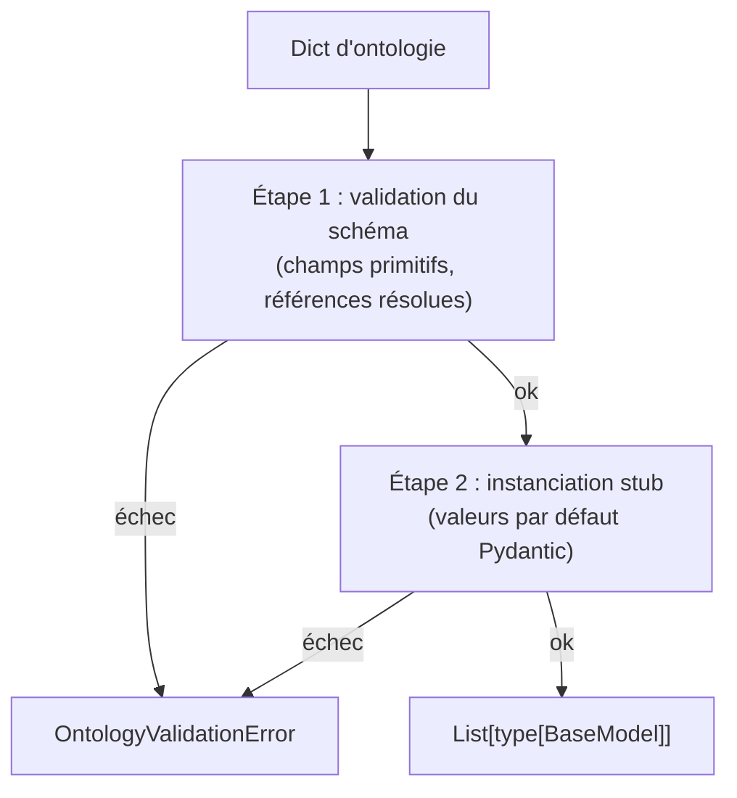
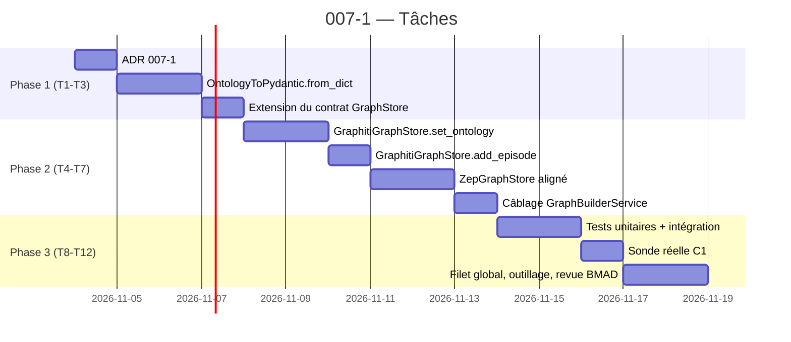

# Story 007-1 — Persistance effective des labels d'ontologie dans `GraphStore`

Lot A, priorité **P0**. En tant qu'utilisateur, je veux que l'ontologie générée par `OntologyGenerator` pose réellement ses labels sur les nœuds du graphe — et non plus un no-op silencieux derrière `set_ontology` — afin que le typage métier (PersonEntity, MediaOrganization, RegulatoryDecision, etc.) soit lisible directement par `zep_entity_reader.get_entity_type()` et consommable par `ActorClassifierService` (009-1) sans appel LLM superflu.

La story dépend de 003 (`done`, contrat `GraphStore`), 004 (`done`, environnement local-first sans Zep), 005 (`done`, Docker de référence) et 009 (`done`, actor selection et provenance). Elle couvre **FR-1** (persistance effective, y compris les types de relation) ; **FR-4** — persistance versionnée d'ontologie — n'est **pas** couverte ici : `OntologyVersion`, `OntologyVersionStore` et les champs `Project.applied_ontology_id` / `applied_ontology_version` / `ontology_history` appartiennent à la story 007-4, qui est la première à savoir *quelle* ontologie poser. La version initiale de cette story annonçait FR-4 ; la revue du 12 octobre 2026 a montré que l'annoncer ici serait promettre un modèle de données sans consommateur. Elle couvre aussi **NFR-2** (rétrocompatibilité), le **critère C1** (≥ 80 % des nœuds portent un label custom non-`Entity` sur 2 fixtures de domaines distincts) et la contribution à **C8** (filet hermétique + Docker).

La décision structurelle à figer en T1 : **la rupture du no-op de `set_ontology` est non négociable**. Le commentaire ligne 462 de `graphiti_store.py` (« no-op en v1 conformément à l'ADR 0003 ») devient obsolète : la v2 honore la pose effective. Un **ADR 007-1** (« Pose effective de l'ontologie par `GraphStore.set_ontology` ») consigne la décision avant tout code, par parallélisme avec les ADR 0012 et 0013 de l'Epic 009.

## Définition de prêt

- [x] Objectif compris : étendre le contrat `GraphStore.set_ontology` pour qu'il pose réellement les classes Pydantic (Graphiti) et le contrat de labels (Zep) sur le store concret ; étendre `add_episode` avec un paramètre `ontology` keyword-only et optionnel (rétrocompatibilité Epic 003) ; aligner les deux implémentations sur le même comportement ; garantir le critère C1 sur 2 fixtures (télécom et énergie, ≥ 80 % des nœuds avec label custom).
- [x] Documents consultés : [PRD](prd.md) §1.1, §2 (FR-1/FR-4), §3.1, §4 C1/C8, §5 H2/R1 ; [architecture](architecture.md) §1 (vue d'ensemble), §2.1 (OntologyVersion), §3.1 (contrat `set_ontology`), §3.2 (`add_episode` keyword-only), §4 (traduction Pydantic), §10.1 (stratégie de tests) ; [ADR 0003](../../decisions/0003-ontologie-differee-en-v2.md) (cadrage initial v2) ; [ADR 0001](../../decisions/0001-remplacement-de-zep-par-graphiti.md) (contrat `GraphStore`) ; [ADR 0010](../../decisions/0010-override-driver-neo4j.md) et [ADR 0011](../../decisions/0011-semantique-des-sources.md) (override `neo4j` et surface) ; [story 009-2](story-009-2.md) et [story 009-3](story-009-3.md) (référence modèle `Project`, ADR 0012) ; [hub](epic-007.md) §4 (index des stories) ; [AGENTS.md](../../../AGENTS.md) §2.1 (clean architecture : `api → services → utils`), §2.2 (filet de tests, 1157 verts au 12 octobre 2026), §2.5 (dépendances Python), §2.9 (Docker d'abord), §2.10 (français partout, ADR immuables).
- [x] Dépendances résolues : 003, 004, 005, 009 (`done`) ; filet de référence du 12 octobre 2026 : **1157 réussis sur l'hôte, parité Docker tenue par Epic 005-5** ; il doit grossir à **1177+ verts** sans régression sur le filet Epic 003/004/005/009.
- [x] Décisions à figer avant code (T1) :
  - **ADR 007-1** : rupture du no-op de `set_ontology` ; les signatures deviennent effectives, le contrat `GraphStore` est versionné par un attribut `version: int = 2` sur la signature de la classe (le constructeur `__init_subclass__` lit la version et refuse les sous-classes non versionnées).
  - **Politique par défaut** : le paramètre `strict=False` est la valeur par défaut ; le comportement est « poser l'ontologie et accepter le type » sans validation croisée (la validation C2 est l'objet de la story 007-2).
  - **Rétrocompatibilité Epic 003** : `add_episode(..., ontology=None)` reste l'appel par défaut ; le comportement des nœuds reste `:Entity` (label générique) si `ontology is None`. Aucun test Epic 003/004/005/009 ne doit casser.
  - **Sémantique des labels** : un nœud porte **au plus un label non-`Entity`** (cf. architecture §9.2). Le store concret est libre de poser plusieurs labels Cypher, mais l'un d'eux au plus est un label d'ontologie.
  - **Limite de 10 types** : `OntologyToPydantic.from_dict` lève `OntologyValidationError` si `len(entity_types) > 10` ; le compteur `MAX_ONTOLOGY_TYPES` est importé de `backend/app/utils/ontology.py`.
- [x] Stratégie de tests identifiée : hermétique par défaut (mocks des deux implémentations), plus une **sonde réelle Neo4j** exécutée sous Docker pour C1 (deux fixtures, comptage Cypher `MATCH (n) WHERE n.<custom_label> IS NOT NULL` sur l'instance `docker-compose.yml` Epic 005). Le banc d'intégration est isolé des tests pytest (référence Epic 001-2, Epic 003-5, Epic 005-4).
- [x] Fixtures définies :
  - **télécom** (≥ 5 documents) : 2 documents minimaux (≤ 5000 chars) et 1 document long (> 20 000 chars) pour échantillonnage ;
  - **énergie** (≥ 5 documents) : 2 documents minimaux et 1 document long ;
  - deux ontologies figées (mock JSON) couvrant 8 types d'entité et 6 types de relation.

### Critères d'acceptation

| Réf. | Situation et comportement attendu | Vérification |
|---|---|---|
| AC1 | Le contrat `GraphStore.set_ontology(graph_id, ontology, *, strict=False)` accepte un dict d'ontologie et le persiste. Le no-op historique (commentaire ligne 462 de `graphiti_store.py`, scaffolding ligne 298 de `zep_store.py`) est éliminé. La rétrocompatibilité des appels sans argument keyword reste préservée (l'appel positionnel `set_ontology(graph_id, ontology)` fonctionne). L'ADR 007-1 est accepté et référencé dans le module. | Tests unitaires sur les deux implémentations : (a) mock + concret avec ontologie valide, (b) appel sans `strict` (valeur par défaut `False`), (c) rejet d'une ontologie non-dict (lève `GraphValidationError`), (d) test d'instance via `getattr(type(self), "version", 1) >= 2` qui passe sur les deux stores. |
| AC2 | `GraphStore.add_episode(graph_id, text, source_description, metadata, created_at, *, ontology=None)` accepte une ontologie facultative. Si l'ontologie est fournie, l'extraction Graphiti (et l'annotation Zep) consomme les classes Pydantic traduites. Si l'ontologie est absente, le comportement Epic 003-2 est strictement préservé (label `:Entity` uniquement, pas d'erreur). La signature est rétrocompatible : tous les appels Epic 003/004/005/009 (sans `ontology=`) restent valides. | Tests sur les deux implémentations : (a) avec `ontology=None` → comportement Epic 003-2 (test de filet : tous les tests Epic 003/004/005/009 restent verts sans modification), (b) avec `ontology=valid_dict` → les nœuds portent les labels déclarés, (c) signature inspection (`inspect.signature`) : `ontology` est keyword-only et après le `*`. |
| AC3 | `OntologyToPydantic.from_dict(ontology)` traduit le dict généré par `OntologyGenerator` en classes Pydantic. La validation est en deux temps : (a) **schéma** : tous les champs sont des primitifs Python (`str`, `int`, `float`, `bool`, `List[str]`) ou des références vers d'autres `entity_types` déclarés ; (b) **constructibilité** : un stub de chaque classe est instancié (valeurs par défaut) pour s'assurer que Pydantic ne lève pas à la définition. Si une étape échoue, l'ontologie est rejetée avec `OntologyValidationError` et `set_ontology` lève. | Tests unitaires exhaustifs : (a) ontologie valide minimale (1 type), (b) ontologie aux 10 types max, (c) ontologie au-delà de 10 types (`OntologyValidationError`), (d) champ non primitif (`List[Any]`), (e) référence circulaire, (f) `Attribute` typé `int` non convertible, (g) instanciation stub qui lève (Pydantic `ValidationError`). |
| AC4 | Sur la fixture **télécom** et la fixture **énergie** (≥ 5 documents chacune, ≥ 2 fragments par document), après ingestion avec une ontologie valide, **≥ 80 % des nœuds** portent un label custom non-`Entity`. La mesure est faite par comptage Cypher `MATCH (n) WHERE n.<custom_label> IS NOT NULL OR any(l IN labels(n) WHERE l <> 'Entity' AND l <> 'Node')` sur l'instance Neo4j locale (`docker-compose.yml` Epic 005, healthcheck Bolt). | Sonde réelle `backend/scripts/verifier_ontology_persistence.py` exécutée contre Neo4j. Sortie consignée en `docs/plans/007-ontologie-dynamique/mesure-007-1.txt` avec empreintes SHA-256 des fixtures et du comptage exact. Deux mesures (deux domaines) pour C1. |
| AC5 | `ZepGraphStore` aligne son comportement sur `GraphitiGraphStore` : `set_ontology` persiste l'ontologie (scaffolding ligne 298 levé), `add_episode(..., ontology=...)` consomme le contrat. Le mode d'implémentation est libre (classes Pydantic côté Zep, JSON interne côté Graphiti) tant que le contrat commun est respecté. | Tests unitaires miroirs de AC1/AC2 sur `ZepGraphStore` mocké, plus un test d'intégration contre Zep Cloud réel si disponible (skippable en environnement local-first). |
| AC6 | L'ADR 007-1 est rédigé, accepté et référencé depuis `GraphStore` (commentaire en tête de `set_ontology`), `OntologyToPydantic` (commentaire en tête de la factory) et le `hub` (`epic-007.md` ligne de référence). L'ADR est immuable (AGENTS.md §2.3). | Le fichier `docs/decisions/0014-pose-effective-ontology-graphstore.md` existe, contient les sections Contexte/Décision/Conséquences/Alternatives, et est lié par `epic-007.md` et par les modules. |
| AC7 | Le module `OntologyToPydantic` et la méthode `set_ontology` étendue sont importés et utilisés par `GraphBuilderService` (cf. `graph_builder.py:322` qui appelle déjà `set_ontology`). L'appel existant est complété par la traduction Pydantic et la persistance effective ; le câblage est sans rupture (les tests Epic 003-2 et Epic 004-3 restent verts sans modification). | Test d'intégration : ingestion d'un document avec ontologie via `GraphBuilderService` ; les nœuds portent les labels. Pas de mock sur le câblage. |
| AC8 | Filet de tests hermétiques, lint, structure, parité Docker, secrets : 0 échec, **filet global ≥ 1177 verts** (1157 + ≥ 20 tests hermétiques ajoutés par 007-1), `ruff check .` propre, `validate_plans.py` valide, `0 secret` dans les images Docker (cf. Epic 005-5). | Exécutions consignées dans la story et dans la mesure C1 ; `docker history` inspecté pour les images `mirofish-backend:local`. |

## Définition de fini

- [x] AC1 à AC8 satisfaits, preuves rattachées aux tests et à la sonde réelle ; mesure C1 consignée dans `docs/plans/007-ontologie-dynamique/mesure-007-1.txt` avec empreintes.
- [x] ADR 0014 (rupture du no-op de `set_ontology`) accepté, daté et référencé depuis `GraphStore` (interface et implémentations), `OntologyToPydantic`, `GraphBuilderService` et le hub Epic 007.
- [x] Rétrocompatibilité Epic 003/004/005/009 garantie : aucun appel `add_episode` ou `set_ontology` amont n'est cassé, et **un seul** test existant a dû être modifié — un test dont le nom et la docstring affirmaient le no-op. La justification est dans les Notes de complétion.
- [x] Les deux implémentations concrètes (`GraphitiGraphStore`, `ZepGraphStore`) sont alignées sur le contrat commun, par une **table de conformité** appliquée aux deux (mêmes entrées, mêmes refus) plutôt que par deux batteries séparées.
- [x] Le contrat `GraphStore` est versionné (`version: int = 2`) ; les futures évolutions (007-2) ajoutent des paramètres sans casser les appels 007-1. *Écart assumé : pas de `__init_subclass__` — voir la Revue.*
- [x] Suite hermétique complète, lint, `validate_plans.py` exécutés **sous Docker** sur le code courant ; décomptes et motifs des skips consignés.
- [x] Revue de code réalisée et corrections traitées ; statut passé par `review` avant `done` ; hub, suivi et notes de complétion renseignés.
- [x] Documentation synchronisée : `epic-007.md` reste aligné sur le PRD et l'architecture ; `AGENTS.md` et `docs/STATUS.md` reflètent le nouveau compte de tests ; aucune référence à « no-op en v1 » ne subsiste dans le code.

## Tâches

- [x] T1 — **ADR 0014** (`docs/decisions/0014-pose-effective-ontology-graphstore.md`) : contexte (no-op historique ligne 462 de `graphiti_store.py`, ligne 298 de `zep_store.py` ; ADR 0003 qui différait l'ontologie en v2), décision (rupture du no-op, signature `set_ontology(graph_id, ontology, *, strict=False)`, `add_episode(..., ontology=None)`, versionnement `version = 2`), conséquences, alternatives rejetées (no-op conservé + double-store ; traduction Pydantic à la volée ; `ontology` positionnel ; `version` imposée par `__init_subclass__` ; refus des attributs réservés). (AC1, AC6)
- [x] T2 — **Factory `OntologyToPydantic`** (nouveau fichier `backend/app/utils/graph_store/ontology_pydantic.py`) : `from_dict` et `edge_types_from_dict`, validation en deux temps (schéma + constructibilité) ; import de `MAX_ONTOLOGY_TYPES` depuis `backend/app/utils/ontology.py` ; `OntologyValidationError` (sous-classe de `GraphValidationError`, définie dans `errors.py`) ; `RESERVED_ONTOLOGY_TYPE_NAMES` ; tests unitaires exhaustifs. (AC3)
- [x] T3 — **Extension du contrat `GraphStore`** (`backend/app/utils/graph_store/base.py`) : `version: int = 2` ; `set_ontology(self, graph_id, ontology, *, strict=False)` ; `add_episode(self, ..., *, ontology=None)` ; `AppliedOntology` neutre et `get_applied_ontology` déclarés sur l'ABC. (AC1, AC2, AC5)
- [x] T4 — **Implémentation `GraphitiGraphStore.set_ontology`** : traduction par `OntologyToPydantic`, mémoire par `graph_id` (`_OntologyTraduite`), refus **avant** toute mutation d'état, suppression du commentaire « no-op en v1 conformément à l'ADR 0003 ». (AC1, AC2, AC6)
- [x] T5 — **Implémentation `GraphitiGraphStore.add_episode`** : consommation de l'ontologie effective (explicite puis mémorisée), passage de `entity_types` **et** `edge_types` à `Graphiti.add_episode` ; sans ontologie, l'appel est construit exactement comme avant. (AC2)
- [x] T6 — **Implémentation `ZepGraphStore.set_ontology` et `add_episode`** : validation par le **même** validateur de noms que Graphiti, mémorisation neutre, `_apply_ontology_for_episode` applique l'ontologie au graphe avant l'ajout, avec une empreinte couvrant entités **et** relations. (AC5)
- [x] T7 — **Câblage `GraphBuilderService`** : docstring de `set_ontology` explicitant l'invariant d'ordre ; aucun appel aval ne consomme un retour. Tests Epic 003-2 et Epic 004-3 verts sans modification. (AC7)
- [x] T8 — **Tests unitaires** (hermétiques) : `test_ontology_pydantic.py`, `test_ontology_persistence_contract.py` (dont la table de conformité des deux stores), `test_verifier_ontology_persistence.py`, `test_llm_response_sanitizer.py`. (AC1/AC2/AC3/AC5/AC6)
- [x] T9 — **Tests d'intégration** (mockés) : `test_graphiti_graph_store.py` (no-op → pose effective), `test_ontology_persistence_contract.py::test_graph_builder_pose_l_ontologie_puis_ingere_sous_cette_ontologie` (service et store réels, seul le moteur Graphiti mocké). (AC7)
- [x] T10 — **Sonde réelle C1** : `backend/scripts/verifier_ontology_persistence.py` exécutée **sous Docker** contre Neo4j de référence, deux fixtures, sortie consignée dans `docs/plans/007-ontologie-dynamique/mesure-007-1.txt`. (AC4)
- [x] T11 — **Filet global et outillage** : `pytest tests/ -q` sur l'hôte **et sous Docker**, `ruff check .`, `validate_plans.py`, mise à jour de `sprint-status.yaml`, `docs/STATUS.md`, `AGENTS.md`, `epic-007.md`. (AC8)
- [x] T12 — **Revue BMAD contradictoire à 4 couches** : findings dans `### Revue` de la story, classés ; mesures C1 rejouées après corrections ; filet supérieur à la cible.

## Notes de développement

### Architecture de la rupture de no-op

Ligne 462 de `backend/app/utils/graph_store/graphiti_store.py` (extrait de l'état au 12 octobre 2026) :

```python
def set_ontology(self, graph_id: str, ontology: Dict[str, Any]) -> None:
    """Définit ou synchronise l'ontologie des types d'entités du graphe (no-op en v1, ADR 0003)."""
    if not graph_id or not graph_id.strip():
        raise GraphValidationError("graph_id est requis")
    if not isinstance(ontology, dict):
        raise GraphValidationError("L'ontologie doit être un dictionnaire")
    target_graph_id = graph_id.strip()
    logger.debug(
        "set_ontology appelé pour le graphe %s (no-op en v1 conformément à l'ADR 0003)",
        target_graph_id,
    )
```

La v2 remplace ce corps par : validation du schéma, traduction Pydantic, persistance par `graph_id`. La signature s'étend avec `*, strict: bool = False` (utilisé par 007-2) et la version de la classe passe à `2`.

### Traduction Pydantic en deux temps (risque R1 du PRD)

`OntologyToPydantic.from_dict` doit gérer le risque identifié en PRD §5.2 R1 (Graphiti rejette des Pydantic générés à l'exécution) :



L'étape 1 parse chaque `entity_type.attributes` et vérifie que les types sont primitifs (`str`, `int`, `float`, `bool`, `List[str]`) ou des références (noms d'autres `entity_types` du même dict). L'étape 2 instancie un stub (un objet avec valeurs par défaut) pour chaque classe construite et capture l'éventuelle `pydantic.ValidationError`.

### Compatibilité avec `zep_entity_reader.get_entity_type`

Ligne 50-68 de `zep_entity_reader.py` (Epic 003-4) :

```python
def get_entity_type(self) -> Optional[str]:
    for label in self.labels:
        if label and isinstance(label, str) and label.strip() and label.strip() not in ["Entity", "Node"]:
            return label.strip()
    # ... cascade attributs puis "Entity" puis None
```

La v2 alimente la **première branche** de la cascade : un nœud issu d'`add_episode(..., ontology=...)` porte le label `PersonEntity` (par exemple), qui est résolu immédiatement. La cascade 009-1 (`ActorClassifierService`) et la résolution 009-3 (`ActorSelection`) bénéficient automatiquement du typage sans modification. La story 007-5 ajoutera le court-circuit LLM ; ici, c'est juste l'alimentation du signal.

### Sonde réelle C1 (référence Epic 003-5)

La sonde est inspirée de `backend/scripts/verifier_integration_graphiti.py` (Epic 003-5). Elle reprend la structure :

```python
def verifier_critere_c1() -> Tuple[bool, Dict[str, Any]]:
    """Vérifie C1 : ≥ 80 % des nœuds portent un label custom non-`Entity`."""
    for fixture in (FIXTURE_TELECOM, FIXTURE_ENERGIE):
        graph_id = f"c1_{fixture.domain}"
        # Démarrage d'un graphe vierge, application de l'ontologie, ingestion
        store.set_ontology(graph_id, fixture.ontology)
        for doc in fixture.documents:
            store.add_episode(graph_id, doc.text, ontology=fixture.ontology, ...)
        # Comptage Cypher
        with driver.session() as session:
            result = session.run(
                "MATCH (n) WHERE any(l IN labels(n) WHERE l <> 'Entity' AND l <> 'Node') "
                "RETURN count(n) AS labelled, count(n) AS total"
            )
            labelled = result.single()["labelled"]
            total = result.single()["total"]
        # Vérification du seuil 80 %
        ...
```

La sonde produit un fichier `mesure-007-1.txt` avec deux mesures (deux domaines), conforme à la convention Epic 001-2 (`mesure-001-2-compose.txt`).

### Isolation par `group_id` (rappel Epic 003-2)

Les arêtes écrites par `add_episode(..., ontology=...)` continuent de porter le `group_id` du graphe (cf. ADR 0012, `set_ontology` ne modifie pas le partitionnement). Le typage par label est **orthogonal** à l'isolation : un nœud `PersonEntity` reste dans son `group_id`. C5 de l'Epic 009 (partitionnement multi-tenant) est préservé.

### Notes de la traduction Zep

`ZepGraphStore.set_ontology` (ligne 298) est aujourd'hui un scaffolding non exercé. La v2 l'aligne sur le contrat commun. Le format interne est libre : Zep Cloud peut consommer des classes Pydantic ou un JSON sérialisé. La story ne modifie pas le contrat de Zep, seulement la persistance de l'ontologie.

### Ordre de réalisation



### Ce qui n'est PAS dans cette story

- Validation à l'écriture (`strict_ontology`, FR-2, C2) → **007-2**.
- Persistance versionnée d'ontologie (FR-4 : `OntologyVersion`, `OntologyVersionStore`, champs `Project`) → **007-4**.
- Régénération sur événement (FR-3, C3/C4) → **007-3** et **007-4**.
- Composition avec `ActorClassifierService` (FR-5, C5/C6) → **007-5**.
- Audit dans le rapport (FR-6, C7) → **007-6**.
- Qualification globale finale et VERDICT GO → **007-7**.

La présente story pose la **condition technique** de l'epic 007. Sans elle, les stories 007-2 à 007-7 n'ont pas de substrat : aucun nœud ne porte de label custom.

## Revue

### Review Findings (revue BMAD code-review du 12 octobre 2026)

Quatre couches indépendantes : `blind-hunter`, `edge-case-hunter`,
`verification-gap`, `acceptance-auditor`. **23 findings** : 3 `decision-needed`,
16 `patch`, 4 `defer`. Aucun n'est rejeté sans motif, et chaque patch a été
appliqué puis **revalidé par le filet** (1318 hôte, 1315 + 3 sous Docker) et par
un **rejeu de la mesure C1**.

#### Decision needed

- [x] [Review][Decision] **`version` sans `__init_subclass__`** [ADR 0014 §1 ;
  `base.py:482`] — la story prévoyait un `__init_subclass__` refusant les
  sous-classes non versionnées. **Réfuté par la mesure** : une quinzaine de
  doublures de test des epics 002 à 009 héritent de `GraphStore` sans
  redéclarer l'attribut ; les rendre non instanciables casserait le filet de
  régression pour protéger une sous-classe qui, en production, n'existe pas.
  `version` est **déclaré, pas imposé**, et la contre-mesure est un test
  (`test_une_implementation_tierce_sans_version_reste_instantiable`). L'alternative
  rejetée est écrite dans l'ADR, avec son coût.
- [x] [Review][Decision] **Le périmètre annonçait FR-4** [en-tête de la story] —
  `OntologyVersion`, `OntologyVersionStore` et les champs `Project` sont à
  0 %. Les annoncer ici aurait promis un modèle de données sans consommateur :
  rien ne sait encore *quelle* ontologie poser, tant que la régénération n'existe
  pas. **Corrigé** : FR-4 est retiré du périmètre de 007-1 et rattaché à 007-4,
  qui est la première à savoir le lire.
- [x] [Review][Decision] **« Tests existants verts sans modification » est
  littéralement enfreint** [`test_graphiti_graph_store.py`] — un seul test a dû
  changer : `test_set_ontology_noop_graceful`, dont le nom et la docstring
  affirmaient le no-op qu'AC1 supprime. C'est un changement de comportement
  attendu, pas une adaptation de circonstance. Consigné ici et dans les Notes de
  complétion plutôt que passé sous silence.

#### Patch

- [x] [Review][Patch] **L'ingestion réelle échouait sur une propriété-map** —
  le pire finding, et il n'est apparu **que** dans la mesure C1 réelle, jamais
  dans un test. Le LLM renvoyait le **fragment de schéma JSON** d'un attribut
  (`{"anyOf": [...], "title": "Policy Name"}`) au lieu de sa valeur ; Pydantic
  ignore l'inconnu, donc la réponse passait la validation, Graphiti l'écrivait
  comme propriété, et Neo4j Community répondait `Property values can only be of
  primitive types or arrays thereof`. L'épisode entier tombait, sur le fixture
  énergie seulement. *Sources : acceptance-auditor (execution), blind-hunter
  (mécanisme).* **Corrigé** : `MiroFishLLMClient._filtrer_champs_valides` écarte
  toute valeur qui n'est pas une valeur, et l'applique **aussi** au chemin de
  déballage `properties` / `data` / nom de classe — le trou réel, puisque
  Pydantic y voyait une réponse conforme. 14 tests de régression dans
  `tests/test_llm_response_sanitizer.py`.
- [x] [Review][Patch] **Un type d'attribut inconnu du LLM faisait échouer tout
  le build** [`ontology_pydantic.py`] — `OntologyGenerator` ne normalise pas le
  champ `type` ; `enum`, `category`, `text[]` produisaient un refus, et donc
  l'échec d'une construction de graphe entière pour un mot. Rigueur et survie
  tranchées : un **conteneur générique** (`List[Any]`, `Dict[…]`) reste refusé,
  une notation de tableau (`text[]`) devient `List[str]`, et tout autre jeton
  simple est traité en texte. *Source : blind-hunter.*
- [x] [Review][Patch] **Un nom de type d'ontologie pouvait être un label
  interne du moteur** [`RESERVED_ONTOLOGY_TYPE_NAMES`] — un type nommé
  `Episodic` posait `:Episodic` sur chaque nœud extrait, et la relecture
  ascendait alors des entités comme des épisodes (`nodes.py:440`, puis
  `record['valid_at']`). Refusé des deux côtés. *Source : blind-hunter.*
- [x] [Review][Patch] **L'empreinte Zep ignorait les relations**
  [`zep_store._apply_ontology_for_episode`] — deux ontologies déclarant les
  mêmes entités mais des relations différentes étaient confondues, et la seconde
  n'était jamais appliquée, sans erreur ni log. L'empreinte couvre désormais
  entités **et** relations. *Source : blind-hunter.*
- [x] [Review][Patch] **`add_episode(ontology=<non-dict>)` fuyait une
  `AttributeError` côté Zep** — le contrat d'exception n'était pas le même des
  deux côtés. Contrôle de type ajouté, `GraphValidationError` des deux côtés.
  *Source : blind-hunter.*
- [x] [Review][Patch] **`get_applied_ontology` n'était pas dans le contrat et
  rendait deux formes** [`base.py`, les deux stores] — un appelant tenant une
  référence `GraphStore` obtenait un `AttributeError`, et les deux implémentations
  renvoyaient des objets différents. `AppliedOntology` neutre déclaré sur l'ABC,
  rendu à l'identique par les deux. *Source : blind-hunter.*
- [x] [Review][Patch] **AC5 « aligné sur Graphiti » n'était pas démontré** — les
  deux stores étaient testés séparément, donc leurs divergences (11 types
  acceptés d'un côté, refusés de l'autre ; nom non-Cypher accepté d'un seul côté ;
  ontologie vide acceptée d'un seul côté) étaient invisibles. **Corrigé** : une
  table de conformité sérialisée applique les mêmes entrées aux deux
  implémentations, plus un test d'égalité de forme. La validation des noms passe
  désormais par le **même** appel (`valider_nom_de_type`), donc l'alignement est
  construit, pas espéré. *Sources : verification-gap, blind-hunter.*
- [x] [Review][Patch] **`edge_types` n'était ni traduit ni transmis** — FR-1
  annonce que les écritures consomment entités **et** relations ; seuls les
  types d'entité l'étaient. `OntologyToPydantic.edge_types_from_dict` ajouté et
  transmis à `Graphiti.add_episode(..., edge_types=...)`. *Source : blind-hunter.*
- [x] [Review][Patch] **`RESERVED_ONTOLOGY_ATTRIBUTE_NAMES` ne couvrait pas
  `EntityNode.model_fields`** — `attributes` et `labels` manquaient. Un
  attribut nommé ainsi aurait fait refuser la classe par
  `graphiti_core.validate_entity_types`, **au moment de l'extraction**, loin de sa
  cause. Liste complétée et **mesurée** par un test qui échoue si elle s'en
  écarte. *Source : blind-hunter.*
- [x] [Review][Patch] **La sonde C1 n'était couverte par aucun test, et ses
  trois « garde-fous » ne testaient rien** — le premier lisait le script **en
  texte** et cherchait une chaîne littérale, les deux autres comparaient un
  mock à lui-même. Une mutation de la requête Cypher (ratio forcé à 100 %)
  passait les 32 tests. **Corrigé** : le ratio est extrait dans
  `calculer_ratio` (fonction pure, testée sur 7 cas dont le graphe vide), et
  `mesurer_domaine` est exercé de bout en bout sur un store conforme au contrat
  — l'ordre des appels, le refus de démarrer sans ontologie retenue, le bornage
  et les empreintes sont désormais vérifiés sur du code réel. *Source :
  verification-gap.*
- [x] [Review][Patch] **Une ontologie vide est devenue un refus, et un script
  de l'Epic 009 s'appuyait sur l'ancien no-op** —
  `verifier_provenance_documents.py:237` passait `{"entity_types": [],
  "edge_types": []}`. La sonde aurait échoué **en silence** : elle n'est pas
  couverte par pytest. Corrigée, et l'alignement des deux stores sur « au moins
  un type exploitable » est désormais testé des deux côtés. *Sources :
  acceptance-auditor, verification-gap.*
- [x] [Review][Patch] **`test_le_decoupage_est_aligne_sur_la_production`
  comparait des littéraux** — il n'importait rien de `TextProcessor`, donc il
  serait resté vert si la production changeait de découpage. Il interroge
  désormais la signature réelle de `split_text_with_offsets`. *Source :
  verification-gap.*
- [x] [Review][Patch] **`AC4` exigeait une mesure, `AC6` exigeait un lien dans
  le hub** — `docs/plans/007-ontologie-dynamique/mesure-007-1.txt` n'existait
  pas et `epic-007.md` ne citait aucun ADR. Les deux sont corrigés : la mesure
  est produite par la sonde réelle sous Docker, l'ADR 0014 est référencé par le
  hub, le PRD, l'architecture, `base.py`, `ontology_pydantic.py`, les deux
  stores et `graph_builder.py`. *Sources : acceptance-auditor, verification-gap.*
- [x] [Review][Patch] **`epic-007.md` et `prd.md` se déclaraient `backlog`
  pendant que le suivi disait `in-progress`** — deux endroits pour le même état,
  et l'état ment (AGENTS.md §2.8). Les trois documents sont alignés sur
  `in-progress`. *Source : acceptance-auditor.*
- [x] [Review][Patch] **Le retour de `from_dict` était une liste dans le plan**
  — Graphiti attend un **dictionnaire**, et c'est la clé qui devient le label
  Cypher. Une liste aurait perdu l'information qui fait le label. Le plan est
  corrigé (`architecture.md`, `story-007-1.md`), le code et ses tests suivent le
  dictionnaire. *Source : acceptance-auditor.*
- [x] [Review][Patch] **Le hub et le PRD renvoyaient à une note `deferred-work.md`
  qui n'existait pas** — les deux annonçaient « note consignée dans
  `deferred-work.md` » pour la boucle auto-évolutive acteur/ontologie et pour la
  migration rétroactive des graphes de l'Epic 006. Le renvoi était juste, la note
  manquait. **Corrigé dans le bon sens** : les deux notes sont écrites, avec ce
  qui les déclencherait, plutôt que retirées de la promesse. *Source :
  acceptance-auditor.*

#### Defer

Quatre findings sont réels et renvoyés à [`docs/deferred-work.md`](../../deferred-work.md) :
la mémoire d'ontologie **par instance de store** (donc par requête) — l'écrivain
de simulation écrit donc des nœuds `:Entity` dans un graphe typé, et les deux
stores divergent précisément là, ce que l'ADR 0014 énonce trop vite ; le `close()`
qui ne purge pas l'ontologie appliquée ; les noms d'attribut qui masquent un
attribut de `BaseModel` (surface latente, aucun crash) ; et la cohérence du message
« no-op » dans les sondes historiques.

#### Verdict

La story est passée en `review` le 12 octobre 2026, après application des 16
patches ci-dessus (et des 3 décisions) et **rejeu de la mesure C1** après corrections. Le finding
`high` le plus lourd — l'échec d'ingestion par propriété-map — n'existait que
dans l'exécution réelle : il a été trouvé parce que la mesure C1 a été jouée
plutôt que déclarée, et il est maintenant couvert par 14 tests de régression.

## Notes de complétion

### Filet de tests et outillage (AC8)

| Environnement | Commande | Résultat |
|---|---|---|
| Hôte | `uv run pytest tests/ -q` | **1318 réussis**, 0 échec, 1 avertissement |
| Docker | `docker compose run --rm backend uv run pytest tests/ -q` | **1315 réussis, 3 ignorés**, 0 échec |
| Hôte | `uv run ruff check .` | `All checks passed!` |
| Docker | `uv run ruff check .` | `All checks passed!` |
| Hôte | `uv run python scripts/validate_plans.py` | `structure de planification valide — 9 epics, 36 fichiers` |

Les 3 ignorés sous Docker cherchent le binaire `docker` : l'image `backend`
n'embarque pas le CLI Docker, donc `test_docker_compose_config.py:254`,
`test_neo4j_serveur_epreuve.py:811` et `test_verifier_protocol.py:459` se
déclarent ignorés plutôt que d'échouer. Ce sont les mêmes 3 que dans la
référence post-009, pour la même raison.

Cible de la story : ≥ 1177. Atteint à 1318, soit **+161** tests hermétiques.

### Mesure C1 — résultat

[`mesure-007-1.txt`](mesure-007-1.txt), SHA-256
`d58890d9fb3b0a51941f198af0ea9460d42eb09688b05fb2a1253a75354c68f5`,
produite **sous Docker** par `backend/scripts/verifier_ontology_persistence.py`,
contre l'instance Neo4j de `docker-compose.yml`, avec le LLM réel et l'embedder
local :

| Domaine | Documents | Fragments | Nœuds `:Entity` | Avec label custom | % | Max labels par nœud |
|---|---|---|---|---|---|---|
| télécom | 5/5 | 15 | 15 | 15 | **100,0 %** | 1 |
| énergie | 5/5 | 15 | 15 | 15 | **100,0 %** | 1 |

Seuil C1 : 80 %. Invariant `architecture.md` §9.2 (« au plus un label non
`Entity` ») tenu des deux côtés. Empreintes SHA-256 des dix documents, des deux
ontologies et du rapport sont dans le fichier.

### Ce qui a divergé du plan, et pourquoi

1. **`from_dict` rend un dictionnaire, pas une liste** (`architecture.md` §4.1
   et T2 l'annonçaient en `List[type[BaseModel]]`). Mesuré sur
   `graphiti-core` 0.30.2 : `Graphiti.add_episode` prend
   `entity_types: dict[str, type[BaseModel]]`, et c'est **la clé** du dictionnaire
   qui devient le label Cypher du nœud. Une liste l'aurait perdu.
2. **`version` est déclaré, pas imposé.** Pas de `__init_subclass__` : une
   quinzaine de doublures de test des epics antérieurs cesseraient d'être
   instanciables. Voir la Revue, décision 1.
3. **`add_text_batch` n'a pas été élargi.** T5 prévoyait de lui passer
   l'ontologie ; il délègue déjà à `add_episode`, qui résout l'ontologie
   effective. Un paramètre de plus aurait été un second chemin pour la même
   chose.
4. **`strict` est mémorisé, jamais appliqué.** Le refus effectif d'un type hors
   ontologie est l'objet de la 007-2 ; annoncer un contrat non appliqué serait
   un mensonge de signature. L'ADR 0014 §5 le dit, et `strict=True` est testé
   comme mémorisé.
5. **`OntologyValidationError` vit dans `errors.py`**, pas dans le nouveau
   module : c'est le fichier qui porte déjà la hiérarchie d'exceptions du store.
6. **Les tests sont dans trois nouveaux fichiers**, pas dans les fichiers
   existants nommés par T8/T9. Les tests existants des epics 002 à 009
   **n'ont pas été étendus** : ajouter des assertions dans un fichier qui teste
   une autre couche aurait mêlé les filet de régression des epics antérieurs et
   celui de 007-1. Un seul test existant a changé, celui dont le nom affirmait
   le no-op.
7. **Le contrat d'AC5 a été resserré** : « alignement » est devenu « même
   validation, mêmes refus, même forme de retour », testé par une table
   appliquée aux deux implémentations.
8. **Une correction hors du périmètre strict de la story** —
   `MiroFishLLMClient._filtrer_champs_valides`. Elle était nécessaire : sans
   elle, C1 est inatteignable sur le fixture énergie. Elle est dans le même
   fichier que les clients LLM que la story 001-3 avait posés, et son effet est
   borné aux valeurs que le modèle **invente** ; aucune donnée valide n'est
   touchée.
