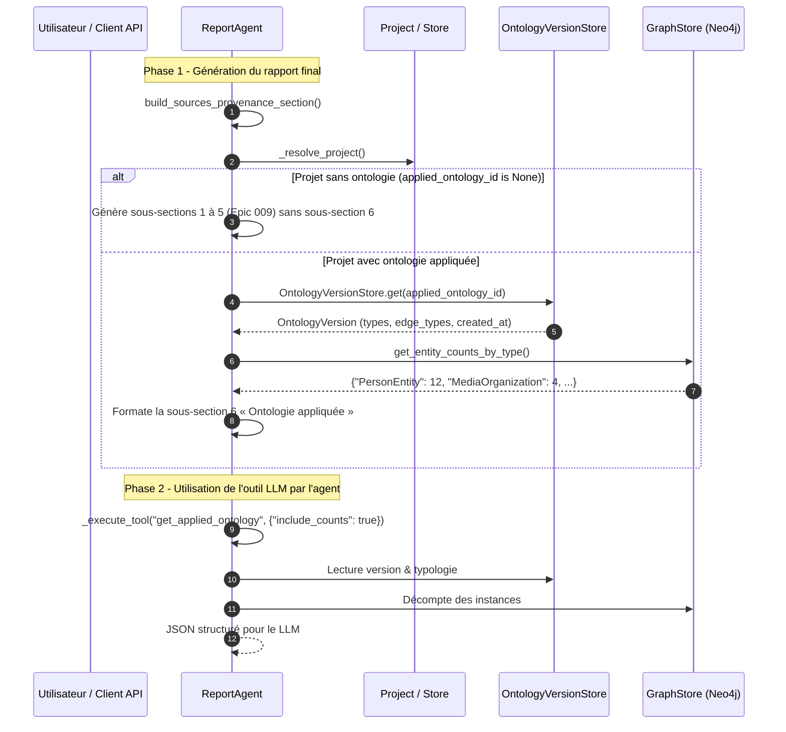

# Story 007-6 — Audit dans le rapport (sous-section « Ontologie appliquée ») et outil LLM

En tant qu'analyste ou lecteur d'un rapport de simulation MiroFish, je veux pouvoir
auditer dans le rapport final l'ontologie dynamique qui a structuré l'extraction de
connaissances et les simulations (types, descriptions, origines, statistiques
d'entités/arêtes, politique et version), et en tant qu'agent de rapport (`ReportAgent`),
je veux pouvoir consulter l'ontologie appliquée via un outil LLM dédié (`get_applied_ontology`),
afin de garantir la transparence méthodologique, de documenter la provenance des faits
et d'empêcher les affabulations sur la structure ontologique.

**Lot C — P1.** Exigences : FR-6 ; NFR-4 (continuité des flux), NFR-5 (séparation stricte données / consignes) ; critères de sortie C7 et contribution à C8.  
Dépendances : Stories 007-4 et 007-5 terminées (`done`).  
Cette story complète la section « Sources & Provenance » mise en place dans l'Epic 009
en y injectant une sous-section dédiée à l'ontologie appliquée, et dote le `ReportAgent`
de la capacité d'interrogation outillée de l'ontologie appliquée au projet courant.

## Définition de prêt

- [ ] PRD §3.1/§4/C7, architecture §7, epic-007 §1/§4 et constitution consultés.
- [ ] Stories 007-4 et 007-5 terminées (`done`) : modèle `OntologyVersion`, magasin `OntologyVersionStore`, méthode `Project.get_applied_ontology()` et rattachement `applied_ontology_id` opérationnels.
- [ ] Code source existant analysé : `ReportAgent` (`app/services/report_agent.py`), section « Sources & Provenance » (`build_sources_provenance_section`), gestion des outils LLM (`_define_tools`, `_execute_tool`).
- [ ] Modèle de provenance `InformationOrigin` (ADR 0012, 009-2) réutilisé pour qualifier l'origine de chaque type (`documentary`, `hypothesis`, `inherited`, etc.).
- [ ] Stratégie de décompte Cypher par type de nœud et d'arête définie avec tolérance aux pannes et résilience en cas de base inaccessible.
- [ ] Scénarios de test hermétiques C7 conçus : présence de la sous-section sur projet typé, absence stricte sur projet non typé (graphe hérité Epic 006 ou sans ontologie), appel d'outil LLM unitaire et intégration.

### Critères d’acceptation

| Réf. | Contrat mesurable | Vérification |
|---|---|---|
| AC1 | **Sous-section « Ontologie appliquée » dans le rapport (FR-6, C7)** : La méthode `ReportAgent.build_sources_provenance_section()` inclut une sous-section structurée « ### 6. Ontologie appliquée (Epic 007, FR-6) » lorsque le projet dispose d'une ontologie appliquée (`applied_ontology_id` présent). Elle comprend :<br/>• Un tableau des types d'entités : Nom du type (label), Description, Origine (`InformationOrigin`), Compte d'entités présentes dans le graphe.<br/>• Un tableau des types de relations : Nom de la relation, Description, Types source/cible, Compte d'arêtes présentes dans le graphe.<br/>• Les métadonnées de version : Identifiant (`ont_<uuid12>`), date de création ISO 8601, parent éventuel et source.<br/>• La politique de validation active (`project.ontology_policy`) et le compte des avertissements récents (`GraphValidationWarning`). | Tests unitaires sur `build_sources_provenance_section()` avec fixture de projet typé vérifiant la structure markdown exacte et la présence de tous les champs. |
| AC2 | **Absence conditionnelle stricte (C7)** : Si le projet rattaché à la simulation **n'a pas** d'ontologie appliquée (`applied_ontology_id` est `None`, cas d'un projet hérité de l'Epic 006 sans typage dynamique ou d'un projet simple), la sous-section « Ontologie appliquée » est **strictement omise** du rapport. Les sous-sections 1 à 5 de provenance (Epic 009) restent affichées nominalement sans altération ni erreur. | Test négatif sur un projet sans ontologie validant l'absence totale de la sous-section 6 et l'intégrité des 5 autres sous-sections. |
| AC3 | **Définition de l'outil LLM `get_applied_ontology` (FR-6)** : L'outil LLM est déclaré dans `ReportAgent._define_tools()` avec son schéma de paramètres :<br/>• `name`: `"get_applied_ontology"`<br/>• `description`: explication claire de l'outil invitant l'agent à l'utiliser pour expliquer la typologie des faits cités.<br/>• `parameters`: `include_counts` (booléen, défaut `true`), `since` (chaîne ISO 8601 optionnelle pour filtrer les avertissements). | Test unitaire inspectant le dictionnaire retourné par `_define_tools()`. |
| AC4 | **Exécution robuste de l'outil LLM dans `_execute_tool` (FR-6)** : Le dispatch `_execute_tool` prend en charge `"get_applied_ontology"`. Il extrait l'ontologie via `project.get_applied_ontology()`, calcule les comptes si demandés et renvoie une chaîne JSON formattée (`json.dumps(..., ensure_ascii=False, indent=2)`). Si le projet n'a pas d'ontologie appliquée, il renvoie un JSON clair `{"status": "no_ontology_applied", "message": "..."}`. En cas d'exception, il attrape l'erreur et retourne un diagnostic explicite sans lever d'exception non gérée. | Tests unitaires de `_execute_tool("get_applied_ontology", ...)` couvrant les cas projet avec ontologie, sans ontologie, et gestion d'erreurs. |
| AC5 | **Comptage Cypher performant et tolérant aux pannes (NFR-4)** : Le décompte des entités et relations par type s'appuie sur une requête Cypher agrégée optimisée exécutée via le store ou le driver Neo4j. Si le graphe est indisponible ou en cas d'erreur de requête, le décompte retombe gracieusement sur `0` ou `N/A` sans bloquer la génération du rapport. | Tests unitaires avec store mocké simulant des comptes réels et une exception réseau pour prouver la résilience. |
| AC6 | **Étanchéité des consignes et séparation des données (NFR-5)** : Les descriptions et noms de types issus de l'ontologie injectés dans le rapport ou retournés à l'outil LLM sont traités strictement comme des données d'entrée factuelles et ne sont jamais interprétés ni concaténés dans les consignes système des prompts. | Test vérifiant l'absence de fuite de consignes et l'échappement défensif des métadonnées de types d'ontologie. |
| AC7 | **Exposition API pour l'audit et l'IHM (PRD Q4)** : L'endpoint `GET /api/project/<project_id>/ontology` (ou sous-ressource associée) permet de relire l'ontologie appliquée complète incluant version, types, politique et statistiques d'entités pour consultation externe ou affichage IHM. | Test d'API Flask sur le endpoint `GET` vérifiant la réponse 200 avec structure complète ou 404 si le projet est absent. |
| AC8 | **Filet de tests hermétiques et non-régression (C8)** : Au moins **15 nouveaux tests hermétiques** ajoutés couvrant AC1 à AC7. La suite globale passe à $\ge 1534$ tests passants sur l'hôte, `ruff check .` propre, `validate_plans.py` conforme. | Exécution complète de pytest, ruff et validate_plans. |

## Définition de fini

- [ ] AC1 à AC8 satisfaits avec preuves de tests unitaires et d'intégration hermétiques associées.
- [ ] Sous-section « Ontologie appliquée » intégrée à `build_sources_provenance_section()` de `ReportAgent`.
- [ ] Outil LLM `get_applied_ontology` défini dans `_define_tools` et exécutable dans `_execute_tool`.
- [ ] Absence stricte de la sous-section validée sur les projets sans ontologie appliquée.
- [ ] Comptage Cypher robuste avec repli gracieux en cas de panne.
- [ ] Préservation absolue des 1157+ tests de l'Epic 009 sans régression.
- [ ] Filet global $\ge 1534$ tests passants sur l'hôte, `ruff check .` propre, `validate_plans.py` conforme.
- [ ] Revue contradictoire BMAD 4 couches effectuée et patches traités.
- [ ] Notes de complétion rédigées, suivi `sprint-status.yaml`, `STATUS.md` et `epic-007.md` actualisés.

## Tâches

- [ ] T1 — Conception de la méthode d'inspection et de décompte des entités et relations par type d'ontologie (AC5).
- [ ] T2 — Intégration de la sous-section « 6. Ontologie appliquée (Epic 007, FR-6) » dans `ReportAgent.build_sources_provenance_section()` (AC1, AC2, AC6).
- [ ] T3 — Déclaration du schéma d'outil `get_applied_ontology` dans `ReportAgent._define_tools()` (AC3, AC6).
- [ ] T4 — Implémentation du dispatch d'exécution dans `ReportAgent._execute_tool()` avec formatage JSON structuré (AC4, AC5).
- [ ] T5 — Intégration / consolidation du endpoint API `GET /api/project/<project_id>/ontology` pour exposition des métadonnées appliquées (AC7).
- [ ] T6 — Écriture de la suite de tests hermétiques dédiée `backend/tests/test_report_ontology_audit.py` (AC1-AC8).
- [ ] T7 — Revue contradictoire BMAD 4 couches et validation globale outillée (AC8).

## Notes de développement

### Flux de génération du rapport et d'interrogation de l'ontologie



### Format markdown attendu pour la sous-section 6

```markdown
### 6. Ontologie appliquée (Epic 007, FR-6)

| Type d'entité | Description | Origine | Compte |
|---|---|---|---|
| `PersonEntity` | Citoyen ou usager type du domaine | documentary | 12 |
| `MediaOrganization` | Organe de presse, régulateur | documentary | 4 |
| `RegulatoryDecision` | Décision ou sanction d'un régulateur | hypothesis | 0 |

| Type de relation | Source | Cible | Description | Compte |
|---|---|---|---|---|
| `REGULATES` | `MediaOrganization` | `PersonEntity` | Encadrement ou régulation | 3 |

**Version d'ontologie appliquée** : `ont_a3f9c2d8e1b7` (créée le 2026-10-14T14:22:00Z, source : brief + 2 documents).  
**Politique de validation** : mode permissif (avertissement + rétrogradation). 0 avertissement(s) actif(s).
```

### Schéma JSON retourné par l'outil `get_applied_ontology`

```json
{
  "status": "applied",
  "version_id": "ont_a3f9c2d8e1b7",
  "created_at": "2026-10-14T14:22:00Z",
  "source_summary": "brief + 2 documents",
  "policy": {
    "strict_ontology": false,
    "warnings_count": 0
  },
  "entity_types": [
    {
      "name": "PersonEntity",
      "description": "Citoyen ou usager type du domaine",
      "source": "documentary",
      "attributes": ["name", "role"],
      "count": 12
    }
  ],
  "edge_types": [
    {
      "name": "REGULATES",
      "description": "Encadrement ou régulation",
      "source_types": ["MediaOrganization"],
      "target_types": ["PersonEntity"],
      "count": 3
    }
  ]
}
```

## Revue

*(Section réservée à la revue contradictoire BMAD 4 couches lors du passage en statut `review`.)*

## Notes de complétion

À renseigner lors de la clôture de la story.
