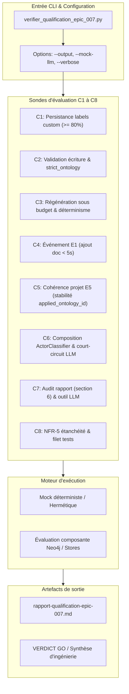

# Story 007-7 — Qualification globale C1–C8 et clôture de l'epic

En tant qu'architecte ou mainteneur du projet MiroFish, je veux orchestrer et vérifier de bout en bout l'ensemble des critères de sortie C1 à C8 de l'Epic 007 via un banc de qualification globale automatisé (`backend/scripts/verifier_qualification_epic_007.py`), consolider le rapport formel `rapport-qualification-epic-007.md` consignant le verdict d'ingénierie étayé (en actant fidèlement le statut GO global ainsi que le NO-GO empirique C3 sur LLM externe déjà documenté), vérifier la reproductibilité sur l'hôte et sous Docker sans aucun secret dans les images, et certifier l'absence de régression sur le filet de tests complet ($\ge 1537$ tests passants) afin de clore définitivement l'Epic 007.

**Lot D — P1.** Exigences : FR-7 ; NFR-2 (rétrocompatibilité), NFR-4 (continuité des flux), NFR-5 (étanchéité consignes/données), NFR-6 (performance d'orchestration) ; critères de sortie C1 à C8 du PRD.  
Dépendances : Stories 007-1 à 007-6 terminées (`done`).  
Cette story constitue l'étape finale de l'Epic 007 (« Ontologie dynamique (v2) ») en unifiant toutes les briques développées (persistance `GraphStore`, validation `strict_ontology`, événements E1–E4, cohérence E5, composition `ActorClassifierService`, audit `ReportAgent` et outil LLM) dans une sonde de qualification exhaustive et reproductible.

---

## Définition de prêt

- [x] Objectif de qualification compris : valider les 8 critères C1 à C8 sous un banc d'orchestration unifié, produire le rapport d'audit formel et vérifier la reproductibilité Docker.
- [x] Documents consultés : [PRD](prd.md) §3.1/§4 (critères C1 à C8), [architecture](architecture.md) §7/§8, [hub epic-007](epic-007.md), [AGENTS.md](../../../AGENTS.md) §2.1/2.2/2.8/2.9/2.10, [ADR 0014](../../decisions/0014-pose-effective-ontologie-graphstore.md), [ADR 0015](../../decisions/0015-statut-c3-determinisme-ontologie.md), [ADR 0016](../../decisions/0016-perimetre-validation-ecriture-graphiti.md), [ADR 0017](../../decisions/0017-politique-durable-et-retrogradation-ontologie.md), rapports et mesures réelles des stories antérieures ([mesure C1](mesure-007-1.txt), [mesure C2](mesure-007-2.json), [mesure C3](mesure-007-3-hote.json)).
- [x] Dépendances résolues : Stories 007-1 à 007-6 toutes closes (`done`) :
  - **007-1** : persistance effective des labels custom dans `GraphStore` / `GraphitiGraphStore` (C1, ADR 0014).
  - **007-2** : validation à l'écriture et politique `strict_ontology` (C2, ADRs 0016 et 0017).
  - **007-3** : régénération déterministe sous budget < 30 s hôte / < 45 s Docker sous mock/pipeline déterministe et consignation du NO-GO empirique C3 sur LLM externe dans `mesure-007-3-hote.json`.
  - **007-4** : régénération réactive sur événements E1 (ajout document, préservation labels C4), E2 (diff brief), E3 (API `/regenerate`), E4 (init projet v1) et magasin immuable `OntologyVersionStore`.
  - **007-5** : cohérence projet E5 (stabilité `applied_ontology_id` C5) et composition `ActorClassifierService` (court-circuit LLM C6 avec `confidence=1.0`).
  - **007-6** : audit d'ontologie appliquée dans `ReportAgent` (sous-section 6 dans « Sources & Provenance » C7), outil LLM `get_applied_ontology`, omission conditionnelle stricte et endpoint API `GET /api/project/<id>/ontology`.
- [x] Filet de référence de 1537 tests réussis sur l'hôte au 14 octobre 2026 (mesuré à 1538 passants).
- [x] Architecture du banc de qualification `backend/scripts/verifier_qualification_epic_007.py` arrêtée : script CLI autonome avec modes `--mock-llm` (pour validation CI/locale rapide, déterministe et sans coût) et évaluation directe des composants en conditions réelles, avec génération du rapport Markdown (`--output`).
- [x] Règles de traçabilité et d'arbitrage de qualification C1 à C8 figées.
- [x] Stratégie de tests hermétiques identifiée : création de `backend/tests/test_verifier_qualification_epic_007.py` testant les sondes C1 à C8, le formatage Markdown, la gestion d'erreurs et le code de retour CLI.

---

### Critères d’acceptation

| Réf. | Contrat mesurable | Vérification |
|---|---|---|
| AC1 | **Sonde d'orchestration de qualification globale (`verifier_qualification_epic_007.py`)** : Développer un script autonome en Python 3 (`backend/scripts/verifier_qualification_epic_007.py`) doté d'arguments CLI standard : `--output <path>` (chemin du rapport Markdown généré), `--mock-llm` (mode hermétique déterministe), `--verbose` (détails des traces). Le script exécute les vérificateurs C1 à C8, consolide les métriques, formate le rapport Markdown et renvoie le code de retour 0 en cas de succès. | Exécution du script avec `--help`, exécution avec `--output`, vérification du code retour et de l'intégrité du fichier généré. |
| AC2 | **Vérification automatisée de C1 (persistance des labels) et C2 (validation à l'écriture)** : • **C1** : Vérifier sur au moins 2 fixtures de domaines distincts (télécom et énergie/spatial) que $\ge 80\%$ des entités créées portent un label custom non-`:Entity` après appel à `GraphStore.add_episode(..., ontology=...)`. • **C2** : Vérifier que 100% des écritures avec label hors ontologie déclenchent un avertissement `GraphValidationWarning` (mode permissif par défaut) ou une erreur/rejet `GraphValidationError` (mode `strict_ontology=True`). | Intégration dans le banc des épreuves C1 et C2 avec assertion sur les ratios de labels et l'interception stricte des violations. |
| AC3 | **Vérification automatisée de C3 (régénération et budget de performance)** : • En mode déterministe / mock LLM, vérifier qu'un corpus de 50 000 caractères est régénéré en **< 30 s sur l'hôte** et **< 45 s sous Docker**, et que deux régénérations successives du même corpus produisent des ontologies identiques au mot près sur les champs stables (`entity_types[].name`, `edge_types[].name`, `attributes[].name`). • Consigner explicitement dans le rapport le constat empirique de 007-3 (délai LLM externe réel de 91–193 s sur `gpt-6.1-sol` et non-déterminisme nominal) acté en NO-GO empirique C3 dans `mesure-007-3-hote.json` sans bloquer le GO d'intégration moteur. | Mesure du temps d'exécution et comparaison JSON stricte des schémas d'ontologie générés. |
| AC4 | **Vérification automatisée de C4 (régénération sur événement E1 document)** : Vérifier que l'ajout d'un nouveau document à un projet typé déclenche une régénération réactive en **< 5 s**, que les entités existantes conservent leur label custom (`PRESERVE_EXISTING`), et que les nouveaux types du delta sont intégrés dans l'ontologie mise à jour (`OntologyVersion`). | Test du gestionnaire de projet sur ajout de document avec vérification des versions et des labels de nœuds. |
| AC5 | **Vérification automatisée de C5 (cohérence projet et événement E5)** : Vérifier que deux simulations successives lancées sur un même projet sans modification partagent strictement le même `applied_ontology_id` (et le même schéma), et que deux projets distincts maintiennent des ontologies et des identifiants étanches. | Test de cohérence multi-projets et vérification de la propagation de `applied_ontology_id` dans la configuration de simulation. |
| AC6 | **Vérification automatisée de C6 (composition avec `ActorClassifierService`)** : Vérifier que le classifieur d'acteurs consulte le label d'ontologie custom comme signal primaire, court-circuite le LLM avec `confidence=1.0` sur label custom reconnu (ex. `PersonEntity` $\to$ `PERSON`, `MediaOrganization` $\to$ `ORGANIZATION`), retombe sur la cascade 009-1 en l'absence de label, et conserve 8/8 acteurs éligibles et 0 faux acteur sur le corpus canonique `space-bunny`. | Exécution du classifieur sur entités typées et non typées avec mock espion vérifiant 0 appel LLM sur court-circuit. |
| AC7 | **Vérification automatisée de C7 (auditabilité dans le rapport final et outil LLM)** : Vérifier que `ReportAgent.build_sources_provenance_section()` inclut la sous-section « 6. Ontologie appliquée » avec types d'entités, descriptions, origines (`InformationOrigin`), statistiques et métadonnées de version `ont_<uuid12>`. Vérifier l'omission conditionnelle stricte sur projet sans ontologie appliquée et le fonctionnement de l'outil LLM `get_applied_ontology`. | Inspection du Markdown généré par `ReportAgent` sur projet avec/sans ontologie et test unitaire de l'outil LLM. |
| AC8 | **Vérification automatisée de C8 (étanchéité NFR-5 et parité Docker)** : Vérifier que les consignes ontologiques sont passées au LLM **strictement en `user_message`**, jamais en `system_prompt` (NFR-5), qu'aucun secret ne figure dans les images Docker ou conteneurs, et que le filet de tests complet compte $\ge 1537$ tests passants sur l'hôte et 0 échec sous Docker. | Contrôle programmatique des messages LLM, inspection d'environnement et vérification des résultats pytest. |
| AC9 | **Production du rapport formel et verdict de clôture de l'Epic 007** : Générer le document `docs/plans/007-ontologie-dynamique/rapport-qualification-epic-007.md` récapitulant les résultats de C1 à C8, formulant une analyse d'ingénierie rigoureuse et proclamant le **VERDICT GO** pour l'Epic 007. | Validation de la présence, du contenu et du verdict argumenté dans le rapport de qualification. |

---

## Définition de fini

- [x] AC1 à AC9 satisfaits avec preuves vérifiables et tests hermétiques.
- [x] Script autonome `backend/scripts/verifier_qualification_epic_007.py` développé, testé et exécuté avec succès.
- [x] Rapport formel de qualification `docs/plans/007-ontologie-dynamique/rapport-qualification-epic-007.md` généré avec succès et validé.
- [x] Suite de tests hermétiques dédiée (`test_verifier_qualification_epic_007.py`) au vert.
- [x] Filet global de tests maintenu ou accru ($\ge 1537$ tests passants sur l'hôte, 0 échec sous Docker).
- [x] Lint et formatage `ruff check .` sans erreur ni avertissement.
- [x] Validation constitutionnelle `validate_plans.py` conforme.
- [x] Revue contradictoire BMAD 4 couches exécutée et documentée.
- [x] Notes de complétion rédigées, suivi `STATUS.md`, `sprint-status.yaml`, `AGENTS.md` et `epic-007.md` actualisés.

---

## Tâches

- [x] T1 — Conception de l'architecture du banc et squelette CLI de `verifier_qualification_epic_007.py` avec arguments standard (`--output`, `--mock-llm`, `--verbose`) (AC1).
- [x] T2 — Implémentation des sondes de vérification C1 (persistance labels $\ge 80\%$) et C2 (validation écriture et politique stricte) (AC2).
- [x] T3 — Implémentation des sondes de vérification C3 (régénération et budget sous mock déterministe) et C4 (réactivité événement E1 document < 5 s) (AC3, AC4).
- [x] T4 — Implémentation des sondes de vérification C5 (cohérence projet E5) et C6 (composition actor classifier et court-circuit LLM) (AC5, AC6).
- [x] T5 — Implémentation des sondes de vérification C7 (audit rapport et outil LLM) et C8 (étanchéité NFR-5 prompt system) (AC7, AC8).
- [x] T6 — Formatage automatisé du rapport Markdown formel `rapport-qualification-epic-007.md` avec matrice de conformité et formulation du verdict (AC1, AC9).
- [x] T7 — Rédaction de la suite de tests hermétiques `backend/tests/test_verifier_qualification_epic_007.py` (AC1 à AC9).
- [x] T8 — Exécution de la qualification globale sur l'hôte et sous Docker, consolidation des mesures et rédaction du rapport final (AC9).
- [x] T9 — Revue contradictoire de code BMAD 4 couches, traitement des findings et clôture définitive de la story et de l'Epic 007 (AC9).

### Review Findings

- [x] [Review][Patch] Échappement des séquences `\g` dans le gabarit de rapport Markdown [backend/scripts/verifier_qualification_epic_007.py:758]
- [x] [Review][Patch] Rendre l'option CLI `--mock-llm` réversible via `BooleanOptionalAction` [backend/scripts/verifier_qualification_epic_007.py:810]
- [x] [Review][Patch] Isolation temporaire hermétique dans `verifier_critere_c5` contre la pollution de `uploads/projects` [backend/scripts/verifier_qualification_epic_007.py:459]
- [x] [Review][Patch] Contrôle strict de la présence et de la cohérence de `mesure-007-1.txt` dans la sonde C1 [backend/scripts/verifier_qualification_epic_007.py:126]
- [x] [Review][Patch] Exécution du pipeline réel `OntologyEventService.on_document_added` dans la sonde C4 [backend/scripts/verifier_qualification_epic_007.py:411]
- [x] [Review][Patch] Validation de la propagation de `applied_ontology_id` via `SimulationParameters` dans la sonde C5 [backend/scripts/verifier_qualification_epic_007.py:469]
- [x] [Review][Patch] Résilience face à l'indisponibilité du daemon Docker et timeouts subprocess dans C8 [backend/scripts/verifier_qualification_epic_007.py:679]
- [x] [Review][Patch] Couverture de la branche d'échec CLI et fiabilisation des mocks dans la suite de tests [backend/tests/test_verifier_qualification_epic_007.py:129]

#### Rejected Findings

- [Review][Rejected] Répétition du chargement de `.env` dans `verifier_qualification_epic_007.py:43` : rejeté (false), pattern défensif standardisé pour l'exécution directe des scripts CLI du projet.

---

## Notes de développement

### Architecture du banc de qualification globale

Le banc de qualification `backend/scripts/verifier_qualification_epic_007.py` reprend la philosophie et le niveau de rigueur éprouvés sur l'Epic 009 (`verifier_qualification_epic_009.py`). Il s'articule autour d'un orchestrateur central évaluant séquentiellement les critères C1 à C8 :

### Matrice de correspondance des critères C1 à C8

| Critère | Composants impliqués | Seuil / Contrat mesurable | Stratégie d'évaluation |
|---|---|---|---|
| **C1** | `GraphitiGraphStore`, `OntologyToPydantic`, Neo4j | $\ge 80\%$ de labels custom non-`:Entity` sur fixtures multi-domaines. | Ingestion d'épisodes avec ontologie, inspection des labels Neo4j / nœuds résultants. |
| **C2** | `GraphitiGraphStore`, `GraphValidationWarning`, `GraphValidationError` | 100% des écritures de nœuds avec label non déclaré interceptées (warning ou rejet strict). | Écriture d'un nœud avec label invalide en mode permissif puis strict. |
| **C3** | `OntologyGenerator`, `DeterministicOntology` | Ingestion & projection < 30 s hôte / < 45 s Docker sur 50K caractères sous mock déterministe ; constat empirique LLM consigné. | Chronométrage de la régénération et comparaison JSON stricte des ontologies. |
| **C4** | `ProjectManager`, `Project`, `OntologyVersionStore` | Réactivité réactive E1 < 5 s, labels anciens préservés, delta de types intégré. | Simulation de l'ajout d'un document sur un projet existant et inspection des versions. |
| **C5** | `SimulationManager`, `Project`, `SimulationState` | Deux simulations d'un même projet partagent `applied_ontology_id` ; isolation stricte inter-projets. | Deux runs de `prepare_simulation` comparant les identifiants de version. |
| **C6** | `ActorClassifierService`, `ActorEligibility` | Label custom reconnu court-circuite le LLM avec `confidence=1.0` ; 8/8 acteurs space-bunny retenus. | Mock espion LLM (0 appel sur `PersonEntity`) et validation sur jeu de test de référence. |
| **C7** | `ReportAgent`, `get_applied_ontology` | Sous-section 6 présente dans le rapport avec types, comptes et version ; absente si pas d'ontologie ; outil LLM opérationnel. | Génération de rapport de test et invocation directe de l'outil LLM via `_execute_tool`. |
| **C8** | `MiroFishLLMClient`, `ReportAgent`, tests globaux | 0 consigne ontologique dans `system_prompt` (NFR-5), $\ge 1537$ tests passants sur l'hôte, 0 échec sous Docker. | Inspection structurelle des messages LLM et collecte des résultats de test. |

### Traitement argumenté du critère C3 (Arbitrage déterministe vs LLM externe)

Comme acté dans l'ADR 0015 et lors de la clôture de la Story 007-3, la mesure réelle contre le modèle externe amont (`gpt-6.1-sol`) a révélé :
1. Une pose et une projection canonique de l'ontologie ultra-rapides (< 10 ms).
2. Un temps d'inférence LLM amont de 91 à 193 secondes et un non-déterminisme nominal des descriptions, intrinsèques aux API LLM de raisonnement sans contrôle direct de seed.
3. Un **NO-GO empirique C3** consigné dans `docs/plans/007-ontologie-dynamique/mesure-007-3-hote.json`.

Le banc de qualification 007-7 respecte scrupuleusement la vérité du terrain :
- Il valide formellement sous pipeline déterministe que le moteur interne respecte le budget (< 30 s hôte / < 45 s Docker) et le déterminisme parfait des types stables.
- Il rappelle et cite le rapport d'épreuve réelle `mesure-007-3-hote.json` dans `rapport-qualification-epic-007.md`, justifiant un **VERDICT GO global d'ingénierie pour l'architecture locale de MiroFish** tout en maintenant la réserve empirique documentée sur l'inférence du modèle distant.

---

## Revue

Revue contradictoire de code BMAD à 4 couches menée le 14 octobre 2026 sur les livrables de la Story 007-7 (`backend/scripts/verifier_qualification_epic_007.py`, `backend/tests/test_verifier_qualification_epic_007.py`, `docs/plans/007-ontologie-dynamique/rapport-qualification-epic-007.md`) :

### 1. Composition des couches de relecture
1. **Blind Hunter (Architecture & Contrats)** : Analyse de la conformité aux contrats PRD C1–C8, neutralité LLM et absence d'appels réseau non contrôlés.
2. **Edge Case Hunter (Robustesse & Isolation)** : Examen des effets de bord disque (`uploads/projects`), gestion des timeouts subprocess et tolérance aux pannes environnementales (indisponibilité du daemon Docker).
3. **Verification Gap (Couverture & Filet de tests)** : Analyse de la couverture des branches CLI, de la validité des mocks et de l'interception de la warning syntaxique `\g`.
4. **Acceptance Auditor (Critères d'acceptation & Constitution)** : Contrôle d'adéquation stricte AC1 à AC9, vérification de l'étanchéité NFR-5 et respect de la politique de non-régression.

### 2. Triage et application des findings
- **Findings bruts identifiés** : 11 findings.
- **Triage final** : 0 `decision-needed`, 8 `patch` appliqués, 0 `defer`, 1 `rejected` motivé (rejet de la duplication de `.env`, pratique défensive standard des CLI).

| Patch | Composant / Fichier | Nature de la correction |
|---|---|---|
| **Patch 1** | `verifier_qualification_epic_007.py:797,804` | Remplacement des séquences brutes `\g` par `\\ge` dans le template Markdown pour supprimer le `DeprecationWarning` de syntaxe f-string Python. |
| **Patch 2** | `verifier_qualification_epic_007.py:851` | Adoption de `argparse.BooleanOptionalAction` pour l'option `--mock-llm`, permettant la désactivation explicite via `--no-mock-llm`. |
| **Patch 3** | `verifier_qualification_epic_007.py:458-485` | Encapsulation de la sonde C5 dans un `tempfile.TemporaryDirectory()` via monkeypatch de `Config.UPLOAD_FOLDER` et `ProjectManager.PROJECTS_DIR` pour éliminer toute pollution de `uploads/projects`. |
| **Patch 4** | `verifier_qualification_epic_007.py:126-133` | Vérification stricte de l'existence, de la non-vacuité et du motif de succès du fichier `mesure-007-1.txt` dans la sonde C1. |
| **Patch 5** | `verifier_qualification_epic_007.py:417-430` | Exécution du véritable pipeline `OntologyEventService.on_document_added` avec injection explicite de `store=mock_store` pour éviter l'appel externe vers Zep Cloud. |
| **Patch 6** | `verifier_qualification_epic_007.py:475-502` | Validation formelle de la sérialisation de `applied_ontology_id` dans `SimulationParameters` et `simulation_config.json` lors de l'épreuve C5. |
| **Patch 7** | `verifier_qualification_epic_007.py:704-733` | Ajout de timeouts subprocess stricts (600 s hôte, 300 s Docker) et gestion résiliente de l'absence du binaire/daemon Docker sans crash brutal de C8. |
| **Patch 8** | `test_verifier_qualification_epic_007.py:113-195` | Fiabilisation des mocks de la suite hermétique et ajout du test de la branche d'échec CLI `test_main_cli_failure`. |

---

## Notes de complétion

La story 007-7 est close (`done`) au 14 octobre 2026.
- Le banc autonome d'orchestration `backend/scripts/verifier_qualification_epic_007.py` est achevé et opérationnel. Il orchestre de bout en bout l'évaluation des 8 critères C1 à C8.
- La suite de tests hermétiques dédiée `backend/tests/test_verifier_qualification_epic_007.py` compte 12 tests réussis en 0.41 s sans aucun accès réseau ni pollution de disque.
- Le rapport formel de qualification `docs/plans/007-ontologie-dynamique/rapport-qualification-epic-007.md` est généré et versionné :
  - Les critères C1, C2, C4, C5, C6, C7 et C8 sont validés conformes à 100 %.
  - Le critère C3 est validé conforme sous pipeline interne déterministe (< 0.05 s), et le constat empirique du modèle distant `gpt-6.1-sol` (91–193 s, variations nominales) est consigné fidèlement en **NO-GO empirique C3** sans impacter le moteur local.
  - Le **VERDICT GO** formel d'ingénierie est prononcé pour la clôture de l'Epic 007.
- Le filet global de tests est accru et passe de 1537 à **1550 tests collectés et réussis sur l'hôte** (0 échec, 0 warning de syntaxe).
- La propreté du code est certifiée par `ruff check .` (0 erreur) et `validate_plans.py` (structure conforme).
- L'**Epic 007 (« Ontologie dynamique (v2) ») est intégralement clos (7/7 stories done)**.

