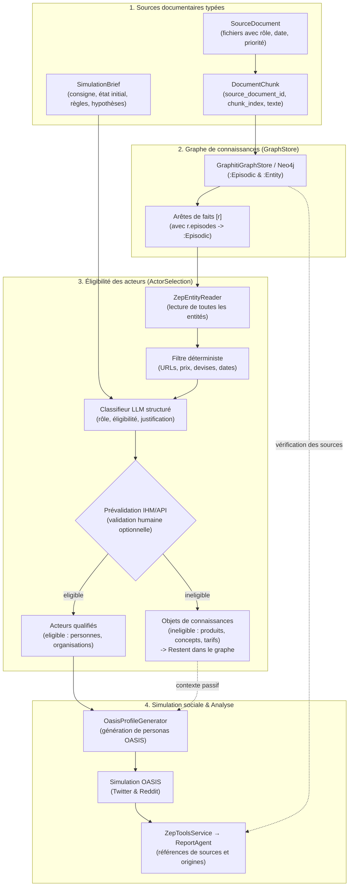
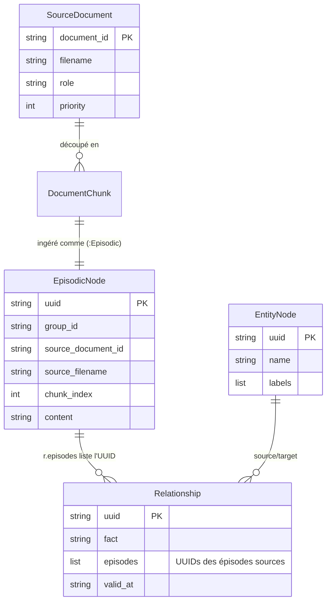
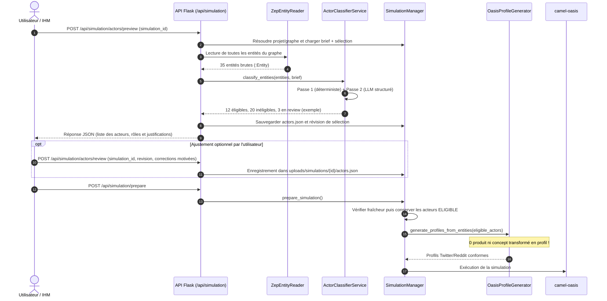

# Architecture — Epic 009 : Éligibilité des acteurs et fiabilisation des sources

- **Statut** : `backlog` · **Dépend de** : 004, 005 · **Bloque** : 007
- **Référence PRD** : [`prd.md`](prd.md)
- **Nature** : cible proposée révisée le 10 octobre 2026 ; [écarts avec le code et arbitrages ouverts](revue-coherence-2026-10-10.md). Les composants ci-dessous ne sont pas encore implémentés.
- **Rapprochement avec le rapport source** : [matrice de couverture](couverture-rapport-audit.md), notamment pour les diagnostics, événements et limites de contexte.

---

## 1. Vue d'ensemble du pipeline fiabilisé

L'architecture transforme le flux linéaire aveugle hérité d'amont en un pipeline à étapes contrôlées et traçables :



---

## 2. Modèles de données

### 2.1 Modèle d'éligibilité (`ActorEligibility`)

Placé dans `backend/app/models/actor_eligibility.py` :

```python
from enum import Enum
from typing import Optional, List, Dict, Any
from dataclasses import dataclass, field

class ActorRole(str, Enum):
    """Rôle sémantique générique d'une entité."""
    PERSON = "person"                  # Individu réel ou persona humaine
    ORGANIZATION = "organization"      # Entreprise, organisme officiel, institution
    COLLECTIVE = "collective"          # Communauté, groupe informel
    PRODUCT = "product"                # Produit, logiciel, offre, formule
    SERVICE = "service"                # Service rendu
    DOMAIN = "domain"                  # Nom de domaine, site web, URL
    PLACE = "place"                    # Lieu géographique, ville, pays
    EVENT = "event"                    # Événement daté, réunion, incident
    CONCEPT = "concept"                # Idée abstraite, sujet, thématique
    UNKNOWN = "unknown"                # Non déterminé

class EligibilityStatus(str, Enum):
    """Statut d'éligibilité à devenir un agent de simulation."""
    ELIGIBLE = "eligible"              # Autorisé à devenir un compte OASIS actif
    INELIGIBLE = "ineligible"          # Conservé en base de connaissances, exclu des agents
    REVIEW = "review"                  # Nécessite confirmation (ambigu)

@dataclass
class ActorEligibility:
    """Qualification d'une entité du graphe."""
    entity_uuid: str
    entity_name: str
    role: ActorRole
    status: EligibilityStatus
    rationale: str
    confidence: float
    original_type: str = "Entity"
    attributes: Dict[str, Any] = field(default_factory=dict)
```

La validation de la sortie LLM impose des enums reconnus, une justification non vide et une confiance finie dans `[0, 1]`. Seuls les rôles d'acteurs autorisés peuvent porter `eligible`. La [story 009-1](story-009-1.md) fixe la politique minimale du premier lot : `person` et `organization` admissibles, `collective` conservé en `review`, exception marque/fiction reportée. La politique élargie et les corrections humaines restent à spécifier en 009-3. Le rôle qualifié guide le prompt persona ; `original_type` reste une information du graphe et ne remplace pas ce rôle.

### 2.2 Documents sources et brief (`SourceDocument` & `SimulationBrief`)

Documents et fragments dans `backend/app/models/source_document.py`, brief dans `backend/app/models/simulation_brief.py`, intégrés dans `Project`. Noms canoniques : `document_id` pour le document, `source_document_id` pour sa référence, `source_filename` pour le nom d'origine porté par un fragment/épisode. Le nom du fichier ne sert jamais d'identifiant.

```python
class DocumentRole(str, Enum):
    FACTS = "facts"                    # Éléments fournis comme faits, à valider
    SCENARIO = "scenario"              # Déroulement ou événement déclencheur
    PERSONAS = "personas"              # Descriptions de cibles ou profils
    HYPOTHESES = "hypotheses"          # Hypothèses ouvertes à explorer
    CONSTRAINTS = "constraints"        # Règles et limites infranchissables
    REFERENCE = "reference"            # Documentation technique ou légale

@dataclass
class SourceDocument:
    document_id: str
    filename: str
    role: DocumentRole
    saved_filename: str                # Liaison avec le fichier réellement sauvegardé
    priority: int = 1                  # 1 (haute) à 5 (basse)
    date: Optional[str] = None
    total_chunks: int = 0
    author: Optional[str] = None
    source: Optional[str] = None
    validation_status: Optional[str] = None  # Valeurs/transitions à spécifier en 009-2

@dataclass
class DocumentChunk:
    source_document_id: str
    source_filename: str
    chunk_index: int                   # Base 0, local au document
    text: str
    source_role: DocumentRole
    char_start: int                    # Dans le texte normalisé du document
    char_end: int                      # Borne exclue
    section: Optional[str] = None      # Seulement si disponible dans l'extraction
    page: Optional[int] = None         # Seulement si connue, jamais déduite d'un index

@dataclass
class SimulationBrief:
    goal: str                          # Question exacte à explorer
    initial_state: str                 # Faits acquis à l'instant t0
    target_audiences: List[str]        # Cibles recherchées
    excluded_actors: List[str]         # Entités interdites de simulation
    rules: List[str]                   # Contraintes absolues
    hypotheses: List[str]              # Points d'interrogation à observer
    additional_context: str = ""      # Champ actuellement perdu après l'ontologie
    schema_version: int = 1
    time_horizon: str = ""            # Champ avancé facultatif
    trigger_event: str = ""
    expected_outputs: List[str] = field(default_factory=list)
    source_document_ids: List[str] = field(default_factory=list)
```

Ces modèles sont des contrats proposés, pas des classes existantes. `to_dict`/`from_dict` doivent préserver tous les champs et accepter les anciens `project.json` sans ces objets. Le brief est copié dans les artefacts de configuration pour conserver le contexte utilisé par la simulation ; la lecture seule d'un ancien projet ne reconstruit pas une provenance imaginaire. Rôle par défaut proposé : `facts`, priorité 1, date inconnue, sans validation automatique de véracité. Le rapport précise un **statut de validation documentaire** ; son cycle de vie et l'effet sur l'ingestion sont à spécifier avant 009-2.

Les positions comptent des caractères du texte normalisé, pas des octets ni des positions dans le PDF original. Pour chaque fragment, `document_text[char_start:char_end] == text`. Page et section restent facultatives lorsque l'extracteur ne les fournit pas. La priorité/source/auteur proviennent des métadonnées explicites, jamais d'un mot contenu dans le nom du fichier.

---

## 3. Classifieur d'éligibilité agnostique à deux passes

Le composant `ActorClassifierService` (`backend/app/services/actor_classifier.py`) opère en deux étapes sans aucune règle hardcodée propre à un métier :

### Passe 1 : Filtrage déterministe
- **Exclusion par syntaxe structurelle** :
  - Reconnaissance d'une valeur entière représentant une URL ou un domaine internet ; pas de liste fermée de suffixes limitée à quelques pays.
  - Reconnaissance d'un montant avec devise, éventuellement accompagné d'une périodicité. Les mots `mensuel` ou `abonnement` seuls ne suffisent pas à exclure une entité.
  - Dates pures ou durées isolées (`2026-10-10`, `3 mois`).
- **Résultat immédiat** : URL/domaine → `domain`, montant/offre → `product`, date → `event`, durée → `concept`, tous `ineligible`, sans appel LLM. Un nom comportant ces valeurs parmi d'autres mots passe à la classification contextuelle.

### Passe 2 : Classification structurée LLM (modèle universel)
Pour les entités restantes, réutiliser le client `LLMClient` de MiroFish et sa compatibilité de session/JSON ; valider la réponse par Pydantic, déjà disponible, sans nouveau client ni dépendance. Le prompt prend en entrée :
- Le nom de l'entité, son résumé (`summary`), ses attributs et ses voisins immédiats dans le graphe.
- Les consignes du `SimulationBrief` (pour savoir si une marque officielle doit disposer d'un compte de communication ou rester passive).
- **Format de sortie attendu** :
  ```json
  {
    "role": "person",
    "status": "eligible",
    "rationale": "Identifié comme praticienne cliente de la plateforme, rôle d'utilisatrice finale.",
    "confidence": 0.95
  }
  ```
- **Règle de sécurité (NFR-3)** : En cas d'échec, JSON invalide, champ absent, rôle/statut incohérent ou incertitude (`confidence < 0.7`), le statut passe en `review`. Ni `review` ni une classification absente ne déclenchent de profil, y compris avec `use_llm_for_profiles=False`. Si aucun acteur ne reste, la préparation s'arrête avec un diagnostic exploitable.
- L'exclusion explicite dans le brief prime sur l'éligibilité. Sa résolution doit utiliser les UUID du graphe ; les noms ambigus sont signalés. Les connaissances rejetées restent intactes dans le store.

---

## 4. Traçabilité des sources dans Neo4j (`GraphStore`)

La traçabilité s'appuie sur les capacités existantes de Neo4j et Graphiti :



Le schéma représente une liaison logique : `SourceDocument` et `DocumentChunk` vivent dans les artefacts du projet ; aucun nœud Neo4j `:SourceDocument` supplémentaire n'est exigé. `r.episodes` est une liste d'UUID, pas une relation physique vers `:Episodic`.

À l'ingestion :

- L'API conserve le texte extrait **par document**, puis `GraphBuilderService` découpe chaque document séparément. La concaténation peut rester un contexte de prompt ; elle ne sert plus de source unique aux fragments tracés.
- Un fragment porte son UUID de document, le nom d'origine, le rôle et son index local base 0. Les noms identiques et les caractères `|`/`:` restent acceptés ; une description lisible ne sert pas de sérialisation autoritaire.
- **Extension de contrat à arrêter dans l'ADR de 009-2** : conserver les appels actuels `chunks: List[str]` et proposer un paramètre facultatif de métadonnées alignées, implémenté dans **les deux stores**. Vérifier longueurs, types et présence des champs avant toute écriture. La signature actuelle n'accepte aucune métadonnée par fragment.
- `GraphitiGraphStore.add_episode(metadata=...)` persiste effectivement les métadonnées (actuellement ignorées). Les mises à jour utilisent l'UUID réellement retourné par Graphiti et `group_id`, jamais une recherche par nom ou une simple liste ordonnée supposée identique. Une erreur d'annotation ne doit pas produire un succès d'ingestion.
- La réconciliation des lots doit distinguer deux textes identiques ayant des sources différentes ; les métadonnées contribuent à l'identité d'opération quand elles sont présentes, tout en préservant les anciens appels.
- Les épisodes d'activité OASIS conservent leur origine `simulation`, le `simulation_id`, la plateforme et les tours ; leurs relations ne sont jamais comptées comme faits documentaires dans C3.
- La lecture des épisodes et des citations passe par un contrat neutre de `GraphStore`, implémenté pour Graphiti et Zep. La méthode et le DTO exacts restent à définir dans le même ADR : le contrat actuel ne propose aucune lecture d'épisode.

Dans le store Graphiti, une requête de résolution **proposée** part de l'arête dans le graphe cible et résout ses références sans masquer celles qui manquent :

```cypher
MATCH (:Entity {group_id: $graph_id})-[r:RELATES_TO {uuid: $edge_uuid}]->(:Entity {group_id: $graph_id})
WHERE r.group_id = $graph_id
UNWIND r.episodes AS episode_uuid
OPTIONAL MATCH (e:Episodic {uuid: episode_uuid, group_id: $graph_id})
RETURN episode_uuid, e.source_document_id, e.source_filename,
       e.chunk_index, e.content
```

Les listes vides, épisodes absents, origines mixtes et graphes hérités sont traités explicitement. Le fragment cité correspond au texte ingéré et non à une page/section inventée. Le rôle `hypotheses`/`scenario` reste visible : provenance documentaire ne signifie pas fait avéré. C3 porte sur les nouvelles ingestions documentaires, pas sur toutes les relations de toute origine présentes dans Neo4j.

---

## 5. Flux de prévalidation et de simulation



---

## 6. Synthèse des composants et de leur responsabilité

| Composant | Fichier | Responsabilité |
|---|---|---|
| `ActorEligibility` | `app/models/actor_eligibility.py` | Modèle de données de qualification d'acteurs. |
| `SourceDocument` | `app/models/source_document.py` | Modèle de document typé avec rôle et métadonnées. |
| `SimulationBrief` | `app/models/simulation_brief.py` | Contexte versionné, sérialisation rétrocompatible. |
| `ActorClassifierService` | `app/services/actor_classifier.py` | Moteur hybride (déterministe + LLM) de classification d'éligibilité. |
| `SimulationManager` | `app/services/simulation_manager.py` | Intégration de la barrière d'éligibilité avant passage à OASIS. |
| `GraphitiGraphStore` | `app/utils/graph_store/graphiti_store.py` | Provenance enrichie sur les nœuds `:Episodic`. |
| `ZepGraphStore` | `app/utils/graph_store/zep_store.py` | Même extension de contrat documentaire, sans régression des appels existants. |
| `ZepToolsService` | `app/services/zep_tools.py` | Acheminement des UUID d'épisodes, citations et origines jusqu'au rapport. |
| `ReportAgent` | `app/services/report_agent.py` | Provenance sourcée des affirmations dans le rapport final. |

## 7. Sélection persistée et corrections humaines

`actors.json` est rattaché à `simulation_id` et contient `project_id`, `graph_id`, la version du schéma, une révision, l'empreinte des entrées de classification (entités/contexte/brief) et les qualifications automatiques et corrections motivées. Le serveur résout les identifiants depuis la simulation ; il refuse un UUID étranger, un statut/rôle invalide ou une révision périmée.

La cible proposée autorise la correction d'un rôle erroné vers un rôle d'acteur, avec justification, mais refuse la combinaison `product + eligible`. Le protocole exact et le traitement des collectifs doivent être arbitrés avant 009-3. Les appels répétés à `preview` réutilisent une sélection valide et ne perdent pas les arbitrages humains. Les mutations pendant préparation/exécution sont refusées ; une révision ne modifie pas une simulation déjà terminée.

`prepare_simulation` consomme cette sélection. Un appel direct à la préparation, avant toute prévisualisation, réalise la même classification. Les points d'entrée unitaires et par lots du générateur appliquent aussi la barrière pour éviter un contournement par les scripts. La génération emploie le rôle qualifié (personne ou organisation), même si le label d'origine reste `Entity`.

Une correction du brief/graphe/sélection invalide les profils et configurations antérieurs. Les contrôles de réutilisation actuels (`_check_simulation_prepared`) et ceux du démarrage doivent vérifier la révision avant de réutiliser des artefacts ; `force_regenerate` ne peut pas contourner l'éligibilité. Les compteurs de l'API distinguent entités lues, acteurs retenus et acteurs `review`.

## 8. Provenance jusqu'au rapport et ordre de réalisation

`ZepToolsService` transporte les références d'épisodes actuellement perdues par sa projection des résultats de recherche. La résolution neutre fournit les fragments, rôles documentaires et origines simulées. Le `ReportAgent` construit ses citations à partir de références effectivement disponibles ; il affiche l'origine inconnue quand elle manque et garde séparées les observations simulées et ses inférences. Une arête soutenue par plusieurs origines conserve toutes ces origines.

Une action présentée comme observée doit aussi renvoyer à une trace d'événement du run. [`action_logger.py`](../../../backend/scripts/action_logger.py) enregistre les actions dans `actions.jsonl`, avec tour, agent, type, arguments et résultat. La référence stable exacte est à définir en 009-4 selon les traces disponibles ; elle doit résoudre le bon run/la bonne plateforme et permettre de contrôler le résultat de l'action. Une intention exprimée dans un post ne démontre pas une autre action, même si ce post a été ingéré dans le graphe. Les entretiens synthétiques restent des contenus simulés.

Ordre proposé : 009-1 ferme le verrou P0 avec les consignes déjà persistées ; 009-2 ajoute documents, brief complet, écriture/lecture de provenance et ADR ; 009-3 livre API **et IHM ciblée** avec révisions ; 009-4 ajoute les outils de citation, la distinction des origines et la qualification globale C1–C7. La story 009-1 est rédigée sur demande et reste `backlog` ; les autres lots vivent encore uniquement dans l'index. Chaque story consigne ses tests avant développement.

## 9. Contextes longs, diagnostics et conflits

Le code actuel borne le contexte d'ontologie et de configuration à 50 000 caractères. La cible distingue les documents ingérés des extraits réellement placés dans chaque prompt : ingestion complète ne signifie pas présence complète dans tous les contextes LLM.

009-2 conserve les diagnostics par document et par étape : erreur d'extraction, fragments ignorés, échantillonnage/troncature, références utilisées et conflits connus. Le stockage exact et la politique de budget sont à définir dans cette story. Le brief explicite est conservé lors de la construction du contexte ; s'il ne tient pas lui-même dans le budget applicable, l'étape refuse avec un diagnostic plutôt que d'en retirer silencieusement des consignes. Une source manquante dans un prompt reste signalée.

Les affirmations contradictoires gardent chacune leurs sources et leurs métadonnées. Une priorité/date ne résout un conflit que si une règle déclarée s'applique ; la décision mentionne cette règle. À défaut, l'état « à confirmer » reste visible. Le mécanisme de détection et le modèle du conflit doivent être spécifiés avant 009-2 ; aucun algorithme universel de détection n'est présumé livré par Graphiti.

009-3 présente ces diagnostics avant préparation et offre le blocage volontaire sur doute/conflit. La revue humaine reste facultative dans le mode simple, qui accepte une consigne et des fichiers sans champs avancés obligatoires. Le filtre automatique est commun à tous les parcours.

Dans les messages LLM et les données de sélection, documents et extraits restent des données sourcées. Ils ne sont pas promus en instructions système ni en corrections humaines autorisées. Les tests de NFR-5 vérifient cette séparation structurelle ; ils ne garantissent pas à eux seuls que le modèle ignore toute instruction malveillante contenue dans une source.
