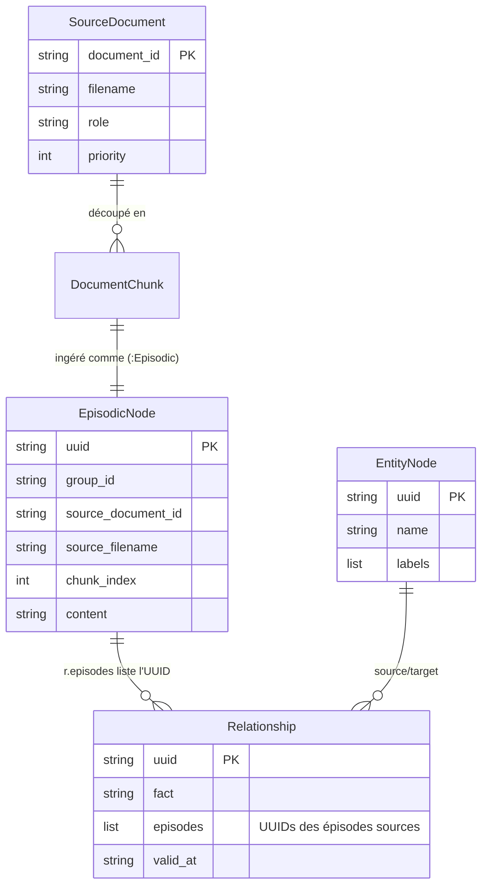
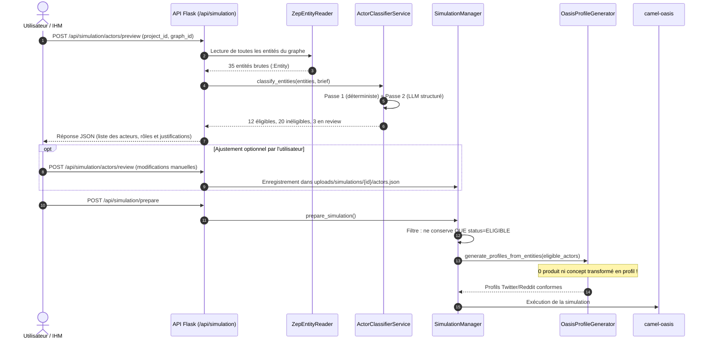

# Architecture — Epic 009 : Éligibilité des acteurs et fiabilisation des sources

- **Statut** : `backlog` · **Dépend de** : 004, 005 · **Bloque** : 007
- **Référence PRD** : [`prd.md`](prd.md)

---

## 1. Vue d'ensemble du pipeline fiabilisé

L'architecture transforme le flux linéaire aveugle hérité d'amont en un pipeline à étapes contrôlées et traçables :


---

## 2. Modèles de données

### 2.1 Modèle d'éligibilité (`ActorEligibility`)

Placé dans `backend/app/models/actor_eligibility.py` :

```python
from enum import Enum
from typing import Optional, List, Dict, Any
from dataclasses import dataclass, field

class ActorRole(str, Enum):
    """Rôle sémantique générique d'une entité."""
    PERSON = "person"                  # Individu réel ou persona humaine
    ORGANIZATION = "organization"      # Entreprise, organisme officiel, institution
    COLLECTIVE = "collective"          # Communauté, groupe informel
    PRODUCT = "product"                # Produit, logiciel, offre, formule
    SERVICE = "service"                # Service rendu
    DOMAIN = "domain"                  # Nom de domaine, site web, URL
    PLACE = "place"                    # Lieu géographique, ville, pays
    EVENT = "event"                    # Événement daté, réunion, incident
    CONCEPT = "concept"                # Idée abstraite, sujet, thématique
    UNKNOWN = "unknown"                # Non déterminé

class EligibilityStatus(str, Enum):
    """Statut d'éligibilité à devenir un agent de simulation."""
    ELIGIBLE = "eligible"              # Autorisé à devenir un compte OASIS actif
    INELIGIBLE = "ineligible"          # Conservé en base de connaissances, exclu des agents
    REVIEW = "review"                  # Nécessite confirmation (ambigu)

@dataclass
class ActorEligibility:
    """Qualification d'une entité du graphe."""
    entity_uuid: str
    entity_name: str
    role: ActorRole
    status: EligibilityStatus
    rationale: str
    confidence: float
    original_type: str = "Entity"
    attributes: Dict[str, Any] = field(default_factory=dict)
```

### 2.2 Documents sources et brief (`SourceDocument` & `SimulationBrief`)

Placés dans `backend/app/models/source_document.py` et intégrés dans `Project` :

```python
class DocumentRole(str, Enum):
    FACTS = "facts"                    # Faits établis et avérés
    SCENARIO = "scenario"              # Déroulement ou événement déclencheur
    PERSONAS = "personas"              # Descriptions de cibles ou profils
    HYPOTHESES = "hypotheses"          # Hypothèses ouvertes à explorer
    CONSTRAINTS = "constraints"        # Règles et limites infranchissables
    REFERENCE = "reference"            # Documentation technique ou légale

@dataclass
class SourceDocument:
    document_id: str
    filename: str
    role: DocumentRole
    priority: int = 1                  # 1 (haute) à 5 (basse)
    date: Optional[str] = None
    total_chunks: int = 0

@dataclass
class SimulationBrief:
    goal: str                          # Question exacte à explorer
    initial_state: str                 # Faits acquis à l'instant t0
    target_audiences: List[str]        # Cibles recherchées
    excluded_actors: List[str]         # Entités interdites de simulation
    rules: List[str]                   # Contraintes absolues
    hypotheses: List[str]              # Points d'interrogation à observer
```

---

## 3. Classifieur d'éligibilité agnostique à deux passes

Le composant `ActorClassifierService` (`backend/app/services/actor_classifier.py`) opère en deux étapes sans aucune règle hardcodée propre à un métier :

### Passe 1 : Filtrage déterministe
- **Exclusion par syntaxe structurelle** :
  - Expressions régulières de détection d'URLs, domaines internet (`.fr`, `.com`, `.org`, `http://`, `https://`).
  - Expressions régulières de tarifs, devises (`€`, `$`, `EUR`, `USD`, `mensuel`, `abonnement`).
  - Dates pures ou durées isolées (`2026-10-10`, `3 mois`).
- **Résultat immédiat** : Ces entités sont marquées `role=DOMAIN`/`PRODUCT`, `status=INELIGIBLE`, sans consommer d'appel LLM.

### Passe 2 : Classification structurée LLM (modèle universel)
Pour les entités restantes, un prompt court avec sortie JSON contrainte (Pydantic / OpenAI Generic Client) prend en entrée :
- Le nom de l'entité, son résumé (`summary`), ses attributs et ses voisins immédiats dans le graphe.
- Les consignes du `SimulationBrief` (pour savoir si une marque officielle doit disposer d'un compte de communication ou rester passive).
- **Format de sortie attendu** :
  ```json
  {
    "role": "person",
    "status": "eligible",
    "rationale": "Identifié comme praticienne cliente de la plateforme, rôle d'utilisatrice finale.",
    "confidence": 0.95
  }
  ```
- **Règle de sécurité (NFR-3)** : En cas d'échec ou d'incertitude (`confidence < 0.7`), le statut passe en `review`.

---

## 4. Traçabilité des sources dans Neo4j (`GraphStore`)

La traçabilité s'appuie sur les capacités existantes de Neo4j et Graphiti :



À l'ingestion dans `GraphitiGraphStore.add_text_batch` :
- Chaque appel à `add_episode` reçoit un `source_description` normalisé :
  `f"file:{doc_id}|name:{filename}|chunk:{idx}"`.
- Une passe Cypher finale indexée associe sur les nœuds `:Episodic` les propriétés `source_document_id`, `source_filename`, `chunk_index`.
- Ainsi, pour n'importe quelle relation `[r]`, une requête Cypher simple :
  ```cypher
  MATCH (e:Episodic) WHERE e.uuid IN r.episodes
  RETURN e.source_filename, e.chunk_index, e.content
  ```
  restitue la citation textuelle exacte et le document qui a produit le fait.

---

## 5. Flux de prévalidation et de simulation



---

## 6. Synthèse des composants et de leur responsabilité

| Composant | Fichier | Responsabilité |
|---|---|---|
| `ActorEligibility` | `app/models/actor_eligibility.py` | Modèle de données de qualification d'acteurs. |
| `SourceDocument` | `app/models/source_document.py` | Modèle de document typé avec rôle et métadonnées. |
| `ActorClassifierService` | `app/services/actor_classifier.py` | Moteur hybride (déterministe + LLM) de classification d'éligibilité. |
| `SimulationManager` | `app/services/simulation_manager.py` | Intégration de la barrière d'éligibilité avant passage à OASIS. |
| `GraphitiGraphStore` | `app/utils/graph_store/graphiti_store.py` | Provenance enrichie sur les nœuds `:Episodic`. |
| `ReportAgent` | `app/services/report_agent.py` | Provenance sourcée des affirmations dans le rapport final. |
