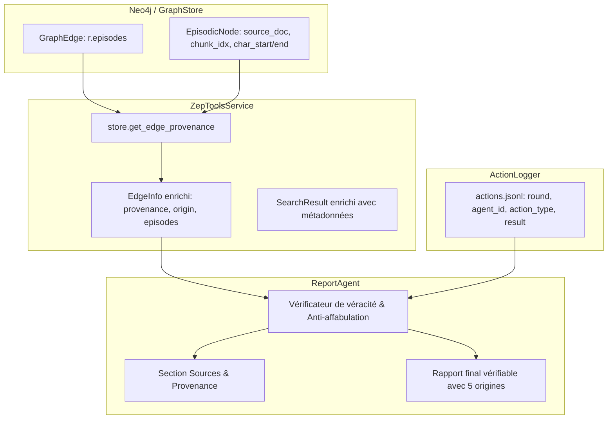

# Story 009-4 — Outils de provenance, rapport vérifiable et qualification globale

Lot D, priorité P1. En tant qu'analyste et utilisateur de MiroFish, je veux que les outils d'interrogation du graphe transportent la provenance complète des faits jusqu'au `ReportAgent`, que le rapport final distingue formellement les 5 origines d'information, conserve les contradictions documentaires sans inventer de faits ni de citations, relie toute action simulée dite observée aux événements réels du run sans la confondre avec une simple intention de post, et qu'un banc de qualification globale valide l'ensemble des critères C1 à C7 de l'Epic 009 sous Docker afin de clore définitivement l'epic avec un verdict GO étayé.

La story dépend de 009-1 (`done`, barrière d'éligibilité et classifieur agnostique), de 009-2 (`done`, documents typés, brief versionné, contrat de provenance `GraphStore` et détection des conflits) et de 009-3 (`done`, sélection persistée `actors.json`, endpoints `preview`/`review`, IHM de révision et blocage volontaire). Elle couvre FR-7 ; NFR-2, NFR-4 et NFR-5 ; le critère C7 et la validation finale des critères C1 à C7 du PRD.

---

## Définition de prêt

- [ ] Objectif compris : acheminer la provenance documentaire et simulée via `ZepToolsService` (`backend/app/services/zep_tools.py`) jusqu'au `ReportAgent` (`backend/app/services/report_agent.py`), distinguer de façon étanche les 5 origines d'information, tracer les actions observées via les journaux du run (`action_logger.py` / `actions.jsonl`), empêcher qu'un post d'intention simulé ne soit promu en action observée (règle anti-affabulation C7), exposer les contradictions documentaires avec statut de résolution explicite ou mention « à confirmer », valider qu'aucune citation textuelle n'est fabriquée, et orchestrer la qualification finale C1 à C7 sous Docker avec un banc autonome (`backend/scripts/verifier_qualification_epic_009.py`).
- [ ] Documents consultés : [PRD](prd.md) §4 FR-7, §5 C1 à C7 ; [architecture](architecture.md) §4 (traçabilité Neo4j), §6 (responsabilités des composants), §8 (provenance jusqu'au rapport et ordre de réalisation), §9 (contextes longs, diagnostics et conflits) ; [ADR 0012](../../decisions/0012-contrat-de-provenance-graphstore.md) (contrat de provenance commun) ; [ADR 0013](../../decisions/0013-semantique-des-sources.md) (validation, conflits, budget) ; [revue de reprise](revue-coherence-2026-10-10.md) R03, R05, R08, R10, R13, R14, R19 ; [matrice de couverture](couverture-rapport-audit.md) A04, A06, A11, A12, A13 ; [hub](epic-009.md) ; stories [009-1](story-009-1.md), [009-2](story-009-2.md) et [009-3](story-009-3.md) ; [AGENTS.md](../../../AGENTS.md) §2.1/2.2/2.8/2.9/2.10.
- [ ] Dépendances résolues : 009-1 (`done`), 009-2 (`done`), 009-3 (`done`), 004 et 005 (`done`) ; filet de référence de 1130 tests réussis sur l'hôte au 11 octobre 2026.
- [ ] Règles d'arbitrage figées :
  - **Typologie stricte des 5 origines** : `documentary` (fait issu d'un document source avec positions exactes), `hypothesis`/`scenario` (hypothèse de brief ou consigne de scénario), `simulation`/`observation` (comportement d'agent enregistré dans `actions.jsonl`), `inference` (déduction analytique du LLM de synthèse), `unknown`/`inherited` (arête héritée, migrée ou référence non résolue signalée).
  - **Règle anti-affabulation C7** : un post d'intention simulé (ex: « Je vais résilier mon abonnement », « J'ai l'intention de boycotter ») ne constitue en aucun cas la preuve d'une action observée sans trace d'événement correspondante (`action_type` effectif dans `actions.jsonl`).
  - **Gestion des contradictions** : deux sources documentaires divergentes ne sont jamais fusionnées silencieusement ; elles sont conservées dans le rapport avec la règle appliquée (priorité de source, date de validité) ou le statut explicite « à confirmer ».
  - **Zéro citation inventée** : toute citation textuelle attribuée à un document source doit correspondre exactement au fragment normalisé sous-jacent (`document_text[char_start:char_end] == text`).
  - **Séparation consignes / sources (NFR-5)** : le texte documentaire reste traité comme donnée et n'est jamais injecté comme instruction système dans les prompts du `ReportAgent`.
- [ ] Stratégie de tests identifiée : tests unitaires du transport de provenance dans `ZepToolsService`, tests de traçabilité des événements `action_logger.py`, tests de détection des fausses actions dans le rapport, tests de non-fusion des sources contradictoires, tests d'intégration du `ReportAgent` et suite de validation du script de qualification globale `verifier_qualification_epic_009.py`.

---

## Définition de fini

- [ ] AC1 à AC9 satisfaits avec preuves vérifiables et tests hermétiques.
- [ ] `ZepToolsService` transporte l'intégralité des références de provenance (`episodes`, `ProvenanceRecord`, origines, fragments et positions) sans perte lors des recherches sémantiques, hybrides et parcours de graphe.
- [ ] Typologie des 5 origines implémentée et respectée dans la sérialisation des faits et relations.
- [ ] Chaînage des observations de simulation relié de façon déterministe aux traces d'événements du run (`actions.jsonl`).
- [ ] Règle anti-affabulation formellement éprouvée : aucun post d'intention simulé n'est promu en action observée sans trace d'action enregistrée.
- [ ] Sources contradictoires présentées avec leurs références respectives et statut de résolution motivé (« résolu selon règle » ou « à confirmer »).
- [ ] Citations textuelles vérifiées sans altération ni fabrication.
- [ ] `ReportAgent` génère des rapports avec section dédiée « Sources & Provenance » et séparation étanche faits documentaires vs données simulées vs inférences.
- [ ] Banc de qualification globale `backend/scripts/verifier_qualification_epic_009.py` exécuté avec succès sous Docker, vérifiant les critères C1 à C7 avec verdict GO consigné dans `docs/plans/009-eligibilite-acteurs-et-sources/rapport-qualification-epic-009.md`.
- [ ] Filet global de tests au vert (supérieur à 1130 tests), 0 échec sous Docker, CI et lint propres (`ruff check .`, `validate_plans.py`).
- [ ] Revue BMAD à 4 couches exécutée et validée, artefacts de suivi actualisés.

---

## Tâches

- [ ] T1 — Enrichissement de `ZepToolsService` (`backend/app/services/zep_tools.py`) : transport des UUIDs d'épisodes, enrichissement de `EdgeInfo` et `SearchResult` avec les enregistrements `ProvenanceRecord` via `GraphStore.get_edge_provenance`, et préservation des métadonnées de position et de rôle (AC1, AC2).
- [ ] T2 — Modélisation et normalisation des 5 origines d'information (`documentary`, `hypothesis`/`scenario`, `simulation`/`observation`, `inference`, `unknown`/`inherited`) avec support des arêtes multi-sources (AC2).
- [ ] T3 — Passerelle de traçabilité des observations de simulation entre `action_logger.py` (`actions.jsonl`) et le système d'outils du rapport : indexation des événements par run, plateforme, tour et agent pour authentifier toute action observée (AC3).
- [ ] T4 — Implémentation du garde-fou anti-affabulation C7 : vérification croisée entre contenus de posts et événements d'action enregistrés, avec rejet ou requalification automatique en « intention simulée » pour tout post sans action réelle (AC4).
- [ ] T5 — Gestion et présentation des contradictions documentaires dans `ZepToolsService` et `ReportAgent` : affichage des sources divergentes avec référence aux `SourceConflict` du brief et statut de résolution (AC5).
- [ ] T6 — Contrôleur de véracité des citations documentaires : vérification de l'adéquation exacte entre extrait cité et texte normalisé du document (`document_text[char_start:char_end]`) (AC6).
- [ ] T7 — Adaptation du `ReportAgent` (`backend/app/services/report_agent.py`) : intégration des outils enrichis, séparation structurelle des sections, génération de la section « Sources & Provenance » et respect strict de NFR-5 (AC7).
- [ ] T8 — Suites de tests unitaires et d'intégration hermétiques couvrant `ZepToolsService`, le garde-fou d'affabulation, la validation des citations et la génération de rapport vérifiable (`backend/tests/`) (AC1 à AC7, AC9).
- [ ] T9 — Développement de la sonde d'orchestration de qualification globale `backend/scripts/verifier_qualification_epic_009.py` validant les critères C1 à C7 (AC8).
- [ ] T10 — Exécution de la qualification globale sous Docker, rédaction du rapport formel `rapport-qualification-epic-009.md` avec verdict GO, revue de code BMAD 4 couches, passage de `ruff check .` et `validate_plans.py`, et clôture finale de l'Epic 009 (AC8, AC9).

---

## Critères d'acceptation

| Réf. | Situation et comportement attendu | Vérification |
|---|---|---|
| AC1 | **Transport de la provenance dans `ZepToolsService`** : `EdgeInfo`, `SearchResult` et `InsightForgeResult` transportent les références de provenance (`episodes: List[str]`, `provenance: List[ProvenanceRecord]`, `origin: str`). Les méthodes `search_graph`, `get_node_edges`, `get_edge_detail` et `insight_forge` résolvent les provenances via `GraphStore.get_edge_provenance` sans perte d'information (document source, fichier, index de fragment, positions en caractères, rôle documentaire). | Tests unitaires de `ZepToolsService` avec mock `GraphStore` vérifiant la présence et l'exactitude des objets `ProvenanceRecord` dans les retours d'outils. |
| AC2 | **Typologie stricte des 5 origines d'information** : chaque fait, relation ou citation manipulé par les outils et le rapport est classé selon l'une des 5 catégories exclusives : `documentary` (fait issu d'un document source validé), `hypothesis`/`scenario` (hypothèse ou paramètre du brief/scénario), `simulation`/`observation` (comportement d'agent observé dans la simulation), `inference` (déduction ou synthèse analytique du LLM), `unknown`/`inherited` (référence non résolue ou graphe historique hérité). Une relation soutenue à la fois par une source documentaire et une observation simulée conserve les deux traces sans écrasement. | Tests unitaires vérifiant la sérialisation, la catégorisation sans ambiguïté et le maintien des origines multiples. |
| AC3 | **Chaînage et authentification des observations simulées** : toute affirmation dans le rapport qualifiée d'« action observée » (ex: vote, publication, partage, achat, abandon) renvoie à un identifiant stable d'événement issu de `actions.jsonl` (`platform`, `round`, `agent_id`, `timestamp`, `action_type`, `action_args`, `result`). Le rapporteur ne peut affirmer un fait simulé sans que l'action n'ait été consignée par `PlatformActionLogger`. | Tests d'intégration liant un run simulé avec `actions.jsonl` et vérifiant la résolution des références d'événements. |
| AC4 | **Garantie anti-affabulation (Règle d'or C7)** : un post d'intention simulé (ex: déclaration textuelle d'un persona sur Twitter/Reddit telle que « Je vais résilier mon abonnement dès demain ») ne peut jamais être promu dans le rapport en action observée (ex: « La cliente a résilié ») sans trace correspondante d'action effective. En l'absence d'événement d'action, le rapport doit qualifier l'énoncé d'« intention simulée exprimée » et expliciter l'absence d'action constatée. | Test dédié simulant un post d'intention sans action dans `actions.jsonl` et vérifiant que le rapport ne conclut pas à une action observée. |
| AC5 | **Traitement transparent des contradictions documentaires** : lorsqu'un fait fait l'objet d'affirmations opposées dans les sources documentaires (conflit de sources `SourceConflict`), le rapport présente explicitement les deux versions contradictoires avec leurs sources respectives (`source_filename`, fragments). Si une règle déclarée de résolution s'applique (ex: document à priorité supérieure ou validité temporelle plus récente), le rapport motive la résolution en citant la règle ; à défaut, le fait est marqué comme « à confirmer ». | Test unitaire et d'intégration injectant deux fragments contradictoires et vérifiant l'affichage des deux sources et de la mention appropriée. |
| AC6 | **Garantie zéro citation fabriquée** : chaque citation textuelle attribuée à une source documentaire est vérifiée contre le texte normalisé du document (`document_text[char_start:char_end] == text`). Toute altération textuelle, hallucination ou citation non retrouvée dans les fragments est interceptée et signalée. | Tests unitaires de validation de citations avec textes conformes et textes altérés. |
| AC7 | **Structure du rapport vérifiable par `ReportAgent`** : le rapport généré par `ReportAgent` comporte une section dédiée « Sources & Provenance » listant les documents utilisés, les taux de couverture, les conflits ouverts et les limites de contexte. Le corps du rapport sépare clairement les faits documentés, les observations du run et les inférences de l'agent. Les consignes documentaires restent des données et ne sont jamais promues en instructions système (NFR-5). | Tests de génération de rapport vérifiant la présence de la section des sources, le découpage des origines et l'étanchéité des prompts. |
| AC8 | **Sonde d'orchestration de qualification globale (`verifier_qualification_epic_009.py`)** : script autonome validant de bout en bout l'ensemble des critères C1 à C7 du PRD : C1 (0 faux acteur), C2 (multi-domaines agnostique), C3 (traçabilité documentaire), C4 (persistance du brief et contexte long), C5 (filet hermétique sous Docker), C6 (prévalidation effective), C7 (rapport vérifiable avec 5 origines et anti-affabulation). Production du rapport final `rapport-qualification-epic-009.md` avec Verdict GO. | Exécution du script en local et sous Docker avec code retour 0 et production du rapport markdown. |
| AC9 | **Conformité constitutionnelle, outillage et parité Docker** : suite complète de tests supérieure à 1130 passants sur l'hôte et sous Docker (0 échec), `ruff check .` sans avertissement, `validate_plans.py` valide, et documentation entièrement synchronisée en français. | Contrôles CI et outillage au vert. |

---

## Notes de développement

### Architecture de la chaîne de provenance vers le rapport

Actuellement, `ZepToolsService` interroge `GraphStore.search()` ou `GraphStore.get_node_edges()`, mais ne conserve dans `SearchResult` et `EdgeInfo` qu'un sous-ensemble projeté de propriétés (`uuid`, `name`, `fact`, `source_node_uuid`, `target_node_uuid`). Les UUIDs d'épisodes portés par `GraphEdge.episodes` et les enregistrements de provenance résolus par `GraphStore.get_edge_provenance()` (introduits par l'ADR 0012 en 009-2) ne sont pas transmis au `ReportAgent`.

### Typologie des 5 origines (ADR 0012 / ADR 0013 / PRD C7)

| Origine | Source technique | Caractéristiques | Rôle dans le rapport |
|---|---|---|---|
| `documentary` | `ProvenanceOrigin.DOCUMENT` (`EpisodicNode` avec `source_document_id`) | Positions en caractères exactes `[char_start, char_end)` dans le document normalisé. | Fait avéré issu de la documentation de référence. |
| `hypothesis` / `scenario` | Brief du projet ou document marqué `hypotheses`/`scenario` | Énoncé d'hypothèse ou de condition initiale formulé pour la simulation. | Hypothèse de travail, explicitement identifiée comme non avérée. |
| `simulation` / `observation` | `ProvenanceOrigin.SIMULATION` ou `actions.jsonl` (`PlatformActionLogger`) | Événement généré par un agent OASIS lors d'un tour, avec horodatage et résultat. | Comportement simulé observé au cours de l'expérience sociale. |
| `inference` | Synthèse LLM (`ReportAgent`) | Déduction analytique, mise en relation ou extrapolation formulée par le modèle. | Conclusion ou recommandation de l'analyste, distincte des faits. |
| `unknown` / `inherited` | `ProvenanceOrigin.LEGACY` ou `ProvenanceOrigin.UNRESOLVED` | Entité/arête issue d'un graphe migré (Epic 006) ou référence absente. | Fait à provenance non traçable, signalé sans inventer de source. |

### Règle anti-affabulation C7 et traçabilité des actions

Lors d'une simulation OASIS, les personas publient du texte sur Twitter ou Reddit. Un persona peut écrire :
> « Je ne supporte plus ce service, je vais résilier immédiatement ! »

Dans l'état antérieur, un agent de rapport naïf pouvait synthétiser :
> « Plusieurs clientes ont résilié leur abonnement. »

Cette affirmation est une affabulation : le persona a exprimé une **intention**, mais aucune action de résiliation n'a été exécutée. La story 009-4 formalise la distinction :
1. Une action n'est qualifiée d'**observée** que si un événement effectif figure dans `actions.jsonl` (`action_type="unsubscribe"`, `action_type="vote"`, `action_type="buy"`, etc.) avec `success=True`.
2. Une déclaration textuelle dans un post sans action correspondante doit impérativement être qualifiée d'**intention simulée exprimée**, en soulignant l'absence d'action concrète observée dans le run.

### Banc d'orchestration de qualification globale (`verifier_qualification_epic_009.py`)

Le script de qualification finale de l'Epic 009 valide de manière reproductible les 7 critères du PRD :

- **C1** : Vérification sur ≥ 20 entités réparties sur 2 domaines distincts qu'aucun faux acteur (produit, tarif, URL, concept) n'est devenu profil actif, et qu'au moins 2 acteurs attendus par domaine sont retenus.
- **C2** : Vérification de la neutralité multi-domaines sans modification du code, avec comparaison des fixtures annotées et de la mesure réelle.
- **C3** : Vérification de la traçabilité documentaire sur une ingestion neuve (≥ 2 documents × 2 fragments), avec 100 % des références résolues et positions en caractères exactes.
- **C4** : Vérification de la persistance intégrale du `SimulationBrief`, de sa portée et de la gestion des contextes longs (> 50 000 caractères) avec diagnostics d'omission sans perte de consignes.
- **C5** : Contrôle du filet de tests hermétiques sous Docker (0 échec, décompte et skips documentés).
- **C6** : Contrôle de la chaîne de prévalidation (`POST /api/simulation/actors/preview` et `review`), du stockage `actors.json`, des contrôles de concurrence (409), de l'interdiction de requalifier un produit en acteur éligible (400) et du blocage volontaire.
- **C7** : Contrôle du rapport vérifiable : distinction des 5 origines, maintien d'une contradiction visible avec ses sources, zéro citation fabriquée, et application stricte de la barrière anti-affabulation.

---

## Revue

### Cadre de revue contradictoire BMAD à 4 couches

La revue de la story 009-4 sera menée selon le protocole de revue contradictoire à quatre couches :
1. **Couche Architecture & Constitution** : respect strict des ADR 0012 et 0013, conformité aux règles d'architecture propre (AGENTS.md §2.1), zéro fuite de dépendances circulaires, et validation de l'étanchéité NFR-5 (séparation données/consignes).
2. **Couche Métier & Anti-affabulation** : contrôle minutieux du chaînage d'événements, respect absolu de la règle C7 sur les intentions vs actions, traitement impartial des sources contradictoires et vérification des citations textuelles.
3. **Couche Robustesse & Sécurité** : gestion des références non résolues ou manquantes, résilience face aux fichiers de logs corrompus ou absents, et gestion propre des contextes longs.
4. **Couche Tests & Qualification Docker** : exécution hermétique sans réseau externe, parité complète dans le conteneur Docker de référence, validation du script `verifier_qualification_epic_009.py` et émission du verdict GO.

---

## Notes de complétion

Story rédigée et positionnée dans le backlog. Les notes de complétion détaillées, les constats de revue BMAD et le verdict de qualification globale seront renseignés lors de l'implémentation et de la clôture de la story.
