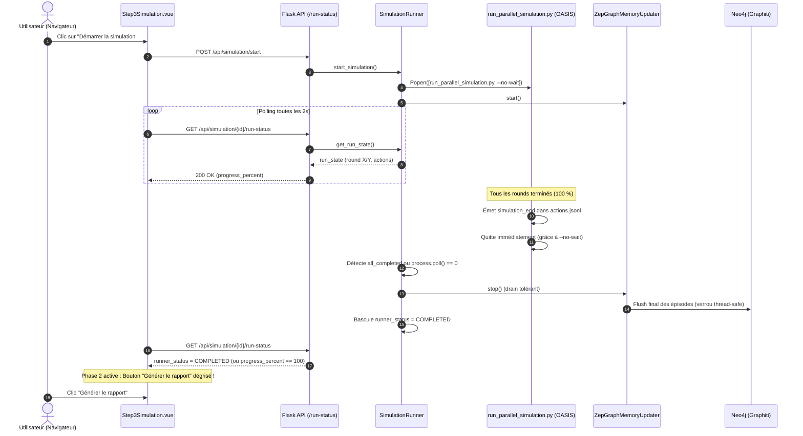

# Architecture Technique — Epic 010 : Fiabilisation du cycle de vie et de la complétion des simulations

> **Statut :** Planifié (Backlog)  
> **Date :** 15 octobre 2026  
> **Auteur :** Antigravity & Équipe MiroFish  

---

## 1. Vue d'Ensemble du Flux & Diagnostic

Le cycle de vie d'une simulation fait intervenir 4 briques asynchrones :



---

## 2. Modifications Architecturales

### 2.1. Arrêt Déterministe du Script de Simulation
- **Problème :** `run_parallel_simulation.py` attendait des commandes IPC en boucle fermée parce que `--no-wait` n'était pas transmis par `SimulationRunner`.
- **Solution :**
  - Dans `SimulationRunner._start_simulation` (autour de la ligne 520) : passer systématiquement `--no-wait` par défaut dans les arguments de ligne de commande `cmd`.
  - Dans `SimulationRunner._monitor_simulation` : dès que `_check_all_platforms_completed(state)` est `True`, si le processus ne s'est pas éteint après 5 secondes, envoyer la commande IPC `send_close_env()` puis fermer les ressources.
  - Positionner explicitement `state.runner_status = RunnerStatus.COMPLETED` dès que tous les rounds sont complétés et vidés.

### 2.2. Réconciliation OS & Invalidation de Cache
- **Problème :** `SimulationRunner.get_run_state()` renvoie aveuglément l'objet en mémoire `_run_states[sim_id]`. Si le processus est mort dans le système, le statut reste faussement `"running"` ou `"stopping"`.
- **Solution :**
  - Introduire une vérification de cohérence OS : si `state.runner_status in (RUNNING, STOPPING)` mais que `_processes.get(sim_id)` a `poll() is not None` (ou que le PID est inexistant), déclencher une réconciliation immédiate (`reconcile_inactive_state`).
  - Si le fichier `run_state.json` sur le disque porte un horodatage de modification plus récent que l'objet mémoire, le fichier disque est l'autorité (`re-read`).

### 2.3. Sécurisation Thread-Safe de SentenceTransformers
- **Problème :** `model.encode(...)` n'est pas thread-safe dans PyTorch lors d'accès simultanés par les threads de synchronisation mémoire, déclenchant des erreurs `Cannot copy out of meta tensor; no data!`.
- **Solution :**
  - Dans `SentenceTransformerEmbedder` (`backend/app/utils/graphiti_embedder.py`), étendre le verrou `self._lock` à l'exécution de `_encode_sync(texts)`.
  - Dans `ZepGraphMemoryUpdater.stop()`, logger les erreurs de batches sans faire lever un `RuntimeError` bloquant afin de garantir que l'arrêt de la simulation atteint toujours son état terminal.

### 2.4. Résilience de l'Interface Utilisateur Vue 3
- **Problème :** `Step3Simulation.vue` lie l'état cliquable du bouton exclusivement à la valeur textuelle `runner_status === 'completed' || runner_status === 'stopped'`.
- **Solution :**
  - Intégrer la complétion par les faits :
    ```javascript
    const isCompleted = data.runner_status === 'completed' 
      || data.runner_status === 'stopped' 
      || (data.progress_percent >= 100 && (data.twitter_completed || data.reddit_completed))
    ```
  - Si cette condition est satisfaite, `phase.value` passe immédiatement à `2` et débloque le bouton de génération du rapport.
