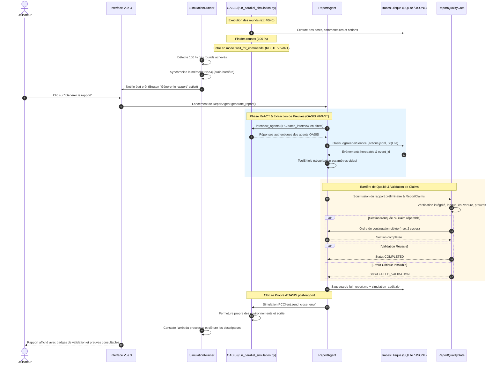

# Architecture Technique — Epic 011 : Preuve par les faits simulés, traçabilité épistémique et intégrité des rapports

> **Statut :** Planifié (Backlog)  
> **Date :** 15 octobre 2026  
> **Auteur :** Antigravity & Équipe MiroFish  
> **Référence :** [`prd.md`](prd.md) · [`rapport-chatgpt.md`](rapport-chatgpt.md)

---

## 1. Vue d'Ensemble du Flux & Cycle de Vie Vivant

L'Epic 010 a résolu le blocage IHM en arrêtant le processus OASIS dès la fin des rounds (`--no-wait`). Cet arrêt a eu pour effet pervers de casser l'outil `interview_agents` du `ReportAgent`, car le mode interactif `wait_for_commands` a été détruit.

L'architecture de l'Epic 011 rétablit le **cycle de vie vivant complet** : le processus reste en écoute IPC jusqu'à la fin de la génération et de la validation du rapport, puis est proprement éteint :



---

## 2. Composants & Chaîne de Traitement

### 2.1. Découplage Complétion / Extinction dans `SimulationRunner`
- **Composant :** `backend/app/services/simulation_runner.py`.
- **Principe :**
  - Ne plus injecter `--no-wait` par défaut au lancement des simulations.
  - Dès que `_check_all_platforms_completed(state)` est vrai, `run_state.status` bascule à `COMPLETED` pour l'IHM après le drain mémoire Neo4j, mais le sous-processus OS est **maintenu en veille active** (`wait_for_commands`).
  - L'extinction `send_close_env()` est reportée à la finalisation du `ReportAgent` (ou à l'abandon explicite via `stop_simulation`).
  - Détection automatique et repli en mode hors-ligne (`OfflineInterviewService`) si le rapport est régénéré ultérieurement sur une simulation déjà éteinte.

### 2.2. Service de Traces d'Actions (`OasisLogReaderService`) & `EvidencePack`
- **Composant :** `backend/app/services/oasis_log_reader.py`.
- **Rôle :**
  - Charger et indexer les actions réelles issues de `twitter/actions.jsonl`, `reddit/actions.jsonl` et des bases SQLite locales (`post`, `comment`, `trace`).
  - Assigner un `event_id` déterministe (`evt_<sha256_8>`), la plateforme, le round, l'horodatage et les arguments d'action.
  - Exposer au `ReportAgent` l'outil ReACT `query_simulation_events(query, agent_name, platform, round_min, round_max)`.
  - Construire un `EvidencePack` structuré avant la rédaction de la synthèse.

### 2.3. Bouclier d'Outils (`ToolShield`) — Zéro Burn d'Itérations
- **Composant :** Décorateur ou intercepteur dans `ReportAgent._execute_tool`.
- **Comportement défensif :**
  - Si un outil tel que `quick_search` ou `panorama_search` est invoqué avec `params: {}` ou `query=""`, `ToolShield` injecte automatiquement le `section_title` en cours.
  - Interception des erreurs de validation de store pour renvoyer un message d'aide exploitable au LLM sans lever d'exception non gérée.
  - Préservation intégrale du budget de 5 itérations ReACT pour chaque section.

### 2.4. Contrat d'Affirmation `ReportClaim` & Validateur Serveur
- **Modèle :** `backend/app/models/report_claim.py`.
```python
@dataclass
class ReportClaim:
    claim_id: str
    text: str
    claim_kind: ClaimKind  # SOURCE_FACT, OBSERVED_ACTION, REPORTED_INTENTION, ANALYST_INFERENCE, SPECULATIVE_PROJECTION
    origin: InformationOrigin  # CANONICAL, SIMULATION, REASONING, HYPOTHESIS
    evidence_refs: list[str]  # event_id ou doc_uuid + offsets
    verification_status: VerificationStatus  # VERIFIED, UNSUPPORTED, CONTRADICTED
    limitations: list[str] = field(default_factory=list)
```
- **Règle d'or (Intention $\neq$ Action) :**
  - Une déclaration verbale d'un agent (« Je vais acheter l'offre ») est obligatoirement typée `REPORTED_INTENTION`.
  - Elle ne peut être qualifiée de `OBSERVED_ACTION` que si une action concrète d'achat existe dans les traces d'exécution de la plateforme.

### 2.5. Typage Épistémique des Documents Sources
- **Composant :** `backend/app/models/source_document.py`.
- **Typologie :**
  - `CANONICAL_DOCUMENT` : Documents officiels de l'organisation (faits réels passés et produit).
  - `PERSONA_SPECIFICATION` : Fiches de personas fictifs et hypothèses de profils.
  - `SCENARIO_BRIEF` : Directives de simulation et contraintes d'expérimentation.
- **Barrière hermétique :** Tout fait extrait d'une source `PERSONA_SPECIFICATION` est étiqueté `[Persona fictif]` et banni de la catégorie `[Contexte documentaire historique]`.

### 2.6. Déterminisme d'Attribution des Personas (Round 0)
- **Composant :** `backend/app/services/simulation_config_generator.py`.
- **Règle :**
  - Lors de la génération des `initial_posts`, la correspondance entre le texte du post et l'`agent_id` assigné s'effectue par **correspondance exacte et insensible à la casse du nom du persona** (`entity_name` / `name`), interdisant tout brassage aléatoire au sein d'une même classe d'agents.

### 2.7. Tableau de Couverture de Cohorte & Anti-Biais
- **Composant :** Module de synthèse dans `ReportAgent`.
- **Exigences :**
  - Production systématique d'un tableau récapitulatif par persona : rôle, nombre d'actions effectives, objections exprimées, décision finale.
  - Les agents silencieux sont identifiés comme `present_no_action` (aucun faux événement n'est créé).
  - Présence obligatoire d'une section « Objections non résolues, contradictions et limites ». La synthèse exécutive ne peut pas affirmer une unanimité si le tableau consigne des refus.

### 2.8. Respect du Temps Simulé & Anti-Métriques Fantômes
- **Composant :** Filtre de cohérence dans `ReportAgent`.
- **Règles :**
  - Les marqueurs temporels (« à 48h », « à J+2 ») doivent correspondre au ratio round/heures déclaré dans `SimulationBrief.time_horizon`.
  - Aucune observation ne peut être située au-delà de l'horizon du run (ex: interdiction de « churn à 90 jours » sur un run de 72h).
  - Interdiction de formuler des ratios statistiques ou des jugements péremptoires (« coût mathématiquement insoutenable ») sans base de calcul fournie.

### 2.9. Barrière de Qualité `ReportQualityGate` & `SectionCompletionGuard`
- **Composant :** `backend/app/services/report_quality_gate.py`.
- **Contrôles préalables à la publication :**
  1. *Intégrité structurelle :* 100 % des sections prévues sont présentes et non vides.
  2. *Anti-troncature :* Détection de phrases inachevées ou coupures de tokens (`finish_reason == "length"`). Déclenchement automatique d'une reprise ciblée (`SectionCompletionGuard`, max 2 relances).
  3. *Vérification des claims :* 0 claim événementiel critique non prouvé (`UNSUPPORTED`).
  4. *Conformité linguistique :* Contrôle de la langue du texte généré selon la locale active (`fr`).
- **Machine d'états :**
  - Succès -> `ReportStatus.COMPLETED`.
  - Échec critique non résolu -> `ReportStatus.FAILED_VALIDATION` (le rapport ne se fait pas passer pour complet).

### 2.10. Dossier d'Audit Téléchargeable (`SimulationAuditService`)
- **Composant :** `backend/app/services/simulation_audit_service.py`.
- **Archive produite :** `simulation_audit.zip` contenant :
  1. `run_manifest.json` : versions, modèle, provider, paramètres, locale.
  2. `simulation_brief.json` : brief utilisateur persisté.
  3. `actors.json` : sélection d'acteurs et rôles.
  4. `source_manifest.json` : documents, rôles épistémiques et statuts de validation.
  5. `observed_events.jsonl` : journal normalisé des actions réelles avec `event_id`.
  6. `report_claims.json` : assertions structurées avec preuves et statuts.
  7. `quality_checks.json` : rapport du `ReportQualityGate`.
  8. `report.md` : texte final publié.

### 2.11. Interface Utilisateur (`ReportView.vue`)
- Affichage clair du statut de validation : badge vert « Validé », badge orange « Validé avec réserves » ou alerte rouge « Non publiable ».
- Références cliquables sous chaque conclusion ouvrant la modalité d'action exacte (horodatage, round, auteur, verbatim).
- Bouton de téléchargement du dossier d'audit complet.
