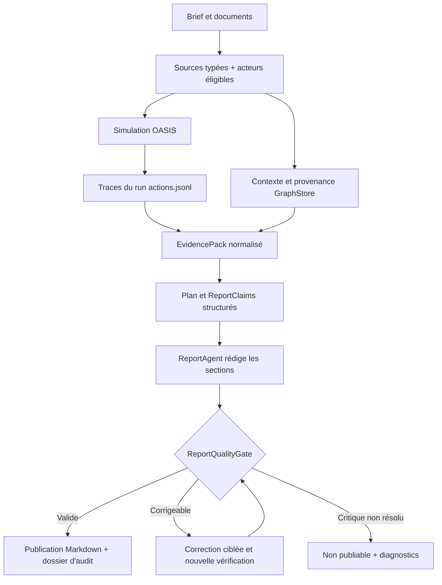

# PRD — Fiabilisation des simulations et des rapports MiroFish

> **Statut :** proposition à arbitrer — **pas une décision déjà actée**  
> **Date :** 15 octobre 2026  
> **Produit :** MiroFish — moteur de simulations sociales générique, local-first  
> **Dépôt de référence :** [`zohac/MiroFish`](https://github.com/zohac/MiroFish/tree/local-first), branche `local-first`  
> **Révision consultée :** [`56baf4b`](https://github.com/zohac/MiroFish/commit/56baf4b4719567cc9b88a303ec9c7cb2d398ab54)  
> **Destinataires :** lead développeur, agent de développement, QA  
> **Échantillon étudié :** cinq rapports de simulation Keova (`Texte collé.txt` et `Texte collé(1).txt` à `Texte collé(4).txt`) ; cinquième prompt fourni par l'utilisateur ; documents canoniques et personas Keova.  
> **Périmètre du présent PRD :** rendre les conclusions *auditables, fidèles aux entrées et explicitement reliées aux actions*, sans spécialiser MiroFish pour Keova.

---

## 1. Synthèse exécutive

### Le problème

Cinq itérations de simulation sur la découverte commerciale d'une offre ont permis d'améliorer la segmentation des agents et la richesse des objections. Le cinquième rapport est le meilleur sur la **pertinence apparente des profils**, mais présente toujours des défauts bloquants pour une utilisation décisionnelle :

1. **Événements non prouvés :** chronologies et conséquences décrites comme « observées » sans référence à des actions du run vérifiables dans le rapport.
2. **Confusion des catégories de sources :** un persona inventé devient un « fait documentaire historique » ; des faits passés sont utilisés comme preuve d'une conversion produite par la simulation.
3. **Hypothèses reconstruites a posteriori :** le rapport invente des hypothèses initiales puis prétend les réfuter.
4. **Non-respect de la langue demandée :** malgré « intégralement en français », une grande partie du rapport 5 est en anglais.
5. **Rapport incomplet :** une section est interrompue en milieu de phrase, sans empêcher la présentation du rapport.
6. **Inférences excessives :** événements opérationnels et causalités affirmés sans données quantitatives ni trace correspondante.
7. **Prémisses produit discutables :** par exemple, le paiement en ligne préalable présenté comme obligatoire pour toutes les séances alors que cette contrainte universelle n'est pas établie dans les sources fournies.

### Décision demandée

**Ne pas réécrire Graphiti, l'ontologie, le classifieur d'acteurs ni l'ensemble du ReportAgent.** Le dépôt dispose déjà de ces briques et d'un vérificateur d'actions. Mettre en place une **barrière obligatoire de qualité avant publication**, construite sur un contrat explicite **affirmation → origine → preuve → statut de validation**, puis mesurer le résultat sur les cinq cas historiques et des fixtures multi-domaines.

### Résultat attendu

MiroFish doit pouvoir produire un rapport utile qui distingue sans ambiguïté :

- ce que l'utilisateur a **fourni** ;
- ce que les agents ont **publié, dit, décidé ou effectivement exécuté** dans le monde simulé ;
- ce que le rapporteur **déduit**, avec un niveau de certitude adapté ;
- ce qui est **inconnu, non vérifié ou hors du périmètre**.

Un rapport moins spectaculaire mais vérifiable est préférable à une narration assurée sans preuves.

---

## 2. Référentiel technique — ne pas redévelopper ce qui existe

**Important :** contrairement à l'audit initial du 10 octobre, la branche `local-first` a déjà évolué. L'Epic 009 est déclaré terminé le **12 octobre 2026** et l'Epic 010 est déclaré clos au **15 octobre 2026**. Les rapports de qualification annoncent respectivement **1 145 tests passants** dans la qualification 009 et **1 580 tests passants** dans le statut du 15 octobre. Ces résultats attestent de la couverture et des validations documentées, **pas** de la qualité d'un rapport de production comme le cinquième essai. Les tests n'ont pas été relancés pour le présent PRD.

| Composant existant | État constaté dans la branche | Évolution demandée |
|---|---|---|
| `ActorClassifierService` + `ActorSelection` | Qualification à deux passes, exclusions de non-acteurs, `actors.json`, revue humaine, fingerprint et révision | Contrôler les **rôles dans le scénario** et la couverture effective du rapport ; diagnostiquer les éventuels mauvais profils |
| `SourceDocument` / `DocumentRole` | `facts`, `scenario`, `personas`, `hypotheses`, `constraints`, `reference` et statut de validation | Distinguer une **personne réelle historique** d'un **persona fictif** à l'échelle de l'affirmation, sans changer arbitrairement les rôles actuels |
| `SimulationBrief` | Horizon, audiences, exclusions, règles, hypothèses et sorties attendues structurés | S'assurer que le ReportAgent lit **les champs réellement déclarés** au lieu de reconstruire des hypothèses |
| `GraphBuilderService` / `GraphitiGraphStore` | Découpage par document, offsets et métadonnées de provenance ; ontologie appliquée et persistée | Exploiter cette provenance dans chaque affirmation du rapport ; vérifier la traversée réelle de bout en bout |
| `SimulationActionVerifier` | Charge `actions.jsonl`, calcule des `event_id`, analyse les intentions et vérifie les citations | Le rendre **obligatoire sur toutes les affirmations événementielles**, pas seulement un outil disponible à la demande du LLM |
| `ReportAgent` | Possède `verify_action`, `verify_citation`, `get_edge_provenance` et une section « Sources & Provenance » | Introduire un **validateur déterministe** du rapport et des preuves associées avant le statut `COMPLETED` |
| `SimulationRunner` | Journaux `twitter/actions.jsonl` et `reddit/actions.jsonl` ; suivi des tours et actions | Fournir une vue consolidée, stable et filtrée par `simulation_id`, plateforme et horizon simulé |
| Internationalisation | `locales/languages.json`, `get_language_instruction()`, propagation partielle de la locale | Faire respecter la langue de **toute la sortie**, pas seulement injecter une consigne au LLM |

**Références code / docs :**

- [`docs/STATUS.md`](https://github.com/zohac/MiroFish/blob/local-first/docs/STATUS.md) — état des Epics 009/010.
- [`docs/plans/009-eligibilite-acteurs-et-sources/rapport-qualification-epic-009.md`](https://github.com/zohac/MiroFish/blob/local-first/docs/plans/009-eligibilite-acteurs-et-sources/rapport-qualification-epic-009.md) — C1 à C7.
- [`docs/architecture/flux-global-simulation.md`](https://github.com/zohac/MiroFish/blob/local-first/docs/architecture/flux-global-simulation.md) — chemin complet IHM → graphe → OASIS → rapport.
- [`backend/app/services/report_agent.py`](https://github.com/zohac/MiroFish/blob/local-first/backend/app/services/report_agent.py) et [`backend/app/services/simulation_action_verifier.py`](https://github.com/zohac/MiroFish/blob/local-first/backend/app/services/simulation_action_verifier.py).
- [`backend/app/models/source_document.py`](https://github.com/zohac/MiroFish/blob/local-first/backend/app/models/source_document.py), [`backend/app/models/simulation_brief.py`](https://github.com/zohac/MiroFish/blob/local-first/backend/app/models/simulation_brief.py), [`backend/app/services/actor_classifier.py`](https://github.com/zohac/MiroFish/blob/local-first/backend/app/services/actor_classifier.py).
- [`docs/decisions/0013-semantique-des-sources.md`](https://github.com/zohac/MiroFish/blob/local-first/docs/decisions/0013-semantique-des-sources.md) — règles actuelles de validation et de conflit.

**Point de vigilance dans le code :** `ReportAgent.generate_report()` assemble les sections, ajoute au besoin « Sources & Provenance », puis attribue `ReportStatus.COMPLETED` sans validation systématique visible de la langue, de l'intégrité des sections et de l'ancrage de **chaque** affirmation. L'existence d'un `SimulationActionVerifier` et d'une section de provenance ne démontre pas à elle seule que toutes les conclusions ont été vérifiées.

---

## 3. Constats tirés des cinq rapports

| Run | Point fort | Défaut révélateur | Conclusion prudente |
|---|---|---|---|
| **R1 — Zep** | Objections commerciales relativement variées | Une praticienne pilote est traitée comme prospect | Meilleure narration ≠ profils bien qualifiés |
| **R2 — premier Graphiti** | Questions opérationnelles sur prix, paiement, confiance | Offre, produit et domaine deviennent des agents sociaux | L'éligibilité des acteurs était un problème visible ; l'Epic 009 vise déjà cette classe de défaut |
| **R3** | Mise en évidence de l'essai gratuit et de la demande d'acquisition de clientes | Rapport dominé par le fondateur et la praticienne pilote | Une cohorte simulée ne doit pas être confondue avec un dialogue entre acteurs connus |
| **R4 — personas ajoutés** | Réactions mieux segmentées | Parcours historique de cliente repris comme « preuve » de conversion ; confusion de rôles et de prix | La richesse documentaire peut provoquer une **fuite entre contexte et résultat** |
| **R5 — prompt très contraint** | Six profils couverts, refus plus différenciés, conditions d'offre mieux décrites | Origines mal attribuées, hypothèses inventées, français non respecté, section tronquée, chronologie invérifiable | **Limite atteinte du prompting seul : besoin de garde-fous logiciels** |

### Anomalies reproductibles à partir du texte R5

- **Faux historique :** « Émilie a payé 1 500 € » classé comme « contexte documentaire historique », alors qu'Émilie est un persona fictif dans le fichier `personas-et-cibles-keova.md`.
- **Hypothèse fabriquée :** le rapport invente une attente de souscription autonome dans les six premières heures, non formulée dans le prompt utilisateur.
- **Chronologie non justifiée :** segmentation du parcours commercial en plages 0–18 h, 18–36 h, 36–54 h, 54–72 h sans références d'événements accompagnant chaque étape.
- **Événement sans preuve :** embouteillage du calendrier du fondateur « dès l'heure 48 », sans compteur de créneaux ni trace de réservation fournie dans le rapport.
- **Sortie tronquée :** première section interrompue après `[Simulated 72-Hour Events] The`, puis passage directement à `02`.
- **Violation de locale :** titres et plusieurs sections en anglais malgré une consigne imposant le français.
- **Raisonnement non fondé :** coût de l'onboarding déclaré « mathématiquement » insoutenable sans durée, coût humain, revenu net, taux d'attrition ou volume mesuré.
- **Prémisse fonctionnelle non validée :** règlement CB à l'avance traité comme obligation universelle, alors que les sources fonctionnelles citées ne l'établissent pas.

Ces défauts sont **constatés dans le texte final**. Leur cause exacte (source, configuration d'agent, graphe, événement manquant, récupération ou rapporteur) est **à diagnostiquer avec les artefacts du run** ; ne pas attribuer automatiquement toutes les anomalies au même composant.

---

## 4. Objectifs, utilisateurs et indicateurs d'acceptation

### Objectifs produit

1. **Vérifiabilité :** une affirmation de comportement « observé » doit être reliée à une action effectivement enregistrée dans **le bon run**.
2. **Étanchéité :** ne pas qualifier un persona fictif de fait historique ; ne pas utiliser une hypothèse comme preuve.
3. **Fidélité :** ne pas déformer les règles du scénario ni inventer d'hypothèses initiales.
4. **Contradiction utile :** une simulation doit pouvoir aboutir à une non-adoption ou à une absence de conclusion, même lorsque le prompt présente une thèse favorable.
5. **Sortie conforme :** respecter la langue, l'horizon temporel et la complétude exigés.
6. **Généricité :** fonctionner pour des simulations commerciales, politiques, scientifiques ou fictives, sans branchement spécifique Keova.

### Utilisateurs concernés

- **Auteur du scénario :** crée le brief, choisit les sources et consulte les limitations avant lancement.
- **Analyste :** doit comprendre ce qui a été observé, inféré ou simplement fourni.
- **Développeur / QA :** doit pouvoir rejouer et auditer un rapport à partir des fichiers d'un run.

### Critères de qualité proposés (cibles de recette, non métriques déjà atteintes)

- **0 affirmation classée `observed_action` sans référence à un événement authentifié du même run.**
- **0 citation « verbatim » non retrouvée à l'identique** dans le document ou l'action référencés.
- **0 persona fictif qualifié automatiquement de `historical_fact`** sur le jeu de recette annoté.
- **100 % des hypothèses initiales présentées comme telles liées à une déclaration explicite** du brief ou étiquetées « hypothèse de l'analyste ».
- **100 % des sections présentes, non vides et non interrompues** avant publication comme rapport terminé.
- **100 % des titres et paragraphes générés dans la langue configurée** sur les tests français ; les citations originales non françaises sont soit traduites en étant étiquetées, soit présentées comme source originale selon la politique configurée.
- **0 événement prétendu dans un horizon non couvert par le run**, et aucune projection future présentée comme observation.
- **100 % des acteurs exigés pour le rapport analysés, ou signalés explicitement comme non observés / absents** ; ne jamais leur fabriquer d'activité pour remplir la couverture.
- Validation sur **Keova + au moins deux domaines indépendants**, avec les mêmes invariants, sans constante métier Keova dans le code.

---

## 5. Exigences fonctionnelles

### FR-01 — Constituer un registre des événements réellement observés — **P0**

**Besoin :** tout `ReportAgent` reçoit un `EvidencePack` construit automatiquement **avant** la rédaction, à partir des traces de simulation et des documents. Le graphe est une source de contexte enrichi ; il ne remplace pas les actions primaires du run.

**Exigences :**

- Réutiliser `SimulationActionVerifier.load_simulation_actions()` et les `event_id` existants ; éviter un second index concurrent.
- Inclure `simulation_id`, `platform`, `round`, `agent_id`, `agent_name`, `action_type`, `timestamp`, `action_args`, `result`, `success`, et l'heure simulée **si elle existe dans les traces**.
- Exclure les actions échouées des « événements exécutés avec succès » ; elles peuvent être décrites comme tentatives.
- Distinguer strictement une publication disant « je vais acheter » d'une action `purchase` réellement prise en charge et tracée. **Si OASIS n'enregistre pas d'action de paiement réelle, la souscription ne peut pas être attestée par la simulation.**
- Si aucun événement exploitable n'existe : rapport limité à « aucune observation enregistrée » ; ne pas reconstituer artificiellement une chronologie.
- Ne jamais substituer l'heure réelle de génération du rapport à l'heure simulée de l'événement ; si la conversion rounds → heures n'est pas connue, ne pas inventer d'heures précises.

**Recette :** supprimer les `actions.jsonl` d'une fixture ; toute conclusion « au 48e heure, X a réservé » doit être bloquée ou requalifiée en hypothèse non vérifiée. Modifier `simulation_id` doit invalider les références d'événements.

### FR-02 — Imposer un contrat structuré pour chaque affirmation — **P0**

Créer un objet intermédiaire de travail `ReportClaim` (nom indicatif), distinct du Markdown final. **Ne pas demander au modèle de garantir lui-même sa vérité sans validation externe.**

```json
{
  "claim_id": "claim_001",
  "text": "Florence a publié une objection au coût fixe.",
  "claim_kind": "observed_social_action",
  "origin": "simulation",
  "evidence": [
    {"kind": "simulation_event", "simulation_id": "sim_X", "event_id": "evt_..."}
  ],
  "verification_status": "verified",
  "limitations": []
}
```

> **Schéma proposé, non implémenté tel quel.** Les valeurs détaillées du contrat devront être alignées avec `InformationOrigin`, les modèles de provenance et les types d'actions actuels.

Catégories minimales de `claim_kind` : `source_fact`, `scenario_hypothesis`, `observed_social_action`, `reported_intention`, `analyst_inference`, `speculative_projection`, `unknown`. Les statuts de vérification : `verified`, `unsupported`, `contradicted`, `not_applicable`.

**Règles :**

- Toute affirmation événementielle réclame au moins une preuve `simulation_event` valide.
- Une citation de document nécessite une source et des offsets vérifiables, ou porte le statut « non vérifiable ».
- Une inférence peut être conservée sans événement direct **à condition d'être explicitement étiquetée** et d'exposer les faits qui l'inspirent ; une causalité forte nécessite des éléments probants adaptés.
- Une prétendue hypothèse de départ doit être retrouvée dans `SimulationBrief.hypotheses`, dans une règle explicite ou dans le scénario initial ; sinon renommer « hypothèse ajoutée par l'analyste » ou supprimer.
- Une affirmation en contradiction avec une source canonique déclarée doit être signalée comme conflit ; ne pas la transformer silencieusement en vérité.
- Les informations non étayées sont supprimées, affaiblies ou rendues visibles comme « à confirmer » selon leur importance.

**Recette :** le passage de R5 sur la « souscription autonome en six heures » ne doit pas être présenté comme hypothèse initiale. L'embouteillage de l'agenda sans événement ni données doit être rejeté comme observation.

### FR-03 — Distinguer les statuts épistémiques et les rôles des documents — **P0**

**Réutiliser** `DocumentRole` et `InformationOrigin`, mais ajouter une qualification explicite des **affirmations** contenues dans un document. Un fichier `personas` peut décrire un profil inventé et contenir aussi une étude de cas historique : le rôle du document seul ne suffit pas.

Proposition de `evidence_class` au niveau d'une affirmation ou d'un fragment annoté :

- `canonical_fact` — information produit/contractuelle explicitement validée ;
- `historical_case` — cas réel passé, sous réserve de source et statut de validation ;
- `fictional_persona` — personnage/scénario de test, **jamais un témoignage réel** ;
- `scenario_premise` — situation hypothétique injectée au départ ;
- `simulation_event` — fait observé dans l'univers simulé ;
- `analyst_inference` — interprétation post-run ;
- `unverified` — origine ou statut non établi.

Cela **complète**, sans renommer, les valeurs existantes de `InformationOrigin` : les deux axes répondent à des questions différentes (`origin` = provenance technique ; `evidence_class` = nature et validité dans le raisonnement).

**Règles :**

- Le statut `validated` d'un document confirme une revue humaine du **document**, pas la réalité de chaque persona qu'il décrit.
- Aucun nom de fichier ou mot-clé `canonical`/`historical` ne suffit à promouvoir son contenu en vérité.
- En mode simple, les contenus sans qualification fine peuvent rester `unverified` ; ne jamais les marquer historiques par défaut.
- Les faits historiques peuvent éclairer la simulation mais **ne prouvent pas un événement émergent** ; une action simulée doit être retrouvée indépendamment dans le journal.
- Ne pas demander à un utilisateur de baliser chaque paragraphe pour commencer une simulation : proposer une détection indicative, corrigeable en mode avancé.

**Recette :** « Émilie a payé 1 500 € », décrit sous `fictional_persona`, ne doit pas apparaître sous « contexte documentaire historique ». Le même principe doit fonctionner avec un personnage fictif d'un dossier spatial ou pédagogique.

### FR-04 — Cohorte, rôles et couverture sans résultats forcés — **P0**

- Réutiliser `ActorClassifierService`, `ActorSelection` et la prévalidation existants.
- Ajouter, si nécessaire, une information de **rôle de scénario** distincte de l'agentivité : `prospect`, `existing_user`, `founder`, `prescriber`, `observer`, `fictional_persona`, etc., **configurable et non spécifique aux métiers Keova**.
- Empêcher qu'un acteur explicitement exclu des prospects soit décrit comme une nouvelle prospect. Ne pas exclure un fondateur ou un prescripteur de toute interaction si le scénario autorise leur présence : seule la **mauvaise qualification du rôle** est interdite.
- Lorsqu'un persona est exigé dans les sorties, vérifier qu'il existe dans `actors.json`, puis dans les événements du run ; distinguer `present_no_action` de `absent_from_simulation`.
- Produire un **tableau de couverture** par persona : rôle, nombre d'actions effectives, objections exprimées, statut de décision, identifiants d'événements. Les décisions ne doivent pas être inférées comme achats réels.
- Si le prompt demande une représentativité impossible au vu des agents réellement générés, afficher cette limitation.

**Recette :** la cohorte fictive de six profils du cinquième scénario est traitée sans que la praticienne pilote déjà active soit requalifiée comme nouvelle cliente ; aucun produit, domaine ou tarif ne devient persona.

### FR-05 — Respecter le temps simulé et éviter les métriques inventées — **P0**

- L'horizon (`SimulationBrief.time_horizon`) constitue une contrainte de rapport, pas seulement une phrase injectée au modèle.
- Lier chaque marqueur « heure 24 », « jour 3 », « au round 7 » à une conversion documentée entre tours et temps simulé.
- Toute extrapolation au-delà de l'horizon doit relever d'un bloc **« Risques à explorer — non observés »**, jamais d'une action du run.
- Interdire les formulations quantitatives sans dénominateur, base et calcul disponibles : taux de conversion, capacité de rendez-vous, coût de support, ROI, délais de churn, etc.
- Les absences d'événements ne prouvent pas l'absence d'intérêt ; signaler la portée limitée des observations.

**Recette :** le R5 ne peut plus raconter un calendrier saturé à 48 h sans traces de capacité/réservation ; l'horizon 72 h ne doit pas générer de « churn observé à 90 jours ».

### FR-06 — Validation obligatoire du rapport avant publication — **P0**

Ajouter une étape `ReportQualityGate` (nom indicatif) **après la rédaction structurée et avant** `ReportStatus.COMPLETED` :

1. **Intégrité :** toutes les sections prévues existent ; contenu non vide ; absence de texte coupé au milieu d'un marqueur, d'une citation ou d'une phrase détectablement incomplète ; JSON/Markdown final assemblé de façon cohérente.
2. **Provenance :** les `ReportClaim` sont vérifiés ; les actions et citations sont résolues ; les conflits avec les sources déclarées remontent.
3. **Couverture :** les éléments obligatoires du brief ont été abordés, ou sont signalés comme non observés.
4. **Périmètre :** aucun événement attesté en dehors de l'horizon du run.
5. **Langue :** contrôle de la langue des parties rédigées, y compris titre, synthèse et sous-titres.
6. **Calibration :** le rapport ne présente pas comme preuve une intention, un profil fictif ou une inférence.

**Comportement attendu :**

- Si une section est récupérable : correction ciblée puis **nouvelle validation** avec budget de tentatives borné et configurable.
- Si des preuves manquent : retirer la conclusion forte ou la rétrograder en hypothèse.
- Si une erreur critique persiste : statut `FAILED_VALIDATION` (ou `FAILED` avec raison structurée, selon le modèle d'état actuel) ; **ne pas annoncer `COMPLETED`**.
- La section automatique « Sources & Provenance » doit refléter des vérifications **réellement exécutées** et leurs limites. Ne pas afficher une garantie globale « toute affirmation est reliée à un événement » si cela n'a pas été contrôlé.

**Recette :** injecter une section réduite à « The » avant un marqueur `02` ; le rapport ne doit pas être publié comme complet.

### FR-07 — Respect strict et cohérent de la langue — **P1**

- Définir une `output_locale` explicite dans le brief ou la configuration du rapport ; valeur de repli depuis les réglages utilisateur, puis la locale projet ; ne pas dépendre uniquement du contenu naturel du prompt.
- Propager cette locale à la génération du plan, des sections, de la synthèse, du rapport de provenance et aux agents OASIS **lorsque la langue des échanges simulés est demandée**.
- Vérifier le comportement de `get_locale()` face à `fr`, `fr-FR`, `fr;q=0.9` et aux tâches de fond, ainsi que la propagation de `set_locale` dans les threads et sous-processus.
- Conserver la citation originale pour la vérification verbatim. Si l'affichage doit être exclusivement en français et que la source est anglaise, afficher une **traduction signalée comme telle** et conserver la référence originale consultable, sans faire passer la traduction pour une citation exacte.
- Détecter les sections essentiellement rédigées dans la mauvaise langue et effectuer une correction ciblée ; revalider ensuite la fidélité des citations.

**Recette :** un rapport demandé en français ne doit pas contenir de titres « The Human Touch Catalyst » ni de paragraphes analytiques anglais. Les mots de code et noms propres restent autorisés.

### FR-08 — Réduire les biais de confirmation du ReportAgent — **P1**

- Construire la synthèse à partir d'un **inventaire des événements**, des positions divergentes et des données manquantes, avant de rédiger la narration.
- Imposer au rapport au moins une rubrique « objections non levées / résultats contradictoires / limites », si elles existent dans le run.
- Interdire de transformer une absence de preuve de conversion en conversion ; différencier `interest`, `intent_to_buy`, `demo_requested`, `purchase_executed` quand les actions le permettent.
- Séparer observation, interprétation et recommandation ; présenter les causalités (« X provoque Y ») avec un langage proportionné à la preuve.
- En cas de contradiction interne entre résumé et sections, signaler ou régénérer la synthèse.

**Recette :** si Florence refuse de s'engager et Émilie reporte sa décision, le résumé ne peut pas affirmer que l'accompagnement « convertit toute la cohorte ».

### FR-09 — Export d'un dossier d'audit par simulation — **P1**

Fournir, en local et via l'API, un **paquet d'audit** téléchargeable contenant au minimum :

```text
simulation_audit/
├── run_manifest.json           # run, versions, modèle, paramètres, horizon, locale
├── simulation_brief.json       # données d'entrée structurées
├── actors.json                 # sélection et rôles, éventuellement anonymisés
├── source_manifest.json        # documents, rôles, statuts, conflits
├── observed_events.jsonl       # actions normalisées, avec event_id
├── report_claims.json         # affirmations, origines, preuves, statuts
├── quality_checks.json        # résultats de contrôle, corrections, limites
└── report.md                  # sortie publiée
```

- Réutiliser les fichiers et journaux existants ; **ne pas dupliquer les contenus sensibles** inutilement.
- Si une source, un modèle ou une trace manque, le déclarer explicitement dans le manifeste.
- Empreinte du corpus, version du prompt, version de l'ontologie, état du graphe et paramètres du run quand disponibles ; aucune fausse reproductibilité si les éléments ne sont pas journalisés.
- Purge / export contrôlés : pas d'exposition de secrets, de données personnelles réelles ni de données de santé ; restrictions renforcées avant tout SaaS multi-utilisateur.

**Recette :** un autre développeur peut expliquer, à partir du paquet et sans connaissance implicite, pourquoi une conclusion apparaît ou a été rejetée.

### FR-10 — Harnais d'évaluation de bout en bout — **P1**

- Fixtures locales **versionnées**, sans secrets, pour cinq défauts : mauvais acteur, persona devenu historique, hypothèse inventée, événement simulé non prouvé, rapport tronqué / mauvaise langue.
- Réutiliser les tests hermétiques existants pour les composants ; ajouter des **tests d'intégration qui passent par l'assemblage réel du rapport et le QualityGate**.
- Faire passer le même contrat dans trois contextes : **offre SaaS B2B** (fixture inspirée des essais Keova), **politique publique** et **simulation spatiale ou télécom**.
- Mesurer des propriétés objectives (`unsupported_observed_claims`, `false_historical_claims`, `wrong_language_sections`, `truncated_sections`, `missing_required_personas`, `invalid_evidence_refs`) ; éviter une note LLM unique sans critères vérifiables.
- Consigner pour les comparaisons réelles : commit, modèle, provider, paramètres, prompts, hash des documents, sélection des agents, scénario OASIS et nombre de rounds. Un écart entre runs ne démontre pas automatiquement une régression du moteur.

---

## 6. UX minimale — rendre les limites visibles

Sur la page de rapport, afficher sans alourdir l'expérience :

1. **Statut du rapport :** `Validé`, `Validé avec réserves`, ou `Non publiable` ; ce statut est fondé sur le contrôleur, pas le discours du LLM.
2. **Nombre d'actions observées** et couverture des agents demandés ; clic vers les traces correspondantes.
3. **Sources utilisées :** type de document, version/date, statut de validation, contradictions et portions non exploitées.
4. **Conclusions sourcées :** référence consultable pour les actions et pour les extraits des documents.
5. **Limites :** quand un résultat est une hypothèse ou qu'aucun événement correspondant n'a été trouvé.

**Mode simple préservé :** le créateur n'a pas à remplir un formulaire complexe pour lancer une simulation. Les contrôles avancés sont automatiques, avec détails accessibles à la demande.

---

## 7. Parcours technique cible



**Point d'intégration essentiel :** utiliser les contrats neutres déjà présents (`GraphStore`, `SimulationActionVerifier`, `SourceDocument`, `SimulationBrief`, `ActorSelection`) plutôt que de contourner ces abstractions depuis le ReportAgent.

### Fichiers candidats à modifier

| Fichier / module | Intervention attendue |
|---|---|
| `backend/app/services/report_agent.py` | Construire la rédaction depuis les preuves, produire les claims, valider avant `COMPLETED` et assembler les sections sans troncature |
| `backend/app/services/simulation_action_verifier.py` | Réutiliser / étendre les vérifications vers un traitement systématique de toutes les assertions, avec preuve par `event_id` |
| `backend/app/models/source_document.py` | Ajouter la sémantique au niveau d'une affirmation ou d'un fragment si nécessaire, sans casser les enums existants |
| `backend/app/models/simulation_brief.py` | Étendre seulement les champs manquants (langue, éventuels rôles scénario), préserver compatibilité |
| `backend/app/services/simulation_manager.py` | Acheminer le brief, les rôles et la couverture des acteurs jusqu'au rapport |
| `backend/app/services/simulation_runner.py` | Exposer la consolidation événementielle sans dupliquer les logs OASIS |
| `backend/app/utils/locale.py` + APIs / workers | Normalisation et propagation des langues, y compris tâche de fond |
| `frontend/src/views/ReportView.vue` | Rendre visibles statut, preuves, réserves et couverture |
| `backend/tests/` | Ajouter tests de bout en bout sur le vrai chemin d'assemblage et de validation |

Le nom des nouveaux modules (`EvidencePack`, `ReportClaim`, `ReportQualityGate`) reste **proposé**, non imposé.

---

## 8. Découpage en stories suggéré

| Lot | Priorité | Story | Livrable / Definition of Done |
|---|---|---|---|
| **A** | P0 | **Audit de la chaîne R5** | Diagnostic documenté indiquant l'origine de chaque anomalie R5, à partir des fichiers bruts, profils, `actors.json`, traces, `agent_log.jsonl`, contexte et rapport ; identification des vérifications réellement exécutées |
| **B** | P0 | **EvidencePack et ReportClaims** | Assertions structurées, `event_id` systématiques, distinction intention / action / inférence, validation serveur et tests de contrat |
| **C** | P0 | **Contrôle de publication du rapport** | QualityGate, sections complètes, contradictions/limites signalées, réécriture bornée, aucun `COMPLETED` invalide |
| **D** | P0 | **Typologie fine des assertions documentaires** | Personas et faits historiques réellement séparés, test de fuite documentaire négatif, compatibilité SourceDocument |
| **E** | P1 | **Locale de bout en bout** | Rapport et interactions demandées intégralement en français sur fixture FR ; citations fidèles et traductions marquées |
| **F** | P1 | **Couverture des acteurs et audit UX** | Tableau par persona, état absent/silencieux, liens vers événements, export d'audit |
| **G** | P1 | **Benchmark de non-régression multi-domaines** | Bench reproductible, métriques versionnées, tests d'intégration et rapport de qualification |
| **H** | P2 | **Améliorations avancées du raisonnement** | Calibration de causalité, comparaison de scénarios, recherche web outillée ; à instruire ultérieurement, **non bloquant** |

**Ordre recommandé :** A → B → C → D → E → F → G. Les sujets A à D peuvent être regroupés dans un Epic « Fiabilité analytique », distinct des Epics 009/010 déjà clos. Pas de réouverture automatique des epics : le besoin est un **nouveau critère de qualité constaté en usage réel**.

---

## 9. Scénarios de recette — exemples précis

### T-01 — Persona fictif ≠ fait historique

**Given** : document `personas` décrivant Émilie comme personnage inventé et dépense hypothétique de 1 500 €.  
**When** : le ReportAgent produit sa synthèse.  
**Then** : l'information ne figure jamais sous « fait historique réel » ; elle est qualifiée de caractéristique du persona fictif et n'est pas utilisée pour démontrer une conversion réelle.

### T-02 — Hypothèse de départ non déclarée

**Given** : aucun objectif de paiement autonome en six heures dans le brief.  
**When** : le rapport affirme « hypothèse initiale : paiement dans les six premières heures ».  
**Then** : le QualityGate rejette cette attribution ; un raisonnement exploratoire peut être conservé uniquement sous une catégorie non initiale explicite.

### T-03 — Intention ≠ souscription

**Given** : un agent publie « Je vais m'abonner », mais les traces ne contiennent pas de transaction supportée.  
**Then** : le rapport indique « intention d'abonnement exprimée » ; il n'affirme pas « abonnement effectué ».

### T-04 — Horizon de 72 h

**Given** : scénario limité à 72 heures sans historique d'actions futures.  
**Then** : aucune résiliation à 90 jours, surcharge à 48 h ou autre événement non tracé n'est présenté comme fait observé.

### T-05 — French-only et citations

**Given** : `output_locale=fr`, documents d'entrée mixtes FR/EN.  
**Then** : titres, résumé et prose générée sont en français ; une citation anglaise est conservée en original dans la preuve, et une traduction affichée est clairement marquée comme traduction.

### T-06 — Rapport incomplet

**Given** : la génération d'une section s'interrompt après un connecteur ou un fragment incomplet.  
**Then** : le rapport ne reçoit pas le statut `COMPLETED` ; une correction est tentée et tracée, sinon le statut d'échec est explicite.

### T-07 — Six profils demandés, mais un profil silencieux

**Given** : six profils exigés par le brief, cinq actifs seulement pendant le run.  
**Then** : le rapport couvre les cinq agents actifs et signale le sixième « aucun événement observé », sans lui inventer de publication.

### T-08 — Non-régression multi-domaine

**Given** : mêmes règles avec des acteurs d'un scénario télécom et d'un scénario de politique publique.  
**Then** : aucune personne fictive promue en fait réel ; aucun objet du graphe traité comme acteur sans autorisation ; chaque observation est reliée à la bonne simulation.

### T-09 — Erreur produit / scénario

**Given** : une fonctionnalité n'est pas établie dans le référentiel déclaré ; un agent en déduit une obligation universelle.  
**Then** : le rapport distingue « perception de l'agent » de « caractéristique du produit », et signale l'absence de preuve plutôt que d'inventer une contrainte.

### T-10 — Résumé contradictoire

**Given** : plusieurs refus ou ajournements observés.  
**Then** : le résumé ne peut déclarer « tous les profils sont convertis » ; il conserve les divergences et l'incertitude.

---

## 10. Contraintes non fonctionnelles et risques

### NFR-01 — Local-first et neutralité fournisseur

- Aucun service de recherche web, compte OpenCode, Codex, Claude Code ou fournisseur propriétaire n'est requis pour ce PRD.
- Les validations déterministes doivent tourner localement avec les artefacts du run.
- Compatibilité des interfaces `GraphStore`, sans accès direct à des détails Neo4j/Zep depuis les composants applicatifs.

### NFR-02 — Sécurité et confidentialité

- Aucun secret, jeton ni identifiant personnel dans les rapports de qualification, traces de debug ou exports de support.
- Données de santé réelles hors jeu de tests ; ne pas faire fuiter de dossiers sensibles vers des modèles ou services externes.
- Prévoir la séparation par utilisateur/projet/run avant mise en SaaS ; contrôle serveur des accès aux journaux et preuves.
- Les contenus documentaires sont des **données**, jamais des instructions capables de modifier la politique de vérification.

### NFR-03 — Dégradation explicite

- En cas de trace manquante, de contexte partiel ou de quota LLM atteint : ne jamais inventer une preuve ; produire un diagnostic.
- Limiter et journaliser les régénérations, pour maîtriser le coût et la latence.
- Préserver les artefacts de diagnostic sans déclarer un rapport invalide comme terminé.

### Risques principaux

| Risque | Mitigation |
|---|---|
| Surcoût LLM / temps de génération | Validation déterministe en premier ; correction ciblée, nombre d'essais borné |
| Trop de conclusions déclassées | Distinguer inférence prudente (autorisée) et observation non étayée (interdite) |
| Tests trop « Keova » | Jeux de recette sur des domaines indépendants ; aucun nom métier codé en dur |
| Confusion temps réel / temps simulé | Champ de temps explicite ; abandon des heures précises si non reconstructibles |
| Langue étrangère dans une citation exacte | Conservation de l'original + traduction signalée, sans falsification de la citation |
| Faux sentiment de sûreté causé par une section « provenance » générique | Calculer et publier de vrais résultats de contrôle par affirmation |
| Risque de compatibilité avec les Epics 009/010 | Tests de non-régression sur acteurs, sources, graphes, cycle de vie du run |

---

## 11. Points ouverts nécessitant une décision technique

1. **Mode strict ou exploratoire :** proposer `strict` par défaut pour les affirmations observées, avec des inférences non vérifiées explicitement étiquetées ; faut-il permettre un rapport purement exploratoire ?
2. **Granularité de l'évidence :** comment associer un extrait précis d'action à une affirmation lorsque les journaux contiennent uniquement certains types d'interactions ?
3. **Statuts finaux :** réutiliser `FAILED` avec `validation_error`, ou ajouter `FAILED_VALIDATION` à la machine d'état ? Ne pas choisir sans examiner les APIs et l'IHM.
4. **Annotations source :** enrichir les fragments existants ou introduire un index séparé des assertions ? Éviter une migration incompatible si les projets sont déjà persistés.
5. **Langue des agents OASIS :** quelles étapes peuvent réellement imposer une langue de publication, et quels contrôles ne portent que sur le rapport ?
6. **Conservation du dossier d'audit :** durée, redaction et politique d'accès avant SaaS.

Ces points sont à instruire par le développeur dans la conception détaillée ; ils ne doivent pas bloquer l'audit initial de R5.

---

## 12. Éléments nécessaires pour qualifier l'incident du cinquième run

Le rapport `.txt` seul ne suffit pas pour attribuer une cause technique. Rassembler, si encore disponibles :

- `simulation_id`, `report_id`, `graph_id`, `project_id` et révision Git exacte du run ;
- documents importés avec leurs rôles / validation (`source_documents`) et `simulation_brief` persisté ;
- `actors.json`, profils OASIS générés et configuration de simulation ;
- `twitter/actions.jsonl`, `reddit/actions.jsonl`, `run_state.json` et, si disponible, les fichiers d'activité consolidée ;
- journaux `ReportAgent` (`agent_log.jsonl` et console) incluant les appels à `verify_action` et `verify_citation` ;
- modèle, provider, paramètres de génération et langue effectivement résolue ;
- sections enregistrées **avant** assemblage, rapport Markdown final, résultats et erreurs de validation existantes.

**Livrable immédiat attendu du développeur :** une table de diagnostic reliant au moins les sept anomalies listées en §3 à une cause vérifiée, ou à la mention « indéterminée — preuve absente » ; puis l'implémentation des lots P0, avec tests d'intégration indépendants de Keova.

---

## 13. Références métier utilisées comme fixture, pas comme logique produit MiroFish

Le cinquième scénario sert de **cas de recette**. Les règles ci-dessous ne doivent pas être codées en dur dans MiroFish :

- `02-utilisateurs-et-offre.md` — **« Offre commerciale canonique »** et **« Conditions de bêta »** : Essentiel 29 € TTC/mois ; aucun engagement ; 0 % commission Keova hors frais Stripe ; domaine personnalisé Premium ; démonstration et configuration humaine de la bêta ; souscription SaaS self-service différée.
- `03-produit-et-perimetre.md` — **« Paiements »**, **« Non disponible ou non promesse »** et **« Frontières produit »** : les états de paiement incluent payé, impayé et couvert ; l'export général des données clientes n'est pas confirmé ; ne pas déduire une obligation universelle de paiement anticipé.
- `05-regles-metier-et-contraintes.md` — **« Contraintes de preuve »**, **« Données personnelles et santé »**, **« Feature gating de la bêta »** : ne pas promouvoir une fonctionnalité non prouvée, ne pas généraliser un cas pilote, éviter toute exposition de données sensibles.
- `06-etat-actuel-et-roadmap.md` — **« État commercial connu »**, **« Différé après la bêta »** : distinguer livré / bêta / différé.
- `personas-et-cibles-keova.md` — **« Cas concrets historiques »** et **« Fiches détaillées des personas cibles »** : Marie-Claude est un cas historique ; Nathalie, Florence, Sylvie, Émilie, Christine et Hélène dans le prompt sont des profils simulés. Les gains, délais, pourcentages et garanties décrits comme argumentaires dans ce document ne deviennent pas automatiquement des promesses validées.

**Règle générale attendue pour tous les domaines :** une source descriptive ou un persona peut définir le monde initial de la simulation sans constituer la preuve des actions qui se produiront ensuite dans ce monde.

---

## 14. Définition de « terminé » pour ce PRD

Le travail est acceptable si, sur les fixtures de recette :

- le rapport démontre la provenance de ses affirmations observées par des références résolubles ;
- les personnes fictives ne sont pas présentées comme cas historiques ;
- les hypothèses initiales ne sont pas inventées ;
- les refus, silences et résultats contraires à la thèse ne sont pas effacés ;
- les contrôles de langue, horizon et complétude s'exécutent **avant** publication ;
- un échec critique produit un état et un diagnostic honnêtes ;
- les scénarios multi-domaines passent sans paramétrage métier spécifique ;
- une revue humaine du **cinquième run avec ses traces** confirme que les conclusions publiées ont été effectivement vérifiées, ou les requalifie explicitement.

**Recommandation finale :** traiter ce PRD comme un **Epic de fiabilité analytique**, distinct de la simple « qualité du prompt ». Les Epics 009/010 sont des fondations utiles ; le besoin supplémentaire est de **rendre leur vérification contraignante dans le produit final**, de manière observable et testée de bout en bout.
