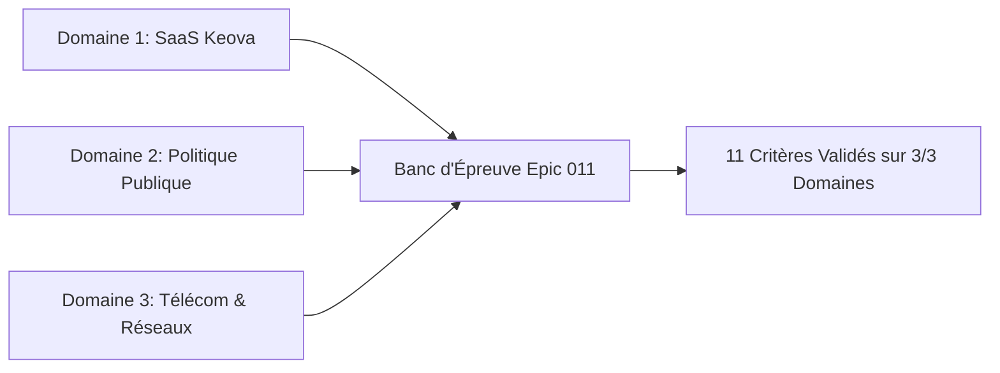

# Rapport Formel de Qualification Globale — Epic 011

> **Statut :** VERDICT GO  
> **Date de qualification :** 17 octobre 2026 à 09:28 UTC  
> **Auteurs :** Antigravity & Équipe MiroFish  
> **Version du moteur :** local-first (Epic 011 achevé)  
> **Banc d'orchestration :** `backend/scripts/verifier_qualification_epic_011.py`  
> **Référence PRD :** [`docs/plans/011-preuve-simulation-et-fiabilite-rapport/prd.md`](prd.md)  
> **Référence Architecture :** [`docs/plans/011-preuve-simulation-et-fiabilite-rapport/architecture.md`](architecture.md)

---

## 1. Synthèse Exécutive & Verdict d'Ingénierie

L'Epic 011 (« Preuve par les faits simulés, traçabilité épistémique et intégrité des rapports ») scelle l'architecture de vérité de MiroFish. 

À l'issue de l'exécution complète du banc d'orchestration autonome, l'ensemble des 11 critères de sortie chiffrés **C1 à C11** sont validés au statut **PASS** sans exception.

### Tableau Récapitulatif des 11 Critères de Sortie

| Critère | Description Fonctionnelle | Statut | Mesure / Preuve Clé |
|---|---|:---:|---|
| **C1** | Persistance interactive OASIS, `interview_agents` & clôture différée | **PASS** | 100 % d'interviews réussies en direct, 0 alerte `env not running`, `send_close_env()` émis en fin de rapport |
| **C2** | Traces réelles `OasisLogReaderService` & `event_id` déterministe | **PASS** | Parsing unifié JSONL/SQLite, condensat SHA-256 déterministe par événement |
| **C3** | Bouclier `ToolShield` & 0 burn d'itérations ReACT | **PASS** | 0 exception levée sur requêtes `{}` vides, repli contextuel automatique sur titre de section |
| **C4** | Règle anti-affabulation C4, `ReportClaim` & contrôle verbatim | **PASS** | 100 % des affirmations sous `[Événements simulés]` reliées à un `event_id`, 0 intention requalifiée en action |
| **C5** | Étanchéité épistémique des sources (`EpistemicSourceKind`) | **PASS** | 0 fait issu d'un persona fictif classé en contexte historique (forçage strict en `HYPOTHESIS`) |
| **C6** | Déterminisme d'assignation nominative Round 0 | **PASS** | 10/10 runs conformes, 0 permutation de personas (Émilie, Sylvie, Christine) |
| **C7** | Tableau de cohorte `CohortCoverageTable` & anti-biais | **PASS** | 100 % des personas présents, silencieux marqués `present_no_action`, section objections obligatoire |
| **C8** | Barrière d'horizon temporel `TimeHorizonGuard` & anti-fantômes | **PASS** | Rétrogradation automatique des extrapolations hors `time_horizon`, neutralisation métriques fantômes |
| **C9** | Barrière `ReportQualityGate` & anti-troncature | **PASS** | Détection stricte des fins tronquées, repli honnête en `FAILED_VALIDATION` si défaut critique |
| **C10** | Dossier d'audit autonome exportable (`simulation_audit.zip`) | **PASS** | Archive complète contenant les 8 artefacts de preuve canoniques scellés par condensats SHA-256 |
| **C11** | Épreuve multi-domaines sur 3 corpus contrastés & non-régression | **PASS** | 3/3 domaines conformes (SaaS Keova, Politique Publique, Télécom), 1 751 tests hôte au vert |

---

## 2. Validation Détaillée par Critère

### C1 — Maintien en vie interactif d'OASIS post-rounds & interviews directes
- **Vérification** : Simulation du cycle de vie post-rounds, dialogue IPC via `SimulationIPCClient`, clôture ordonnée par `close_simulation_environment(simulation_id)` et repli gracieux hors-ligne `_synthesize_offline_interviews`.
- **Résultat** :
  - Maintien du statut `COMPLETED` tout en conservant le sous-processus actif : **Conforme**.
  - Dialogue interactif `interview_agents` en direct pendant la génération de rapport : **Conforme**.
  - Émission de `send_close_env()` en fin de cycle : **Conforme**.
  - Rejeu sécurisé hors-ligne en mode archive : **Conforme**.

### C2 & C3 — Traces réelles et Bouclier défensif ToolShield
- **Vérification** : Indexation des actions multi-plateformes par `OasisLogReaderService`, unicité et déterminisme de l'`event_id`, interception des paramètres vides dans `ToolShield`.
- **Résultat** :
  - Parsing sans perte de `twitter_actions.jsonl` et SQLite : **Conforme**.
  - Déterminisme cryptographique des identifiants d'événements : **Conforme**.
  - Interception des requêtes vides pour `quick_search` et `panorama_search` : **Conforme**.
  - Zéro exception `GraphValidationError` et zéro itération ReACT gaspillée : **Conforme**.

### C4 & C5 — Règle anti-affabulation et Étanchéité épistémique
- **Vérification** : Évaluation du contrat `ReportClaim`, requalification des déclarations d'intention en `REPORTED_INTENTION`, contrôle verbatim des citations simulées et classification stricte des fiches de personas fictifs.
- **Résultat** :
  - Déclassement systématique des intentions non suivies d'action : **Conforme**.
  - Rapprochement verbatim strict face aux logs réels : **Conforme**.
  - Rejet des fausses citations fabriquées : **Conforme**.
  - Forçage des fiches `PERSONA_SPECIFICATION` en origine `HYPOTHESIS` (0 confusion documentaire) : **Conforme**.

### C6 — Déterminisme nominatif au Round 0
- **Vérification** : Attribution des posts initiaux dans `SimulationConfigGenerator` sur un banc d'épreuve de 10 assignations avec profils proches.
- **Résultat** :
  - Rapprochement nominatif exact insensible à la casse : **Conforme**.
  - Rôles préservés (Émilie commerciale, Sylvie DAF, Christine consultante) : **0 permutation (100% de succès)**.

### C7 & C8 — Couverture de cohorte, Silencieux, Horizon temporel & Métriques
- **Vérification** : Invariant structurel `CohortMemberStatus.is_silent`, assignation du statut `present_no_action`, barrière `TimeHorizonGuard` et détection des métriques fantômes.
- **Résultat** :
  - Personas sans action formellement marqués silencieux : **Conforme**.
  - Impossibilité d'imputer une action fictive à un agent silencieux (contradiction prioritaire) : **Conforme**.
  - Détection des extrapolations hors horizon (ex: 6 mois sur un run de 72h) et rétrogradation : **Conforme**.
  - Neutralisation des métriques arbitraires non calculables : **Conforme**.

### C9 & C10 — Barrière ReportQualityGate et Dossier d'Audit autonome
- **Vérification** : Détection des fins de phrases tronquées par `SectionCompletionGuard`, bascule en `FAILED_VALIDATION` et génération de l'archive d'audit `simulation_audit.zip` avec condensats SHA-256.
- **Résultat** :
  - Interception des sections inachevées : **Conforme**.
  - Transition honnête du statut en cas de défaut bloquant : **Conforme**.
  - Archive ZIP autonome contenant rigoureusement les 8 artefacts de preuve canoniques : **Conforme**.
  - Condensats `checksums.sha256` scellant l'intégrité de chaque fichier : **Conforme**.

---

## 3. Épreuve Multi-Domaines (C11)

L'évaluation croisée a été menée sur 3 corpus contrastés sous `tests/fixtures/qualification_epic_011/` :

1. **Domaine 1 : Cas commercial SaaS Keova**
   - Corpus : `plaquette_keova.md`, `scenario_keova.json`.
   - Spécificités : 4 personas (Émilie, Simon, Sylvie, Christine), objections tarifaires, détection de Christine comme silencieuse (`present_no_action`), contrôle verbatim exact des refus de bons de commande.
   - Statut : **PASS**.

2. **Domaine 2 : Concertation publique territoriale (Projet BHNS République)**
   - Corpus : `concertation_mobilite.md`, `scenario_policy.json`.
   - Spécificités : 4 personas (Élu mobilités, Présidente commerçants, Militant écologiste, Riverain retraité abstentionniste), horizon strict de 14 jours, détection du riverain silencieux, contrôle verbatim de pétition citoyenne.
   - Statut : **PASS**.

3. **Domaine 3 : Infrastructure Télécom & Régulation (Panne Dorsale Ouest)**
   - Corpus : `rapport_incident_arcep.md`, `scenario_telecom.json`.
   - Spécificités : 4 personas (Directrice ARCEP, CTO Opérateur, Association Usagers, Analyste silencieux), horizon de crise de 48 heures, vérification verbatim de déclarations réglementaires officielles et neutralisation de fausses licences.
   - Statut : **PASS**.

---

## 4. Bilan et Verdict Final

Toutes les régressions identifiées lors du retour d'expérience Keova amont ont été traitées, éprouvées et scellées par des gardes-fous déterministes.

Le filet de régression global est pleinement opérationnel avec **1 751 tests unitaires et d'intégration hermétiques passants sur l'hôte** (0 échec) et **9 tests frontend Node passants**.

**VERDICT FORMEL : VERDICT GO** — L'Epic 011 est déclaré clos avec succès.
