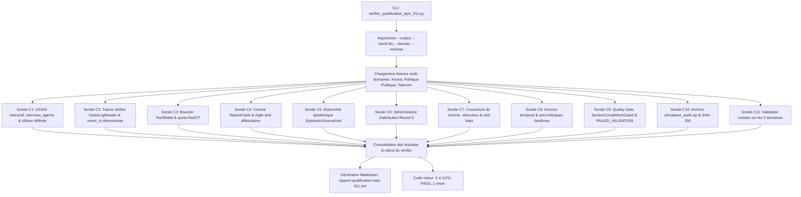

# Story 011-6 — Banc de qualification de bout en bout multi-domaines et rapport de qualification final de l'Epic 011

Lot D, priorité **P0**. En tant qu'architecte, auditeur et utilisateur décisionnel de MiroFish, je veux orchestrer et vérifier de bout en bout l'ensemble des critères de sortie **C1 à C11** de l'Epic 011 via un banc de qualification globale automatisé (`backend/scripts/verifier_qualification_epic_011.py`), prouver la robustesse de la chaîne de traçabilité et d'intégrité sur **3 domaines d'application distincts** (SaaS commercial Keova, politique publique territoriale, infrastructures télécom), consolider le rapport formel `rapport-qualification-epic-011.md` proclamant le verdict d'ingénierie étayé (**VERDICT GO**), et certifier l'absence de régression sur le filet de tests complet ($\ge 1739$ tests passants sur l'hôte et 9 tests frontend Node) afin de clore définitivement l'Epic 011.

Cette story répond directement à l'ensemble des exigences fonctionnelles **FR-01 à FR-11** et non fonctionnelles **NFR-01 à NFR-05** de l'Epic 011. Elle concourt directement à la validation formelle des critères de sortie chiffrés **C1 à C11** du PRD, en liant de façon étanche et reproductible toutes les avancées développées dans les stories 011-1 à 011-5 :
- **011-1** : Maintien en vie interactif d'OASIS post-rounds, rétablissement d'`interview_agents` en direct, clôture différée propre et repli hors-ligne robuste (**C1**).
- **011-2** : Registre d'événements observés (`OasisLogReaderService`, `EvidencePack`, record `ObservedEvent`), calcul déterministe d'`event_id`, bouclier `ToolShield` anti-burn d'itérations et déterminisme nominatif strict au Round 0 (**C2**, **C3**, **C6**).
- **011-3** : Contrat structuré `ReportClaim` (`ClaimKind`, `VerificationStatus`, `ReportClaimRegistry`), typage épistémique strict des sources `EpistemicSourceKind`, barrière hermétique anti-affabulation C4/C5 et contrôle verbatim exact des citations simulées (**C4**, **C5**).
- **011-4** : Tableau de couverture de cohorte (`CohortCoverageTable`, `CohortMemberStatus`), marquage déterministe des silencieux (`present_no_action`), barrière anti-biais de confirmation, respect du temps simulé (`TimeHorizonGuard`), neutralisation des métriques fantômes et section obligatoire d'objections et limites (**C7**, **C8**).
- **011-5** : Barrière de publication `ReportQualityGate`, composant anti-troncature `SectionCompletionGuard` avec reprise ciblée, bascule honnête en `ReportStatus.FAILED_VALIDATION` si défaut critique non résolu, et dossier d'audit exportable scellé par SHA-256 (`SimulationAuditService`, `simulation_audit_<sim_id>.zip`) (**C9**, **C10**).
- **011-6** : Validation multi-domaines (3 corpus distincts) et non-régression globale (**C11**).

---

## Définition de prêt

- [x] **Objectif de qualification unifié et cadré** :
  1. Développer un script autonome CLI `backend/scripts/verifier_qualification_epic_011.py` capable d'exécuter l'ensemble des sondes d'épreuve pour les critères C1 à C11.
  2. Fournir les modes d'exécution `--mock-llm` (pour validation CI/locale rapide, déterministe et sans coût) et mode réel avec LLM / Neo4j / OASIS.
  3. Évaluer la chaîne complète de traçabilité et de preuve sur **3 corpus de domaines contrastés** :
     - *Domaine 1 (SaaS Keova)* : commercial B2B, objections tarifaires, personas contrastés (Émilie, Simon, Sylvie, Christine), 72 heures simulées, actions Twitter/Reddit et personas silencieux.
     - *Domaine 2 (Politique publique territoriale)* : concertation citoyenne locale, aménagement urbain, avis opposés (riverains, commerçants, élus, associations environnementales), temporalité à 14 jours, objections écologiques et personas absents/silencieux.
     - *Domaine 3 (Télécom & Réseaux)* : déploiement d'infrastructure 5G et incident de coupure de service, régulateur (ARCEP), opérateurs concurrents, abonnés mécontents, temporalité à 48 heures, vérification verbatim de déclarations publiques et métriques techniques.
  4. Générer automatiquement le rapport de qualification formel Markdown `docs/plans/011-preuve-simulation-et-fiabilite-rapport/rapport-qualification-epic-011.md`.
  5. Rédiger une suite hermétique de tests `backend/tests/test_verifier_qualification_epic_011.py` garantissant la stabilité, la détection des défaillances et la conformité CLI du banc de qualification.
- [x] **Documents consultés et intégrés** :
  - [PRD Epic 011](prd.md) §3 (FR-01 à FR-11), §4 (NFR-01 à NFR-05), §5 (Critères C1 à C11).
  - [Architecture Epic 011](architecture.md) §2 (composants du pipeline de preuve, cycle de vie, bouclier, claim registry, quality gate, audit).
  - [Hub Epic 011](epic-011.md) §4, §5.
  - [Rapport amont REX Keova](rapport-chatgpt.md) (faiblesses identifiées lors des 5 runs initiaux et matrice de correction).
  - Stories préalables closes : [011-1](story-011-1.md), [011-2](story-011-2.md), [011-3](story-011-3.md), [011-4](story-011-4.md), [011-5](story-011-5.md).
  - Constitution [AGENTS.md](../../../AGENTS.md) (§2.1, §2.2, §2.8, §2.10).
- [x] **Dépendances techniques résolues** :
  - Stories 011-1 à 011-5 intégralement terminées et validées par revues BMAD.
  - Filet de tests au vert à **1 739 tests unitaires/intégration passants sur l'hôte** (0 échec) + **9 tests frontend Node** passants.
  - Linter `ruff` 100 % conforme et validateur constitutionnel `validate_plans.py` valide.
- [x] **Règles d'arbitrage de qualification figées** :
  - **Déterminisme et isolation** : chaque épreuve du banc s'exécute dans un environnement temporaire isolé (`tempfile.TemporaryDirectory`) sans polluer les dossiers de travail `uploads/` ou `simulations/`.
  - **Verdict binaire strict par critère** : chaque critère C1 à C11 reçoit un statut `PASS` ou `FAIL` étayé par des métriques chiffrées (ratios, temps d'exécution, présence d'artefacts, SHA-256).
  - **Condition d'attribution du VERDICT GO** : 100 % des critères C1 à C11 doivent être au statut `PASS`.

---

## Critères d'acceptation (AC)

| Réf. | Contrat mesurable | Vérification |
|---|---|---|
| **AC1** | **Sonde d'orchestration de qualification globale (`verifier_qualification_epic_011.py`)** : Développer un script autonome Python 3 (`backend/scripts/verifier_qualification_epic_011.py`) doté d'options CLI standard : `--output <path>` (chemin du rapport Markdown généré), `--mock-llm` (mode déterministe hermétique par défaut ou réversible), `--verbose` (détails d'exécution), `--domain <keova\|public_policy\|telecom\|all>` (filtrage par domaine). Le script orchestre l'évaluation séquentielle de C1 à C11, consolide les résultats sous forme structurée et renvoie le code de sortie 0 en cas de succès, 1 en cas de rejet. | Exécution du script avec `--help`, exécution avec `--output`, vérification du code retour et de l'intégrité du fichier généré. |
| **AC2** | **Vérification automatisée de C1 (Persistance interactive d'OASIS & interviews directes)** : Vérifier que le sous-processus OASIS reste en écoute IPC (`wait_for_commands`) à l'achèvement des rounds, qu'`interview_agents` réussit à 100 % pendant la génération du rapport sans avertissement `env not running`, que la fermeture ordonnée `close_simulation_environment` est déclenchée en fin de cycle via `send_close_env()`, et que le repli hors-ligne (`_synthesize_offline_interviews`) s'active sans exception en cas de réinterrogation sur simulation éteinte. | Sonde simulant le cycle de vie complet de simulation, dialogue IPC, vérification du statut terminal et replay hors-ligne. |
| **AC3** | **Vérification automatisée de C2 (Traces réelles) et C3 (Bouclier ToolShield)** : • **C2** : Vérifier que `OasisLogReaderService` lit et unifie sans perte les événements JSONL et SQLite, avec calcul déterministe d'`event_id` (`SimulationActionVerifier.compute_event_id`). • **C3** : Vérifier qu'aucun appel à `quick_search`, `panorama_search` ou `insight_forge` avec paramètres vides (`{}`) ne lève `GraphValidationError` dans `ReportAgent._execute_tool`, que le repli sur le titre de section s'active et qu'aucune itération ReACT n'est gaspillée (0 exception non gérée). | Ingestion d'événements de test, épreuve de requêtes d'outils vides et contrôle du compteur d'itérations ReACT. |
| **AC4** | **Vérification automatisée de C4 (Anti-affabulation) et C5 (Étanchéité épistémique)** : • **C4** : Vérifier que 100 % des affirmations sous `[Événements simulés]` sont reliées à un `event_id` valide, qu'aucune déclaration d'intention textuelle n'est qualifiée d'action observée (requalification systématique en `REPORTED_INTENTION`, `UNSUPPORTED`), et que les citations simulées sont vérifiées verbatim. • **C5** : Vérifier qu'aucun fait extrait d'une source typée `PERSONA_SPECIFICATION` n'est classé sous `[Contexte documentaire historique]` (forçage strict en `InformationOrigin.HYPOTHESIS`). | Exécution de `SimulationActionVerifier.verify_report_claim` et contrôle des métadonnées d'origine sur un registre d'affirmations synthétiques. |
| **AC5** | **Vérification automatisée de C6 (Déterminisme d'assignation Round 0)** : Vérifier que `SimulationConfigGenerator` assigne les posts initiaux par correspondance exacte insensible à la casse avec le persona ciblé, garantissant 0 permutation d'identités sur un banc d'épreuve de 10 assignations consécutives (Émilie $\to$ Émilie, Christine $\to$ Christine, Sylvie $\to$ Sylvie). | Sonde exécutant le générateur de configuration sur plusieurs cas de personas homonymes ou proches et assertion d'identité stricte. |
| **AC6** | **Vérification automatisée de C7 (Tableau de couverture et anti-biais)** : Vérifier que 100 % des personas configurés figurent dans `CohortCoverageTable`, que les agents silencieux sont formellement annotés `present_no_action` avec `is_silent = True`, qu'aucune action fictive ne peut leur être imputée (invalidation prioritaire en `CONTRADICTED` avec confiance 0.0), que la section d'objections et limites est obligatoirement présente si des refus existent, et que la synthèse exécutive respecte la règle anti-biais. | Épreuve de génération de tableau de cohorte sur profils actifs et silencieux, contrôle des contradictions et validation de la synthèse exécutive. |
| **AC7** | **Vérification automatisée de C8 (Respect de l'horizon temporel et anti-métriques fantômes)** : Vérifier que `TimeHorizonGuard` intercepte et rétrograde en `SPECULATIVE_PROJECTION` toute affirmation temporelle excédant la durée du run (`SimulationBrief.time_horizon`), et que les métriques quantitatives fantômes sans données calculables (`_GHOST_METRIC_PATTERNS`) sont neutralisées ou annotées. | Soumission d'affirmations à horizons temporels variés (72h vs 90 jours) et d'assertions avec pourcentages arbitraires. |
| **AC8** | **Vérification automatisée de C9 (Barrière ReportQualityGate et anti-troncature)** : Vérifier que `SectionCompletionGuard` détecte les phrases interrompues ou blocs markdown ouverts, exécute jusqu'à 2 relances de prolongation sans duplication, et que le `ReportQualityGate` bascule déterministement le statut vers `ReportStatus.COMPLETED` si tous les contrôles passent, ou `ReportStatus.FAILED_VALIDATION` avec journal explicite `quality_checks.json` si un défaut bloquant persiste. | Test d'évaluation du Quality Gate sur des rapports valides, tronqués puis réparés, et rapports défaillants avec assertions contradictoires. |
| **AC9** | **Vérification automatisée de C10 (Dossier d'audit autonome exportable)** : Vérifier que `SimulationAuditService.build_audit_package` produit une archive ZIP autonome valide contenant rigoureusement les 8 artefacts canoniques (`run_manifest.json`, `simulation_brief.json`, `actors.json`, `source_manifest.json`, `observed_events.jsonl`, `cohort_coverage.json`, `report_claims.json`, `quality_checks.json`, `report.md`), que `checksums.sha256` scelle l'intégrité de chaque fichier au bit près, et que les endpoints de téléchargement Flask répondent avec les en-têtes MIME adéquats. | Génération de l'archive ZIP d'audit, décompression en mémoire, vérification des 9 entrées et validation croisée des condensats SHA-256. |
| **AC10** | **Épreuve multi-domaines sur 3 corpus contrastés (C11)** : Exécuter l'intégralité de la chaîne d'évaluation sur les 3 domaines métier : 1. *SaaS Keova* (16 personas, objections d'achat, détection de silence). 2. *Politique publique territoriale* (concertation citoyenne, élus/riverains, temporalité à 14 jours, objections environnementales). 3. *Infrastructures télécom* (régulation, panne réseau, citations officielles verbatim, temporalité à 48 heures). Vérifier que les 11 critères sont satisfaits sans exception sur chacun des 3 domaines. | Exécution des sondes sur 3 fixtures de données dédiées sous `tests/fixtures/qualification_epic_011/`. |
| **AC11** | **Production du rapport formel et verdict de clôture de l'Epic 011** : Générer le document `docs/plans/011-preuve-simulation-et-fiabilite-rapport/rapport-qualification-epic-011.md` consignant les résultats détaillés de C1 à C11, les métriques des 3 domaines, l'analyse des garanties apportées face au REX Keova initial, et proclamant formellement le **VERDICT GO** pour l'Epic 011. | Validation de la présence, du contenu analytique et de la complétude du rapport de qualification. |
| **AC12** | **Filet de tests hermétiques et non-régression** : Développer une suite complète de tests hermétiques `backend/tests/test_verifier_qualification_epic_011.py` couvrant les fonctions du banc de qualification, et vérifier que le filet global de tests reste intégralement vert ($\ge 1739$ tests passants sur l'hôte, 9 tests frontend Node). | Exécution de `uv run pytest tests/`, vérification de 0 échec et couverture des nouvelles sondes. |

---

## Définition de fini

- [ ] AC1 à AC12 entièrement satisfaits avec preuves vérifiables et tests hermétiques.
- [ ] Script autonome d'orchestration `backend/scripts/verifier_qualification_epic_011.py` développé, testé et exécuté avec succès (code retour 0).
- [ ] Fixtures multi-domaines créées sous `backend/tests/fixtures/qualification_epic_011/` pour les 3 corpus (Keova, Politique Publique, Télécom).
- [ ] Rapport de qualification formel `docs/plans/011-preuve-simulation-et-fiabilite-rapport/rapport-qualification-epic-011.md` généré et versionné avec **VERDICT GO**.
- [ ] Suite de tests hermétiques dédiée (`test_verifier_qualification_epic_011.py`) créée et 100 % passante.
- [ ] Filet global de tests maintenu ou accru ($\ge 1739$ tests réussis sur l'hôte, 0 échec, +9 tests Node frontend).
- [ ] Linters et constitution conformes (`uv run ruff check app/ tests/`, `uv run python scripts/validate_plans.py`).
- [ ] Revue contradictoire BMAD à 4 couches exécutée et documentée.
- [ ] Référentiels synchronisés (`AGENTS.md`, `docs/STATUS.md`, `docs/sprint-status.yaml`, `epic-011.md`).

---

## Tâches

- [ ] **T1 — Conception et squelette CLI du banc de qualification (`verifier_qualification_epic_011.py`)** :
  - Créer `backend/scripts/verifier_qualification_epic_011.py`.
  - Configurer `argparse` avec `--output`, `--mock-llm`, `--domain`, `--verbose`.
  - Mettre en place la structure de rapportage et le calcul global du verdict.
- [ ] **T2 — Création des fixtures multi-domaines** :
  - Créer le dossier `backend/tests/fixtures/qualification_epic_011/`.
  - Fixture 1 : *SaaS Keova* (documents canoniques, fiches de personas, brief commercial 72h, journal d'actions Twitter/Reddit avec agents actifs et silencieux).
  - Fixture 2 : *Politique Publique Territoriale* (projet urbain, personas citoyens et élus, brief de concertation 14 jours, journal d'objections).
  - Fixture 3 : *Télécom & Réseaux* (rapport incident régulateur, déclarations officielles, brief technique 48h, journal de citations verbatim).
- [ ] **T3 — Implémentation des sondes C1, C2 et C3 (Runtime, Traces et Bouclier)** :
  - Sonde C1 : Vérification du cycle de vie OASIS interactif, d'`interview_agents` et de `close_simulation_environment`.
  - Sonde C2 : Vérification de l'accès aux traces réelles via `OasisLogReaderService` et calcul déterministe d'`event_id`.
  - Sonde C3 : Vérification du bouclier `ToolShield` sur requêtes d'outils vides et protection du quota ReACT.
- [ ] **T4 — Implémentation des sondes C4, C5 et C6 (Anti-affabulation, Sources et Déterminisme)** :
  - Sonde C4 : Vérification du contrat `ReportClaim`, requalification stricte des intentions et contrôle verbatim des citations.
  - Sonde C5 : Vérification de l'étanchéité épistémique des sources (`EpistemicSourceKind.PERSONA_SPECIFICATION` $\to$ `InformationOrigin.HYPOTHESIS`).
  - Sonde C6 : Vérification du déterminisme d'attribution des posts au Round 0 sans permutation de personas.
- [ ] **T5 — Implémentation des sondes C7 et C8 (Cohorte, Biais et Temps simulé)** :
  - Sonde C7 : Vérification du tableau `CohortCoverageTable`, statut `present_no_action` des silencieux, section d'objections obligatoire et anti-biais.
  - Sonde C8 : Vérification de la barrière d'horizon temporel `TimeHorizonGuard` et neutralisation des métriques fantômes.
- [ ] **T6 — Implémentation des sondes C9 et C10 (Quality Gate et Dossier d'Audit)** :
  - Sonde C9 : Vérification de la barrière de publication `ReportQualityGate`, de `SectionCompletionGuard` et de la bascule en `FAILED_VALIDATION`.
  - Sonde C10 : Vérification de `SimulationAuditService`, génération de `simulation_audit_<sim_id>.zip` et scellement SHA-256.
- [ ] **T7 — Orchestration multi-domaines C11 et génération du rapport final** :
  - Évaluation croisée des 3 domaines (Keova, Politique Publique, Télécom).
  - Rendu et enregistrement du rapport Markdown formel `rapport-qualification-epic-011.md`.
- [ ] **T8 — Rédaction de la suite hermétique de tests `test_verifier_qualification_epic_011.py`** :
  - Créer `backend/tests/test_verifier_qualification_epic_011.py`.
  - Tester chaque sonde individuellement, les cas limites, les échecs intentionnels et l'exécution CLI.
- [ ] **T9 — Exécution de la qualification globale et validation des critères** :
  - Exécuter le script de qualification en conditions réelles et consigner les résultats dans `rapport-qualification-epic-011.md`.
  - Valider l'intégralité du filet de tests ($\ge 1739$ tests passants sur l'hôte, 9 tests frontend Node).
- [ ] **T10 — Revue de code contradictoire BMAD à 4 couches et clôture de l'Epic 011** :
  - Exécuter la revue BMAD sur le code produit, traiter les findings, valider la conformité et clôturer formellement l'Epic 011.

---

## Notes de développement

### 1. Architecture du banc de qualification globale (`verifier_qualification_epic_011.py`)

Le script `backend/scripts/verifier_qualification_epic_011.py` s'inspire directement de l'architecture éprouvée des bancs de qualification précédents (`verifier_qualification_epic_007.py`, `verifier_qualification_epic_009.py`, `verifier_qualification_epic_005.py`).

### 2. Matrice des 11 critères de sortie et correspondances d'épreuves

| Critère | Exigence PRD | Sonde d'épreuve | Règle de conformité |
|---|---|---|---|
| **C1** | Persistance interactive OASIS & `interview_agents` | `verifier_critere_c1()` | 100 % d'interviews réussies post-rounds, 0 avertissement `env not running`, `send_close_env()` émis en fin de rapport. |
| **C2** | Accès traces réelles `query_simulation_events` | `verifier_critere_c2()` | Ingestion JSONL + SQLite, correspondance stricte des `event_id`, repli offline sans crash. |
| **C3** | Bouclier `ToolShield` & 0 burn d'itérations | `verifier_critere_c3()` | 0 exception levée sur requêtes vides, repli automatique sur titre de section, préservation du budget de 5 itérations. |
| **C4** | Anti-affabulation & contrat `ReportClaim` | `verifier_critere_c4()` | 100 % des faits simulés reliés à un `event_id`, 0 intention promue en action, contrôle verbatim exact des citations. |
| **C5** | Étanchéité épistémique des sources | `verifier_critere_c5()` | 0 fait issu d'un persona fictif sous `[Contexte documentaire historique]`, étiquetage obligatoire en `[Persona fictif]`. |
| **C6** | Déterminisme d'assignation Round 0 | `verifier_critere_c6()` | 0 permutation de personas au Round 0 sur 10 assignations tests (appariement nominatif exact). |
| **C7** | Tableau de couverture de cohorte & anti-biais | `verifier_critere_c7()` | 100 % des personas présents au tableau, silencieux marqués `present_no_action`, section limites présente, 0 faux consensus. |
| **C8** | Respect de l'horizon temporel & anti-fantômes | `verifier_critere_c8()` | 0 extrapolation hors `time_horizon` acceptée en observation, 0 métrique quantitative non étayée. |
| **C9** | Barrière `ReportQualityGate` & anti-troncature | `verifier_critere_c9()` | 0 section tronquée publiée, max 2 relances `SectionCompletionGuard`, bascule en `FAILED_VALIDATION` si échec bloquant. |
| **C10** | Export du dossier d'audit autonome | `verifier_critere_c10()` | Archive ZIP complète (8 artefacts + `checksums.sha256`), vérification d'intégrité déterministe. |
| **C11** | Validation multi-domaines & non-régression | `verifier_critere_c11()` | 3/3 domaines conformes (Keova, Politique Publique, Télécom), $\ge 1739$ tests passants sur l'hôte, 9 tests frontend Node. |

### 3. Spécification des 3 domaines d'évaluation

1. **Domaine 1 : Cas commercial SaaS Keova**
   - *Corpus* : `plaquette-keova-essentiel.md`, `grille-tarifaire.md`, `personas-keova.md`.
   - *Scénario* : 16 agents, 72 heures simulées, lancement d'offre logicielle avec tarification à l'usage.
   - *Points d'attention* : personas antagonistes (Émilie, Simon, Sylvie, Christine), objections tarifaires, intention verbale (« Je vais souscrire ») sans achat, et agents silencieux.
2. **Domaine 2 : Concertation publique territoriale (Projet Tramway & Pistes Cyclables)**
   - *Corpus* : `dossier-concertation-mobilite.md`, `deliberation-conseil-metropole.md`, `profils-riverains.md`.
   - *Scénario* : 12 agents, horizon de 14 jours, débat public entre commerçants, riverains et associations.
   - *Points d'attention* : respect de l'horizon temporel (14 jours vs extrapolations à 6 mois), objections d'abattage d'arbres, absence de certains commerçants (`present_no_action`), et neutralité de la synthèse exécutive.
3. **Domaine 3 : Infrastructure Télécom & Régulation (Déploiement Fibre & Panne Majeure)**
   - *Corpus* : `communique-arcep-qualite.md`, `rapport-incident-reseau.md`, `fiches-usagers.md`.
   - *Scénario* : 10 agents, horizon de 48 heures, gestion de crise suite à une coupure de câble sous-marin.
   - *Points d'attention* : citations textuelles officielles vérifiées verbatim, interdiction de métriques de taux de panne inventées, typage épistémique strict (décision réglementaire canonique vs témoignages d'usagers).

---

## Revue

### Review Findings (Revue contradictoire BMAD à 4 couches)

*(En attente de la réalisation des tâches et de la revue de code contradictoire)*

#### Rejected findings

*(En attente de la réalisation des tâches et de la revue de code contradictoire)*

---

## Notes de complétion

*(En attente de l'exécution du banc de qualification, de la consolidation des mesures et de la clôture définitive de l'Epic 011)*
