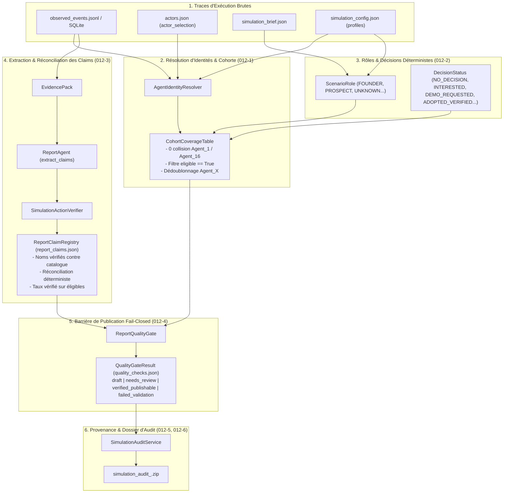
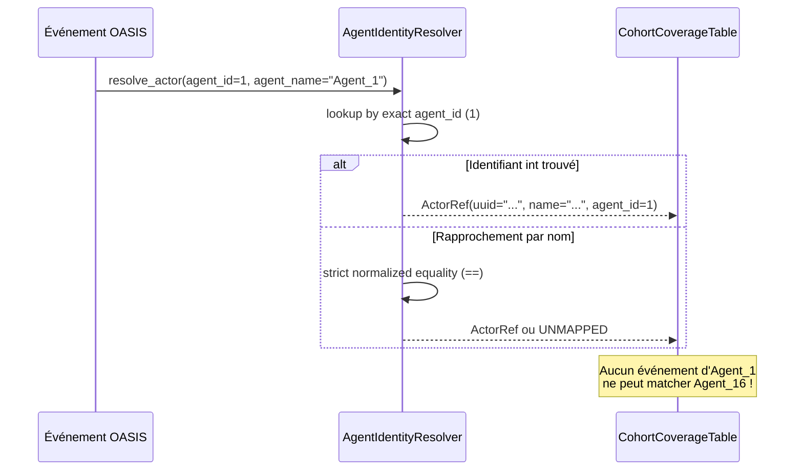
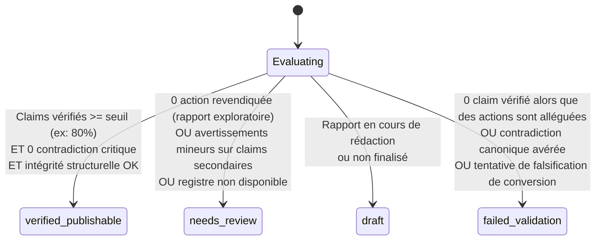

# Architecture — Epic 012 : Fiabilité des acteurs, intégrité des preuves et publication stricte

> **Statut :** Validé — En cours  
> **Date de création :** 17 octobre 2026  
> **Auteur :** Antigravity & Équipe MiroFish  
> **Dépendances :** Epic 005, Epic 007, Epic 008, Epic 009, Epic 010, Epic 011  
> **Fichier associé :** [`prd.md`](prd.md) · [`epic-012.md`](epic-012.md)

---

## 1. Vue d'Ensemble & Diagramme de Flux

L'Epic 012 renforce l'intégrité de la chaîne post-simulation, depuis l'ingestion des logs d'actions brutes jusqu'à la certification finale du rapport analytique.



---

## 2. Conception Détaillée des Composants

### 2.1. Résolution d'Identités sans Collision (`012-1`)

#### Problème constaté à l'audit R6
La comparaison dans `CohortCoverageTable.build_from_simulation` :
```python
# CODE VULNÉRABLE DANS R6
if key in ev_agent_lower or ev_agent_lower in key:
```
provoquait l'attribution des événements de `Agent_1` à `Agent_16` car `"agent_1"` est une sous-chaîne de `"agent_16"`.
De plus, la fonction incluait toutes les entités de `actor_selection` (y compris inéligibles comme Stripe ou WhatsApp) et créait des entrées distinctes pour les noms techniques `Agent_X` en plus des personas nommés.

#### Nouvelle Architecture de Résolution
1. **Résolution par Clé Primaire OASIS (`agent_id` int)** :
   - Chaque persona instancié dans OASIS possède un identifiant numérique entier `agent_id` unique ($0, 1, 2, \dots$).
   - Chaque action dans `observed_events.jsonl` porte son `agent_id` numérique ou un identifiant d'instance strict.
   - Les événements sont d'abord appariés par égalité exacte d'`agent_id`.
2. **Normalisation Stricte pour les Noms** :
   - Pour les rapprochements nominatifs, application d'une normalisation canonique : `unicodedata.normalize('NFKD', s).casefold().strip()`.
   - Correspondance par **égalité stricte** (`==`), sans aucune recherche par inclusion de sous-chaîne (`in`).
3. **Séparation Tridimensionnelle des Populations** :
   - `actor_catalog` : ensemble des entités extraites du graphe documentaire.
   - `simulation_participants` : agents réellement instanciés dans OASIS (ayant un `agent_id`).
   - `target_cohort` : ensemble des personas cibles éligibles (`eligibility_status == "eligible"`) définis par la configuration de simulation.
   - Les entités inéligibles du graphe ne sont jamais injectées dans le tableau de cohorte cible.
   - Si un agent `Agent_X` possède un nom de persona (ex: `Agent_0` = `Simon`), seule la fiche du persona nommé est retenue et porte les actions de l'agent.



---

### 2.2. Rôles de Scénario & Statuts de Décision Déterministes (`012-2`)

#### Rôles de Scénario
- Suppression du mapping par défaut `ActorRole.PERSON -> ScenarioRole.PROSPECT`.
- Le rôle est déterminé par ordre de priorité :
  1. Spécification explicite dans la configuration de simulation (`profiles` ou `target_audiences`).
  2. Rôle identifié dans le `simulation_brief` (ex: fondateur, prescripteur, partenaire, pilote).
  3. Repli neutre : `ScenarioRole.UNKNOWN` (interdiction d'inférer un rôle commercial sans source).
- Nouvelles valeurs canoniques de rôles : `FOUNDER`, `TEAM_MEMBER`, `EXISTING_USER`, `PROSPECT`, `PARTNER`, `INSTITUTION`, `UNKNOWN`.

#### Statuts de Décision Déterministes
- `NOT_APPLICABLE` : attribué d'office aux fondateurs, membres de l'équipe et institutions (ne font pas partie du dénominateur d'adoption des prospects).
- `NO_DECISION` (anciennement implicite) : aucun engagement ni rejet explicite.
- `INTERESTED` : sentiment positif ou questions exploratoires sans engagement ferme.
- `DEMO_REQUESTED` : demande explicite de démonstration, prise de contact commerciale.
- `REJECTED_EXPRESSED` : objection bloquante ou refus motivé tracé dans les actions.
- `ADOPTED_VERIFIED` : acte d'adoption vérifié par une transaction ou événement métier probant. L'absence d'objection ne confère **jamais** le statut d'adoption.

---

### 2.3. Réconciliation Robuste Claims $\leftrightarrow$ EvidencePack (`012-3`)

#### Normalisation de l'Extraction
- Validation préalable des entités : l'expression régulière n'extrait un claim que si le sujet correspond à un participant réel de la simulation (`simulation_participants` ou `target_cohort`). Les faux sujets (« Si », « Dès », « Le », « Conclusions ») sont rejetés.
- Les titres de section (`#`, `##`, `###`) sont systématiquement exclus des assertions de faits.

#### Réconciliation Déterministe
Pour chaque claim prétendant décrire une action observée (`ClaimKind.OBSERVED_SOCIAL_ACTION` ou `ClaimKind.SIMULATED_BEHAVIOR`) :
1. Recherche des événements dans l'`EvidencePack` filtrés par l'`agent_id` ou nom de l'acteur concerné.
2. Vérification de la compatibilité temporelle (round / heure simulée).
3. Contrôle de cohérence de contenu ou appariement verbatim.
4. Attribution de l'`event_id` correspondant dans `evidence_refs`.
5. Si aucun événement probant n'est trouvé, attribution explicite du statut `VerificationStatus.UNSUPPORTED` avec motif diagnostique.

---

### 2.4. Barrière de Publication « Fail-Closed » (`012-4`)

Le composant `ReportQualityGate` passe d'un comportement permissif à une barrière stricte :



1. **`verified_publishable`** : Le rapport est certifié conforme. Toutes les actions clés sont sourcées et prouvées par des `event_id` authentiques.
2. **`needs_review`** : Le rapport est consultable avec un bandeau d'avertissement explicite (ex : analyse théorique sans simulation d'actions, ou claims partiellement vérifiés).
3. **`failed_validation`** : La publication certifiée est refusée (`is_publishable = False`). Le fichier reste consultable à titre d'archive d'audit mais ne peut être diffusé comme rapport vérifié.

---

## 3. Rétrocompatibilité & Schémas

Pour garantir la non-régression sur les anciens exports sans casser l'IHM :
- `CohortMemberStatus` : supporte la désérialisation des anciens statuts (`REJECTED`, `ADOPTED`) en les mappant de manière transparente vers `REJECTED_EXPRESSED` et `ADOPTED_VERIFIED` ou `NO_DECISION`.
- `QualityGateResult` : enrichi des champs `publication_status` (`draft`, `needs_review`, `verified_publishable`, `failed_validation`) tout en conservant le booléen `is_publishable` (qui vaut `True` uniquement si `verified_publishable`, ou `False` sinon avec option configurable pour `needs_review`).
