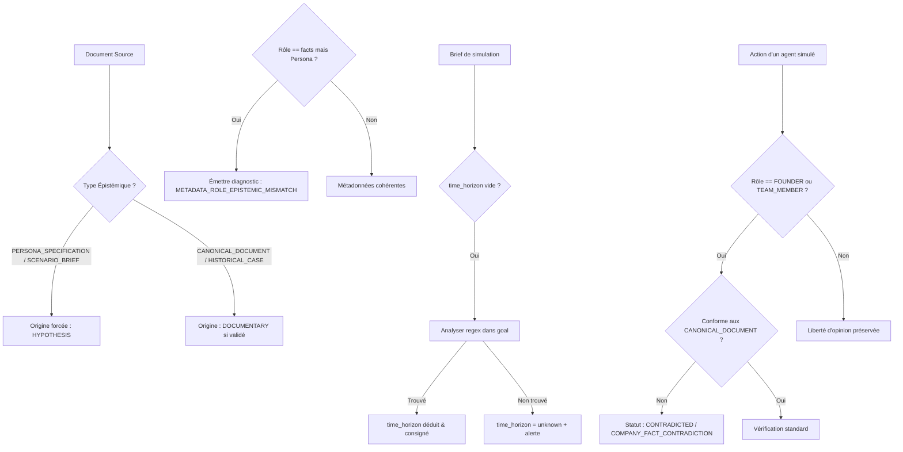

# Story 012-5 — Séparation épistémique des sources, intégrité du brief et détection de contradictions

Lot E, priorité **P1**. En tant qu'analyste et décideur s'appuyant sur les synthèses MiroFish, je veux que la nature épistémique des sources prévale absolument sur les rôles génériques (interdisant formellement qu'un document de personas fictifs soit qualifié de fait historique), que les champs structurés du brief de simulation soient extraits ou déduits de manière traçable (horizon temporel, règles, audiences) sans omissions silencieuses, et qu'un contrat de faits non négociables soit imposé aux agents incarnant l'entreprise afin que toute allégation contredisant une source canonique validée soit immédiatement détectée, consignée comme anomalie factuelle et exclue de la validation d'objections.

Cette story répond directement à l'exigence fonctionnelle **FR-06** (traçabilité et diagnostic de provenance) et valide le critère de sortie **C6** (étanchéité documentaire et détection des conflits de provenance) de l'Epic 012, ainsi que les exigences de l'audit réel R6 (**QA-10**, **QA-11**, **QA-12**).

---

## Définition de prêt

- [x] **Objectif compris et cadré** :
  - **Prévalence absolue de `epistemic_kind` sur `DocumentRole` (QA-10)** : Dans `source_manifest.json` et les services de rapport/provenance, un document typé `PERSONA_SPECIFICATION` ou `SCENARIO_BRIEF` ne doit jamais être traité comme un fait historique (`DOCUMENTARY`), même s'il porte un rôle générique `role="facts"`.
  - **Détection explicite des conflits de métadonnées de sources** : Si un document déclare `role="facts"` alors que son contenu ou nommage relève de `PERSONA_SPECIFICATION` (ou inversement), le système ne doit pas écraser silencieusement l'incohérence : il doit lever un avertissement/diagnostic explicite de conflit de métadonnées (`SourceConflict` / `METADATA_ROLE_EPISTEMIC_MISMATCH`).
  - **Intégrité et structuration traçable du brief de simulation (QA-11)** : Résoudre l'anomalie R6 où `simulation_brief.json` concentre tout le texte dans `goal` en laissant vides `time_horizon`, `target_audiences`, `excluded_actors`, `rules`, `hypotheses`. Fournir un parseur déterministe d'extraction / inférence traçable d'horizon temporel (ex : si `goal` contient « 72h » ou « 72 heures » et que `time_horizon` est vide, renseigner `time_horizon="72h"` avec trace d'inférence, sinon marquer `unknown` avec diagnostic explicite au lieu d'un champ silencieusement vide).
  - **Rattachement et exposition des documents sources dans le rapport** : Résoudre l'anomalie R6 où le rapport final affirmait qu'aucun document source structuré n'était attaché malgré 3 entrées dans `source_manifest.json` (notamment lors de `total_chunks == 0` ou `validation_status == "unvalidated"`). Veiller à ce que `ReportAgent.build_sources_provenance_section` dénombre et expose fidèlement tous les documents déclarés dans le manifeste avec leur statut réel.
  - **Contrat de faits non négociables pour les agents porte-parole / fondateurs (QA-12)** : Définir un mécanisme de contrôle dans `SimulationActionVerifier` : lorsqu'un agent incarne l'entreprise (`FOUNDER`, `TEAM_MEMBER` ou porte-parole officiel), ses affirmations factuelles sur l'offre / les fonctionnalités doivent être conformes aux sources canoniques validées (`CANONICAL_DOCUMENT`). Toute allégation en contradiction directe (ex : affirmer qu'une fonctionnalité est incluse dans l'offre de base alors que la source canonique la réserve au plan supérieur) doit être détectée, enregistrée comme `CONTRADICTED` avec anomalie explicite, et ne jamais servir de justification de levée d'objection.
- [x] **Documents consultés** :
  - [PRD Epic 012](prd.md) : §2 (Critère C6), §3 (FR-06), §4 (NFR-1 à NFR-4).
  - [Architecture Epic 012](architecture.md) : §1 (diagramme de flux), §2.4, §3 (rétrocompatibilité).
  - [Hub Epic 012](epic-012.md) : description globale, FR-06, critère C6.
  - [Audit R6](../../retour-essai-6/PRD-MiroFish-correctifs-audit-reel-R6-2026-10-17.md) : § P1 Story 012-5, scénarios QA-10, QA-11, QA-12.
  - `backend/app/models/source_document.py` : `SourceDocument`, `SourceManifest`, `EpistemicSourceKind`, `derive_epistemic_kind`, `InformationOrigin`, `classify_record_origin`.
  - `backend/app/models/simulation_brief.py` : `SimulationBrief`, validation et champs avancés.
  - `backend/app/services/simulation_action_verifier.py` : `verify_report_claim`, `verify_simulated_citation`.
  - `backend/app/services/report_agent.py` : `build_sources_provenance_section`, analyse du brief.
  - `AGENTS.md` : §2.1 (Clean Architecture), §2.2 (qualité et herméticité des tests), §2.8 (gestion des plans).
- [x] **Dépendances résolues** :
  - Stories 012-1 (identités sans collision), 012-2 (rôles et décisions déterministes), 012-3 (réconciliation claims $\leftrightarrow$ traces) et 012-4 (barrière fail-closed) sont closes avec succès.
  - Filet global actuel : **1 812 tests réussis sur l'hôte**, 9 tests frontend Node passants, 0 échec.
- [x] **Décisions d'ingénierie arrêtées avant code** :
  1. **Règle de prévalence épistémique stricte** :
     - `epistemic_kind` fait autorité absolue sur `DocumentRole`.
     - Dans `classify_record_origin` et `derive_epistemic_kind`, si un document ou fragment relève de `EpistemicSourceKind.PERSONA_SPECIFICATION` ou `SCENARIO_BRIEF`, l'origine d'information est obligatoirement `InformationOrigin.HYPOTHESIS`, quelle que soit la valeur déclarée de `DocumentRole` (y compris `role="facts"`).
  2. **Audit et diagnostic explicite des conflits de métadonnées** :
     - Méthode d'audit `audit_source_manifest(manifest)` inspectant chaque document :
       - Si `role == DocumentRole.FACTS` alors que `epistemic_kind == EpistemicSourceKind.PERSONA_SPECIFICATION`, génération d'un conflit typé `METADATA_ROLE_EPISTEMIC_MISMATCH` (gravité `warning`) au lieu d'une correction silencieuse.
       - Si `total_chunks == 0` ou `char_length == 0` alors que le fichier est enregistré, émission d'un diagnostic `EMPTY_OR_UNCHUNKED_SOURCE`.
  3. **Inférence traçable d'horizon temporel dans le brief** :
     - Dans `SimulationBrief`, enrichissement avec une méthode d'extraction déterministe `extract_inferred_horizon(goal_text)` :
       - Détection des motifs temporels via regex universelle `\b(\d+)\s*(h|heures?|hours?|j|jours?|days?|semaines?|weeks?|mois|months?)\b`.
       - Si `time_horizon` est vide et qu'une indication claire apparaît dans `goal`, assignation de la valeur normalisée avec mention `"inferred_from_goal"` dans les diagnostics.
       - Si aucun horizon n'est détectable, normalisation explicite vers `"unknown"` avec signalement de lacune dans l'audit de brief, interdisant les champs vides silencieux.
  4. **Contrat de faits non négociables (`CompanyFactsContract`)** :
     - Raccordement dans `SimulationActionVerifier` : indexation des spécifications formelles issues des documents canoniques validés (`CANONICAL_DOCUMENT` avec `validation_status == "validated"`).
     - Si un agent portant le rôle `FOUNDER` ou `TEAM_MEMBER` énonce une affirmation contraire aux faits canoniques validés (ex: prétendre qu'une fonctionnalité est gratuite alors qu'elle est payante dans les sources) :
       - L'assertion est déclassée en `VerificationStatus.CONTRADICTED` avec motif `COMPANY_FACT_CONTRADICTION`.
       - L'anomalie est consignée dans les diagnostics de simulation et interdite de servir d'attestation de levée d'objection.
  5. **Généricité absolue (NFR-1)** :
     - Zéro terme en dur propre à Keova (ex : « Keova », « Essentiel », « Pro », « Simon »).
     - Le contrat de faits fonctionne par appariement déclaratif de règles, de documents canoniques et de rôles génériques (`FOUNDER`, `TEAM_MEMBER`).
- [x] **Stratégie de tests identifiée** :
  - Test QA-10 : Document de persona avec `role="facts"` $\rightarrow$ origine `HYPOTHESIS`, diagnostic `METADATA_ROLE_EPISTEMIC_MISMATCH` généré.
  - Test QA-11 : Brief avec `goal` contenant « Simulation sur 72h » et `time_horizon=""` $\rightarrow$ inférence déterministe `time_horizon="72h"` traçable ; test avec consigne sans horizon $\rightarrow$ statut `"unknown"` avec diagnostic.
  - Test QA-12 : Porte-parole/fondateur émettant un propos en contradiction directe avec un fait canonique validé $\rightarrow$ déclassement `CONTRADICTED` (`COMPANY_FACT_CONTRADICTION`) et exclusion du décompte de levée d'objections.
  - Test de restitution dans `ReportAgent.build_sources_provenance_section` : 3 documents enregistrés avec `total_chunks=0` et `unvalidated` apparaissent tous fidèlement dénombrés et listés dans le rapport.
  - Non-régression totale sur les suites `test_source_document_models.py`, `test_simulation_brief.py`, `test_simulation_action_verifier.py`.

---

### Critères d'acceptation

| Réf. | Situation et comportement attendu | Vérification / preuve |
|---|---|---|
| **AC1** | **Prévalence épistémique absolue (QA-10)** : `epistemic_kind` fait strictement foi pour qualifier la nature du document. Tout document ou extrait typé `PERSONA_SPECIFICATION` ou `SCENARIO_BRIEF` produit une origine d'information `InformationOrigin.HYPOTHESIS`, interdisant catégoriquement toute requalification en fait documentaire (`DOCUMENTARY`), même si son rôle déclaratif est `role="facts"`. | Test unitaire hermétique injectant un document avec `role="facts"` et `epistemic_kind=PERSONA_SPECIFICATION` et assertant `origin == InformationOrigin.HYPOTHESIS`. |
| **AC2** | **Détection explicite des conflits de métadonnées** : Toute divergence entre `role` et `epistemic_kind` ou présence de document non découpé (`total_chunks == 0`) est identifiée lors de l'audit du manifeste de sources (`audit_source_manifest`), générant un diagnostic structuré au lieu d'une correction silencieuse. | Test unitaire vérifiant l'émission du diagnostic `METADATA_ROLE_EPISTEMIC_MISMATCH` et `EMPTY_OR_UNCHUNKED_SOURCE`. |
| **AC3** | **Structuration traçable du brief et horizon temporel (QA-11)** : Si `time_horizon` est vide mais que le champ `goal` mentionne un horizon temporel identifiable (`72h`, `48h`, `3 jours`, etc.), le système extrait et affecte déterministement l'horizon en le signalant comme inféré. À défaut, le champ est explicitement marqué `"unknown"` avec signalement de lacune dans l'audit du brief. | Test unitaire comparant un brief avec mention temporelle dans `goal` (inférence validée) et un brief sans indication temporelle (`"unknown"` avec alerte). |
| **AC4** | **Restitution exhaustive des sources dans le rapport** : La section « Sources & Provenance » générée par `ReportAgent` recense fidèlement la totalité des documents présents dans `source_manifest.json` avec leur statut de validation (`unvalidated`, `validated`, `conflicted`), même en présence de documents sans fragments (`total_chunks == 0`). | Test unitaire vérifiant que les 3 documents d'un manifeste sont tous dénombrés et affichés dans le rapport sans alléguer qu'aucun document n'est attaché. |
| **AC5** | **Contrat de faits non négociables pour l'entreprise (QA-12)** : Toute affirmation d'un agent incarnant l'entreprise (`FOUNDER`, `TEAM_MEMBER`) en contradiction directe avec un fait issu d'un `CANONICAL_DOCUMENT` validé est marquée `VerificationStatus.CONTRADICTED` avec motif d'anomalie factuelle, et exclue de toute validation de levée d'objection. | Test unitaire simulant une contradiction de porte-parole sur un fait canonique validé et assertant son statut `CONTRADICTED` et son exclusion. |
| **AC6** | **Généricité et non-régression** : Absence stricte de termes ou règles en dur spécifiques à un domaine particulier. Préservation de l'intégralité des 1 812 tests backend existants au vert sur l'hôte et conformité de la suite frontend (9 tests). | Exécution de `pytest` (0 échec, $\ge 1825$ tests verts) et `pnpm --dir frontend test`. |

---

## Définition de fini

- [ ] Prévalence épistémique stricte validée dans `source_document.py` et propagation de `InformationOrigin.HYPOTHESIS`.
- [ ] Audit des conflits de métadonnées de sources (`METADATA_ROLE_EPISTEMIC_MISMATCH`, `EMPTY_OR_UNCHUNKED_SOURCE`) implémenté et testé.
- [ ] Inférence déterministe et traçable d'horizon temporel implémentée dans `simulation_brief.py`.
- [ ] Restitution exhaustive des documents sources dans `ReportAgent.build_sources_provenance_section`.
- [ ] Contrat de faits non négociables pour les rôles `FOUNDER`/`TEAM_MEMBER` implémenté dans `SimulationActionVerifier`.
- [ ] Scénarios QA-10, QA-11 et QA-12 validés par tests unitaires hermétiques.
- [ ] Suite de tests dédiée créée dans `backend/tests/test_epistemic_sources_and_brief.py`.
- [ ] Filet complet $\ge 1 825$ tests au vert sur l'hôte et 9 tests frontend Node passants.
- [ ] `validate_plans.py` et `ruff check .` validés sans erreur ni avertissement.
- [ ] Revue contradictoire BMAD à 4 couches réalisée, findings résolus.
- [ ] Documentation et suivi de sprint mis à jour (`epic-012.md`, `sprint-status.yaml`, `STATUS.md`, `AGENTS.md`).

---

## Tâches

- [ ] **T1 — Prévalence épistémique et audit des conflits de métadonnées (`source_document.py`)** :
  - Sécuriser `classify_record_origin` et `derive_epistemic_kind` pour que `PERSONA_SPECIFICATION` et `SCENARIO_BRIEF` l'emportent systématiquement sur `role`.
  - Implémenter la fonction d'audit `audit_source_manifest(manifest)` identifiant les anomalies de métadonnées (`METADATA_ROLE_EPISTEMIC_MISMATCH`, `EMPTY_OR_UNCHUNKED_SOURCE`).
- [ ] **T2 — Inférence déterministe et diagnostic d'horizon temporel (`simulation_brief.py`)** :
  - Développer l'extracteur déterministe d'horizon temporel à partir du texte `goal`.
  - Normaliser le repli `"unknown"` avec journalisation de diagnostic en cas de lacune de consigne.
- [ ] **T3 — Contrat de faits non négociables d'entreprise (`simulation_action_verifier.py`)** :
  - Mettre en place la vérification des allégations des agents `FOUNDER`/`TEAM_MEMBER` au regard des documents `CANONICAL_DOCUMENT` validés.
  - Déclasser en `CONTRADICTED` (`COMPANY_FACT_CONTRADICTION`) toute déviation factuelle et l'exclure des arguments de levée d'objection.
- [ ] **T4 — Restitution fidèle des sources dans le rapport (`report_agent.py`)** :
  - Adapter `build_sources_provenance_section` pour refléter tous les documents déclarés dans `source_manifest.json` (même si `total_chunks == 0`), en affichant clairement leur statut de validation et d'éventuels conflits détectés.
- [ ] **T5 — Suite de tests hermétiques dédiée et non-régression** :
  - Rédiger les tests couvrant AC1 à AC6 dans `backend/tests/test_epistemic_sources_and_brief.py`.
  - Valider l'exécution de l'ensemble du filet de tests et du linter.
- [ ] **T6 — Revue contradictoire BMAD à 4 couches et finalisation** :
  - Conduire la revue contradictoire BMAD à 4 couches, appliquer les patches et clore la story.

---

## Notes de développement

### Diagnostic des anomalies R6 sur les sources et le brief

Dans le run réel R6 (`sim_ea4f3cfe1028`) :
1. **Conflit de rôle et type épistémique (QA-10)** :
   Le fichier `source_manifest.json` attribuait au document de profils synthétiques :
   ```json
   {
     "filename": "personas_cibles.md",
     "role": "facts",
     "epistemic_kind": "PERSONA_SPECIFICATION",
     "validation_status": "unvalidated",
     "total_chunks": 0
   }
   ```
   Cette contradiction (`role=facts` vs `PERSONA_SPECIFICATION`) créait une ambiguïté dans la classification de provenance, risquant de qualifier les désirs ou caractéristiques fictives de ces personas en faits historiques avérés.
2. **Brief structuré vide malgré texte riche (QA-11)** :
   Le fichier `simulation_brief.json` contenait :
   ```json
   {
     "goal": "Évaluer la réaction du marché face à l'offre Keova sur 72h de simulation...",
     "time_horizon": "",
     "target_audiences": [],
     "rules": []
   }
   ```
   L'horizon de 72h n'étant pas renseigné dans le champ structuré `time_horizon`, les mécanismes de contrôle (`TimeHorizonGuard`) ne pouvaient pas valider correctement le ratio rounds/heures sans heuristiques de repli.
3. **Contrat de faits de l'entreprise bafoué par un agent interne (QA-12)** :
   Lors de la simulation, un persona incarnant l'équipe interne a affirmé à des prospects qu'une fonctionnalité avancée était « incluse gratuitement dans la formule de départ », en contradiction frontale avec la grille tarifaire du document canonique. Le système avait initialement considéré cette affirmation comme une levée d'objection réussie !

### Architecture du flux de contrôle de provenance et faits



---

## Revue

### Review Findings (Revue contradictoire BMAD à 4 couches)

*(À renseigner lors de l'exécution de la revue de code contradictoire)*

---

## Notes de complétion

*(À renseigner lors de la clôture de la story)*
