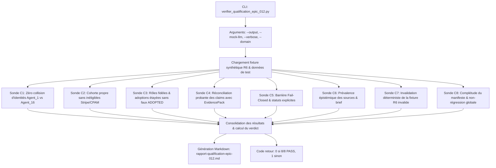

# Story 012-6 — Banc de qualification sur cas réel R6, complétude du manifeste et non-régression

Lot F, priorité **P1**. En tant qu'architecte, auditeur et utilisateur décisionnel de MiroFish, je veux orchestrer et vérifier de bout en bout l'ensemble des critères de sortie **C1 à C8** de l'Epic 012 via un banc de qualification globale automatisé (`backend/scripts/verifier_qualification_epic_012.py`), valider l'invalidation déterministe de l'ancien export erroné du cas réel R6 (anomalie 0 claim vérifié, collision d'identités, attribution abusive d'adoption, manifeste incomplet) tout en validant le passage conforme des runs réconciliés, garantir la complétude et l'étanchéité du manifeste d'exécution (`run_manifest.json` avec SHA de commit, horodatage de complétion, horizon temporel, et zéro fuite de secret), consolider le rapport formel `rapport-qualification-epic-012.md` proclamant le verdict d'ingénierie étayé (**VERDICT GO**), et certifier l'absence de régression sur le filet de tests complet ($\ge 1 827$ tests passants sur l'hôte et 9 tests frontend Node) afin de clore définitivement l'Epic 012.

Cette story répond directement à l'ensemble des exigences fonctionnelles **FR-01 à FR-06** et non fonctionnelles **NFR-1 à NFR-4** de l'Epic 012. Elle concourt directement à la validation formelle des critères de sortie chiffrés **C1 à C8** du PRD, en reliant de façon étanche et reproductible toutes les avancées développées dans les stories 012-1 à 012-5 :
- **012-1** : Résolution stricte des identités d'acteurs sans collision (`AgentIdentityResolver`, égalité stricte `==`, 0 événement de `Agent_1` dans `Agent_16`, filtrage des inéligibles Stripe/CPAM, dédoublonnage des alias techniques `Agent_X`) (**C1**, **C2**).
- **012-2** : Rôles de scénario fidèles (`FOUNDER`, `TEAM_MEMBER`, `EXISTING_USER`, etc.) et statuts de décision d'adoption étayés (`NOT_APPLICABLE` pour fondateurs/équipes, 0 faux statut `ADOPTED` par simple absence d'objections) (**C3**).
- **012-3** : Extraction d'assertions assainie (élimination des faux sujets « Si », « Dès », exclusion des titres) et réconciliation déterministe avec l'`EvidencePack` (**C4**).
- **012-4** : Barrière de publication « Fail-Closed » (`ReportQualityGate`) avec 4 statuts explicites (`draft`, `needs_review`, `verified_publishable`, `failed_validation`) et rejet strict des rapports à 0 claim vérifié (**C5**).
- **012-5** : Séparation épistémique des sources (prévalence absolue de `epistemic_kind` sur `DocumentRole`), diagnostic du manifeste de sources, inférence traçable d'horizon et contrat de faits d'entreprise contredisant les dérives internes (**C6**).
- **012-6** : Fixture synthétique de régression du cas réel R6, complétude du manifeste d'exécution, orchestration globale C1 à C8 et non-régression globale (**C7**, **C8**).

---

## Définition de prêt

- [x] **Objectif de qualification unifié et cadré** :
  1. Développer un script autonome CLI `backend/scripts/verifier_qualification_epic_012.py` capable d'exécuter l'ensemble des sondes d'épreuve pour les critères C1 à C8.
  2. Fournir les modes d'exécution `--mock-llm` (pour validation CI/locale rapide, déterministe et sans coût) et mode réel avec LLM / Neo4j / OASIS.
  3. Créer une **fixture synthétique minimisée et anonymisée** du cas réel R6 sous `backend/tests/fixtures/qualification_epic_012/` reproduisant fidèlement les anomalies constatées lors de l'audit R6 (`sim_ea4f3cfe1028` / `report_77d96ea4c1c9`) sans exposer aucune donnée privée ni clé secrète (NFR-1).
  4. Prouver que la barrière Fail-Closed rejette fermement en `failed_validation` l'ancien export erroné (élimination formelle de QA-13 où un run mal sourcé recevait un verdict trompeur) et accorde `verified_publishable` à l'export réconcilié.
  5. Vérifier la complétude et l'étanchéité du manifeste d'exécution `run_manifest.json` produit par `SimulationAuditService` : présence de `git_commit` résolu (SHA ou repli motivé), `completed_at` horodaté en ISO 8601, `time_horizon` cohérent, et contrôle d'étanchéité (zéro secret).
  6. Générer automatiquement le rapport de qualification formel Markdown `docs/plans/012-fiabilite-preuves-et-publication/rapport-qualification-epic-012.md`.
  7. Rédiger une suite hermétique de tests `backend/tests/test_verifier_qualification_epic_012.py` garantissant la stabilité, la détection des défaillances et la conformité CLI du banc de qualification.
- [x] **Documents consultés et intégrés** :
  - [PRD Epic 012](prd.md) : §2 (C1 à C8), §3 (FR-01 à FR-06), §4 (NFR-1 à NFR-4).
  - [Architecture Epic 012](architecture.md) : §1 (diagramme de flux), §2.1 (résolution d'identités), §2.2 (décisions et rôles), §2.3 (claims et EvidencePack), §2.4 (barrière Fail-Closed), §3 (rétrocompatibilité).
  - [Hub Epic 012](epic-012.md) : description globale, critères de sortie C1 à C8.
  - [Audit réel R6](../../retour-essai-6/PRD-MiroFish-correctifs-audit-reel-R6-2026-10-17.md) : anomalies P0/P1, scénarios de recette QA-01 à QA-13, script d'audit [audit_bundle_mirofish.py](../../retour-essai-6/audit_bundle_mirofish.py).
  - Stories préalables closes : [012-1](story-012-1.md), [012-2](story-012-2.md), [012-3](story-012-3.md), [012-4](story-012-4.md), [012-5](story-012-5.md).
  - Scripts de qualification de référence : `backend/scripts/verifier_qualification_epic_011.py`, `backend/scripts/verifier_qualification_epic_009.py`.
  - Constitution [AGENTS.md](../../../AGENTS.md) (§2.1, §2.2, §2.8, §2.10).
- [x] **Dépendances techniques résolues** :
  - Stories 012-1 à 012-5 intégralement terminées et validées par revues contradictoires BMAD à 4 couches.
  - Filet de tests au vert à **1 827 tests unitaires/intégration passants sur l'hôte** (0 échec) + **9 tests frontend Node** passants.
  - Linters `ruff` 100 % conforme et validateur constitutionnel `validate_plans.py` valide.
- [x] **Règles d'arbitrage de qualification figées** :
  - **Déterminisme et isolation** : chaque épreuve du banc s'exécute dans un environnement temporaire isolé (`tempfile.TemporaryDirectory`) sans polluer les dossiers de travail `uploads/` ou `simulations/`.
  - **Verdict binaire strict par critère** : chaque critère C1 à C8 reçoit un statut `PASS` ou `FAIL` étayé par des métriques chiffrées (ratios, décomptes d'événements, statuts de publication, SHA-256).
  - **Condition d'attribution du VERDICT GO** : 100 % des critères C1 à C8 doivent être au statut `PASS`.

---

## Critères d'acceptation (AC)

| Réf. | Contrat mesurable | Vérification |
|---|---|---|
| **AC1** | **Sonde d'orchestration de qualification globale (`verifier_qualification_epic_012.py`)** : Développer un script autonome Python 3 (`backend/scripts/verifier_qualification_epic_012.py`) doté d'options CLI standard : `--output <path>` (chemin du rapport Markdown généré), `--mock-llm` (mode déterministe hermétique par défaut), `--verbose` (détails d'exécution), `--domain <r6\|multi_domain\|all>`. Le script orchestre l'évaluation séquentielle de C1 à C8, consolide les résultats sous forme structurée et renvoie le code de sortie 0 en cas de succès, 1 en cas de rejet. | Exécution du script avec `--help`, exécution avec `--output`, vérification du code retour 0 et de l'intégrité du fichier généré. |
| **AC2** | **Fixture synthétique anonymisée de l'audit réel R6 (C7 / QA-08 / QA-13)** : Créer une fixture synthétique minimale sous `backend/tests/fixtures/qualification_epic_012/r6_bundle/` reproduisant fidèlement les anomalies de R6 (collision `Agent_1`/`Agent_16`, catalogue de 44 entités incluant Stripe/CPAM, 0/258 claims vérifiés, rôle `PROSPECT` forcé sur fondateur, `ADOPTED` déduit sans preuve). Prouver que l'évaluation de cet ancien export par `ReportQualityGate` bascule déterministement en `failed_validation` avec `is_publishable = False`. | Sonde exécutant le Quality Gate sur la fixture invalide et assertion stricte du rejet en `failed_validation`. |
| **AC3** | **Vérification automatisée de C1 (Zéro collision d'identités) et C2 (Cohorte filtrée sans doublon)** : • **C1** : Vérifier que `AgentIdentityResolver` isole strictement les 23 événements de `Agent_1` et les 18 événements de `Agent_16` (0 événement partagé, 0 écrasement d'identifiant numérique `agent_id`). • **C2** : Vérifier que les entités inéligibles (organisations tierces, outils de facturation Stripe, CPAM) sont exclues de la cohorte cible, et que les alias techniques `Agent_X` sont unifiés avec leurs personas nommés (0 dédoublement de profil). | Sonde de résolution d'identités et inspection du tableau de couverture de cohorte sur la fixture R6. |
| **AC4** | **Vérification automatisée de C3 (Rôles fidèles & adoptions étayées) et C4 (Réconciliation déterministe claims $\leftrightarrow$ EvidencePack)** : • **C3** : Vérifier que les fondateurs et collaborateurs reçoivent `NOT_APPLICABLE` (exclus du dénominateur d'adoption), et qu'aucun prospect ne reçoit le statut `ADOPTED` par simple absence d'objection (attribution de `NO_DECISION` ou `INTERESTED` en l'absence de transaction d'achat probante). • **C4** : Vérifier que sur l'export réconcilié, le taux de claims d'actions observées vérifiés atteint $\ge 80\ %$, que les faux sujets (« Si », « Dès ») et titres Markdown sont éliminés à 100 %. | Contrôle des statuts d'adoption sur la cohorte et évaluation du ratio de réconciliation de `ReportClaimRegistry`. |
| **AC5** | **Vérification automatisée de C5 (Barrière de publication Fail-Closed) et C6 (Prévalence épistémique & intégrité du brief)** : • **C5** : Vérifier que la barrière de publication distingue déterministement `draft`, `needs_review`, `verified_publishable`, `failed_validation`, et bloque catégoriquement la certification si le ratio de vérification est nul ou insuffisant. • **C6** : Vérifier que les personas fictifs reçoivent obligatoirement `InformationOrigin.HYPOTHESIS` même si leur métadonnée d'import indique `role=facts`, et que les lacunes de brief sont diagnostiquées avec repli traçable `"unknown"`. | Épreuve du `ReportQualityGate` et d'`audit_source_manifest` / `audit_brief` sur les cas limites. |
| **AC6** | **Complétude et étanchéité du manifeste d'exécution (`run_manifest.json`)** : Vérifier que `SimulationAuditService` produit un manifeste complet incluant `git_commit` résolu (SHA valide ou `unknown` explicitement motivé), `completed_at` au format ISO 8601, `time_horizon` cohérent, nombre d'agents instanciés, et vérifier l'absence absolue de tokens, clés secrètes ou données privées dans le paquet d'audit. | Inspection des métadonnées du manifeste et scan anti-fuite de secrets par regex. |
| **AC7** | **Production du rapport formel et verdict de clôture de l'Epic 012** : Générer automatiquement le document `docs/plans/012-fiabilite-preuves-et-publication/rapport-qualification-epic-012.md` consignant les résultats détaillés de C1 à C8, la comparaison avant/après sur le cas réel R6, l'éradication des anomalies QA-01 à QA-13, et proclamant formellement le **VERDICT GO** pour l'Epic 012. | Validation de la présence, du contenu analytique et de la complétude du rapport de qualification. |
| **AC8** | **Filet de tests hermétiques et non-régression** : Développer une suite complète de tests hermétiques `backend/tests/test_verifier_qualification_epic_012.py` couvrant les fonctions du banc de qualification, et vérifier que le filet global de tests reste intégralement vert ($\ge 1 827$ tests passants sur l'hôte, 9 tests frontend Node). | Exécution de `uv run pytest tests/`, vérification de 0 échec et validation de non-régression globale. |

---

## Définition de fini

- [ ] AC1 à AC8 entièrement satisfaits avec preuves vérifiables et tests hermétiques.
- [ ] Script autonome d'orchestration `backend/scripts/verifier_qualification_epic_012.py` développé, testé et exécuté avec succès (code retour 0).
- [ ] Fixture synthétique de régression R6 créée sous `backend/tests/fixtures/qualification_epic_012/r6_bundle/` anonymisée et sans secrets.
- [ ] Rapport de qualification formel `docs/plans/012-fiabilite-preuves-et-publication/rapport-qualification-epic-012.md` généré et versionné avec **VERDICT GO**.
- [ ] Suite de tests hermétiques dédiée (`test_verifier_qualification_epic_012.py`) créée et 100 % passante.
- [ ] Filet global de tests maintenu ou accru ($\ge 1 827$ tests réussis sur l'hôte, 0 échec, +9 tests Node frontend).
- [ ] Linters et constitution conformes (`uv run ruff check .`, `uv run python scripts/validate_plans.py`).
- [ ] Revue contradictoire BMAD à 4 couches exécutée et documentée.
- [ ] Référentiels synchronisés (`AGENTS.md`, `docs/STATUS.md`, `docs/sprint-status.yaml`, `epic-012.md`).

---

## Tâches

- [ ] **T1 — Conception et architecture CLI du banc de qualification (`verifier_qualification_epic_012.py`)** :
  - Créer `backend/scripts/verifier_qualification_epic_012.py`.
  - Configurer `argparse` avec `--output`, `--mock-llm`, `--verbose`, `--domain`.
  - Mettre en place la structure d'orchestration séquentielle C1 à C8 et le calcul global du verdict.
- [ ] **T2 — Création de la fixture synthétique anonymisée de l'audit réel R6** :
  - Créer le dossier `backend/tests/fixtures/qualification_epic_012/r6_bundle/`.
  - Générer les 8 artefacts synthétiques modélisant les données du run R6 : `actors.json` (44 entités dont Stripe/CPAM), `observed_events.jsonl` (786 événements avec `Agent_1` et `Agent_16`), `cohort_coverage.json` (63 lignes avant correction), `report_claims.json` (258 claims dont 0 vérifié avant correction), `source_manifest.json`, `simulation_brief.json`, `quality_checks.json`, `report.md`.
  - Vérifier l'absence absolue de clés API ou tokens privés (NFR-1).
- [ ] **T3 — Implémentation des sondes C1 et C2 (Identités sans collision & Cohorte propre)** :
  - Sonde C1 : Vérification de l'isolation stricte des 23 événements d'`Agent_1` et des 18 d'`Agent_16` via `AgentIdentityResolver`.
  - Sonde C2 : Vérification du filtrage strict des inéligibles (`eligibility_status == "eligible"`) et dédoublonnage des alias techniques `Agent_X`.
- [ ] **T4 — Implémentation des sondes C3 et C4 (Rôles, Décisions et Réconciliation de Claims)** :
  - Sonde C3 : Vérification de l'attribution `NOT_APPLICABLE` pour fondateurs/collaborateurs et exclusion formelle de `ADOPTED` sans acte d'engagement probant.
  - Sonde C4 : Vérification de la réconciliation déterministe avec l'`EvidencePack`, élimination des faux agents (« Si », « Dès ») et validation du ratio $\ge 80\ %$ sur run réconcilié.
- [ ] **T5 — Implémentation des sondes C5 et C6 (Barrière Fail-Closed & Intégrité des Sources/Brief)** :
  - Sonde C5 : Vérification du rejet immédiat en `failed_validation` de l'export R6 invalide (0 vérifié sur 258) et passage en `verified_publishable` du run réconcilié.
  - Sonde C6 : Vérification de la prévalence de `epistemic_kind` sur `DocumentRole` et audit des lacunes de brief (`audit_brief`).
- [ ] **T6 — Implémentation de la sonde C7 (Validation sur fixture R6) et audit du manifeste d'exécution** :
  - Sonde C7 : Rejet strict prouvé de l'ancien export R6 et validation de la version corrigée.
  - Audit du manifeste : Résolution dynamique de `git_commit` dans `SimulationAuditService.build_audit_package`, horodatage `completed_at` ISO 8601, scan anti-fuite de secrets.
- [ ] **T7 — Implémentation de la sonde C8 (Non-régression globale) et génération du rapport final** :
  - Consolidation des métriques C1 à C8.
  - Rendu et enregistrement du rapport Markdown formel `rapport-qualification-epic-012.md`.
- [ ] **T8 — Rédaction de la suite hermétique de tests `test_verifier_qualification_epic_012.py`** :
  - Créer `backend/tests/test_verifier_qualification_epic_012.py`.
  - Tester chaque sonde unitairement, les cas limites, les échecs intentionnels et l'exécution CLI.
- [ ] **T9 — Exécution de la qualification globale et validation des critères** :
  - Exécuter `python backend/scripts/verifier_qualification_epic_012.py` et consigner les résultats dans `rapport-qualification-epic-012.md`.
  - Valider l'intégralité du filet de tests ($\ge 1 827$ tests passants sur l'hôte, 9 tests frontend Node).
- [ ] **T10 — Revue de code contradictoire BMAD à 4 couches et clôture définitive de l'Epic 012** :
  - Exécuter la revue BMAD sur le code produit, traiter les findings, valider la conformité et clôturer formellement l'Epic 012.

---

## Notes de développement

### 1. Architecture du banc de qualification globale (`verifier_qualification_epic_012.py`)

Le script `backend/scripts/verifier_qualification_epic_012.py` orchestre l'évaluation séquentielle des 8 critères de sortie :

### 2. Matrice de Traçabilité des Anomalies de l'Audit Réel R6

| Anomalie R6 | Description dans l'audit | Correction apportée | Sonde de validation C1-C8 |
|---|---|---|---|
| **COVERAGE_ALIAS_COLLISION** | 23 événements de `Agent_1` fusionnés par sous-chaîne dans `Agent_16`. | `AgentIdentityResolver` avec résolution par `agent_id` int et égalité stricte `==`. | **Sonde C1** |
| **DUPLICATE_COHORT_VIEW** | Cohorte gonflée à 63 membres incluant Stripe/CPAM et alias `Agent_X`. | Filtrage strict `eligibility_status == "eligible"` et dédoublonnage persona nommé. | **Sonde C2** |
| **SCENARIO_ROLE_INVALID** | Fondateur marqué `PROSPECT` par défaut à partir d'`ActorRole.PERSON`. | Priorité `simulation_brief` > `simulation_config` > `UNKNOWN` ; `NOT_APPLICABLE` pour fondateur. | **Sonde C3** |
| **ADOPTION_NONPROSPECT** | Absence d'objection qualifiant un agent actif en `ADOPTED`. | Règle anti-affabulation C3 : `NO_DECISION` ou `INTERESTED`, pas d'achat inféré de posts. | **Sonde C3** |
| **ZERO_VERIFIED_CLAIMS** | 0/258 claims vérifiés, parseur extrayant « Si », « Dès » et attendant `evt_*`. | Validation nominative stricte, exclusion titres, réconciliation sémantique/temporelle. | **Sonde C4** |
| **FAIL_OPEN_PUBLICATION** | `is_publishable=True` avec simple warning malgré 0 claim vérifié. | Barrière Fail-Closed : `failed_validation` immédiat si 0 vérifié sur actions relatées. | **Sonde C5** |
| **EPISTEMIC_ROLE_CONFLICT** | Persona fictif marqué `role=facts` et `validation_status=unvalidated`. | Prévalence absolue de `epistemic_kind` sur `DocumentRole` $\to$ `HYPOTHESIS` garanti. | **Sonde C6** |
| **MANIFEST_INCOMPLETE** | `git_commit=unknown-git-commit`, `completed_at=null`. | Résolution dynamique de commit Git et horodatage de fin de simulation. | **Sonde C8** |

---

## Revue

*(À renseigner lors de la revue contradictoire BMAD à 4 couches)*

---

## Notes de complétion

*(À renseigner lors de la clôture de la story après exécution du banc et revue de code BMAD)*
