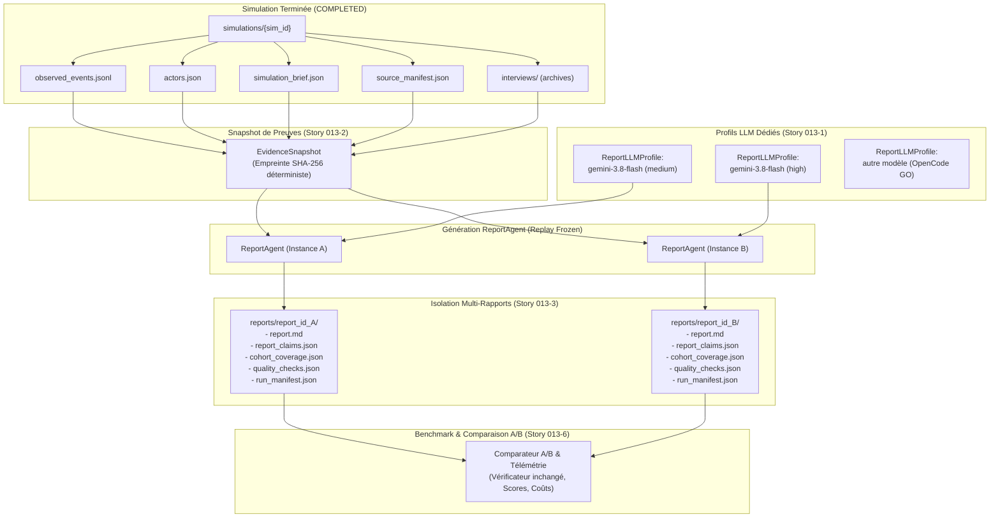

# Architecture Technique — Epic 013 : Benchmark LLM du ReportAgent et mode replay non destructif

> **Projet** : MiroFish, branche `local-first`  
> **Statut** : Cadrage validé  
> **Date** : 19 octobre 2026  
> **Dossier de plan** : `docs/plans/013-benchmark-llm-report-replay/`  
> **Complète** : [`prd.md`](prd.md) · [`epic-013.md`](epic-013.md)

---

## 1. Vue d'Ensemble & Diagramme de Flux

L'architecture de l'Epic 013 introduit deux capacités fondamentales :
1. **L'isolation de la configuration LLM par job** (`ReportLLMProfile`) évitant toute mutation d'environnement globale.
2. **Le mode de rejeu à preuves figées (`replay_frozen`)** et la **conservation multi-rapports sans écrasement** sous `reports/<report_id>/`.



---

## 2. Modèles de Données

### 2.1 `ReportLLMProfile` (`backend/app/models/report_llm_profile.py`)

Configuration immuable d'inférence injectée lors du lancement d'un job de rapport :

```python
from dataclasses import dataclass, asdict
from typing import Optional, Dict, Any

@dataclass(frozen=True)
class ReportLLMProfile:
    profile_id: str                      # ex: "flash-medium", "flash-high", "deepseek-v4-pro"
    model: str                           # ex: "gemini-3.8-flash"
    provider_id: str = "custom"          # "antigravity-local" ou "opencode-go"
    reasoning_effort: Optional[str] = None # "low" | "medium" | "high" | None
    temperature: Optional[float] = None
    max_tokens: Optional[int] = None
    base_url: Optional[str] = None       # Résolu côté serveur, non exposé à l'IHM
    api_key: Optional[str] = None        # Résolu côté serveur, secret
    max_total_cost_usd: float = 2.0      # Plafond de coût estimé
    max_wall_seconds: int = 900          # Timeout global de génération
    billing_mode: str = "auto"           # "auto" | "free" | "metered" (Story 013-4)

    def to_dict(self, expose_secrets: bool = False) -> Dict[str, Any]:
        data = asdict(self)
        if not expose_secrets:
            data.pop("api_key", None)
            data.pop("base_url", None)
        return data
```

### 2.2 `EvidenceSnapshot` (`backend/app/models/evidence_snapshot.py`)

Capture l'ensemble des fichiers sources et preuves pour attester que deux rapports A et B ont été soumis rigoureusement aux mêmes données d'entrée :

```python
@dataclass(frozen=True)
class EvidenceSnapshot:
    snapshot_id: str                     # ex: "snap_80a54d7bbd7b_20261019"
    simulation_id: str
    sha256_hash: str                     # Hash combiné des fichiers de preuves
    file_hashes: Dict[str, str]          # {"observed_events.jsonl": "...", ...}
    total_events: int
    total_actors: int
    has_archived_interviews: bool
    created_at: str                      # ISO 8601
```

### 2.3 `ReportUsageMetrics` (`backend/app/models/report_usage.py`)

Consigne l'utilisation effective des tokens et le coût estimé :

```python
@dataclass
class ReportUsageMetrics:
    report_id: str
    profile_id: str
    model: str
    reasoning_effort_requested: Optional[str]
    reasoning_effort_effective: Optional[str] # Confirmé ou "unknown"
    prompt_tokens: int = 0
    completion_tokens: int = 0
    thinking_tokens: int = 0
    total_tokens: int = 0
    estimated_cost_usd: Optional[float] = None
    duration_seconds: float = 0.0       # somme des temps d'inférence
    wall_seconds: float = 0.0           # temps mural du job
    calls_count: int = 0
    usage_available: bool = True
    phase_totals: Dict[str, Dict[str, int]]
    calls: List[CallUsageRecord]
    budget_exceeded: bool = False
    timeout_exceeded: bool = False
    stop_reason: Optional[str] = None
```

---

## 3. Prise en Compte de `reasoning_effort` et Passerelle Antigravity

### 3.1 Découplage de `create_chat_completion`
Dans [`backend/app/utils/openai_chat_compat.py`](../../backend/app/utils/openai_chat_compat.py) :
- Ajout du paramètre `reasoning_effort: Optional[str] = None`.
- Si `reasoning_effort` est fourni explicitement, l'utiliser prioritairement sans lire `os.environ`.
- Si omis, repli rétrocompatible sur `os.environ.get("LLM_REASONING_EFFORT")`.

### 3.2 Prise en charge dans `antigravity_proxy.py`
Dans [`backend/scripts/antigravity_proxy.py`](../../backend/scripts/antigravity_proxy.py) :
- Dans `_build_gemini_request(body, backend_model, thinking_level)` :
  Extraction de `effort = body.get("reasoning_effort")`.
  Si présent, pour `gemini-3.8-flash-tiered`, construction de `thinkingConfig` :
  - `medium` $\to$ `thinkingBudget: 2048` ou `thinkingLevel: "MEDIUM"`
  - `high` $\to$ `thinkingBudget: 8192` ou `thinkingLevel: "HIGH"`
  - `low` $\to$ `thinkingBudget: 1024` ou `thinkingLevel: "LOW"`
- Cela rend la variation d'effort immédiatement effective sur le serveur Antigravity local.

### 3.3 Passerelle OpenCode GO
Lors de la bascule vers OpenCode GO :
- Le client transmet directement `reasoning_effort` dans le corps OpenAI compatible.
- `llm_request_headers` injecte les en-têtes requis (`x-opencode-session`).

---

## 4. Isolation du Stockage Multi-Rapports

Actuellement :
- `reports/<report_id>/report.md` et `report.json`
- `simulations/<sim_id>/report_claims.json` (écrasé à chaque régénération)
- `simulations/<sim_id>/cohort_coverage.json` (écrasé à chaque régénération)
- `simulations/<sim_id>/quality_checks.json` (écrasé à chaque régénération)

**Nouvelle architecture cible :**
1. Chaque génération écrit ses artefacts sous `reports/<report_id>/` :
   - `reports/<report_id>/report.json`
   - `reports/<report_id>/report.md`
   - `reports/<report_id>/outline.json`
   - `reports/<report_id>/report_claims.json`
   - `reports/<report_id>/cohort_coverage.json`
   - `reports/<report_id>/quality_checks.json`
   - `reports/<report_id>/run_manifest.json`
   - `reports/<report_id>/usage.json`
   - `reports/<report_id>/simulation_audit_<report_id>.zip`
2. Pour la rétrocompatibilité des lectures historiques, un lien ou une copie miroir met à jour le pointeur « dernier rapport actif » de la simulation.
3. Un index `simulations/<sim_id>/report_history.json` répertorie l'ensemble des `report_id` générés avec leur `profile_id`, date, statut de publication et métriques.

---

## 5. Mode Replay Figé (`replay_frozen`)

1. Vérifie la présence de tous les artefacts nécessaires dans `simulations/<sim_id>/` :
   - `observed_events.jsonl`
   - `actors.json`
   - `simulation_brief.json`
   - `source_manifest.json`
2. Calcule le hash SHA-256 du bundle de preuves.
3. Désactive tout appel IPC vers OASIS :
   - En mode `replay_frozen`, les outils d'interviews live sont neutralisés au profit exclusif de la lecture d'archives `_synthesize_offline_interviews`.
4. Si un fichier de preuve obligatoire est absent, le rejeu est rejeté immédiatement avec le statut d'erreur explicite `REPLAY_NOT_REPRODUCIBLE`.
