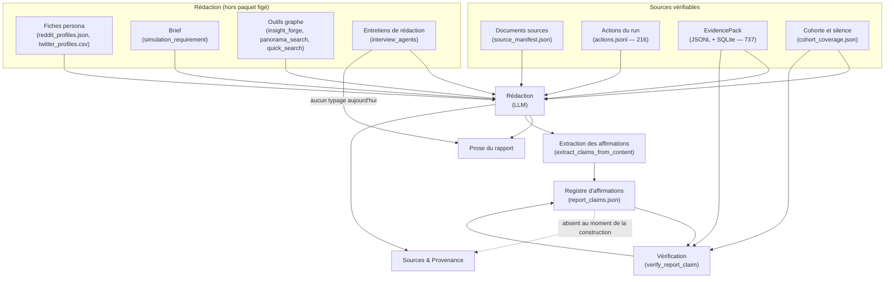
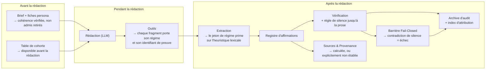

# Architecture Technique — Epic 014 : Intégrité des preuves de rédaction

> **Statut** : Rédigé le 21 octobre 2026, avant tout code.
> **Héritier** : l'architecture de l'Epic 013 (`docs/plans/013-benchmark-llm-report-replay/architecture.md`).
> **Principe directeur** : *un rapport ne doit certifier que ce qu'il a
> vérifié.* Tout ce qui n'est pas vérifiable est déclaré non établi — jamais
> présenté comme un fait.

---

## 1. Vue d'ensemble

Trois régimes de preuve cohabitent aujourd'hui dans un même rapport, sans
Frontière. C'est la cause racine des défauts constatés en campagne.



Trois constats structurent l'epic :

1. **B4 n'a pas de typage** : rien ne distingue une parole d'entretien d'un
   fait du graphe dans la prose ni dans le registre. C'est le défaut de la
   story 014-1.
2. **S est construit avant C** : la section de provenance ne peut structurellement
   pas s'appuyer sur le registre. C'est le défaut de la story 014-2.
3. **B1 et B2 ne sont pas filtrés** : les fiches des personas non admis et le
   brief arrivent tels quels dans le contexte du LLM. C'est le défaut de la
   story 014-3 et 014-4.

## 2. Le modèle de preuve — un régime par fragment

### 2.1 Principe

Chaque fragment de texte qui entre dans la rédaction porte un **régime de
provenance** : d'où il vient, et s'il est vérifiable. Le régime est structuré,
pas inféré du texte après coup.

| Régime | Source | Vérifiable ? | Dans le paquet figé ? |
|---|---|---|---|
| `document` | document source découpé (`SourceDocument`) | oui — par `chunk_index` et positions | oui |
| `event` | événement observé (`EvidencePack`) | oui — par `event_id` | oui |
| `action` | action du run (`actions.jsonl`) | oui — par position dans le journal | **non** (hors `CANONICAL_AUDIT_FILES`) |
| `graph` | fait restitué par un outil graphe | **non** — le graphe n'est pas scellé | non |
| `interview` | entretien de rédaction | **non** — la réponse est fabriquée pendant la rédaction | non |
| `inference` | déduction de l'agent | non | non |

### 2.2 Structure porteuse

Le régime est transporté par une structure, pas deviné par heuristique
lexicale. Contrainte de pureté : `app/utils/` n'importe jamais
`app/models/` — le nouveau type doit donc vivre dans `app/models/`, comme
`InformationOrigin` aujourd'hui.

```python
# backend/app/models/source_document.py (proposition)

class ProvenanceRegime(str, Enum):
    """Régime de provenance d'un fragment de texte produit par le rapport."""
    DOCUMENT = "document"      # document source découpé, vérifiable
    EVENT = "event"            # événement observé, vérifiable par event_id
    ACTION = "action"          # action du run, vérifiable par position
    GRAPH = "graph"            # fait restitué par un outil graphe
    INTERVIEW = "interview"    # entretien de rédaction, non vérifiable
    INFERENCE = "inference"    # déduction de l'agent
```

Chaque fragment observateur de rédaction (message d'outil injecté dans le
prompt) est accompagné d'un **jeton de régime** et, pour les régimes
vérifiables, d'un **identifiant de preuve** (`event_id`, `chunk_index`, ou
position dans le journal).

### 2.3 Ce que la rédaction doit produire

- Un passage d'entretien porte **toujours** son régime, visible dans la
  provenance de la section qui le cite.
- Un passage vérifiable porte **toujours** son identifiant de preuve, de
  sorte que l'extracteur puisse le rattacher sans le deviner.
- Un passage sans régime explicite est traité comme `inference` : il ne peut
  donc pas devenir une « action observée » par simple lexique.

> **Décision de design** : l'extracteur cesse de **deviner** l'origine par
> mot-clé. `report_agent.py:3271-3297` applique aujourd'hui neuf heuristiques
> (verbes d'intention, verbes d'action, « hypothèse », « churn », titres de
> section…). Elles restent comme **repli** pour le texte libre, mais un
> fragment porteur d'un jeton de régime prime sur elles. C'est la seule façon
> d'atteindre que l'étiquette `[Événements simulés réels]` — que **aucun
> code** ne produit — cesse d'être avalée comme un nom d'agent.

## 3. La section « Sources & Provenance » — certifier ou s'abstenir

### 3.1 Deux défauts distincts

| Défaut | Correction |
|---|---|
| La section est construite **avant** le registre (`report_agent.py:2591-2597` contre `:2618-2625`) : elle ne peut pas le lire | soit la section est **reconstruite** après le registre, soit elle est produite par un **second passage** explicite |
| « Toute affirmation d'action observée est reliée à un événement horodaté » (`report_agent.py:2987`) est un littéral | le littéral est **calculé** : le nombre d'affirmations porteuses d'`evidence_refs`, sur le total ; s'il est nul, la section le dit |
| « Aucune divergence intention vs action non résolue détectée » (`report_agent.py:2998`) confond « 0 intention détectée » et « aucune divergence » | la phrase est remplacée par un **dénominateur explicite** : intentions détectées / actions analysées, et les deux populations (216 actions, 737 événements) sont nommées avec ce que chacune contient |

### 3.2 Règle de l'omission honnête

> Une section qui ne peut pas établir une propriété **l'écrit** au lieu de
> l'affirmer. Le Fail-Closed s'applique à la communication : une traçabilité
> invérifiable ne s'écrit pas « établie », elle s'écrit « non établie sur
> N affirmation(s) ».

C'est la transposition du Fail-Closed de la publication à la **section
méta** du rapport.

### 3.3 L'archive d'audit doit porter la trace

`simulation_audit_service.py:228-378` liste 11 artefacts ; **`agent_log.jsonl`
n'y est pas**, alors que c'est le seul qui permette d'attribuer un passage à
un outil. Deux options, à trancher en story 014-2 :

- **inclure** `agent_log.jsonl` dans l'archive — coût : le fichier est volumineux
  et contient le texte des observations ;
- **inclure** un **index d'attribution** allégé : pour chaque identifiant de
  preuve, l'outil qui l'a produit et son régime. C'est préférable : l'archive
  reste lisible, et le tiers peut établir l'origine sans lire les journaux.

## 4. La règle de silence, de la prose à la barrière

### 4.1 Ce qui existe

`simulation_action_verifier.py:939-961` : un actor `is_silent` ne peut se voir
attribuer d'action — **dans le registre seulement**. Le markdown n'est jamais
réécrit, et la contradiction produite est reclassée `SPECULATIVE_PROJECTION`
(`:953`), donc **non critique** pour la barrière
(`report_quality_gate.py:464-493`).

### 4.2 Ce qui manque

Trois applications, du plus faible au plus fort :

1. **Le contexte de rédaction.** Les fiches persona (`reddit_profiles.json`,
   `twitter_profiles.csv`) et le brief (`simulation_requirement`) entrent dans
   le prompt sans filtrage (`report_agent.py:688`, `:1886`). Un persona `review`
   ou `ineligible` doit **y être absent**, ou y être marqué de façon que l'agent
   ne puisse pas en faire un acteur. *Choix à trancher : filtrer, ou baliser.*
   Le filtre est plus sûr ; le balisage conserve l'information de cadrage.
2. **La prose.** La règle doit atteindre le texte : soit le rapport est
   reconstruit pour retirer les passages attribués à un persona silencieux,
   soit la section concernée est **inhibée**. *Choix à trancher en story 014-3.*
3. **La barrière.** La contradiction « persona silence ↔ action affirmée » doit
   être **critique** : elle ne peut plus se déguiser en avertissement par un
   reclassement (`SPECULATIVE_PROJECTION`).

### 4.3 Le point d'application le plus économique

La table de cohorte est **déjà disponible avant la rédaction** :
`report_agent.py:1942-1947` construit une table temporaire pour décider
s'il faut injecter une section « Objections ». Cette table peut être passée à la
rédaction — le filtre n'a donc pas besoin d'être recalculé.

## 5. Le brief et les fiches persona

### 5.1 La confusion des biographies

L'épisode « 1 500 € / WordPress » appartient à la fiche d'un persona et se
retrouve dans la fiche d'un autre, dans le brief. Le symptôme est mesuré ; la
cause est dans la **construction des briefs et des fiches**, pas dans le
`ReportAgent`.

Le chantier 014-4 doit donc agir **en amont** :

- vérifier que chaque persona d'un brief a une **fiche unique** et que les
  épisodes qui lui sont attribués ne sont pas attribués ailleurs ;
- faire échouer la **construction** du brief (et non la rédaction) quand deux
  fiches se contredisent ;
- exclure du contexte de rédaction les fiches des personas non admis.

### 5.2 Pourquoi pas seulement un filtre

Filtrer à la rédaction laisserait le brief contradictoire dans les artefacts
(`simulation_brief.json` est dans l'archive d'audit). La contradiction
continuerait d'être visible et reproductible. Elle doit être **corrigée à la
source**, ou **refusée à la construction**.

## 6. Robustesse de la résolution de projet

`ProjectManager.get_project` (`project.py:307-325`) fait `json.load` sans
garde. `list_projects` (`:337-348`) parcourt tout le répertoire. Résultat
mesuré : un `project.json` tronqué dans le répertoire voisin fait échouer
`find_projects_by_graph_id`, l'exception est avalée par `_resolve_project`
(`report_agent.py:1414-1424`), le projet résolu vaut `None`, et **tous** les
rapports de la pile perdent leur section de sources.

La correction est locale et sans risque : la garde d'exception doit être **par
projet**, dans `get_project`, qui renvoie alors `None` pour le seul projet
corrompu. Le rapport concerné le signalera ; les autres ne changeront pas.

## 7. Diagramme de flux cible



## 8. Contraintes de non-régression

| Contrainte | Origine |
|---|---|
| Le filet de tests ne rétrécit pas ; le Fail-Closed reste Fail-Closed | AGENTS.md §2.2, ADR 0014/0016 |
| Les Epics 011 et 012 ne sont pas rouverts : leurs barrières sont le vérificateur | AGENTS.md §10 |
| `app/utils/` n'importe jamais `app/models/` : le nouveau type de régime vit dans `app/models/` | AGENTS.md §2.1 |
| Le graphe n'est pas dans l'empreinte : tout fait issu d'un outil graphe est déclaré non vérifiable | story 013-6, décision n° 3 |
| Une donnée absente s'affiche « non établi » ou « indisponible », jamais `0` | AGENTS.md §2.2, PRD §5 NFR-5 |
| La campagne de re-qualification se rejoue sur R7 et son rapport ne doit plus porter de certification mensongère | PRD §6 C8 |
