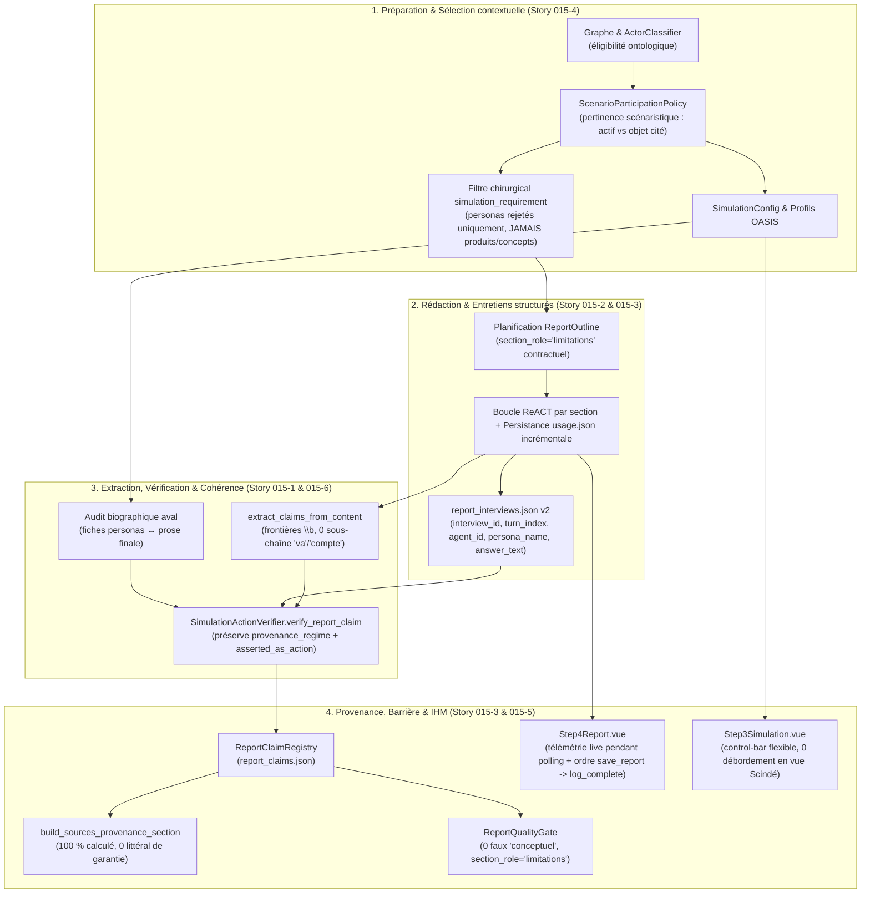

# Architecture Technique — Epic 015 : Contrats de preuve de bout en bout, pertinence des rôles et ergonomie IHM de suivi

> **Statut** : Rédigé le 29 octobre 2026, avant tout code applicatif.
> **Héritier** : architectures des Epics 011 à 014 (`docs/plans/014-integrite-preuves-redaction/architecture.md`).
> **Principe directeur** : *réparer les coutures des contrats existants plutôt qu'empiler des abstractions redondantes (KISS / DRY).*

---

## 1. Vue d'ensemble du flux corrigé

Plutôt que de créer des composants parallèles (`EvidenceLedger`, `InterviewLedger`, `ReportRenderer`, `FactLedger`), l'Epic 015 resserre les **cinq coutures** où l'information se perdait ou se déformait entre les briques existantes, et assainit le suivi temps réel IHM aux étapes 3 et 4.



---

## 2. Contrats de données enrichis (compatibilité ascendante garantie)

### 2.1 `ReportClaim` (`backend/app/models/report_claim.py`) — Story 015-1

Le modèle `ReportClaim` reste une `dataclass(frozen=True)` rétrocompatible avec les fichiers `report_claims.json` existants, enrichie d'un booléen explicite de traçabilité d'assertion d'action :

```python
@dataclass(frozen=True)
class ReportClaim:
    claim_id: str
    text: str
    claim_kind: ClaimKind
    origin: InformationOrigin
    evidence_refs: List[str] = field(default_factory=list)
    verification_status: VerificationStatus = VerificationStatus.UNSUPPORTED
    agent_name: Optional[str] = None
    round_num: Optional[int] = None
    confidence: float = 1.0
    limitations: List[str] = field(default_factory=list)
    provenance_regime: Optional[ProvenanceRegime] = None
    asserted_as_action: bool = False  # True dès que le texte affirme une action exécutée, même après déclassement
```

**Règles d'intégrité dans `SimulationActionVerifier.verify_report_claim` :**
1. **Zéro perte de `provenance_regime`** : remplacer les ré-instanciations manuelles oubliant des champs par `dataclasses.replace(claim, ...)` (ou passage systématique de `provenance_regime` et `asserted_as_action`) sur **100 % des chemins de retour**.
2. **Traçabilité du déclassement** : si `claim.claim_kind == ClaimKind.OBSERVED_SOCIAL_ACTION` (ou `claim.asserted_as_action is True`) échoue à la réconciliation, le claim retourné est déclassé en `ClaimKind.REPORTED_INTENTION` + `VerificationStatus.UNSUPPORTED` **tout en conservant `asserted_as_action=True`**.
3. **Lexique à frontières de mots (`\b`)** : dans `extract_claims_from_content`, suppression définitive de `any(k in text_lower for k in ("va", "veut", "compte", ...))` au profit de motifs compilés `\b(?:va\s+\w+|veut|compte\s+(?:suivre|tester|souscrire|acheter|attendre|voir|faire)|prévoit|songe|souhaite)\b` évalués sans masquer les verbes d'action accomplie (`a publié`, `publie`, `répond`, `a répondu`, `suit`, `a suivi`, `aime`, `a aimé`, `partage`, `commente`, etc.).
4. **Appartenance stricte de l'événement à l'acteur** : un `evt_*` valide dans l'`EvidencePack` mais émis par un autre acteur que `claim.agent_name` résolu est rejeté avec limitation motivée.

---

### 2.2 `report_interviews.json` structuré par tour et répondant — Story 015-2

Au lieu d'aplatir toutes les citations d'un appel `interview_agents` dans une liste anonyme, chaque session d'entretien persiste des tours individualisés et stables (`schema_version: "2.0"`) :

```json
{
  "schema_version": "2.0",
  "simulation_id": "sim_...",
  "report_id": "report_...",
  "sessions": [
    {
      "interview_id": "ivw_01_a8f3c21b",
      "subject": "Sujet de l'entretien",
      "mode": "replay_frozen",
      "recorded_at": "2026-10-29T12:00:00Z",
      "turns": [
        {
          "turn_id": "ivw_01_a8f3c21b_t01",
          "agent_id": 14,
          "persona_name": "Nom Canonique",
          "question": "Question posée",
          "answer_text": "Réponse complète par plateforme ou synthétisée",
          "key_quotes": [
            {
              "quote": "Extrait exact",
              "char_start": 12,
              "char_end": 48
            }
          ]
        }
      ]
    }
  ]
}
```

- **Rétrocompatibilité** : les lecteurs acceptent aussi l'ancien format liste plate (`v1`).
- **Authentification sans promotion** : lorsqu'un claim porte `provenance_regime == ProvenanceRegime.INTERVIEW` (ou cite un extrait présent dans `turns[*].answer_text` du même `persona_name`), `verify_report_claim` vérifie que la citation entre guillemets appartient bien au `answer_text` de cet agent, lui attache la référence `turn_id` (`ivw_...`), mais **interdit formellement** `ClaimKind.OBSERVED_SOCIAL_ACTION` (un entretien reste une parole déclarative post-run / hors run). Si la citation est attribuée au mauvais répondant ou altérée entre guillemets, elle est marquée `UNSUPPORTED` / `CONTRADICTED` avec diagnostic explicite.

---

### 2.3 Contrat de section `limitations` et barrière `ReportQualityGate` — Story 015-3

1. **Rôle structurel dans `ReportSection` (`report_agent.py`)** :
   - Ajout d'un champ optionnel rétrocompatible `section_role: Optional[str] = None` (valeurs : `"analysis"`, `"limitations"`, `"recommendations"`, etc.) dans `ReportSection`.
   - Lorsque la cohorte comporte des refus, hésitations ou objections, `plan_outline` exige ou injecte une section marquée `section_role="limitations"`, quel que soit son titre éditorial formulé par le LLM.
   - `ReportQualityGate` valide le contrôle 4 (`LIMITATIONS_SECTION`) si `any(s.section_role == "limitations" for s in outline.sections)` (avec contenu effectif non vide traitant des réserves/objections) **ou** par repli sur les titres FR/EN historiques.
2. **Fermeture de l'angle mort « rapport conceptuel » (`report_quality_gate.py`)** :
   - Soit `asserted_actions = [c for c in claims_registry.claims if c.claim_kind == ClaimKind.OBSERVED_SOCIAL_ACTION or getattr(c, "asserted_as_action", False)]`.
   - Si `len(asserted_actions) > 0` et `len(verified_action_claims) == 0`, le contrôle 5 passe immédiatement en **`QualityStatus.FAILED`** (`PublicationStatus.FAILED_VALIDATION`, anomalie QA-08), jamais en `WARNING` « rapport conceptuel ».
   - Le statut `WARNING` « rapport conceptuel » reste réservé aux seuls rapports réellement théoriques où `len(asserted_actions) == 0` **et** où aucune action sociale n'a été alléguée dans le texte.
3. **Suppression du littéral résiduel dans `build_sources_provenance_section` (`report_agent.py:3137`)** :
   - Le texte de la sous-section 3 devient calculé à partir du registre (`verified_action_claims / len(asserted_actions)`), s'alignant à 100 % sur la sous-section 7 et `quality_checks.json`.

---

### 2.4 Pertinence scénaristique des acteurs, filtre de prompt et dénominateur de cohorte — Story 015-4

1. **Deux décisions distinctes pour chaque entité (`actor_selection.py` / `actor_classifier.py`)** :
   - `eligibility_status` (ontologique : `person`, `organization` → `eligible` ; `concept`, `product`, `location` → `ineligible`).
   - `scenario_participation` (`active_agent`, `context_only`, `review`) et `conversion_eligible: Optional[bool]` :
     - Une organisation/marque/logiciel mentionné uniquement comme *outil utilisé*, *moyen de paiement*, *institution de tutelle passive* ou *sujet même de l'offre évaluée* est classé `context_only` par défaut, sauf si le brief demande explicitement qu'il prenne la parole comme acteur du scénario (ex. opérateur de transport en grève, porte-parole officiel).
2. **Correction du caviardage `[persona non admis]` (`api/report.py` & `brief_consistency.py`)** :
   - `_filter_simulation_requirement_for_report` ne doit **jamais** passer les entités `role not in ("person", "individual_actor", ...)` (telles que produits, formules tarifaires, noms de domaine, logiciels tiers, concepts) dans `excluded_names` !
   - Seuls les **candidats personas humains** écartés (`role == ActorRole.PERSON` et non retenus dans la cohorte simulée) sont filtrés en tant que personas non admis. Les objets, offres et outils du domaine restent intacts dans le brief de rédaction.
3. **Dénominateur d'adoption par inclusion positive (`cohort_coverage.py`)** :
   - `prospect_members` retient exclusivement les membres ayant `ScenarioRole.PROSPECT` (ou `conversion_eligible is True`).
   - Si un scénario ne comporte aucun prospect (`len(prospect_members) == 0`, ex. débat associatif ou concertation publique), `adoption_rate` vaut `None` (sérialisé `null`, affiché « non applicable au scénario » et jamais `0.0 %`).

---

### 2.5 Ergonomie IHM Step 3 & Télémétrie vivante Step 4 — Story 015-5

1. **Étape 3/5 — `frontend/src/components/Step3Simulation.vue` :**
   - `.control-bar` : remplacer `height: 64px` rigide par `min-height: 64px; height: auto; flex-wrap: wrap; gap: 12px 16px; padding: 10px 20px;`.
   - `.status-group` : `display: flex; flex-wrap: wrap; gap: 10px; flex: 1 1 auto; min-width: 0;`.
   - `.platform-status` : `padding: 8px 12px; min-width: 0; max-width: 100%; overflow: visible;` (pour préserver le tooltip au survol tout en dimensionnant proprement le cadre) avec `.platform-stats { display: flex; flex-wrap: wrap; gap: 6px 12px; }` et `.stat { white-space: nowrap; }` pour interdire à `48 h 0 min` ou `ATTENTE 366` de se couper au milieu ou de sortir de la bordure de carte.
   - `.action-controls` : `flex-shrink: 0; margin-left: auto;` garantissant un espace minimal constant avec la dernière carte, même en mode `Scindé` (50 % de l'écran).

2. **Étape 4/5 — `ReportAgent` + `frontend/src/components/Step4Report.vue` :**
   - **Persistance incrémentale côté backend (`report_agent.py`)** : appeler `self._persist_usage_metrics(report_id, report)` (écriture atomique de `usage.json`) dès la fin de `plan_outline`, à la fin de chaque section générée, et après chaque session d'entretien — et sauvegarder `ReportManager.save_report(report)` dès l'initialisation puis **avant** `log_report_complete` (éliminant la fenêtre de course `404` en fin de génération).
   - **Rafraîchissement live côté frontend (`Step4Report.vue`)** :
     - Appeler `loadCurrentTelemetry(props.reportId)` lors des jalons de polling (`planning_complete`, `section_complete`, `tool_result`, `report_complete`, ainsi que `error` / arrêt contrôlé).
     - Tant que le rapport est en cours de génération (`!isComplete` et statut actif), si le registre `report_claims.json` n'est pas encore produit (404 normal avant la phase finale d'assemblage), afficher `t('step4.metricPending')` (« en cours… ») au lieu de « indisponible ».
     - Pour le coût estimé : si le modèle/fournisseur est non tarifé dans la grille locale (ex. endpoint gratuit OpenCode Go ou modèle hors grille), afficher une mention explicite et honnête (`non tarifé` / `indisponible`) sans laisser croire que les tokens eux-mêmes sont indisponibles.

---

### 2.6 Audit biographique aval, reproductibilité Docker & Replay R8 — Story 015-6

1. **Contrôle biographique fiches ↔ prose finale (`brief_consistency.py`)** :
   - Réutiliser les extracteurs déterministes d'attributs factuels de `brief_consistency.py` (durées d'exercice/ancienneté en années/mois, montants/tarifs associés à un épisode personnel) pour extraire le profil factuel de chaque fiche persona admise, puis vérifier chaque phrase de la prose finale attribuée à ce persona :
     - Si le rapport affirme « installée depuis 17 ans » alors que la fiche source établit « installée depuis 1 an » (écart incompatible), le claim correspondant passe en `VerificationStatus.CONTRADICTED` avec diagnostic `PERSONA_BIOGRAPHY_CONTRADICTION`.
     - Les opinions, hésitations et jugements de valeur restent 100 % libres.
2. **Traçabilité `git_commit` et `time_horizon` (`Dockerfile`, `docker-compose.yml`, `simulation_audit_service.py`)** :
   - Ajouter `ARG GIT_COMMIT=unavailable` / `ENV GIT_COMMIT=${GIT_COMMIT}` dans `backend/Dockerfile` et `docker-compose.yml`, lu en priorité par `SimulationAuditService._resolve_git_commit()` lorsque `git rev-parse HEAD` n'est pas disponible dans le conteneur.
   - Persister dans `simulation_brief.json` et `run_manifest.json` l'horizon temporel effectif (`time_horizon` + `time_horizon_is_inferred`).

---

## 3. Arbitrages techniques explicites

| Option envisagée | Décision | Justification |
|---|---|---|
| Créer `EvidenceLedger`, `InterviewLedger`, `DocumentaryLedger`, `ReportRenderer` | **Rejeté** | Doublon direct avec `EvidencePack`, `ReportClaimRegistry`, `report_interviews.json` et `ReportManager.assemble_full_report`. Viole KISS et DRY (`AGENTS.md`). |
| Forcer le LLM à rédiger chaque section en JSON de claims puis générer le Markdown par template | **Rejeté** | Casse la boucle ReACT existante, `SectionCompletionGuard` et la qualité analytique. Conserver le flux Markdown + durcir l'extracteur lexical `\b`, `asserted_as_action`, `report_interviews.json` v2 et `dataclasses.replace` résout les anomalies mesurées sans régression. |
| Exclure universellement toutes les entités `Organization` de la simulation | **Rejeté** | Casserait les simulations institutionnelles (syndicats, régulateurs, opérateurs de transport). La participation dépend du rôle scénaristique (`ScenarioParticipationPolicy`). |
| Masquer toutes les entités `ineligible` par `[persona non admis]` dans le brief | **Rejeté (bug corrigé)** | Les entités `ineligible` incluent les produits, offres et outils du domaine : les masquer corrompt le sujet même de l'étude. Seuls les personas humains non retenus sont filtrés. |

