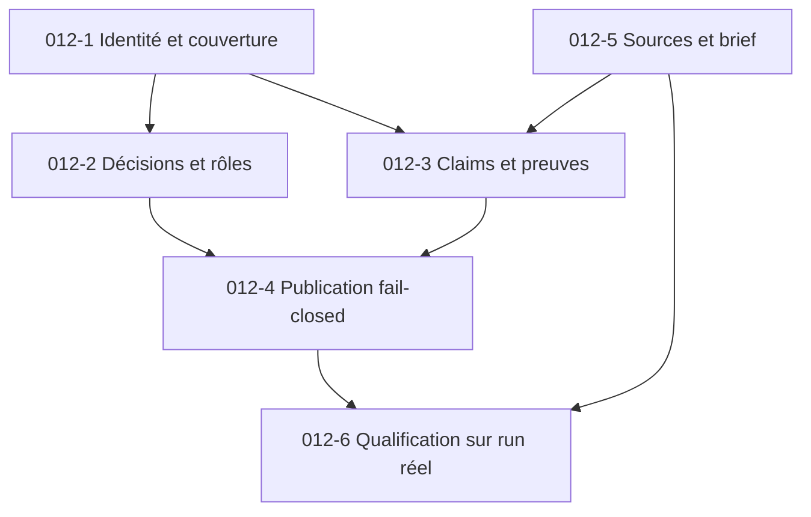

# MiroFish — PRD correctif post-Epic 011 : fiabilité des acteurs, des preuves et de la publication

> **Statut :** PROPOSÉ — correctifs non intégrés dans le code à la date de rédaction  
> **Date :** 17 octobre 2026  
> **Branche auditée :** `zohac/MiroFish`, `local-first`  
> **HEAD vérifié :** `e6bdc44c7cbaaf5f9e3fb523977387279e08ca69`  
> **Cas de qualification :** sixième simulation Keova, `sim_ea4f3cfe1028`, `report_77d96ea4c1c9`  
> **Statut Epic 011 :** clos (`6/6` stories) selon le dépôt ; ce document demande une **campagne corrective complémentaire**, et non la réimplémentation de l'Epic 011.  
> **Portée :** architecture et qualité *génériques* de MiroFish, aucun comportement Keova codé en dur.

## 1. Résumé exécutif

Les nouvelles fonctionnalités d'audit sont présentes (journal d'événements, `EvidencePack`, `ReportClaim`, couverture de cohorte, `ReportQualityGate`, archive ZIP). Le sixième export apporte des traces inspectables. Néanmoins, un cas réel révèle des écarts bloquants entre leur **existence** et leur **efficacité de contrôle** :

1. **Confusion d'identités** : 23 événements émis par `Agent_1` ont été ajoutés à `Agent_16` dans la couverture de cohorte ; ceci est compatible avec le rapprochement par sous-chaîne actuellement codé.
2. **Population incohérente** : 44 entités dans `actors.json`, 20 éligibles, mais 63 lignes de couverture, réunissant identités nommées et identifiants techniques ; les dénominateurs « membres / prospects / agents effectivement lancés » sont confondus.
3. **Décisions d'adoption invalides** : des acteurs non prospects sont marqués `ADOPTED`, tandis que l'absence d'objection suffit actuellement à attribuer `ADOPTED` à un agent actif.
4. **Preuves non liées** : `report_claims.json` indique **0 `VERIFIED` sur 258 claims**, 241 `UNSUPPORTED`, 17 `CONTRADICTED` et des `evidence_refs` vides.
5. **Publication tolérante à l'échec** : `quality_checks.json` conclut `is_publishable=true`, `final_status=warning`, malgré un ratio de preuve de 0,0.

Ces chiffres décrivent **ce run précis**, pas la fréquence des défauts sur l'ensemble de MiroFish. Le rapport est une **analyse exploratoire simulée**, non une prévision de conversions réellement constatées.

### 1.1. Les trois commits poussés pendant l'audit

La base a été rafraîchie après le signalement de trois commits supplémentaires :

| Commit | Changement déclaré | Conséquence pour ce PRD |
|---|---|---|
| `f1ebef5e90e9` | Qualification multi-domaines, clôture story 011-6, Epic 011 `done` | Ne pas redemander le banc ; y ajouter un cas de non-régression basé sur le véritable export R6. |
| `31144b8aa6e4` | Cache et verrou global `SentenceTransformer`, repli vers recherche locale | Correction utile pour l'indexation ; hors du périmètre des anomalies de preuves ci-dessous. |
| `e6bdc44c7cba` | Carte de synchronisation mémoire / bouton rapport conditionné à `is_report_ready` | Correction du passage simulation → rapport ; ne répare pas, à elle seule, les décisions de cohorte ni les claims. |

**Chronologie :** le paquet d'audit R6 porte `generated_at=2026-10-17T14:42:00Z`, tandis que les deux derniers commits sont datés de `14:54:31Z`. L'export ne valide donc **pas** ces deux dernières modifications. Les anomalies restent néanmoins **observables dans le code HEAD** de `cohort_coverage.py` et `report_quality_gate.py`. Le rapport officiel de qualification 011 affiche « VERDICT GO » sur ses fixtures ; cela n'annule pas les échecs constatés sur R6.

## 2. Sources et méthode

**Artefacts fournis :** `actors.json`, `cohort_coverage.json`, `observed_events.jsonl`, `report_claims.json`, `quality_checks.json`, `run_manifest.json`, `simulation_brief.json`, `source_manifest.json`, `report.md`, `checksums.sha256`.

**Revue du code GitHub (`local-first`, HEAD ci-dessus) :**

- `backend/app/models/cohort_coverage.py` — `ScenarioRole.from_actor_role`, `CohortCoverageTable.build_from_simulation` ;
- `backend/app/models/evidence_pack.py` — `EvidencePack.filter_events` ;
- `backend/app/services/report_agent.py` — `extract_claims_from_content`, `audit_and_save_report_claims` ;
- `backend/app/services/report_quality_gate.py` — contrôles des claims et publication ;
- `backend/app/services/simulation_audit_service.py` — manifeste d'exécution et sources ;
- `docs/plans/011-preuve-simulation-et-fiabilite-rapport/epic-011.md` et `rapport-qualification-epic-011.md`.

Les métriques de l'archive sont conservées telles quelles ; lorsqu'une cause exacte n'est pas prouvée par un test d'exécution, elle est qualifiée de *cause probable*.

**Contrôle d'intégrité :** les neuf fichiers référencés dans `checksums.sha256` correspondent à leurs empreintes ; cela contrôle l'intégrité du transfert, pas l'exactitude des sorties du modèle. Les 786 lignes JSONL possèdent 786 `event_id` distincts ; elles comprennent des actions et des représentations dérivées/techniques, et ne constituent **pas** 786 décisions métier indépendantes.

## 3. Scope / non-objectifs

**Dans le scope :** rapprochement strict des acteurs, distinction entre rôles et participation, états d'adoption fondés sur des preuves explicites, audit de claims exploitable, fail-closed configurable par criticité, provenance, contrôle de cohérence final, fixtures de run réel, manifestes reproductibles.

**Hors scope :** nouveau fournisseur LLM, recherche web, nouveau crawler, refonte OASIS/Graphiti, optimisation générale du produit Keova, création de nouvelles offres commerciales, remplacement de toutes les synthèses génératives par des règles figées, refonte des fonctionnalités clôturées dans 011-1 à 011-6.

## 4. Exigences prioritaires et découpage proposé

### P0 / STORY 012-1 — Identité des acteurs et couverture de cohorte sans collision

**Défaut établi.** La boucle `build_from_simulation` compare `key in ev_agent_lower or ev_agent_lower in key`. `Agent_1` peut matcher `Agent_16`, ce qui explique la collision observée de 23 événements. La même fonction rassemble *toutes* les entités d'`actor_selection` sans filtrer les `ineligible`, puis ajoute les noms techniques rencontrés.

**Comportement attendu :**

- Construire une table de correspondance à partir d'un **identifiant d'instance OASIS stable** (`agent_id`, plateforme/identifiant de session si nécessaire) vers une `entity_uuid` et un persona ; ne pas rapprocher les IDs numériques par sous-chaîne.
- Pour les noms, utiliser une normalisation exacte (`trim`, casse, Unicode normalisé) uniquement en repli contrôlé, et exposer les ambiguïtés au lieu de les fusionner.
- Distinguer `actor_catalog` (entités du graphe), `simulation_participants` (agents lancés) et `target_cohort` (profils d'intérêt). Une organisation réelle peut être actrice d'un scénario si celui-ci l'autorise ; elle ne doit **pas** devenir automatiquement une prospect Keova.
- Construire les actions uniquement à partir d'événements `is_action_executed=true` et attribuer chaque événement à **un seul participant**, sauf cas explicitement documenté de représentation multi-compte.
- Exposer `identity_resolution_status` (`resolved`, `ambiguous`, `unmapped`) et des anomalies structurées ; dans la couverture, le nombre d'agents actifs doit être réconciliable avec le registre réellement instancié.

**DoD / tests :**

- `Agent_1` (23 événements) et `Agent_16` (18 événements) restent distincts ; leurs actions ne se chevauchent pas.
- Aucune ligne de `cohort_coverage` ne comptabilise un `event_id` appartenant à un autre `agent_id`.
- Le rapport distingue clairement total entités, total participants, total cibles, silencieux et comptes officiels ; pas de double comptage.
- Tests unitaires parametrés `Agent_1`/`Agent_16`, casse/accents, aliases, agents inconnus, participants organisationnels, événement dupliqué et run multi-plateformes.

**Fichiers probables :** `backend/app/models/cohort_coverage.py`, `backend/app/models/evidence_pack.py`, générateurs de profils/config OASIS, tests de cohorte.

### P0 / STORY 012-2 — Statuts de décision déterministes et honnêtes

**Défaut établi.** Le code attribue `REJECTED` dès qu'une chaîne générique contient « refus », et `ADOPTED` si un membre actif n'a pas d'objection détectée. Il affecte aussi `ScenarioRole.PROSPECT` à toute personne (`ActorRole.PERSON`), y compris le fondateur ou une utilisatrice existante.

**Comportement attendu :**

- Séparer **sentiment**, **intention exprimée**, **demande de démonstration**, **inscription/commande observée** et **conversion réellement prouvée**.
- En l'absence d'événement métier de souscription, ne jamais déduire `ADOPTED` d'un post positif, d'une citation ou de l'absence d'objections.
- Utiliser les rôles du brief et/ou des profils effectifs (`FOUNDER`, `EXISTING_USER`, `PROSPECT`, `PRESCRIBER`, etc.) ; si inconnus, `UNKNOWN`, sans inventer un rôle à partir du seul type d'entité.
- Proposer des statuts tels que `NO_DECISION`, `INTERESTED`, `DEMO_REQUESTED`, `REJECTED_EXPRESSED`, `ADOPTED_VERIFIED` avec provenance et heure simulée. Maintenir une compatibilité de lecture des anciens exports, ou versionner le schéma.
- Mettre `NOT_APPLICABLE` pour une organisation institutionnelle ou un fondateur lorsqu'il s'agit d'adoption commerciale ; ne pas les inclure dans les ratios de prospects.

**DoD / tests :**

- Un agent actif silencieux sur le produit reste « décision inconnue », non « adopté ».
- Une déclaration « je vais m'abonner » reste intention ; « demande de visio » n'est pas paiement ; aucun achat Keova ne peut être inféré des types d'actions sociaux OASIS seuls.
- Les tests couvrent contradiction tardive, changement d'opinion, plusieurs posts contradictoires, neutralité et personnes connues non prospects.

### P0 / STORY 012-3 — Preuves réellement reliées aux affirmations

**Défaut établi.** `report_claims.json` : 258 claims, 0 vérifié, 241 sans preuve, 17 contredits. Dans `ReportAgent.extract_claims_from_content`, des titres, des phrases d'analyse et même le premier mot d'une phrase (« Si », « Dès ») sont utilisés comme claims ou noms d'agents. Les `evidence_refs` sont extraits de `evt_*` littéraux présents dans le Markdown ; or la plupart des citations n'incluent pas ces IDs.

**Comportement attendu :**

- Préférer un format de génération **structuré** (`ReportSection` + `ReportClaim[]`) où chaque observation contient `actor_id`, `event_ids`, `claim_kind`, `origin`, `confidence`, et le texte du rapport. Le rendu Markdown vient **après** la validation.
- Seuls les claims d'actions observées exigent des événements ; les faits documentaires exigent des références de documents validées ; les inférences sont permises si clairement étiquetées et reliées aux observations dont elles découlent.
- Validation stricte `event_id` existant, simulation correspondante, auteur compatible, round/temps cohérents, événement effectivement exécuté, texte compatible avec la conclusion. Une simple présence d'`event_id` ne suffit pas à valider le sens de l'affirmation.
- Toute citation présentée comme **verbatim** doit correspondre au texte original (normalisation blanche seulement). Les résumés doivent être marqués « reformulation ».
- Ne jamais masquer un claim sans preuve en donnant une confiance `1.0` arbitraire. Les claims non rapprochés doivent être marqués et, si critiques, empêcher publication.

**DoD / tests :**

- Sur un nouveau run de référence : 100 % des affirmations qualifiées « action observée » ont au moins une preuve valide et pertinente ; 0 événement d'un autre agent ; 0 souscription déduite d'un like/commentaire.
- Les titres Markdown ne sont pas traités comme faits ; « Si », « Dès », « Conclusions » ne deviennent jamais des noms d'agents.
- Le registre contient des justifications vérifiables et des liens de preuve vers le JSONL ; taux calculé **sur les claims éligibles à la vérification**, pas sur toutes les phrases littéraires.
- Régression reproduite sur l'ancien export R6 : **le traitement doit échouer proprement ou produire un audit explicitement non validé**, sans changer a posteriori le sens des traces.

**Fichiers probables :** `backend/app/services/report_agent.py`, `backend/app/models/report_claim.py`, `backend/app/services/simulation_action_verifier.py`, `backend/app/models/evidence_pack.py`, `backend/tests/test_report_claim_epistemic.py`.

### P0 / STORY 012-4 — Barrière de publication « fail closed » sur défauts critiques

**Défaut établi.** `ReportQualityGate` ne bloque que les `OBSERVED_SOCIAL_ACTION` explicitement `CONTRADICTED`. Il accepte en avertissement les autres contradictions et considère comme succès l'absence de registre. Il termine actuellement par `is_publishable=True` en cas de warnings, même lorsque le ratio de vérification est 0 %.

**Comportement attendu :**

- Rejeter un rapport qui prétend décrire des événements authentifiés lorsque **aucun claim événementiel n'est prouvé**, lorsqu'une conversion repose sur un événement non existant, ou quand une contradiction sur les conditions canoniques d'une offre est avérée.
- Distinguer `draft` / `needs_review` / `verified_publishable` / `failed_validation`. Un rapport peut rester lisible en mode brouillon avec avertissements, **mais jamais être présenté comme vérifié**.
- En cas d'échec de collecte des logs ou de registre absent, état `needs_review` ou `failed_validation`, non `PASSED` par défaut.
- Faire remonter en sortie API/UX les causes, le nombre de claims vérifiables, l'absence de preuve, les erreurs de mapping et la date de la vérification.
- Prendre en charge les rapports exploratoires *sans* assertions d'événements (absence de preuve attendue et clairement signalée), sans faire échouer inutilement les synthèses théoriques.

**DoD / tests :**

- Le paquet R6 actuel (`0/258` ; `is_publishable=true`) passe à `failed_validation` ou `needs_review` sur une nouvelle vérification **sans masquer le rapport historique**.
- Un rapport avec des preuves correctes et des avertissements mineurs reste affichable, avec état explicitement distinct de « vérifié ».
- 100 % des cas tests d'événements « observés » sans preuve bloquent le badge de publication vérifiée.

**Fichiers probables :** `backend/app/services/report_quality_gate.py`, modèles `report_quality`, génération du rapport, API qualité, `Step4Report.vue`.

### P1 / STORY 012-5 — Séparation des faits, du scénario et des rôles

**Défaut observé.** `source_manifest.json` marque le document de personas `PERSONA_SPECIFICATION` mais lui donne aussi `role=facts`, trois documents à `total_chunks=0` et `validation_status=unvalidated`. Le rapport final annonce qu'aucun document source structuré n'est attaché, malgré 3 entrées dans le manifeste ; `simulation_brief.json` a le texte intégral dans `goal`, mais des champs structurés `target_audiences`, `excluded_actors`, `rules`, `hypotheses`, `time_horizon` vides.

**Comportement attendu :**

- Faire de `epistemic_kind` la source de vérité pour le statut fictif/historique ; ne pas traiter des personas fictifs comme des faits historiques même s'ils portent un rôle générique `facts`.
- Détecter explicitement les conflits de métadonnées plutôt que les corriger silencieusement ; tolérer les projets anciens par migration/compatibilité.
- Extraire ou demander au pipeline de structurer le brief lors de l'import ; si `time_horizon` est absent et que `goal` contient « 72h », en déduire de manière traçable un horizon proposé, sinon marquer `unknown` (pas de valeur silencieuse garantie).
- Respecter les documents canoniques, les personas fictifs et les cas historiques, avec identifiants des extraits et statuts de validation ; ne pas inventer la capacité d'export client, un mode de paiement ou le domaine d'une formule.
- Lorsqu'un agent incarne l'entreprise, appliquer un **contrat de faits non négociables** dérivé du brief/sources ; préserver la liberté des opinions des autres agents ; enregistrer toute dérive comme anomalie.

**DoD / tests :**

- L'ancien paquet R6 signale les conflits de provenance et le brief incomplet au lieu de les décrire comme entièrement couverts.
- Aucun énoncé de fonctionnalité contredisant une source canonique validée ne peut être accepté sans signalement ; test de domaine « réservé au plan Premium » vs « inclus dans Essentiel ».
- N'importe quel autre domaine (politique publique, télécom, produits tiers) peut bénéficier du même contrôle sans mots-clés « Keova » en production.

### P1 / STORY 012-6 — Reproductibilité et qualification sur jeu réel

**Défaut observé.** `run_manifest.json` conserve `git_commit=unknown-git-commit`, `completed_at=null`, un modèle donné et une URL de fournisseur locale. Les 3 commits nouvellement poussés ont ajouté un banc multi-domaines et corrigé l'indexation, mais le cas réel R6 reste à ajouter comme **fixture de régression**, pas à substituer à leur qualification.

**Comportement attendu :**

- Dans le manifeste, inclure le SHA de build (ou `unknown` explicitement justifié), l'horodatage de complétion, l'horizon, le nombre d'agents instanciés, les versions de schéma et les réglages de simulation non secrets.
- Ne jamais exposer dans l'archive les clés, tokens, contenus identifiables ou données privées. Les cas réels nominatifs doivent être synthétisés/anonymisés dans les fixtures committées.
- Créer une **fixture synthétique minimisée** reproduisant les collisions, statuts absurdes et `0 VERIFIED`/publication ; éviter de committer le paquet Keova brut.
- Ajouter le cas à `backend/scripts/verifier_qualification_epic_011.py` (ou une suite `012`) et exiger son PASS dans CI. Vérifier que le script d'épreuve n'est pas une simple vérification de fixtures tautologiques ; au moins un test doit traverser les méthodes réellement utilisées par `ReportAgent`.
- Vérifier les SHA du paquet, l'absence d'alias collision, la résolution des sources et la non-publication sur vérification incomplète.

**DoD / tests :**

- Le correctif fait échouer les anciennes sorties invalides **à l'étape de validation**, puis passe sur des sorties correctement sourcées.
- CI verte sur tous les tests existants et nouvelles régressions, y compris frontend, sans annoncer un nombre de tests non réellement exécutés.
- Audit reproduit depuis une fixture indépendante et rapport d'écart automatisé joint à la PR.

## 5. Ordre d'intégration et dépendances



**Ordre conseillé :** reproduire les erreurs (fixture), corriger identité/rôles, fiabiliser les preuves, puis durcir la publication ; qualifier sur un nouveau run. P0 = bloquant pour toute étiquette « rapport vérifié », P1 = amélioration du contexte et de la reproductibilité.

## 6. Exemples de scénarios de recette (Given / When / Then)

| ID | Étant donné | Quand | Alors |
|---|---|---|---|
| QA-01 | `Agent_1` et `Agent_16` coexistent | construction couverture | aucun événement `agent_id=1` dans le profil 16 |
| QA-02 | Stripe et CPAM présents dans le graphe | constitution cohorte cible | ils ne figurent pas comme prospects ni dans le dénominateur de conversion |
| QA-03 | fondateur et utilisatrice pilote dans les données | résolution rôles | `FOUNDER` / `EXISTING_USER`, jamais `PROSPECT` par défaut |
| QA-04 | un agent dit « je pense m'abonner » | génération statuts | intention, non `ADOPTED_VERIFIED` |
| QA-05 | un prospect publie dix messages sans objection | génération statuts | état d'adoption inconnu, pas « adopté » |
| QA-06 | une action de commentaire avec `evt_id` existant | construction claim | claim lié, agent+round+contenu validés |
| QA-07 | une citation reformulée par le rapporteur | contrôle verbatim | « reformulation » ou blocage du guillemet verbatim |
| QA-08 | 258 claims, 0 vérifié, une conversion annoncée | `ReportQualityGate` | `verified_publishable=false`, erreur explicite |
| QA-09 | aucun registre disponible | `ReportQualityGate` | état « à revoir » ou échec, jamais réussite silencieuse |
| QA-10 | une source fictive classée `role=facts` | ingestion/audit | prévalence du type persona, diagnostic de conflit |
| QA-11 | le brief dit « 72h » mais champ vide | préparation run | horizon structuré ou lacune signalée |
| QA-12 | un porte-parole prétend une fonction contraire aux sources | contrôle scénario | anomalie factuelle enregistrée, non utilisée comme preuve de levée d'objection |
| QA-13 | les tests hermétiques de l'Epic 011 passent | qualification cas réel | le run mal sourcé ne reçoit pas un « VERDICT GO » trompeur |

## 7. Interface / contrat API recommandé

Les exports devraient distinguer clairement :

```json
{
  "run_id": "sim_...",
  "participants": {"instantiated": 20, "target_cohort": 6},
  "claims": {"action_claims": 42, "verified_action_claims": 39, "unsupported_action_claims": 3},
  "publication": {"status": "needs_review", "verified_publishable": false},
  "diagnostics": [
    {"code": "CLAIM_EVIDENCE_MISSING", "severity": "error", "claim_id": "clm_..."}
  ]
}
```

*Ces nombres sont illustratifs (format à concevoir), pas des métriques du run R6.*

L'interface doit expliquer les limites (« certaines affirmations ne sont pas sourcées »), proposer la consultation de l'événement original et rendre l'audit téléchargeable. L'export brut reste disponible même si le rapport échoue à la validation.

## 8. Conditions de clôture

Le chantier ne sera considéré `done` que si :

1. Les tests unitaires ciblés passent et la CI complète ne régresse pas.
2. **0 collision** entre identifiants d'agents ; aucun mélange entre entités du graphe et cohorte commerciale.
3. **0 adoption inventée** en l'absence d'événement métier probant.
4. **100 % des claims « événements observés » publiés comme vérifiés** disposent d'ID d'événements compatibles avec auteur, round et contenu ; les autres sont rétrogradés ou bloqués.
5. Un rapport à `0` action vérifiée avec des actions observées revendiquées est **non publiable comme vérifié**, même en présence de simples warnings.
6. Les sources de personas fictifs restent distinctes des documents canoniques et des cas historiques.
7. Le contrôle sur les trois domaines de l'Epic 011 reste vert, **plus** une fixture indépendante issue des défauts de R6.
8. Un second run complet est analysé avec `run_manifest`, `observed_events`, `report_claims`, `quality_checks`, `cohort_coverage` ; les erreurs éventuelles sont corrigées avant clôture.

## 9. Gains, coût et risques

- **Bénéfice attendu :** pouvoir qualifier les rapports sur des preuves réellement associées, réduire les faux « prospects convertis », améliorer la confiance et la reproductibilité, sans sacrifier la richesse narrative.
- **Coût :** modifications de la résolution des acteurs, versions des schémas d'export, validation des claims, ajustements UI et tests d'intégration. Aucun effort chiffré n'est engagé ici.
- **Risque principal :** durcir trop brutalement la publication et rendre indisponibles les rapports exploratoires ; distinguer « brouillon informatif » et « rapport vérifié » et conserver les exports d'origine.
- **Décisions existantes :** l'Epic 011 reste formellement `done`, sauf décision explicite de l'équipe. Ce document **propose** un correctif complémentaire, sans défaire les trois commits récents ni modifier les offres de Keova.

## 10. Liens de travail

- Dépôt : <https://github.com/zohac/MiroFish/tree/local-first>
- Epic 011 existant : <https://github.com/zohac/MiroFish/blob/local-first/docs/plans/011-preuve-simulation-et-fiabilite-rapport/epic-011.md>
- Qualification Epic 011 : <https://github.com/zohac/MiroFish/blob/local-first/docs/plans/011-preuve-simulation-et-fiabilite-rapport/rapport-qualification-epic-011.md>
- `cohort_coverage.py` : <https://github.com/zohac/MiroFish/blob/local-first/backend/app/models/cohort_coverage.py>
- `report_agent.py` : <https://github.com/zohac/MiroFish/blob/local-first/backend/app/services/report_agent.py>
- `report_quality_gate.py` : <https://github.com/zohac/MiroFish/blob/local-first/backend/app/services/report_quality_gate.py>
- `evidence_pack.py` : <https://github.com/zohac/MiroFish/blob/local-first/backend/app/models/evidence_pack.py>

---

**Note de livraison :** PRD et audit hors ligne prêts à remettre au développeur. Aucun changement applicatif ni nouveau test CI n'est présenté comme déjà déployé ou validé. Les corrections doivent être implémentées puis qualifiées séparément.
